# 🧠 How Mujou Works

This page explains the nine ideas you need to write programs with Mujou, in the order you meet them, with diagrams and code. It ends with the rules a node keeps. The [Tutorial](tutorial/1-run.md) puts them to work.

!!! abstract "What you will learn"

    - How you write only one update of a node, and Mujou calls it over and over
    - How nodes talk without waiting for each other, through the latest values only
    - How runs, time, state, testing and learning are built on top of that

    You should have used PyTorch's `nn.Module` and tensors.

## The big picture

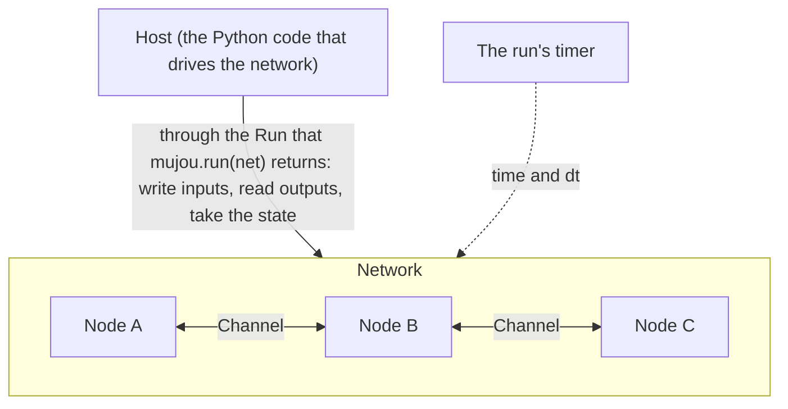

The parts of the picture, and the sections that explain them:

| Part             | In a line                                                     | Section                                        |
| ---------------- | ------------------------------------------------------------- | ---------------------------------------------- |
| Node             | A class that holds one update; Mujou calls it over and over   | [1. Nodes](#1-nodes)                           |
| Port and channel | A node's connection point, and the line between two of them   | [2. Ports and channels](#2-ports-and-channels) |
| Spec             | The shape and dtype of the tensors a port sends and receives  | [3. Message types](#3-message-types-specs)     |
| Network          | A container to build with; a path names a node inside it      | [4. Networks and paths](#4-networks-and-paths) |
| Run              | `mujou.run` starts every node and gives the host a `Run`      | [5. Runs](#5-runs)                             |
| Time             | One timer per run; updates are in proportion to the time `dt` | [6. Time](#6-time)                             |
| State            | The state of the whole run in one dict, to go on from later   | [7. State](#7-state)                           |
| Testing          | A virtual timer you move by hand, for deterministic runs      | [8. Testing](#8-testing)                       |
| Learning         | Update rules live in nodes; no training mode, no epochs       | [9. Learning](#9-learning)                     |

### From PyTorch

If you know PyTorch, start from this table.

| PyTorch                                     | Mujou                                                                |
| ------------------------------------------- | -------------------------------------------------------------------- |
| You call the model's `forward` in your loop | Mujou calls the node's `on_update(dt)`; you write no loop            |
| The arguments and return value of `forward` | A port's `recv()` and `send()`                                       |
| You assign submodules to a parent module    | You assign nodes to a `Network`                                      |
| `model.train()` and `model.eval()`          | None: inference and learning happen at the same time                 |
| `loss.backward()` reaches the whole model   | Gradients stay inside a node; messages pass between nodes            |
| `model.state_dict()`                        | Each node's `state_dict()`, and `run.state_dict()` for the whole run |

## 1. Nodes

!!! abstract "Key idea"

    A node is a class whose `on_update(dt)` holds one update. You write no loop: Mujou calls it over and over.

A node is the unit of computation, written as a class that inherits from `mujou.Node`. This one sends `a * x + b` of what it receives:

```python
--8<-- "examples/quickstart.py:node"
```

`__init__` makes the ports, and `on_update(dt)` reads, computes and sends. A node keeps its state in its own attributes.

### The order of the hooks

Mujou calls the other hooks too. In one run, a node goes through them like this:

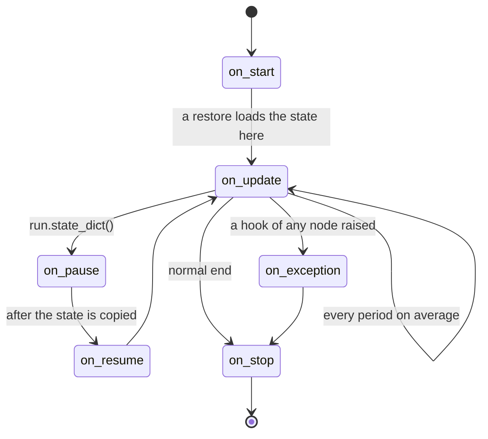

| Hook                        | When it is called                                                                   |
| --------------------------- | ----------------------------------------------------------------------------------- |
| `on_start()`                | Once when the run starts (also on a restore). Open I/O here                         |
| `on_update(dt)`             | Over and over, every `period` on average. `dt` is the seconds since the last update |
| `on_pause()`, `on_resume()` | When `run.state_dict()` stops the node to take its state, and when it goes on       |
| `on_exception()`            | Once on every node, before `on_stop`, when a hook of any node has raised            |
| `on_stop()`                 | Once when the run stops (also after an exception). Release I/O and other resources  |

The exact order and its fine print are in the API reference of [`Node`](api/node-and-ports.md#mujou.Node).

!!! tip "Call `super()` first in what you override"

    In `__init__` and in every hook, call `super().__init__(...)` or `super().on_update(dt)` first, as the code above does.

### Synchronous inside, asynchronous between

The way computation runs changes at the boundary of a node.

|           | Inside a node                       | Between nodes                                            |
| --------- | ----------------------------------- | -------------------------------------------------------- |
| Execution | Synchronous: ordinary PyTorch code  | Asynchronous: no node waits for another                  |
| Exchange  | Variables and the computation graph | Messages through ports (copies, detached from the graph) |
| Gradients | Recorded, as plain PyTorch does     | Never cross                                              |

The node class decides how much computation one node holds: one layer, several layers, or a whole model. Put layers that should compute together (or learn together by backpropagation) in one node class.

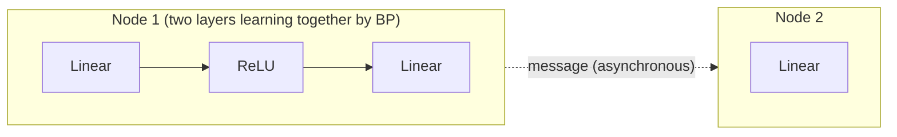

Solid arrows are synchronous computation inside a node; the dotted one is an asynchronous message between nodes.

??? question "Why does a node hold no loop?"

    Mujou runs many nodes on a few worker threads. When a node holds only one update, Mujou decides when and on which thread to call it. That is also what lets it stop every node to take the state, and lets a test update the nodes one step at a time.

## 2. Ports and channels

!!! abstract "Key idea"

    A port is a connection point of a node, and a channel is the line between two ports. A reader never waits: it reads the latest value the peer sent.

`connect` joins two ports with one channel, and returns the channel.

```python
self.scale.next.connect(self.shift.prev)  # the output of scale to the input of shift
```

### Nothing queues: only the latest value stays

A channel is not a queue. A value sent replaces the one before it, and `recv()` returns the latest at that moment.

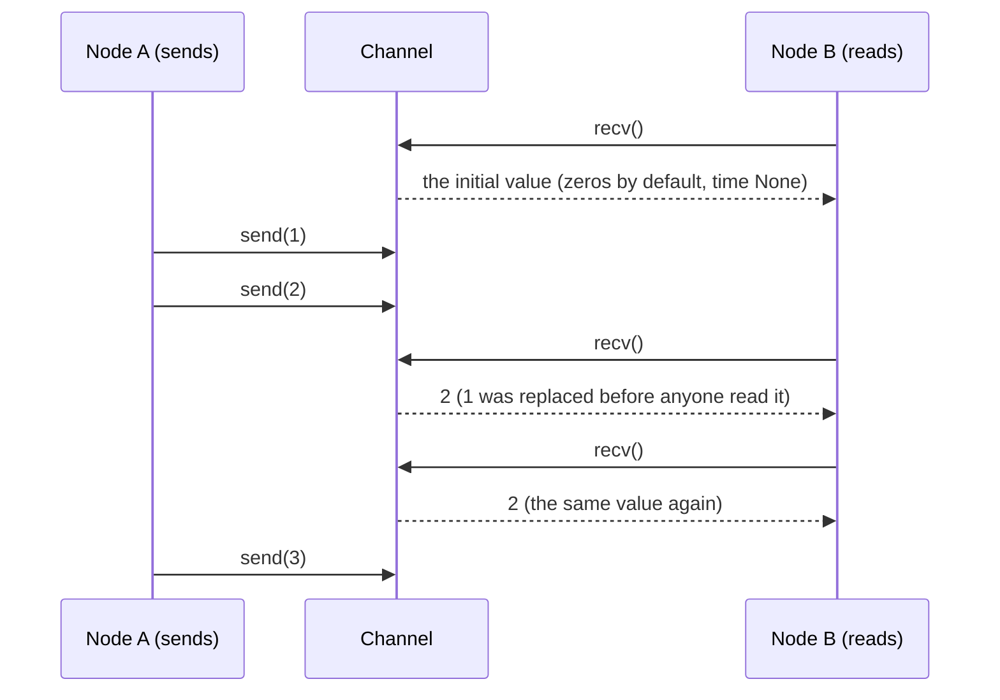

- Reading never waits: a value comes back at once, even before the peer has sent anything
- Until the peer first sends, it returns the peer's initial value (zeros by default) with the time `None`
- Every value carries the time it was sent. Read it with `recv_with_time()` to tell a new value from the same one read again

??? question "Why not a queue?"

    In a queue, values pile up when the sender and the reader run at different rates, and the nodes end up in step with the slower one. When nodes only read and write the latest value, each runs at its own rate without waiting for the others.

### Port and MultiPort

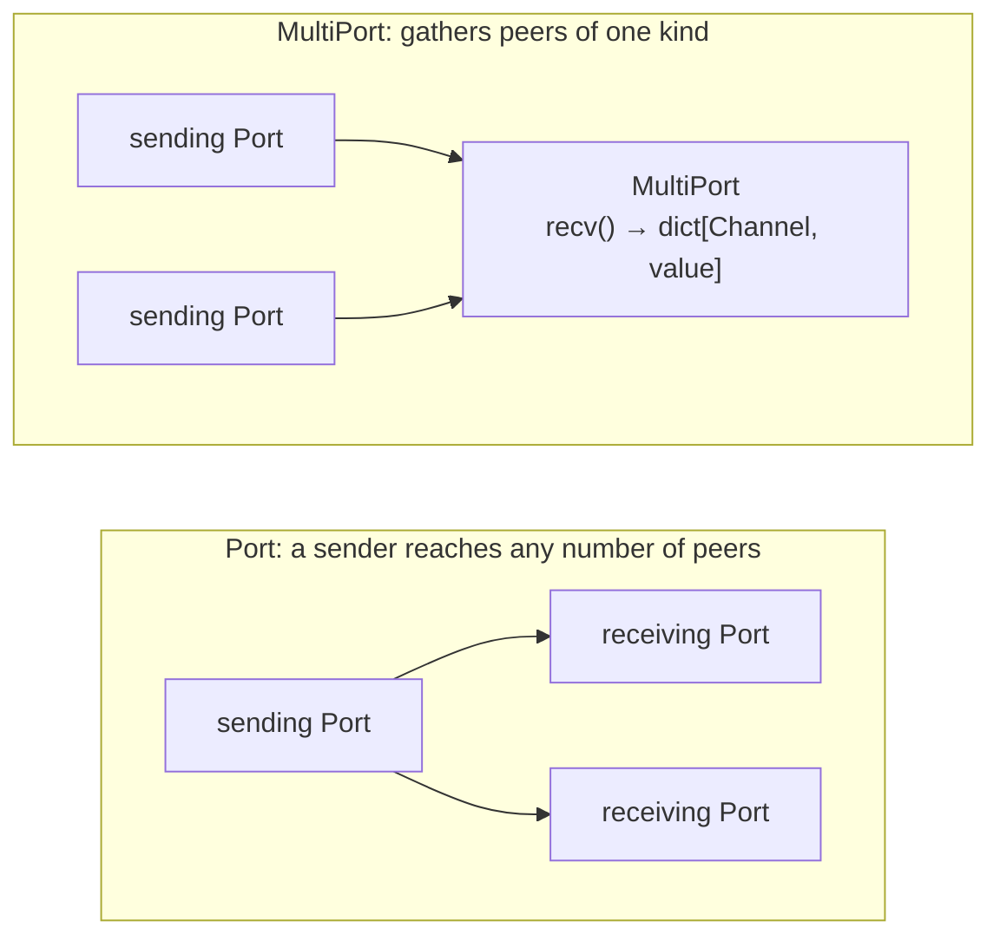

|                        | `Port`                                              | `MultiPort`                                                        |
| ---------------------- | --------------------------------------------------- | ------------------------------------------------------------------ |
| Peers it receives from | At most one                                         | Any number, of one kind                                            |
| What `recv()` returns  | One value                                           | A `dict[Channel, value]`, in the order of `connect`                |
| Use it for             | One-to-one exchange; one-to-many when it only sends | Gathering inputs of one kind; the node decides how to combine them |

Inputs of different roles (a prediction and an error, say) go to separate `Port`s, not to one `MultiPort`. Connections may form cycles. More in [Ports and Channels](topics/ports.md).

## 3. Message types (specs)

!!! abstract "Key idea"

    A port declares the shape and dtype of what it sends and receives with a spec. Only ports whose specs match connect.

```python
VECTOR = TensorSpec((3,))      # a float32 vector of 3
self.prev = Port(recv=VECTOR)  # receives only
self.next = Port(send=VECTOR)  # sends only
```

Two ports connect only when the spec each sends matches the spec the other receives. The values are always `torch.Tensor` or a dict of them, and there are two kinds of spec:

| Spec                       | What it carries          | Use it for                                                        |
| -------------------------- | ------------------------ | ----------------------------------------------------------------- |
| `TensorSpec(shape, dtype)` | One tensor               | One value, such as an activity or an error                        |
| `DictSpec`                 | A `TypedDict` of tensors | Values that must arrive together, such as an input and its target |

!!! warning "Send values that belong together in one message"

    The values of two ports arrive separately: a reader may read a new value of one with an old value of the other. Put an input and its target in a `DictSpec`, and the whole dict arrives at once.

`send` sends a copy, detached from the computation graph: changing the tensor afterwards does not change what was sent.

## 4. Networks and paths

!!! abstract "Key idea"

    A `Network` is a container for building nodes together; it runs nothing itself. A path, the attribute names from the root joined with dots, names a node inside.

As you give an `nn.Module` its submodules, you assign nodes to a network's attributes and connect their ports. This network puts two nodes in a row: double, then add 1.

```python
--8<-- "examples/quickstart.py:network"
```

The last line exposes the input of the first node and the output of the last as the network's own `prev` and `next`, so that the network connects from outside like a node.

With networks inside networks, a path joins the attribute names from the root:

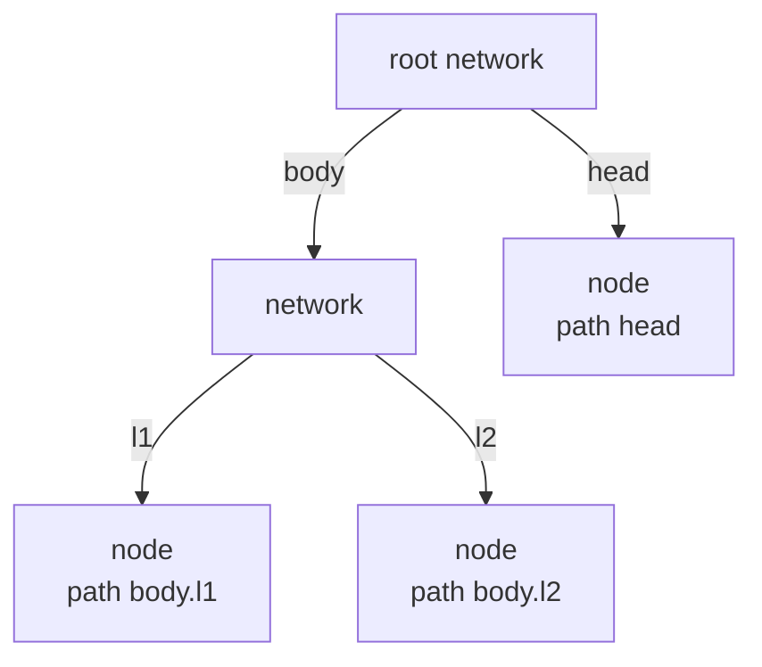

Paths are the keys of the state ([7. State](#7-state)). To only put children side by side under names, use `Group(**named)`. A network runs nothing itself; while running, the nodes inside it each run on their own.

## 5. Runs

!!! abstract "Key idea"

    `mujou.run(root)` runs every node in the background and gives the host a handle, the `Run`. Through it, the host writes inputs and reads outputs.

The host is your program. This runs the `Pipeline` above and waits for its output:

```python
--8<-- "examples/quickstart.py:run"
```

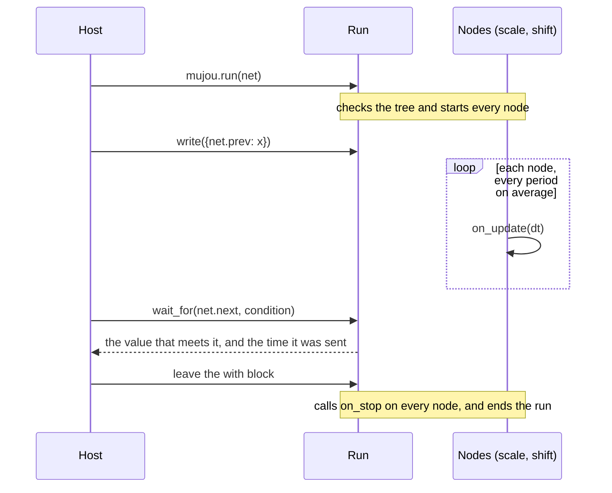

What the host does with a `Run`:

| To                                        | Use                                         |
| ----------------------------------------- | ------------------------------------------- |
| Write an input                            | `run.write`                                 |
| Read the latest output                    | `run.read`, `run.read_with_time`            |
| Wait for an output that meets a condition | `run.wait_for`                              |
| Take every value sent, in turn            | `run.subscribe`                             |
| Wait on the run's time                    | `run.timer.sleep`                           |
| Take the state                            | `run.state_dict()`                          |
| End the run                               | Leave the `with` block, or `run.shutdown()` |

A root runs once: to run again, build new instances. After the run, the nodes' attributes are the host's to read. More in [Host I/O](topics/host-io.md).

## 6. Time

!!! abstract "Key idea"

    A run has one time axis, its timer. A node moves its state forward in proportion to `dt`, the time since its last update.

Each run has one time axis, its timer, used by every node and by the host: `mujou.time.global_timer` unless the run is given a `Timer` of its own. The host waits on it and pauses it through `run.timer`; a node only reads it, with `self.timer`.

### Updating in proportion to `dt`

Each node updates once every `period` on average, but the intervals differ between nodes and vary. So `on_update` moves the state in proportion to the `dt` it is given, not to the number of updates.

<figure class="mujou-diagram">
<svg viewBox="0 0 640 170" role="img" aria-label="The update times of two nodes. Node A updates at even intervals, node B at uneven ones, one of them much longer">
<line class="mujou-axis" x1="90" y1="150" x2="620" y2="150"/>
<text class="mujou-label" x="620" y="166" text-anchor="end">the run's timer →</text>
<text class="mujou-label" x="10" y="54">Node A</text>
<line class="mujou-lane" x1="90" y1="50" x2="620" y2="50"/>
<g class="mujou-tick-a"><line x1="100" y1="38" x2="100" y2="62"/><line x1="160" y1="38" x2="160" y2="62"/><line x1="220" y1="38" x2="220" y2="62"/><line x1="280" y1="38" x2="280" y2="62"/><line x1="340" y1="38" x2="340" y2="62"/><line x1="400" y1="38" x2="400" y2="62"/><line x1="460" y1="38" x2="460" y2="62"/><line x1="520" y1="38" x2="520" y2="62"/><line x1="580" y1="38" x2="580" y2="62"/></g>
<text class="mujou-note" x="130" y="30" text-anchor="middle">dt</text>
<text class="mujou-note" x="190" y="30" text-anchor="middle">dt</text>
<text class="mujou-label" x="10" y="114">Node B</text>
<line class="mujou-lane" x1="90" y1="110" x2="620" y2="110"/>
<g class="mujou-tick-b"><line x1="100" y1="98" x2="100" y2="122"/><line x1="175" y1="98" x2="175" y2="122"/><line x1="235" y1="98" x2="235" y2="122"/><line x1="400" y1="98" x2="400" y2="122"/><line x1="455" y1="98" x2="455" y2="122"/><line x1="530" y1="98" x2="530" y2="122"/><line x1="590" y1="98" x2="590" y2="122"/></g>
<path class="mujou-brace" d="M 237 92 Q 237 84 245 84 L 390 84 Q 398 84 398 92"/>
<text class="mujou-note" x="317" y="78" text-anchor="middle">a busy machine only makes dt longer</text>
</svg>
<figcaption>Each vertical line is an update. The intervals differ between nodes and vary; every update gets the time since the last one as <code>dt</code></figcaption>
</figure>

A node that follows its input $u$ with the time constant $\tau$, say, obeys this differential equation:

$$
\frac{dx}{dt} = \frac{u - x}{\tau}
$$

and `on_update(dt)` moves it forward by `dt`:

$$
x \leftarrow x + \left(1 - e^{-\Delta t / \tau}\right)(u - x)
$$

Written this way, nodes updating at different and varying rates follow the same dynamics; a busy machine only makes `dt` longer, and none of the elapsed time is lost. You build this node, `Leaky`, in [Write a Node](tutorial/2-node.md).

### Two kinds of seconds

| Seconds of      | Used by                                                       |
| --------------- | ------------------------------------------------------------- |
| The run's timer | `dt`, `period`, `run.timer.sleep`, the times values were sent |
| Real time       | `timeout` only                                                |

The host can pause the run's timer or change its speed; `dt` and `period` follow the timer, and only `timeout` is measured in real time. More in [Time](topics/time.md).

## 7. State

!!! abstract "Key idea"

    A node's state is collected from its attributes by itself. `run.state_dict()` takes the state of the whole run in one dict, and `mujou.run(..., state=tree)` goes on from there.

### What is in a node's state

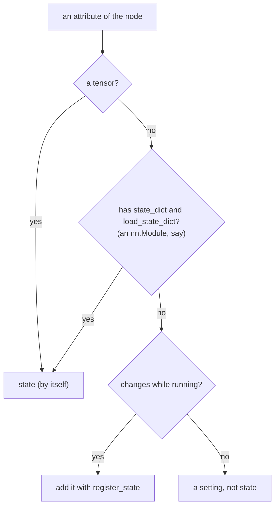

| Attribute                                | In the state?                        |
| ---------------------------------------- | ------------------------------------ |
| `self.x = SCALAR.zeros()`                | Yes, by itself: a tensor             |
| `self.model = nn.Linear(4, 2)`           | Yes, by itself: it has `state_dict`  |
| `self.count = 0`                         | With `self.register_state("count")`  |
| `self.buffer = []` (a list of tensors)   | With `self.register_state("buffer")` |
| `self.tau = 0.05` (a setting that stays) | No                                   |

The state of the node's random generator is in it too. The rules are in the API reference of [`Node`](api/node-and-ports.md#mujou.Node).

### Saving the whole run and going on

`run.state_dict()` takes the state of the whole run at one time, without ending it: the nodes' states, the latest message on each channel and the time, in one plain dict keyed by paths.

```python
tree = run.state_dict()
# {
#     "timer": {"time_ns": ..., "time_scale": ...},
#     "nodes": {
#         "body.l1": {"state": ..., "last_update_ns": ..., "ports": {...}},
#         ...
#     },
# }
```

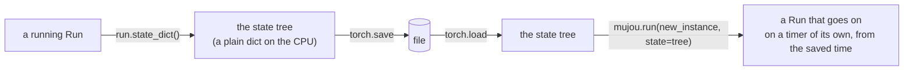

See [Save and Resume](tutorial/6-save-and-resume.md).

## 8. Testing

!!! abstract "Key idea"

    `mujou.testing.run` runs on a virtual timer that you move by hand, deterministically.

In an ordinary run, when each node updates varies from run to run. In a test, the test decides the time and the order of the updates.

|         | `mujou.run`                                 | `mujou.testing.run`                                            |
| ------- | ------------------------------------------- | -------------------------------------------------------------- |
| Timer   | The run's timer (`global_timer` by default) | A virtual timer, which moves only with `run.step`              |
| Updates | Each node, every `period` on average        | Once each with `run.step(dt, *nodes)`; `period` does not apply |
| `dt`    | The time that actually passed               | The time `step` moved                                          |
| Results | Vary from run to run                        | The same every time                                            |

`run.step(dt, *nodes)` moves the time `dt` forward, then updates the given nodes once each, in the given order. Without nodes, it updates every node in the order of the tree.

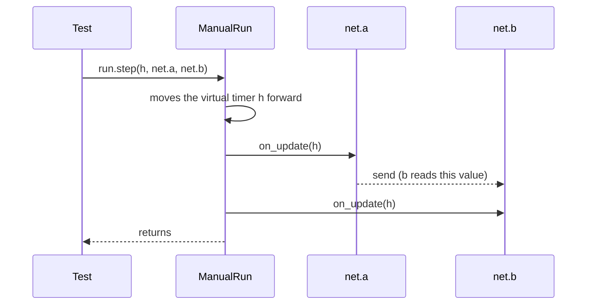

This test compares `Leaky`, the node of section 6, with the exact solution:

```python
--8<-- "examples/test_leaky.py:test"
```

See [Test a Node](tutorial/3-test.md).

## 9. Learning

!!! abstract "Key idea"

    An update rule is written inside the nodes. Only messages pass between nodes, and there is no training mode, no inference mode and there are no epochs.

### A network that keeps learning

Classical machine learning fixes the weights after training, then infers. A running Mujou network takes input, produces output and learns at the same time.

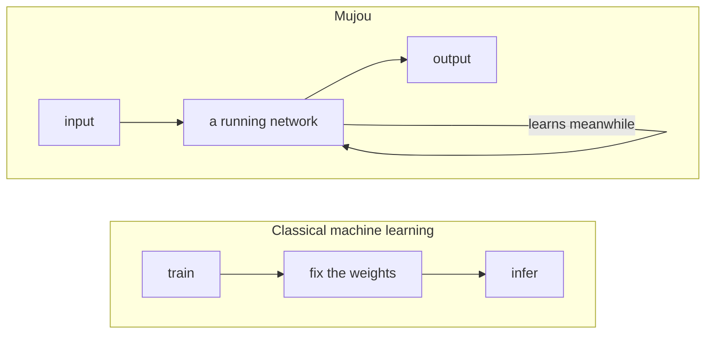

### Choosing an update rule

Mujou builds no rule into nodes, ports or the scheduler: the nodes decide how they learn.

| Update rule               | Where gradients are taken                           | Read                                             |
| ------------------------- | --------------------------------------------------- | ------------------------------------------------ |
| Backpropagation in a node | Inside one node, with an ordinary `loss.backward()` | [Learn in a Node](tutorial/4-learn-in-a-node.md) |
| PC-ALM (`mujou.pc`)       | Inside each node; neighbors exchange messages       | [Learn with PC-ALM](tutorial/5-learn-with-pc.md) |
| A rule of your own        | As the node decides                                 | [Update Rules](topics/update-rules.md)           |

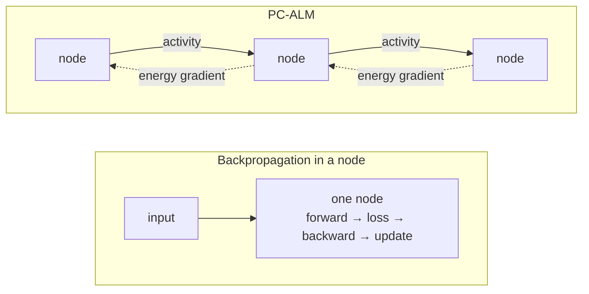

No computation graph crosses nodes, because a port sends a detached copy: what passes between nodes is messages, such as activities, errors and targets.

## Rules a node keeps

The cautions about nodes on the other pages are gathered here.

| Rule                                                                                                  | If you break it                            |
| ----------------------------------------------------------------------------------------------------- | ------------------------------------------ |
| [Do not block with `time.sleep`](#sleeping)                                                           | The other nodes' `dt` grows                |
| [A node runs once](#running-again)                                                                    | `RuntimeError`                             |
| [Do not read a node's attributes from the host while it runs](#attributes-while-running)              | It races with the node's updates           |
| [Send nothing that depends on the state in `on_start`](#sending-in-on_start)                          | It sends the state from before the restore |
| [Do not change the state in `on_stop`](#the-state-in-on_stop)                                         | The state taken after a normal end changes |
| [Register the values that change while running](#registering-state)                                   | A restore starts them again                |
| [Keep the graph inside one update](#the-extent-of-the-graph)                                          | The graph keeps growing                    |
| [After an exception, the time stands still](#the-time-after-an-exception)                             | No time passes on `self.timer`             |
| [Only the host moves the time, and only through ports does a node talk](#moving-the-time-and-talking) | `RuntimeError`                             |

### Sleeping

**Do not block with `time.sleep`.** A node shares its worker thread with others, and a hook that blocks holds the worker: the other nodes' `dt` grows.

=== "Avoid"

    ```python
    def on_update(self, dt: float) -> None:
        super().on_update(dt)
        time.sleep(0.1)  # to update every 0.1 s
    ```

=== "Write instead"

    ```python
    def __init__(self) -> None:
        super().__init__(period=0.1)  # updates every 0.1 s on average
    ```

Update at intervals with `period`, and give a node whose hooks must block (on a device, a socket, a lock) `dedicated_thread=True`. The host waits with `run.timer.sleep`, which follows the time scale and the pauses of the run; `time.sleep` follows neither.

### Running again

**A node runs once.** Running a node or network that has run raises `RuntimeError`; build new instances to run again. After the run, the attributes stay readable.

### Attributes while running

**Do not read a node's attributes from the host while it runs.** It races with the node's updates. Read the ports with `run.read`, or take `run.state_dict()`.

### Sending in on_start

**Send nothing that depends on the state in `on_start`.** A restore loads the state after `on_start`.

### The state in on_stop

**Do not change the state in `on_stop`.** The state taken after a normal end is the state the nodes left after `on_stop`. Release resources such as I/O there.

### Registering state

**Register the values that change while running.** Tensors and modules are collected by themselves; plain values (a counter, the time last seen) and containers of tensors (a list as a replay buffer) need `register_state`, or a restore starts them again.

=== "Avoid"

    ```python
    self.count = 0  # back to 0 after a restore
    ```

=== "Write instead"

    ```python
    self.count = 0
    self.register_state("count")  # register in __init__
    ```

### The extent of the graph

**Keep the graph inside one update.** Hooks record gradients as plain PyTorch does. Update the parameters inside `torch.no_grad()`, and detach a value computed from the parameters before you carry it to the next update in an attribute, or the graph keeps growing.

=== "Avoid"

    ```python
    self.last_y = self.model(x)  # carries the graph to the next update
    ```

=== "Write instead"

    ```python
    self.last_y = self.model(x).detach()
    with torch.no_grad():
        for p in self.model.parameters():
            p -= lr * p.grad
    ```

### The time after an exception

**After an exception, the time stands still.** The run's time stops when the run ends, so `self.timer` does not move in `on_exception` and `on_stop`: measure real time there (to slow a robot down over a second, say).

### Moving the time and talking

**Only the host moves the time, and only through ports does a node talk.** In a hook, `Timer.sleep`, `pause`, `resume`, `set_time_scale`, `VirtualTimer.advance` and the methods of `Run` raise `RuntimeError`: a node that moved the time would change the `dt` of every other node of the run. `backward()` cannot reach another node, since a sent value is a detached copy.
