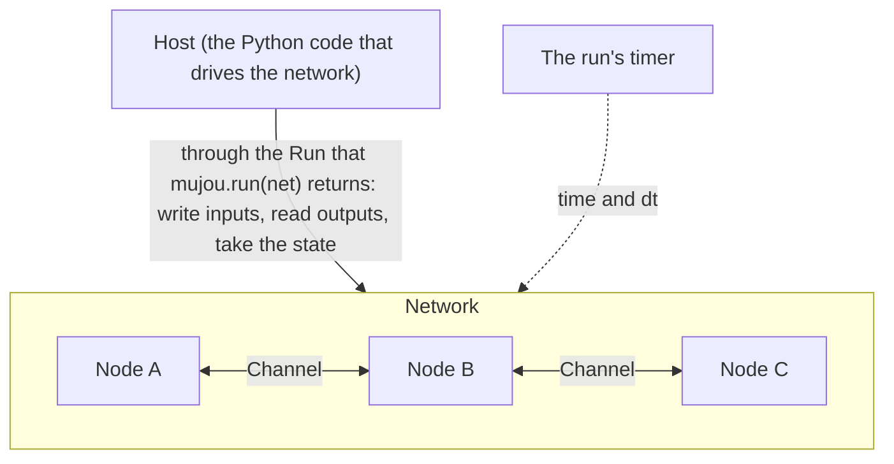

# 🧠 How Mujou Works

This page explains the nine ideas you need to use Mujou, in the order you meet them, and ends with the rules a node keeps. The [Tutorial](tutorial/1-run.md) puts them to work.

## 1. Nodes

A node is the unit of computation. You write it as a class that inherits from `mujou.Node`, and write one step of its work in `on_update(dt)`. Mujou calls `on_update` over and over, so a node holds no loop of its own; it also calls other hooks, such as `on_start` and `on_stop`, whose order is in the API reference of [`Node`](api/node-and-ports.md#mujou.Node).

Inside a node, ordinary PyTorch code runs synchronously, and records gradients as plain PyTorch does. Between nodes, everything is asynchronous: a node never waits for another, and talks to the others only through its ports. A node keeps its state in its own attributes.

The node class decides how much computation one node holds: one layer, several layers, or a whole model. The node boundaries are the asynchronous boundaries, so put layers that should compute (or learn by backpropagation) together in one node class.

## 2. Ports and channels

A **port** is a connection point of a node. `connect` joins two ports with one **channel**, and returns it.

- A `Port`'s `recv()` returns one value, so it receives from at most one peer. A `Port` that only sends reaches any number of peers
- A `MultiPort` gathers peers of one kind. Its `recv()` returns a `dict[Channel, value]`, in the order of `connect`, and the node decides how to combine them. Inputs of different roles (a prediction and an error, say) go to separate `Port`s
- Connections may form cycles

Reading never waits and nothing queues: `recv()` returns the latest value the peer sent. Until the peer first sends, it returns the peer's initial value (zeros by default) with the time `None`. Every value carries the time it was sent, which tells whether it is new. More in [Ports and Channels](topics/ports.md).

## 3. Message types (specs)

A port declares what it sends and receives with a spec: `TensorSpec(shape, dtype)` for one tensor, or `DictSpec` for a `TypedDict` of tensors that travel together. The values are always `torch.Tensor` (or a dict of them). Two ports connect only when the spec each sends matches the spec the other receives, and `send` copies the value, detached from the computation graph.

## 4. Networks and paths

A `Network` is a container for building: you assign nodes to its attributes and connect their ports, as you give an `nn.Module` its submodules. `Group(**named)` is a network that only puts its children side by side under names. A network runs nothing itself; while running, the nodes inside it each run on their own.

A node's **path** is the attribute names from the root joined with dots, such as `"body.l1"`. Paths are the keys of the state.

## 5. Runs

`mujou.run(root)` checks the tree, starts every node, and returns a `Run`, the handle of the host (your program). The host writes inputs with `write`, reads outputs with `read`, `wait_for` and the like, and waits on `run.timer`. A root runs once: to run again, build new instances. After the run, the nodes' attributes are the host's to read.

## 6. Time

Each run has one time axis, its timer, used by every node and by the host: `mujou.time.global_timer` unless the run is given a `Timer` of its own. The host controls it through `run.timer`; a node only reads it, with `self.timer`.

`dt` is the time in seconds since the node's last update, on the run's timer. A node updates in proportion to `dt`, so that nodes updating at different and varying rates follow the same dynamics; a busy machine only makes `dt` longer. Each node updates once every `period` on average. Timeouts are the one exception: they are in real seconds. More in [Time](topics/time.md).

## 7. State

A node's state is collected automatically: its tensor attributes, its attributes with `state_dict` and `load_state_dict` (an `nn.Module`, say), and the state of its random generator. Other values that change while it runs (a counter, the time last seen, a list of tensors such as a replay buffer) join with `register_state`. The rules are in the API reference of [`Node`](api/node-and-ports.md#mujou.Node).

`run.state_dict()` takes the state of the whole run at one time, without ending it: the nodes' states, the latest message on each channel and the time, in one plain dict. `mujou.run(new_instance, state=tree)` goes on from there, on a timer of its own that starts at the saved time. See [Save and Resume](tutorial/6-save-and-resume.md).

## 8. Testing

`mujou.testing.run` runs a tree on a virtual timer, deterministically: `run.step(dt, *nodes)` moves the time `dt` forward, then updates the nodes once each. See [Test a Node](tutorial/3-test.md).

## 9. Learning

An update rule is written inside the nodes: backpropagation inside one node, PC-ALM (the nodes of `mujou.pc`), or a rule of your own. Mujou builds no rule into nodes, ports or the scheduler. No computation graph crosses nodes, because a port sends a copy: what passes between nodes is messages, such as activities, errors and targets. See [Learn in a Node](tutorial/4-learn-in-a-node.md), [Learn with PC-ALM](tutorial/5-learn-with-pc.md) and [Update Rules](topics/update-rules.md).

There is no training mode and no inference mode, and there are no epochs: a running network takes input, produces output and learns at the same time.

## Rules a node keeps

The other pages link here instead of repeating these.

- **Do not block with `time.sleep`.** A node shares its worker thread with others, and a hook that blocks holds the worker: the other nodes' `dt` grows. Update at intervals with `period`, and give a node whose hooks must block (on a device, a socket, a lock) `dedicated_thread=True`. The host waits with `run.timer.sleep`, which follows the time scale and the pauses of the run; `time.sleep` follows neither
- **A node runs once.** Running a node or network that has run raises `RuntimeError`; build new instances to run again. After the run, the attributes stay readable
- **Do not read a node's attributes from the host while it runs.** It races with the node's updates. Read the ports with `run.read`, or take `run.state_dict()`
- **Send nothing that depends on the state in `on_start`.** A restore loads the state after `on_start`
- **Do not change the state in `on_stop`.** The state taken after a normal end is the state the nodes left after `on_stop`. Release resources such as I/O there
- **Register the values that change while running.** Tensors and modules are collected by themselves; plain values (a counter, the time last seen) and containers of tensors (a list as a replay buffer) need `register_state`, or a restore starts them again
- **Keep the graph inside one update.** Hooks record gradients as plain PyTorch does. Update the parameters inside `torch.no_grad()`, and detach a value computed from the parameters before you carry it to the next update in an attribute, or the graph keeps growing
- **After an exception, the time stands still.** The run's time stops when the run ends, so `self.timer` does not move in `on_exception` and `on_stop`: measure real time there (to slow a robot down over a second, say)
- **Only the host moves the time, and only through ports does a node talk.** In a hook, `Timer.sleep`, `pause`, `resume`, `set_time_scale`, `VirtualTimer.advance` and the methods of `Run` raise `RuntimeError`: a node that moved the time would change the `dt` of every other node of the run. `backward()` cannot reach another node, since a sent value is a detached copy
