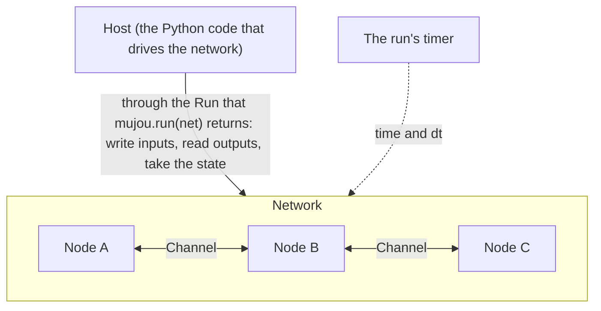

# 🧠 How Mujou Works

This page explains the ideas behind Mujou. It covers five of them.

- **Nodes**: the units of computation
- **Ports and channels**: the connection points of nodes and the connections between them
- **Networks**: how nodes are put together
- **Global time**: the flow of time that every node follows
- **State**: what you can take from a running network and put back later

How to write the code is in the [User Guide](user-guide/index.md).



## Nodes

A node is the unit of computation. You write a node as a class that inherits from `mujou.Node`.

Inside a node, ordinary PyTorch code runs synchronously. It may even use backpropagation (BP), as long as the BP stays inside the node.

Between nodes, everything is asynchronous. Mujou calls the node's `on_update(dt)` over and over, on threads it shares among the nodes, and a node never waits for another node. In each `on_update`, the node does three things.

1. It reads the latest values its neighbors sent
2. It updates its state
3. It sends its results

Mujou owns the loop, so a node holds no `while` loop of its own. Mujou also calls other hooks that a node can override, for example when the run starts and stops; their order is in the API reference of [`Node`](api/node.md).

There are no epochs, no switch between training and inference, and no hook called for each received message.

The node class decides how much computation one node holds: one layer, or several layers, or a whole model. The node boundaries are the asynchronous boundaries. To compute several layers synchronously, put them in one node class. The same holds when several layers should learn together with BP.

!!! info "The three rules a node keeps"

    - **No graphs across nodes**: it does not join computation graphs across nodes. A value is detached from the computation graph when it is sent, so gradients never pass between nodes
    - **Only through ports**: it talks to other nodes and to the host only through its own ports
    - **Time is read-only**: it only reads the time. Only the host moves the time

If a node raises an exception, the whole run stops. Mujou never stops only the node that raised and keeps the others running (see [Errors and Shutdown](user-guide/errors.md)).

The default update rule is [PC-ALM](https://pub.sakana.ai/pc-alm/) (Augmented Lagrangian Predictive Coding), where each node learns with local updates only. Its nodes are in the module `mujou.pc` (see [Learning with PC-ALM](user-guide/pc.md)). Update rules are not built into Mujou: a node can use any rule that keeps to the rules above.

## Ports and channels

A **port** is a connection point that a node holds. A **channel** is one connection between two ports, made by `connect`.

A channel has one slot for the value in each direction, and only the sender in that direction writes the slot.

A port declares what it sends and what it receives, as a shape and a dtype. Two ports connect only when the type that each sends matches the type that the other receives. Mujou checks this when you call `connect`, and converts no dtype.

Reading and writing work like this.

- **No waiting**: a reader gets the latest value at that moment. It never waits for a new value
- **No queue**: a value may be overwritten before anyone reads it, and the same value may be read many times. Both are normal
- **Initial value**: before the sender has written, the reader gets the initial value of the sender's port (zeros by default). Its time is `None`, which tells that the sender has not written yet
- **A copy**: every value is a copy of a `torch.Tensor`, detached from the computation graph. Changing a received tensor affects no other node
- **With its time**: every value carries the time it was sent. To tell whether a value is new, read it with its time (`recv_with_time()`) and compare that time with the time of the value read last. If the time has moved on, the value is new

A `Port` receives from at most one peer, and a `Port` that only sends reaches any number. A `MultiPort` connects to several peers of one kind: it receives one value per channel, and the node decides how to combine them (sum, average, ...).

A port may also stay unconnected. Unconnected ports are the inputs and outputs of the network.

- The host writes input to an unconnected input port. The written value stays there until the host writes again
- The host can read the latest value that any sending port sent. This covers not only unconnected output ports but also ports that connect nodes

## Networks

A network declares how nodes are put together. You write it as a class that inherits from `mujou.Network`, much like giving a PyTorch `nn.Module` its child modules. You build it in three steps.

1. Hold nodes, or other networks, as attributes
2. Connect their ports with `connect`
3. Expose the ports that should connect from outside as the network's own attributes

A network that exposes ports connects to other nodes and networks just like a node does.

A network is used only for building. It has no hooks and runs nothing itself. While running, the nodes inside it each run on their own, so wrapping nodes in a network does not synchronize them.

`mujou.run(net)` reads the structure from the attributes, checks it, and runs it. A connection made after the start changes nothing: to run another structure, run new instances.

Each node is named by its path, the attribute names from the root joined with `.`, such as `"body.l1"`. The state uses these paths.

!!! warning "Renaming breaks restoring"

    Renaming an attribute or changing a connection makes a state taken before the change impossible to restore.

## Global time

Mujou treats a learning network as a system that changes continuously over time. `dt` is the time in seconds since the node's last update.

A node updates its state in proportion to `dt`. For a state $x$ that follows $\frac{dx}{dt} = f(x)$, one update is this (explicit Euler).

```python
x = x + dt * f(x)
```

Nodes update at different rates, and their rates vary with the load. If the update size were fixed per iteration, a faster node would change its state more. With updates proportional to `dt`, every node follows the same dynamics on the same flow of time; a higher load only makes `dt` longer.

!!! warning "Mind a long `dt`"

    Mujou never caps `dt`: it is the time that really passed, and a capped `dt` drops some of it. If a large `dt` makes the update of the node's own state unstable, split it into smaller steps inside one `on_update`. Splitting does not help when the instability comes from the coupling with other nodes, whose messages stay as they were over `dt`; such a node may cap the `dt` it uses, at the cost of the time it drops.

Every node has a period, 0.01 s by default. The interval between two updates varies, but on average the node updates once every period. When the node is late, `dt` is longer than the period. `dt` is the time that actually passed, so update in proportion to `dt` even with a period set.

Each run has one timer, and every node of the run and the host use it. By default, it is the global timer, one per process. The host can make the time run faster or slower than real time. Nodes only read the time.

!!! tip "The host waits with `run.timer.sleep`"

    To wait on that time, for example to show an input for two seconds, the host uses `run.timer.sleep`, not the standard `time.sleep`, which waits in real time.

To take the state of a running network, Mujou pauses the run and stops its timer. The paused time does not enter any `dt` after the run resumes, so to the nodes it is as if the pause never happened.

A pause stops the time of every run that uses the same timer; give a run its own timer to keep it apart (see [Controlling Time](user-guide/time.md)).

A pause is for taking the state and for observing. Do not make pausing part of how the network learns.

## State

You can take the state of a running network without ending the run, and later run the network again from that state. The state is one tree that holds:

- the state of each node (weights, activities, and other tensors), by node path
- the latest value in each slot, with its time
- the time of each node's last update, and the time of the timer

The values in the slots are part of the state because a network is its nodes together with the values flowing between them. If they went back to their initial values, the neighbors would leave the equilibrium they had reached.

A node collects its own state, as `nn.Module` does: tensors and `nn.Module`s assigned to its attributes go into the state automatically.

Taking the state causes the pause described in the previous section. Each node pauses not in the middle of `on_update` but after one update ends and before the next begins, so every value in the tree belongs to the same moment.

| When you take the state | What you get                                                                              |
| ----------------------- | ----------------------------------------------------------------------------------------- |
| While the network runs  | The state at that moment                                                                  |
| After a normal end      | The values as the nodes left them after `on_stop`                                         |
| After an exception      | Nothing: it raises `NetworkError`. Take the state you want to keep while the network runs |

In the tree taken after a normal end, the timer's time is when `shutdown()` asked the run to stop: the time of the run stands still from then on, so no update or message of the run is later. A run restored from this tree does not count the time that passed after the end.

!!! warning "Do not change the state in `on_stop`"

    Because the tree after a normal end is taken after `on_stop`, a change that `on_stop` makes to the state goes into that tree. For example, `self.w = None` in `on_stop` removes `w` from it. Do not change the state in `on_stop`; release only resources such as I/O there.

To restore, pass the tree as `mujou.run(net, state=tree)`. The network goes on from the time the tree was taken, with the same node states and slot values. The network must have the same node paths and connections as the one the tree was taken from.

Storing the tree in a file (`torch.save`, `pickle`, ...) is up to you. See [Saving and Restoring State](user-guide/state.md).
