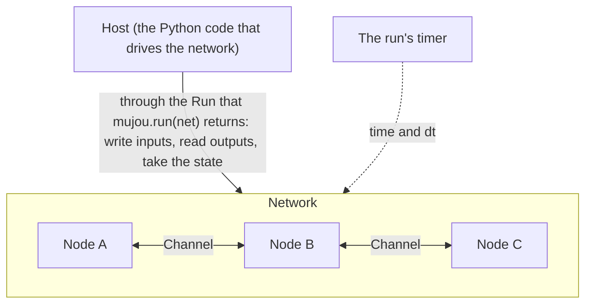
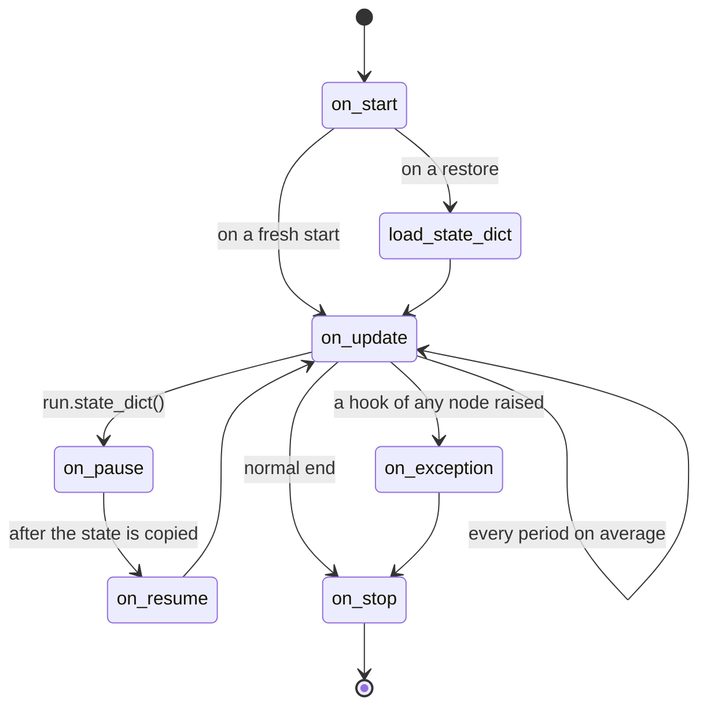
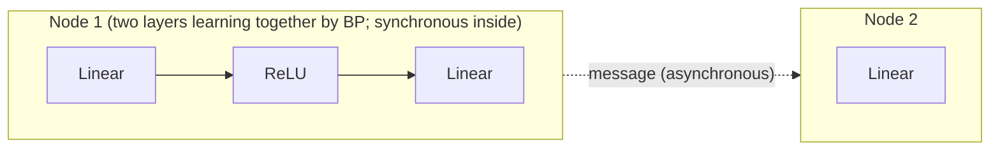
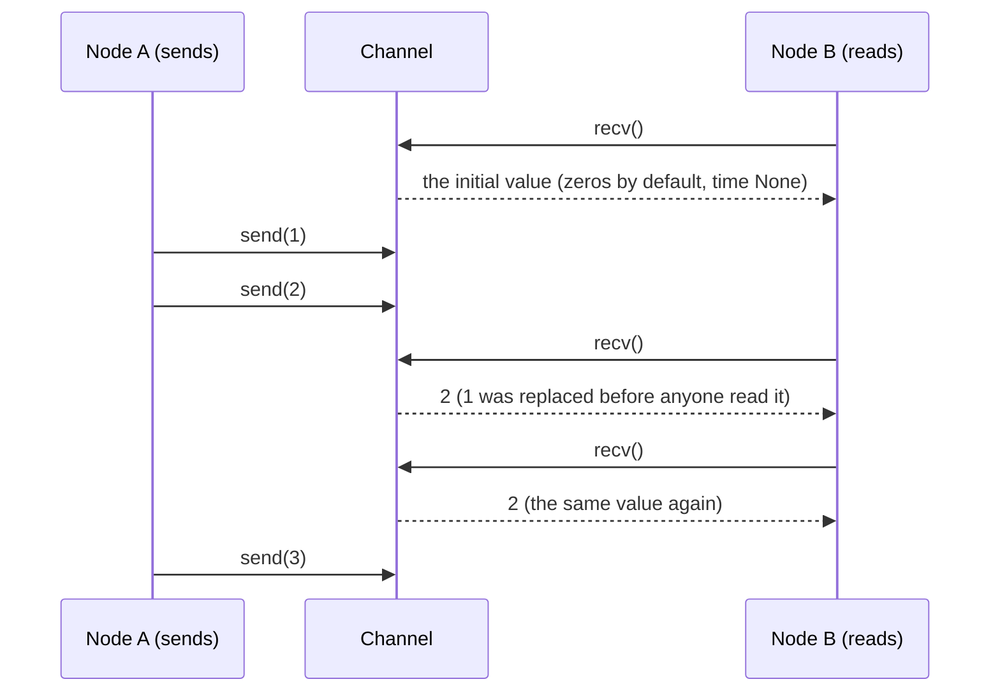
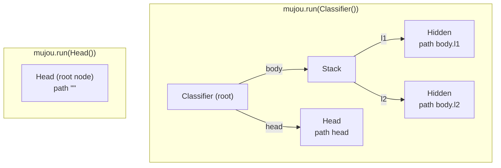

# 🧠 How Mujou Works

This page assumes you have used PyTorch's `nn.Module` and tensors. To start with code, go to [Run a Network](tutorial/1-run.md).

## The big picture {#overview}



| Part             | In a line                                                                                                                     | Where                                            |
| ---------------- | ----------------------------------------------------------------------------------------------------------------------------- | ------------------------------------------------ |
| Node             | A class whose `on_update(dt)` holds one update; Mujou calls it over and over                                                  | [Nodes](#nodes)                                  |
| Port and channel | A node's connection point, and the line between two of them. Nothing queues: only the latest value stays                      | [Ports and channels](#ports)                     |
| Network          | A container to build nodes with; a path names a node inside it                                                                | [Networks and paths](#networks)                  |
| Run              | [`mujou.run`][mujou.run] runs every node in the background and returns a `Run`; the host talks to the network only through it | [Run a Network](tutorial/1-run.md#run)           |
| Time             | A node moves its state forward in proportion to `dt`, the time since its last update                                          | [Time](#time)                                    |
| State            | [`run.state_dict()`][mujou.Run.state_dict] takes it without ending the run; pass it as `state=` to new instances to go on     | [Save and Resume](tutorial/6-save-and-resume.md) |
| Simulation       | [`mujou.run_manually`][mujou.run_manually] moves virtual time with `step`, and the results are the same every time            | [Simulation](topics/simulation.md#two-ways)      |
| Learning         | Update rules live inside nodes; each node decides how it learns                                                               | [Learning](#learning)                            |

### From PyTorch {#pytorch}

| PyTorch                                     | Mujou                                                                |
| ------------------------------------------- | -------------------------------------------------------------------- |
| You call the model's `forward` in your loop | Mujou calls the node's `on_update(dt)`; you write no loop            |
| The arguments and return value of `forward` | A port's `recv()` and `send()`                                       |
| You assign submodules to a parent module    | You assign nodes to a `Network`                                      |
| `model.train()` and `model.eval()`          | None: inference and learning happen at the same time                 |
| `loss.backward()` reaches the whole model   | Gradients stay inside a node; messages pass between nodes            |
| `model.state_dict()`                        | Each node's `state_dict()`, and `run.state_dict()` for the whole run |

## Nodes {#nodes}



!!! tip "Call `super()` first in what you override"

    In `__init__` and in every hook, call `super().__init__(...)` or `super().on_update(dt)` first ([`Node`][mujou.Node]).

|           | Inside a node                       | Between nodes                                            |
| --------- | ----------------------------------- | -------------------------------------------------------- |
| Execution | Synchronous: ordinary PyTorch code  | Asynchronous: no node waits for another                  |
| Exchange  | Variables and the computation graph | Messages through ports (copies, detached from the graph) |
| Gradients | Recorded, as plain PyTorch does     | Never cross                                              |

The node class, not a setting, decides how much computation one node holds (one layer, several layers, or a whole model); put layers that should learn together by backpropagation in one node class.



??? question "Why does a node hold no loop?"

    Mujou runs many nodes on a few worker threads. When a node holds only one update, Mujou decides when and on which thread to call it. That is also what lets it stop every node to take the state, and lets a test update the nodes one step at a time.

## Ports and channels {#ports}



??? question "Why not a queue?"

    In a queue, values pile up when the sender and the reader run at different rates, and the nodes end up in step with the slower one. When nodes only read and write the latest value, each runs at its own rate without waiting for the others.

A reader never waits: before the peer has sent anything, it gets the initial value, with the time `None` ([`Port.recv`][mujou.Port.recv], [`Port.recv_with_time`][mujou.Port.recv_with_time]).

A port's [spec](topics/ports.md#spec) sets the type of its messages, and a value sent arrives as a copy detached from the computation graph.

Use a [`Port`][mujou.Port] to receive from one peer (it may send to any number), and a [`MultiPort`][mujou.MultiPort] to gather peers of one role ([Kinds of port](topics/ports.md#kinds)).

## Networks and paths {#networks}

A [`Network`][mujou.Network] is a container: you assign nodes to its attributes and `connect` their ports. It runs nothing itself. Assign a child's port to the network's own attribute (`prev` and `next` by convention), and the network connects from outside like a node (code in [Network](tutorial/1-run.md#network)).



Paths are the keys of the state tree (for renaming an attribute, see [When you resume](tutorial/6-save-and-resume.md#restore)).

To put several networks side by side in one run, use a [`Group`][mujou.Group] ([Groups](topics/groups.md)).

## Time {#time}

<figure class="mujou-diagram">
<svg viewBox="0 0 640 170" role="img" aria-label="The update times of two nodes. Node A updates at even intervals, node B at uneven ones, one of them much longer">
<text class="mujou-note" x="90" y="12">each vertical line = a call to on_update; the interval since the last one is dt</text>
<line class="mujou-axis" x1="90" y1="150" x2="620" y2="150"/>
<text class="mujou-label" x="620" y="166" text-anchor="end">the run's timer →</text>
<text class="mujou-label" x="10" y="54">Node A</text>
<line class="mujou-lane" x1="90" y1="50" x2="620" y2="50"/>
<g class="mujou-tick-a"><line x1="100" y1="38" x2="100" y2="62"/><line x1="160" y1="38" x2="160" y2="62"/><line x1="220" y1="38" x2="220" y2="62"/><line x1="280" y1="38" x2="280" y2="62"/><line x1="340" y1="38" x2="340" y2="62"/><line x1="400" y1="38" x2="400" y2="62"/><line x1="460" y1="38" x2="460" y2="62"/><line x1="520" y1="38" x2="520" y2="62"/><line x1="580" y1="38" x2="580" y2="62"/></g>
<text class="mujou-note" x="130" y="30" text-anchor="middle">dt</text>
<text class="mujou-note" x="190" y="30" text-anchor="middle">dt</text>
<text class="mujou-label" x="10" y="114">Node B</text>
<line class="mujou-lane" x1="90" y1="110" x2="620" y2="110"/>
<g class="mujou-tick-b"><line x1="100" y1="98" x2="100" y2="122"/><line x1="175" y1="98" x2="175" y2="122"/><line x1="235" y1="98" x2="235" y2="122"/><line x1="400" y1="98" x2="400" y2="122"/><line x1="455" y1="98" x2="455" y2="122"/><line x1="530" y1="98" x2="530" y2="122"/><line x1="590" y1="98" x2="590" y2="122"/></g>
<path class="mujou-brace" d="M 237 92 Q 237 84 245 84 L 390 84 Q 398 84 398 92"/>
<text class="mujou-note" x="317" y="78" text-anchor="middle">a busy machine only makes dt longer</text>
</svg>
</figure>

A run has one time axis, its timer, used by every node and by the host ([Time](topics/time.md)).

The intervals between updates differ between nodes and vary, so `on_update` moves the state in proportion to the `dt` it is given, not to the number of calls ([Updating in proportion to dt](tutorial/2-node.md#dt)).

## Learning {#learning}

Mujou builds no update rule into nodes, ports or the scheduler.

| Update rule               | Where gradients are taken                           | Read                                             |
| ------------------------- | --------------------------------------------------- | ------------------------------------------------ |
| Backpropagation in a node | Inside one node, with an ordinary `loss.backward()` | [Learn in a Node](tutorial/4-learn-in-a-node.md) |
| PC-ALM (`mujou.pc`)       | Inside each node; neighbors exchange messages       | [Learn with PC-ALM](tutorial/5-learn-with-pc.md) |
| A rule of your own        | As the node decides                                 | [Update Rules](topics/update-rules.md)           |

## Rules a node keeps {#rules}

| Rule                                                                      | If you break it                                    | Instead                                                                                                                                                                                                  |
| ------------------------------------------------------------------------- | -------------------------------------------------- | -------------------------------------------------------------------------------------------------------------------------------------------------------------------------------------------------------- |
| Do not block with `time.sleep`                                            | The other nodes' `dt` grows                        | To update at intervals, [`period`][mujou.Node.period]. To wait with no choice, [`dedicated_thread=True`][mujou.Node.dedicated_thread]. For the host to wait, [`run.timer.sleep`][mujou.time.Timer.sleep] |
| A node runs once                                                          | `RuntimeError`                                     | Build new instances to run again ([`mujou.run`][mujou.run])                                                                                                                                              |
| Do not read a node's attributes from the host while it runs               | It races with the node's updates                   | Read ports with [`run.read`][mujou.Run.read] and the state with [`run.state_dict()`][mujou.Run.state_dict]. Attributes are readable after the run ends                                                   |
| Send nothing that depends on the state in `on_start`                      | It sends the state from before the restore         | Send it in the first `on_update` (`load_state_dict` comes after `on_start`; see the diagram in [Nodes](#nodes))                                                                                          |
| Do not change the state in `on_stop`                                      | The state taken after a normal end changes         | In `on_stop`, only release resources such as I/O                                                                                                                                                         |
| Register plain values and containers of tensors that change while running | A restore starts them again                        | Counters, the time last seen, and lists or dicts of tensors go to [`register_state`][mujou.Node.register_state]                                                                                          |
| Keep the computation graph inside one update                              | The graph keeps growing                            | `detach` the values you carry to the next update, and update parameters inside `torch.no_grad()` (code below)                                                                                            |
| Do not measure time with `self.timer` in `on_exception` and `on_stop`     | The run's time stops at the end, so no time passes | Measure real time ([`Node.timer`][mujou.Node.timer])                                                                                                                                                     |
| Only the host moves the time; a node talks only through ports             | `RuntimeError`                                     | Move the time with the host's [`run.timer`][mujou.Run.timer]. A node calls neither the methods of `Run` nor `mujou.run`, and talks through its own ports                                                 |

```python
self.last_y = self.model(x).detach()  # detach values carried to the next update
with torch.no_grad():  # do not record the parameter update
    for p in self.model.parameters():
        p -= lr * p.grad
```
