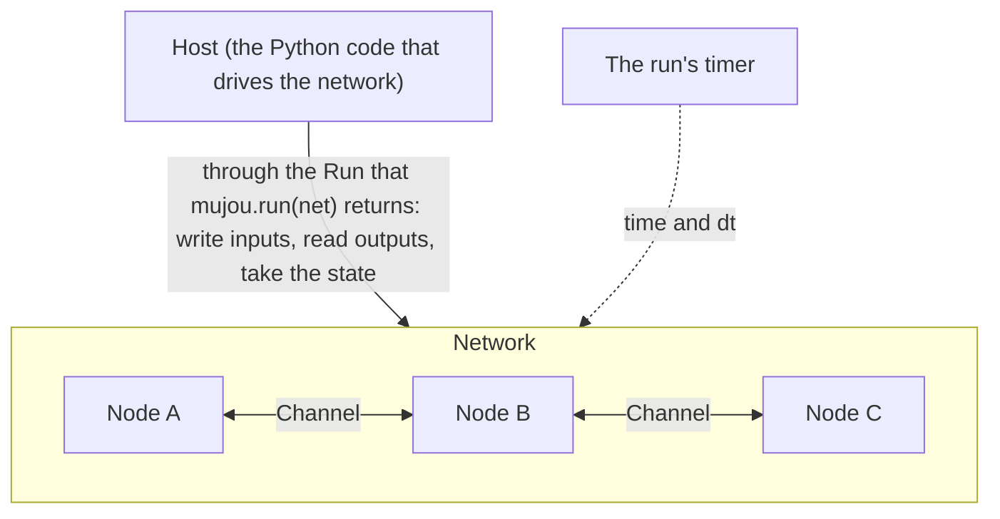

# Concepts

This section explains the ideas to know before you use Mujou. How to write the code is in the [User Guide](../user-guide/index.md).

## What Mujou builds

Mujou is a framework for building learning machines that keep inferring and learning at the same time. Conventional machine learning trains a model, then freezes its weights for inference. A Mujou network takes input for as long as it runs, and keeps learning from it.

## The five elements

| Element                        | In one line                                                                   |
| ------------------------------ | ----------------------------------------------------------------------------- |
| [Nodes](nodes.md)              | The unit of computation: synchronous inside, asynchronous towards other nodes |
| [Ports and channels](ports.md) | A node's connection points, and the line that joins two of them               |
| [Networks](networks.md)        | The structure that declares how nodes are put together                        |
| [Global time](time.md)         | One time axis per run, which sets how much each node updates                  |
| [State](state.md)              | What a network holds, taken while it runs and restored later                  |

They relate as follows.

Each node calls `on_update(dt)` over and over on its own thread, and no node waits for another.

## How it differs from conventional training

| Conventional training (a typical PyTorch training loop)             | Mujou                                                                                                          |
| ------------------------------------------------------------------- | -------------------------------------------------------------------------------------------------------------- |
| Loops over a dataset in epochs                                      | No epochs. Input is a signal that changes over time; a value the host writes holds until the host writes again |
| Switches between training and inference with `train()` and `eval()` | No modes to switch. Nodes keep updating for as long as they run                                                |
| Calls `backward()` on the whole network from the loss               | `backward()` across nodes is forbidden. Each node updates from its own state and its neighbors' values only    |
| The update size is set per iteration                                | The update size is proportional to `dt`, the time since the last update                                        |
| Stops training, then saves the weights                              | The state can be taken while the network runs                                                                  |

There are no epochs and no modes because Mujou targets machines that keep learning from a stream. Endless input has no epoch boundaries. And if learning and inference are separate, the machine cannot learn while it infers.

Mujou does not use `backward()` over the whole network because it synchronizes the forward and backward passes of every node. With that synchronization, the nodes cannot run without waiting for each other. The default update rule, PC-ALM, is reported to perform close to backpropagation (BP) with local updates only. BP itself is still available when it stays inside a single node (see [Nodes](nodes.md)).
