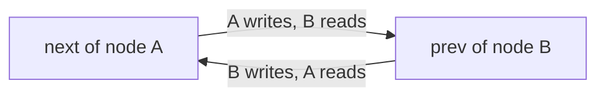

# Ports and Channels

Nodes exchange values with each other only through ports and channels.

## Connection points and connections

- A port is a connection point that a node holds. Declare it as an attribute in `__init__`
- A channel is one connection between two ports. Each call to `connect` makes one channel; a channel cannot be created any other way

A channel is two-way. One channel has one slot for the value in each direction. Between two one-way ports, values flow in one direction only, so the channel has one slot. Only one node writes each slot: the sender in that direction.

The two arrows together are one channel.

## Port types

A port holds a pair of types: the type of what it sends (`send`) and the type of what it receives (`recv`). Two ports connect only when the `send` of each matches the `recv` of the other. If they do not match, the call to `connect` raises an error. Once a port is assigned to a node, errors and `repr` name it by the node's class and the attribute, such as `Shift.next`.

A port may have only `send` or only `recv`. Use such ports for a node that only sends input, or a node that only observes.

Declare the types with specs.

| Spec         | What it describes                                                                |
| ------------ | -------------------------------------------------------------------------------- |
| `TensorSpec` | The shape and dtype of one `torch.Tensor`. Example: `TensorSpec((32, 256))`      |
| `DictSpec`   | A `TensorSpec` for each key of a `TypedDict`. Sends several tensors as one value |

The match compares shape and dtype. Ports with different dtypes do not connect, and no dtype is converted implicitly. The batch dimension is part of the shape; Mujou gives it no special treatment. A spec has no device, so a CPU node and a GPU node can connect.

## How reading and writing behave

A node writes with `send(value)` and reads with `recv()`.

- The reader gets the latest value at that moment. There is no way to wait for a new value
- Old values do not pile up. Some values are overwritten without ever being read, and the same value may be read many times. Both are normal
- If the peer has not written yet, the reader gets the initial value. It is the value that the peer's port declares with `initial=`, or zeros of the shape and dtype in the spec if it declares none (for a `DictSpec`, a zero tensor for each key). A port that takes one peer but is not connected reads zeros, or the value given in `inputs` (see [Unconnected ports](#unconnected-ports))
- A port that takes many peers but is not connected has no channel, so it reads an empty dict
- The value is a `torch.Tensor` (for a `DictSpec` port, a dict of tensors, one per key). It is copied on every read and write, so changing a received tensor affects no other node
- A sent value is detached from the computation graph. Gradients never pass through a port

Each value carries the time it was written (a `Timestamp` on the [run's timer](time.md#timers), which by default is the global timer). Read the value and its time as a pair with `recv_with_time()` to tell how old the value is.

## PrevPort, NextPort and Port

There are three ways to declare a port. They differ in which one `a.connect(b)` uses, and in the default number of peers.

| Declaration | Role in `a.connect(b)` | Default number of peers |
| ----------- | ---------------------- | ----------------------- |
| `PrevPort`  | used on the `b` side   | one                     |
| `NextPort`  | used on the `a` side   | many                    |
| `Port`      | not used               | one                     |

`a.connect(b)` connects the `NextPort` of `a` to the `PrevPort` of `b`. Connect two `Port`s by naming them, as in `a.out.connect(b.inp)`. Change the number of peers with `multi=True` or `multi=False`.

On a port with one peer, `recv()` returns the value itself. On a port with many peers, `recv()` returns a dict keyed by channel, in the order of connection. The key is the channel that `connect` returned. For example, when node `head` is connected to node `x` by `ch = head.connect(x)`, `head.next.recv()[ch]` gives the value from `x`. The node decides how to combine the values of many peers (sum them, average them, ...). Mujou does not decide that.

To send to many peers, either send the same value to all of them with `send(value)`, or a different value to each with `send_to(channel, value)`.

## Unconnected ports

A port may stay unconnected. Unconnected ports become the inputs and outputs of the network (see [Networks](networks.md)).

- The host writes input with `Run.write` to an unconnected port that takes one peer. The first input can be passed as `mujou.run(net, inputs={port: value})`; that value becomes the port's initial value. The host cannot write to a connected port, so that each slot keeps a single writer
- The host reads with `Run.read` the latest value that a node sent, from any port that has a send type. Reading an unconnected port gives an output; reading a connected port observes an intermediate value

How to declare and connect ports in detail is in [Building a network](../user-guide/building-a-network.md).
