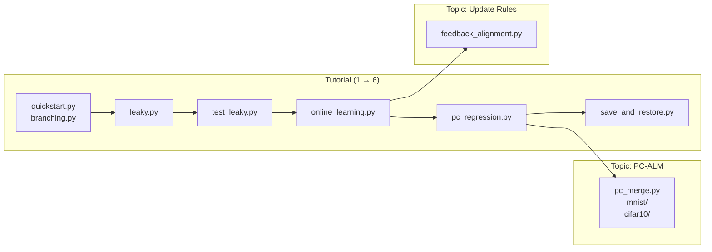

# 💡 Examples

Working programs that show how to use Mujou, all in `examples/` of the repository. The pages of this site include them as they are, so the code shown is the code you can run. `examples/` is a guide for users: the test suite does not run it.

The programs of the tutorial (1 to 6) build on each other in the order of the arrows. From there, go on to the programs of the topics Update Rules and PC-ALM.



## By what you want to do

| What you want to do                                             | Program                 | Explained in                                                                                       |
| --------------------------------------------------------------- | ----------------------- | -------------------------------------------------------------------------------------------------- |
| Run something, anything                                         | `quickstart.py`         | [1. Run a Network](tutorial/1-run.md)                                                              |
| Branch a network and merge it again                             | `branching.py`          | [1. Run a Network](tutorial/1-run.md#branching-and-merging), [Ports and Channels](topics/ports.md) |
| Write a node whose state changes in continuous time             | `leaky.py`              | [2. Write a Node](tutorial/2-node.md)                                                              |
| Test a node deterministically                                   | `test_leaky.py`         | [3. Test a Node](tutorial/3-test.md)                                                               |
| Keep learning from a stream, with BP inside a node              | `online_learning.py`    | [4. Learn in a Node](tutorial/4-learn-in-a-node.md)                                                |
| Learn across nodes with a rule of your own                      | `feedback_alignment.py` | [Update Rules](topics/update-rules.md)                                                             |
| Learn a regression with PC-ALM, in a few lines                  | `pc_regression.py`      | [5. Learn with PC-ALM](tutorial/5-learn-with-pc.md)                                                |
| Write a node of PC-ALM of your own (with two inputs)            | `pc_merge.py`           | [PC-ALM](topics/pc.md#nodes-of-your-own)                                                           |
| Learn MNIST with PC-ALM, and compare it with BP                 | `mnist/`                | [PC-ALM](topics/pc.md#mnist)                                                                       |
| Learn CIFAR-10 with a ResNet on the GPU, and compare it with BP | `cifar10/`              | [PC-ALM](topics/pc.md#cifar-10)                                                                    |
| Save the state and resume from it                               | `save_and_restore.py`   | [6. Save and Resume](tutorial/6-save-and-resume.md)                                                |
| Run several networks together                                   | `group.py`              | [Groups](topics/groups.md)                                                                         |
| Follow every new output (values in between may be skipped)      | `subscribe.py`          | [Host I/O](topics/host-io.md#reading)                                                              |
| Use a timer of a run's own, a time scale, or pause several runs | `timers.py`             | [Time](topics/time.md)                                                                             |
| Simulate a network as fast as the machine computes              | `simulation.py`         | [Simulation](topics/simulation.md)                                                                 |
| See what happens when a node raises                             | `errors.py`             | [Errors and Shutdown](topics/errors.md)                                                            |
| Draw the graph of a network, and open it in a browser           | `visualize.py`          | [Visualize a Network](topics/visualize.md)                                                         |

## What each program shows

!!! abstract "In short"

    The programs fall into five groups by use. To find how an API is used, look it up in the column Main API.

### Run and connect

| Program         | What it shows                                                                                                                          | Main API                                                       |
| --------------- | -------------------------------------------------------------------------------------------------------------------------------------- | -------------------------------------------------------------- |
| `quickstart.py` | Runs a two-node network, writes an input and waits until the expected output arrives                                                   | `with mujou.run(...)`, `write`, `wait_for`                     |
| `branching.py`  | Connects a `Port` that only sends to two branches, which a `MultiPort` merges. Then a `MultiPort` sends a different value to each peer | `Port`, `MultiPort`, the channels `connect` returns, `send_to` |
| `group.py`      | Runs several networks together. How the paths of the nodes are formed (`"enc.scale"`)                                                  | `Group(enc=..., dec=...)`                                      |
| `subscribe.py`  | Receives the latest output, then each newer one. Stops with `break`                                                                    | `run.subscribe`                                                |

### Write and test nodes

| Program         | What it shows                                                                                                                                                                                                               | Main API                                                |
| --------------- | --------------------------------------------------------------------------------------------------------------------------------------------------------------------------------------------------------------------------- | ------------------------------------------------------- |
| `leaky.py`      | The leaky integrator. Defined in continuous time and advanced by the exact solution, so it is stable for any `dt`. Steps the input of two in a row and compares each output with the exact solution at the time it was sent | `on_update(dt)`                                         |
| `test_leaky.py` | Tests of the node of `leaky.py`: against the exact solution, bit for bit against the discrete algorithm, and a resumed run against one that did not stop                                                                    | The virtual timer of `mujou.run_manually`, manual steps |
| `errors.py`     | What happens when a node raises. The order `on_exception` → `on_stop`, and `mujou.run` raising for an exception in `on_start`                                                                                               | `NetworkError` and its `__cause__`                      |

Run `test_leaky.py` as tests:

```sh
uv run pytest examples/test_leaky.py
```

### Learn

| Program                 | How it learns                           | What it shows                                                                                                                                                                                                           | Main API                               |
| ----------------------- | --------------------------------------- | ----------------------------------------------------------------------------------------------------------------------------------------------------------------------------------------------------------------------- | -------------------------------------- |
| `online_learning.py`    | BP inside a node                        | A teacher sends batches from y = a x + b with the `a` the host writes and changes. The learner learns from each new batch for the time since the last one. The host follows the loss as it falls, jumps and falls again | Plain PyTorch autograd                 |
| `feedback_alignment.py` | A rule of your own (feedback alignment) | Two nodes learn a two-layer network. Two-way ports, a target relayed with the activity, one learning step per sample                                                                                                    | `pc.clock.LearnClock`                  |
| `pc_regression.py`      | PC-ALM                                  | Learns a regression from a stream of batches. The loss is measured before each batch is learned from                                                                                                                    | `pc.Chain`, `pc.show`                  |
| `pc_merge.py`           | PC-ALM (a node of your own)             | `Merge`, a node with two inputs, joins two towers that learn a regression                                                                                                                                               | `pc.functional`, `pc.clock.LearnClock` |
| `mnist/`                | PC-ALM and BP                           | A 784-256-256-10 network learns MNIST. The same network also learns by BP from the same initial weights on the same batches                                                                                             | `pc.Chain`                             |
| `cifar10/`              | PC-ALM and BP (GPU)                     | A ResNet-20 on a CUDA device, cut into a node for each stage, learns CIFAR-10. The same network also learns by BP on the GPU from the same initial weights, batches and optimizer                                       | `pc.Chain`, `pc.optim.AdamW`           |

`mnist/` and `cifar10/` are made of several files. Both start from `main.py`.

| File         | `mnist/`                                 | `cifar10/`                                               |
| ------------ | ---------------------------------------- | -------------------------------------------------------- |
| `main.py`    | Entry point                              | Entry point                                              |
| `data.py`    | Loads the data                           | Loads and augments the data                              |
| `metrics.py` | Measures                                 | Measures                                                 |
| `bp.py`      | Trains the BP baseline                   | Trains the BP baseline                                   |
| `watch.py`   | Counts the `dt` of the nodes (`--watch`) | —                                                        |
| `resnet.py`  | —                                        | Builds the network and says why it is cut into few nodes |

### Time, state and simulation

| Program               | What it shows                                                                                                                                                                                                                                          | Main API                                                      |
| --------------------- | ------------------------------------------------------------------------------------------------------------------------------------------------------------------------------------------------------------------------------------------------------ | ------------------------------------------------------------- |
| `save_and_restore.py` | Takes the state, saves it and resumes it in a new instance. The resumed run goes on on a timer of its own                                                                                                                                              | `run.state_dict()`, `torch.save`, `mujou.run(..., state=...)` |
| `timers.py`           | A timer of a run's own at a time scale, the scale of the global timer, and pausing the global timer to take the states of two runs at one time. A run resumed from one goes on on a timer of its own                                                   | `Timestamp`, `Timer`                                          |
| `simulation.py`       | Simulates the chain of `leaky.py` on a sine input in steps of 1 ms and prints how long it took in real time. The input is written between steps. Also: the same result with any number of workers, and `step(dt)` with the nodes given in either order | `mujou.run_manually`, `step(dt)`                              |

### Look

| Program        | What it shows                                                                                       | Main API            |
| -------------- | --------------------------------------------------------------------------------------------------- | ------------------- |
| `visualize.py` | Writes the pages of a network of two networks and a node, and of a `pc.Chain`, without running them | `mujou.viz.to_html` |

## How to run them

!!! abstract "In short"

    In an environment built from source ([Installation](install.md)), run them with `uv run python` from the root of the repository.

```sh
uv run python examples/quickstart.py
uv run python examples/mnist/main.py
uv run python examples/cifar10/main.py
```

| Program                         | Time                                                     | Download on the first run | GPU        |
| ------------------------------- | -------------------------------------------------------- | ------------------------- | ---------- |
| All but `mnist/` and `cifar10/` | Within 15 seconds                                        | —                         | Not needed |
| `mnist/`                        | About 2 minutes with the default 3 epochs                | MNIST (about 11 MB)       | Not needed |
| `cifar10/`                      | About 4 minutes on an RTX 4090 with the default 3 epochs | CIFAR-10 (about 160 MB)   | Needs CUDA |
