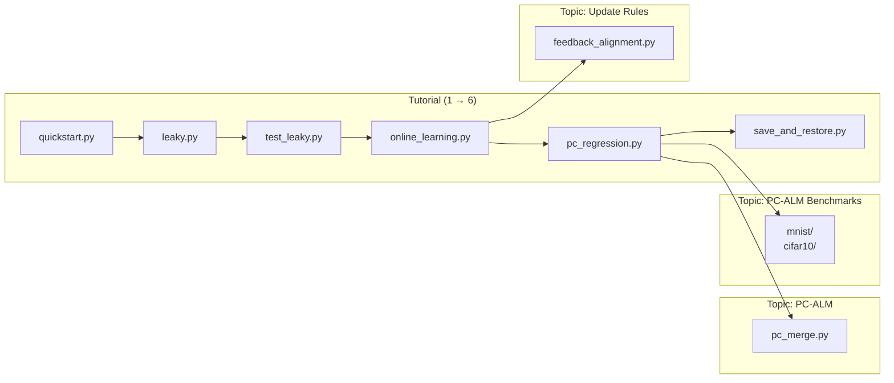

# 💡 Examples

Every example lives in `examples/` of the repository, and the pages include it as it is, so the code shown is the code you can run.



## By what you want to do {#by-goal}

| What you want to do                                             | Program                 | Main API                                                                                                               | Explained in                                          |
| --------------------------------------------------------------- | ----------------------- | ---------------------------------------------------------------------------------------------------------------------- | ----------------------------------------------------- |
| Run something, anything                                         | `quickstart.py`         | [`run`][mujou.run], [`write`][mujou.Run.write], [`wait_for`][mujou.Run.wait_for]                                       | [1. Run a Network](tutorial/1-run.md)                 |
| Branch a network and merge it again                             | `branching.py`          | [`Port`][mujou.Port], [`MultiPort`][mujou.MultiPort], [`Channel`][mujou.Channel], [`send_to`][mujou.MultiPort.send_to] | [Ports and Channels](topics/ports.md#fan-out)         |
| Write a node whose state changes in continuous time             | `leaky.py`              | [`on_update`][mujou.Node.on_update]                                                                                    | [2. Write a Node](tutorial/2-node.md)                 |
| Test a node deterministically                                   | `test_leaky.py`         | [`run_manually`][mujou.run_manually], [`step`][mujou.ManualRun.step]                                                   | [3. Test a Node](tutorial/3-test.md)                  |
| Keep learning from a stream, with BP inside a node              | `online_learning.py`    | PyTorch autograd                                                                                                       | [4. Learn in a Node](tutorial/4-learn-in-a-node.md)   |
| Learn across nodes with a rule of your own                      | `feedback_alignment.py` | [`pc.clock.LearnClock`][mujou.pc.clock.LearnClock]                                                                     | [Update Rules](topics/update-rules.md)                |
| Learn a regression with PC-ALM, in a few dozen lines            | `pc_regression.py`      | [`pc.Chain`][mujou.pc.Chain], [`pc.show`][mujou.pc.show]                                                               | [5. Learn with PC-ALM](tutorial/5-learn-with-pc.md)   |
| Write a PC-ALM node of your own (with two inputs)               | `pc_merge.py`           | [`pc.functional`][mujou.pc.functional], `pc.clock.LearnClock`                                                          | [PC-ALM](topics/pc.md#own-node)                       |
| Learn MNIST with PC-ALM, and compare it with BP                 | `mnist/`                | `pc.Chain`                                                                                                             | [PC-ALM Benchmarks](topics/pc-benchmarks.md#mnist)    |
| Learn CIFAR-10 with a ResNet on the GPU, and compare it with BP | `cifar10/`              | `pc.Chain`, [`pc.optim.AdamW`][mujou.pc.optim.AdamW]                                                                   | [PC-ALM Benchmarks](topics/pc-benchmarks.md#cifar-10) |
| Save the state and resume from it                               | `save_and_restore.py`   | [`Run.state_dict`][mujou.Run.state_dict], `run(..., state=...)`                                                        | [6. Save and Resume](tutorial/6-save-and-resume.md)   |
| Run several networks together                                   | `group.py`              | [`Group`][mujou.Group]                                                                                                 | [Groups](topics/groups.md)                            |
| Follow every new output (values in between may be skipped)      | `subscribe.py`          | [`subscribe`][mujou.Run.subscribe]                                                                                     | [Host I/O](topics/host-io.md#read)                    |
| Use a timer of a run's own, a time scale, or pause several runs | `timers.py`             | [`Timer`][mujou.time.Timer], [`Timestamp`][mujou.time.Timestamp]                                                       | [Time](topics/time.md)                                |
| Simulate a network as fast as the machine computes              | `simulation.py`         | `run_manually`, `step`                                                                                                 | [Simulation](topics/simulation.md)                    |
| See what happens when a node raises                             | `errors.py`             | [`NetworkError`][mujou.NetworkError]                                                                                   | [Errors and Shutdown](topics/errors.md)               |
| Draw the graph of a network, and open it in a browser           | `visualize.py`          | [`viz.to_html`][mujou.viz.to_html]                                                                                     | [Visualize a Network](topics/visualize.md)            |

## How to run them {#run}

In an environment [built from source](install.md#source), run them with `uv run python` from the root of the repository.

```sh
uv run python examples/quickstart.py
uv run python examples/mnist/main.py
uv run python examples/cifar10/main.py
```

| Program                         | Time                                                     | Download on the first run | GPU        |
| ------------------------------- | -------------------------------------------------------- | ------------------------- | ---------- |
| All but `mnist/` and `cifar10/` | Within 15 seconds                                        | —                         | Not needed |
| `mnist/`                        | About 2 minutes with the default 3 epochs                | MNIST (about 11 MB)       | Not needed |
| `cifar10/`                      | About 4 minutes on an RTX 4090 with the default 3 epochs | CIFAR-10 (about 160 MB)   | Needs CUDA |
