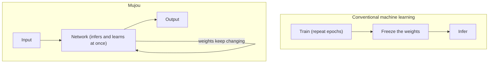

# Mujou

Asynchronous Distributed Deep Learning Library for Continuous Learning
{ .mujou-tagline }

<figure class="mujou-figure" markdown="span">
  { .mujou-hero }
  <figcaption>Image: a new work based on Yoichi Ochiai's <em>Liquid Universe</em>.</figcaption>
</figure>

Mujou is a deep learning framework in which a network of connected nodes keeps inferring and learning at the same time.

!!! warning "Early development"

    Mujou is in an early stage of development. The API may change without notice.

## A network that keeps learning {#continual}



The name comes from 無常 (*mujō*, impermanence: nothing stays the same), as in the Buddhist phrase 諸行無常. Mujou builds machines that keep learning from a stream and keep changing, for uses that learn while they act, such as real-time processing and robotics.

In the program below, a chain of PC-ALM nodes (three of them learning) keeps running while each incoming batch is first predicted and then learned from as a regression (walked through in [5. Learn with PC-ALM](tutorial/5-learn-with-pc.md)).

```python
--8<-- "examples/pc_regression.py:chain"

--8<-- "examples/pc_regression.py:run"
```

## Features {#features}

- 🔄 **[Inference and learning at once](concepts.md#learning)**: no training mode, no inference mode, no epochs
- 🧩 **[Nodes in PyTorch](concepts.md#nodes)**: each node is written and run in PyTorch
- ⚡ **[Asynchronous nodes](concepts.md#ports)**: each node updates on its own schedule and never waits for another
- ⏱️ **[Continuous time](concepts.md#time)**: nodes update in proportion to `dt`, the time that really passed
- 🧠 **[Any update rule](concepts.md#learning)**: BP inside a node, PC-ALM across nodes, or a rule of your own
- 💾 **[Save the state](tutorial/6-save-and-resume.md)**: take the state of a network and resume from it later
- 🧪 **[Simulation and deterministic tests](topics/simulation.md)**: step virtual time by hand and simulate as fast as the machine computes

## Where to go next {#next}

<div class="grid cards" markdown>

- **📦 Installation**

    ______________________________________________________________________

    How to install and check it works.

    [:octicons-arrow-right-24: Installation](install.md)

- **🧠 How Mujou Works**

    ______________________________________________________________________

    The mechanism, in diagrams.

    [:octicons-arrow-right-24: How Mujou Works](concepts.md)

- **🚀 Tutorial**

    ______________________________________________________________________

    Step by step, in code.

    [:octicons-arrow-right-24: Tutorial](tutorial/1-run.md)

- **🗺️ Topics**

    ______________________________________________________________________

    How to choose and decide, topic by topic.

    [:octicons-arrow-right-24: Topics](topics/ports.md)

- **💡 Examples**

    ______________________________________________________________________

    Find a program by what you want to do.

    [:octicons-arrow-right-24: Examples](examples.md)

- **📚 API Reference**

    ______________________________________________________________________

    Every public class and function, generated from the docstrings.

    [:octicons-arrow-right-24: API Reference](api/node-and-ports.md)

</div>
