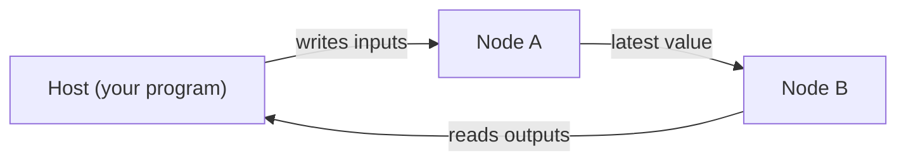

# Mujou

Mujou is a deep learning framework that keeps inferring and learning at the same time. You write nodes in PyTorch code and run a network that connects them.

!!! warning "Early development"

    Mujou is in an early stage of development. The API may change without notice.

## A network that keeps learning

Conventional machine learning trains a model, then freezes its weights for inference. A Mujou network takes input and produces output for as long as it runs, and keeps learning at the same time. There is no mode to switch between training and inference, and there are no epochs.

The name comes from 無常 (*mujō*, impermanence: nothing stays the same), as in the Buddhist phrase 諸行無常. Mujou is a framework for machines that keep learning from a stream and keep changing. It targets uses that learn while they act, such as real-time processing and robotics.

## The design in short

| Point                                | What it means                                                                                                                                                                                                                                                      |
| ------------------------------------ | ------------------------------------------------------------------------------------------------------------------------------------------------------------------------------------------------------------------------------------------------------------------ |
| Synchronous inside, asynchronous out | The unit of computation is the node. Inside a node, you compute synchronously in ordinary PyTorch code. Nodes never wait for each other; a node only reads the last value its peer sent                                                                            |
| One global time                      | A node updates by an amount proportional to `dt`, the time since its last update. Nodes that update at different rates still run on the same flow of time                                                                                                          |
| Swappable update rules               | The default update rule will be [PC-ALM](https://pub.sakana.ai/pc-alm/) (Augmented Lagrangian Predictive Coding; not implemented yet), where each node learns with local updates. You can swap in other rules, including backpropagation (BP) kept inside one node |



Each node repeats its update on a thread of its own. The host (the program that runs the network) writes inputs to the running network and reads its outputs.

## The smallest program

The program below runs a network of two nodes that computes $y = 2x + 1$ and reads the output. The [Quickstart](getting-started/quickstart.md) explains each line.

??? example "examples/quickstart.py"

    ```python
    --8<-- "examples/quickstart.py"
    ```

## Where to go next

| Section                                     | What it covers                                                    |
| ------------------------------------------- | ----------------------------------------------------------------- |
| [Getting Started](getting-started/index.md) | Install Mujou and run your first network                          |
| [Concepts](concepts/index.md)               | How to think about nodes, ports, networks, global time, and state |
| [User Guide](user-guide/index.md)           | Tasks: writing nodes, building and running networks, and more     |
| [Examples](examples/index.md)               | A list of working programs                                        |
| [API Reference](api/index.md)               | The classes and functions of Mujou, generated from the docstrings |
