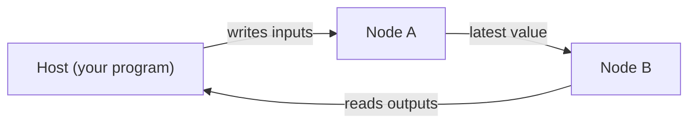

# Mujou

Asynchronous Distributed Deep Learning Library for Continuous Learning
{ .mujou-tagline }

<figure class="mujou-figure" markdown="span">
  { .mujou-hero }
  <figcaption>Image: a new work based on Yoichi Ochiai's <em>Liquid Universe</em>.</figcaption>
</figure>

Mujou is a deep learning framework that keeps inferring and learning at the same time. You write nodes in PyTorch code and run a network that connects them.

!!! warning "Early development"

    Mujou is in an early stage of development. The API may change without notice.

## 🌱 A network that keeps learning

Conventional machine learning trains a model, then freezes its weights for inference. A Mujou network takes input and produces output for as long as it runs, and keeps learning at the same time.

There is no mode to switch between training and inference, and there are no epochs.

The name comes from 無常 (*mujō*, impermanence: nothing stays the same), as in the Buddhist phrase 諸行無常. Mujou is a framework for machines that keep learning from a stream and keep changing. It targets uses that learn while they act, such as real-time processing and robotics.

The program below is such a network: a chain of PC-ALM nodes, three of them learning, that learns a regression from a stream of batches. Each batch is predicted before the nodes learn from it, while the nodes keep running.

```python
--8<-- "examples/pc_regression.py:chain"

--8<-- "examples/pc_regression.py:run"
```

## ✨ Features

- 🔄 **Inference and learning at once**: no training mode, no inference mode, no epochs
- 🧩 **Nodes in PyTorch**: write each node in ordinary PyTorch code, run synchronously inside the node
- ⚡ **Asynchronous nodes**: each node updates on its own schedule and never waits for another
- ⏱️ **Continuous time**: nodes update in proportion to `dt`, the time that really passed
- 🧠 **Any update rule**: backpropagation inside a node, PC-ALM across nodes, or a rule of your own
- 💾 **State without stopping**: take the state of a running network and resume from it later
- 🧪 **Deterministic tests**: a virtual timer and manual updates for testing nodes

## ⚙️ How it runs



Each node repeats its update on its own schedule and never waits for another node; it reads the latest value its neighbor sent.

The host (the program that runs the network) writes inputs to the running network and reads its outputs.

## 🧭 Where to go next

New to Mujou? Install it, read How Mujou Works, then follow the Tutorial from the first page. The Topics go deeper into each part, the Examples list every program, and the API Reference has every public name.

<div class="grid cards" markdown>

- **📦 Installation**

    ______________________________________________________________________

    Build Mujou from source and check that it works.

    [:octicons-arrow-right-24: Installation](install.md)

- **🧠 How Mujou Works**

    ______________________________________________________________________

    Nodes, ports, networks, runs, time, state, testing and learning, and the rules a node keeps.

    [:octicons-arrow-right-24: How Mujou Works](concepts.md)

- **🚀 Tutorial**

    ______________________________________________________________________

    Run a network, write and test a node, learn in a node and with PC-ALM, save and resume.

    [:octicons-arrow-right-24: Tutorial](tutorial/1-run.md)

- **🗺️ Topics**

    ______________________________________________________________________

    Ports, groups, host I/O, time, threads and devices, errors, update rules, PC-ALM.

    [:octicons-arrow-right-24: Topics](topics/ports.md)

- **💡 Examples**

    ______________________________________________________________________

    Every example program, by what you want to do.

    [:octicons-arrow-right-24: Examples](examples.md)

- **📚 API Reference**

    ______________________________________________________________________

    Every public class and function, generated from the docstrings.

    [:octicons-arrow-right-24: API Reference](api/node-and-ports.md)

</div>
