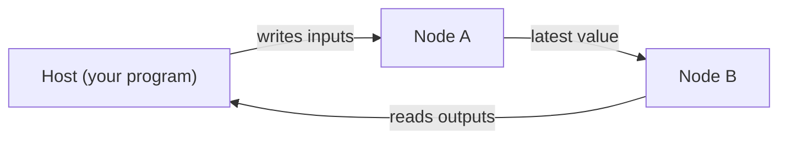

# Mujou

Asynchronous Distributed Deep Learning Library for Continuous Learning
{ .mujou-tagline }

Mujou is a deep learning framework that keeps inferring and learning at the same time. You write nodes in PyTorch code and run a network that connects them.

!!! warning "Early development"

    Mujou is in an early stage of development. The API may change without notice.

## 🌱 A network that keeps learning

Conventional machine learning trains a model, then freezes its weights for inference. A Mujou network takes input and produces output for as long as it runs, and keeps learning at the same time.

There is no mode to switch between training and inference, and there are no epochs.

The name comes from 無常 (*mujō*, impermanence: nothing stays the same), as in the Buddhist phrase 諸行無常. Mujou is a framework for machines that keep learning from a stream and keep changing. It targets uses that learn while they act, such as real-time processing and robotics.

## ✨ Features

- 🔄 **Inference and learning at once**: no training mode, no inference mode, no epochs
- 🧩 **Nodes in PyTorch**: write each node in ordinary PyTorch code, run synchronously inside the node
- ⚡ **Asynchronous nodes**: each node updates on a thread of its own and never waits for another
- ⏱️ **Continuous time**: nodes update in proportion to `dt`, the time that really passed
- 💾 **State without stopping**: take the state of a running network and run again from it later
- 🧪 **Deterministic tests**: a virtual timer and manual updates for testing nodes

## ⚙️ How it runs



Each node repeats its update on a thread of its own and never waits for another node; it reads the latest value its neighbor sent.

The host (the program that runs the network) writes inputs to the running network and reads its outputs.

## 🚀 The smallest program

The program below runs a network of two nodes that computes $y = 2x + 1$ and reads the output. The [Quickstart](getting-started/quickstart.md) explains what it does.

??? example "examples/quickstart.py"

    ```python
    --8<-- "examples/quickstart.py"
    ```

## 🧭 Where to go next

New to Mujou? Read Installation, Quickstart and How Mujou works, in that order. To write your own nodes and networks, go on to the User Guide, the Examples and the API Reference.

<div class="grid cards" markdown>

- **📦 Installation**

    ______________________________________________________________________

    Build Mujou from source and check that it works.

    [:octicons-arrow-right-24: Installation](getting-started/installation.md)

- **🚀 Quickstart**

    ______________________________________________________________________

    Run the smallest program and read its output.

    [:octicons-arrow-right-24: Quickstart](getting-started/quickstart.md)

- **🧠 How Mujou works**

    ______________________________________________________________________

    Nodes, ports and channels, networks, global time, and state.

    [:octicons-arrow-right-24: How Mujou works](concepts.md)

- **🧭 User Guide**

    ______________________________________________________________________

    Write your own nodes, build networks, and run them.

    [:octicons-arrow-right-24: User Guide](user-guide/index.md)

- **💡 Examples**

    ______________________________________________________________________

    Working programs, each run by the tests.

    [:octicons-arrow-right-24: Examples](examples/index.md)

- **📚 API Reference**

    ______________________________________________________________________

    Every public class and function, generated from the docstrings.

    [:octicons-arrow-right-24: API Reference](api/index.md)

</div>
