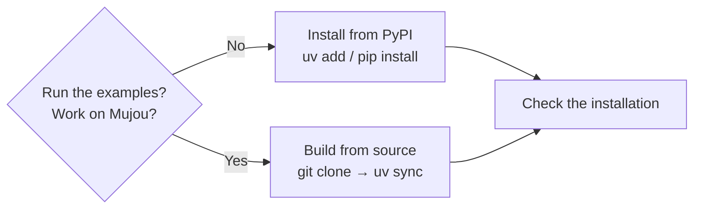

# 📦 Installation

!!! abstract "On this page"

    - What you need to run Mujou
    - How to install it from PyPI, and how to build it from source
    - How to check that the installation works



## Requirements

!!! abstract "In short"

    To install from PyPI you need Python 3.14 or later (and Rust on platforms without a wheel). To build from source you also need Rust and uv.

| Requirement | Details                                                                                   | From PyPI                         | From source |
| ----------- | ----------------------------------------------------------------------------------------- | --------------------------------- | ----------- |
| Python      | 3.14 or later. The free-threaded build 3.14t is recommended; the build with the GIL works | Needed                            | Needed      |
| PyTorch     | Installed automatically as a dependency of Mujou                                          | Automatic                         | Automatic   |
| Rust        | 1.85 or later, installed with [rustup](https://rustup.rs/). For building from source      | Only on platforms without a wheel | Needed      |
| uv          | [uv](https://docs.astral.sh/uv/). For building from source                                | If you use `uv add`               | Needed      |

### Python builds

| Build                 | Nodes written in Python              | Choice      |
| --------------------- | ------------------------------------ | ----------- |
| 3.14t (free-threaded) | Run in parallel                      | Recommended |
| 3.14 (with the GIL)   | Compete for the GIL, rarely parallel | Works too   |

??? question "Why the free-threaded build?"

    The nodes run on several worker threads at once, so 3.14t, without the GIL, is recommended. With the GIL, nodes written in Python compete for it and rarely run in parallel.

!!! warning "The API still changes"

    Mujou is in its 0.x releases, and how the API may change depends on the kind of release.

    | Release       | What changes      |
    | ------------- | ----------------- |
    | Minor (0.x.0) | The API may break |
    | Patch (0.x.y) | Bug fixes only    |

    === "Avoid"

        ```toml
        dependencies = ["mujou"]  # the next minor release may break the API
        ```

    === "Write this"

        ```toml
        dependencies = ["mujou~=0.1.0"]  # pin the minor version
        ```

    Read the [Changelog](changelog.md) before you move to a new minor version.

## Install from PyPI

!!! abstract "In short"

    Install with `uv add mujou` or `pip install mujou`. The platforms in the table below have wheels, so nothing needs to be built.

=== "uv"

    In a uv project:

    ```sh
    uv add mujou
    ```

=== "pip"

    In a virtual environment with Python 3.14 or later:

    ```sh
    pip install mujou
    ```

Published wheels:

| OS      | Architecture    | Python         |
| ------- | --------------- | -------------- |
| Linux   | x86_64, aarch64 | 3.14 and 3.14t |
| macOS   | arm64           | 3.14 and 3.14t |
| Windows | x86_64          | 3.14 and 3.14t |

On a platform not in the table, pip builds Mujou from the sdist, which needs Rust (1.85 or later).

!!! tip "A CPU-only or another CUDA build of PyTorch"

    PyTorch is installed from PyPI, like the other dependencies. To use a CPU-only build or another CUDA version, follow the [PyTorch installation guide](https://pytorch.org/get-started/locally/).

## Build from source

!!! abstract "In short"

    To run the example programs or to work on Mujou itself, clone the repository and run `uv sync`.

```sh
git clone https://github.com/Geson-anko/mujou.git
cd mujou
uv sync
```

What `uv sync` does:


Choose the Python with the arguments of `uv sync`.

=== "3.14t (free-threaded, default)"

    ```sh
    uv sync
    ```

=== "3.14 (with the GIL)"

    ```sh
    uv sync --python 3.14
    ```

## Check the installation

!!! abstract "In short"

    Print the version, and run `quickstart.py`, the smallest example.

=== "Built from source"

    In the clone of the repository:

    ```sh
    uv run python -c "import mujou; print(mujou.__version__)"
    uv run python examples/quickstart.py
    ```

=== "Installed with pip"

    Copy [`examples/quickstart.py`](https://github.com/Geson-anko/mujou/blob/main/examples/quickstart.py) to your machine, then:

    ```sh
    python -c "import mujou; print(mujou.__version__)"
    python quickstart.py
    ```

| Command                  | What it prints                                           |
| ------------------------ | -------------------------------------------------------- |
| Import `mujou` and print | A version such as `0.1.0`                                |
| Run `quickstart.py`      | A line such as `y = tensor([3., 5., 7.]) at t = 0.017 s` |

The [first page of the tutorial](tutorial/1-run.md) explains the second program, `quickstart.py`, and its output.
