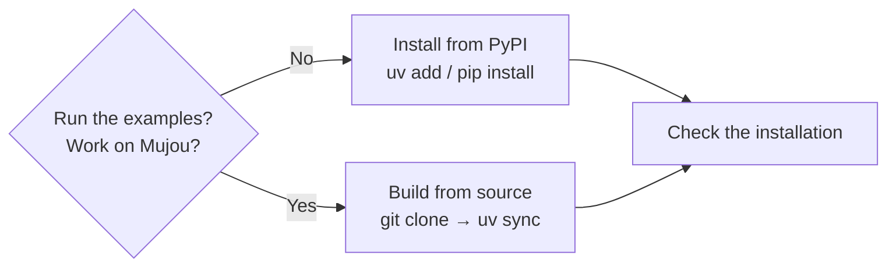

# 📦 Installation



## Requirements {#requirements}

| Requirement | Details                                                                                                                                                                   | From PyPI                         | From source |
| ----------- | ------------------------------------------------------------------------------------------------------------------------------------------------------------------------- | --------------------------------- | ----------- |
| Python      | 3.14 or later. The free-threaded build 3.14t is recommended; the build with the GIL works ([why](topics/threads-and-devices.md#workers))                                  | Needed                            | Needed      |
| PyTorch     | Installed automatically as a dependency of Mujou. For a CPU-only or another CUDA build, follow the [PyTorch installation guide](https://pytorch.org/get-started/locally/) | Automatic                         | Automatic   |
| Rust        | 1.85 or later, installed with [rustup](https://rustup.rs/). For building from source                                                                                      | Only on platforms without a wheel | Needed      |
| uv          | [uv](https://docs.astral.sh/uv/). For building from source                                                                                                                | If you use `uv add`               | Needed      |

## Install from PyPI {#pypi}

=== "uv"

    In a uv project:

    ```sh
    uv add mujou
    ```

=== "pip"

    In a virtual environment with Python 3.14 or later:

    ```sh
    pip install mujou
    ```

Platforms with published wheels (nothing to build):

| OS      | Architecture    | Python         |
| ------- | --------------- | -------------- |
| Linux   | x86_64, aarch64 | 3.14 and 3.14t |
| macOS   | arm64           | 3.14 and 3.14t |
| Windows | x86_64          | 3.14 and 3.14t |

Pin the minor version in your dependencies, and read the [Changelog](changelog.md) before you move to a new one.

```toml
dependencies = ["mujou~=0.1.0"]
```

## Build from source {#source}

```sh
git clone https://github.com/Geson-anko/mujou.git
cd mujou
uv sync  # creates .venv/, installs the dependencies (with what the examples need, such as numpy) and builds the Rust core
```

Choose the Python with the arguments of `uv sync`.

=== "3.14t (free-threaded, default)"

    ```sh
    uv sync
    ```

=== "3.14 (with the GIL)"

    ```sh
    uv sync --python 3.14
    ```

## Check the installation {#check}

=== "uv"

    ```sh
    uv run python -c "import mujou; print(mujou.__version__)"  # prints a version such as 0.1.0
    ```

=== "pip"

    ```sh
    python -c "import mujou; print(mujou.__version__)"  # prints a version such as 0.1.0
    ```

Run your first program in [1. Run a Network](tutorial/1-run.md#program).
