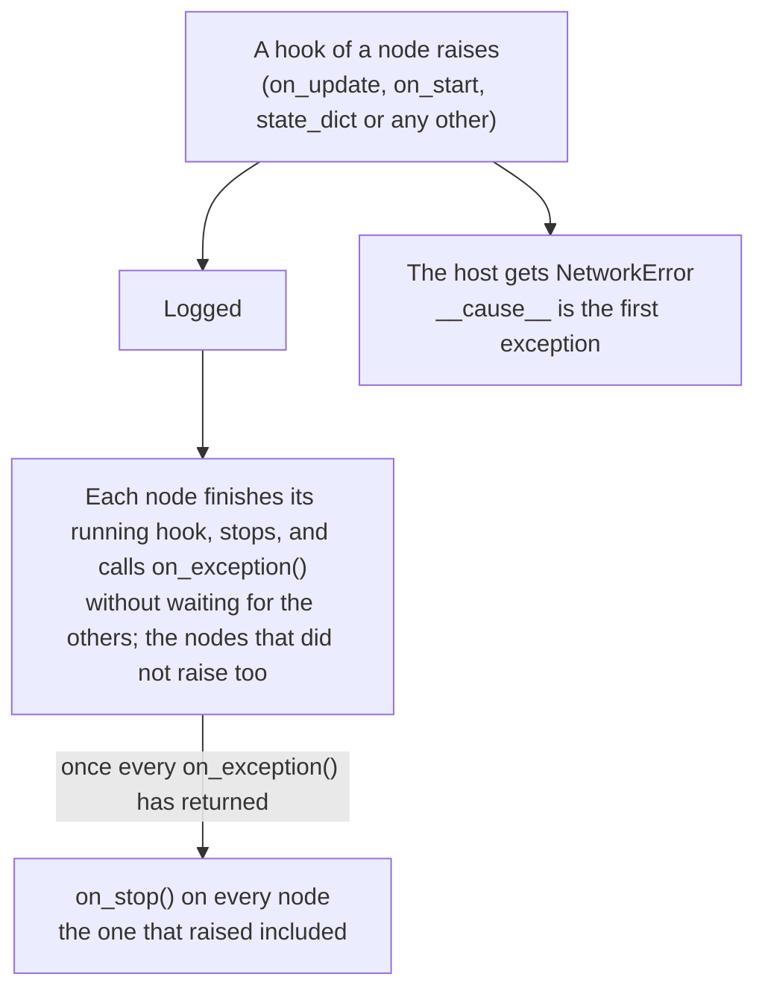
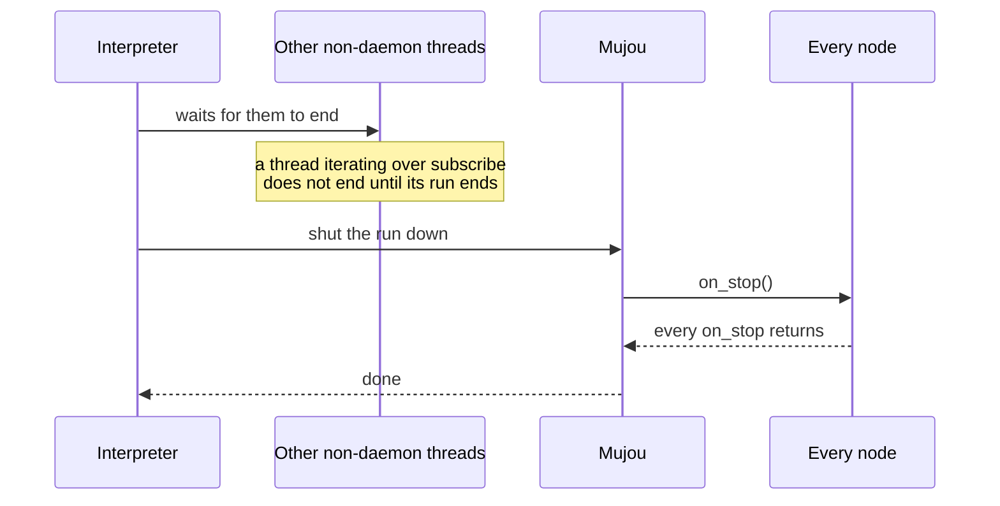

# 🚨 Errors and Shutdown

## One node's exception stops everything {#stop}



```python
--8<-- "examples/errors.py"
```

??? question "Why not stop only the node that raised?"

    Its neighbors would keep reading its old values and drift away from the equilibrium without anyone noticing.

## Where the host receives it {#where}

An exception while the run starts (`on_start`, ...) is raised by `mujou.run`; one after the start, by the host's next call of a [`Run`][mujou.Run] method, as [`NetworkError`][mujou.NetworkError]. So a host that only waits waits with `run.join(timeout=...)`, not with `run.timer.sleep`.

=== "Avoid"

    ```python
    run = mujou.run(net)
    run.timer.sleep(10.0)  # does not notice when a node raises
    ```

=== "Write instead"

    ```python
    run = mujou.run(net)
    run.join(timeout=10.0)  # a node's exception arrives as NetworkError (TimeoutError if it has not stopped in 10 s)
    ```

## `on_exception` and `on_stop` {#hooks}

| Hook                                        | What to write                                                     |
| ------------------------------------------- | ----------------------------------------------------------------- |
| [`on_exception()`][mujou.Node.on_exception] | The work of an abnormal end, such as a safe stop of the actuators |
| [`on_stop()`][mujou.Node.on_stop]           | The release of resources such as I/O; called at every end         |

`on_exception` takes no arguments, so a node does not learn what stopped the run; the host handles the cause, from the `__cause__` of `NetworkError`. To handle an exception in the node, catch it with `try` in the hook (an exception caught there does not stop the run).

## Logging {#logging}

A node's exception is logged with its traceback (the logger's name and level are in [`NetworkError`][mujou.NetworkError]). Configure Python's `logging` to send it elsewhere: the `logging.basicConfig` line of [the program above](#stop) sends it to standard output (standard error if not configured).

## The state after an exception {#state}

The state of a run that ended by an exception is not kept, so take the state you want to keep while it runs (regularly in a long run), and build new instances to run again.

## Timeouts {#timeouts}

Which seconds the `timeout` of a waiting call counts is in the table of [units of time](time.md#units).

!!! warning "A long `on_update` delays the pause"

    A node whose single `on_update` is long (heavy BP, say) delays every pause for the state, since each node finishes its running `on_update` before it pauses.

## Interpreter exit {#exit}


