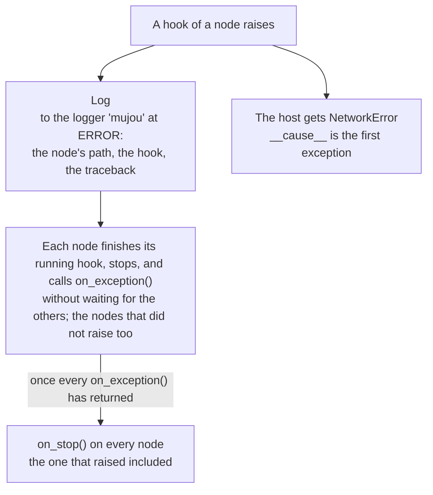
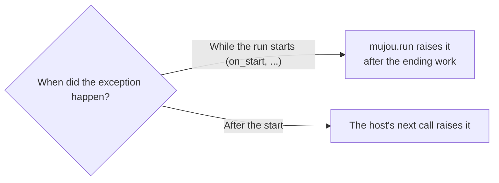
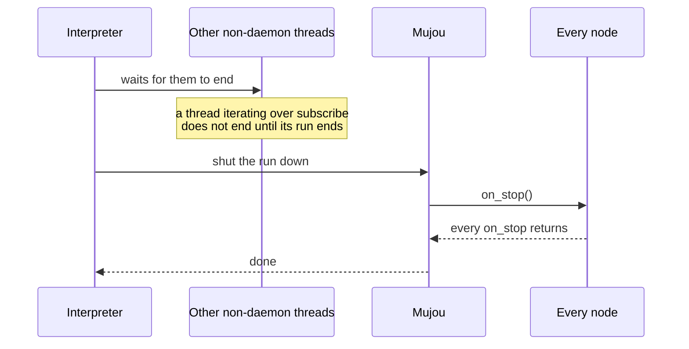

# 🚨 Errors and Shutdown

This page shows what happens when a hook of a node raises, where the host receives the exception, and the timeouts of the host's calls.

!!! abstract "What you will learn"

    - How one node's exception stops the whole run
    - Where the host receives `NetworkError`, and what to write in `on_exception` and `on_stop`
    - The timeouts of the host's calls, and what happens when the interpreter exits

## One node's exception stops everything

!!! abstract "Key idea"

    Whichever hook of whichever node raises (`on_update`, `on_start`, `state_dict` or any other), the whole run stops. Every node gets `on_exception()`, then `on_stop()`.



1. Mujou logs the node's path, the hook and the traceback to the logger `"mujou"` at the ERROR level
2. Each node finishes the hook it is running, stops, and calls its `on_exception()`, without waiting for the others. The nodes that did not raise are called too
3. Once every `on_exception()` has returned, every node's `on_stop()` is called, the one that raised included
4. The host gets a `NetworkError`, a subclass of `RuntimeError`, whose `__cause__` is the first exception. Exceptions of other nodes at about the same time are only logged

??? question "Why not stop only the node that raised?"

    Its neighbors would keep reading its old values and drift away from the equilibrium without anyone noticing.

```python
--8<-- "examples/errors.py"
```

## Where the host receives it

!!! abstract "Key idea"

    An exception while the run starts is raised by `mujou.run`; one after the start, by the host's next call, as `NetworkError`.



| The exception happens                  | What raises `NetworkError`                                                                                                                             |
| -------------------------------------- | ------------------------------------------------------------------------------------------------------------------------------------------------------ |
| While the run starts (`on_start`, ...) | `mujou.run` itself, after the ending work (`on_exception`, `on_stop`)                                                                                  |
| After the start                        | The next `write`, `read`, `read_with_time`, `subscribe` (and its iterator), `wait_for`, `state_dict`, `shutdown` or `join`, or `step` of a `ManualRun` |

An exception after the start reaches the host at its next call, so a host that only waits does not notice it. Wait with `run.join(timeout=...)`, not with `run.timer.sleep` (see the tabs below).

=== "Avoid"

    ```python
    run = mujou.run(net)
    run.timer.sleep(10.0)  # does not notice when a node raises
    ```

=== "Write instead"

    ```python
    run = mujou.run(net)
    run.join(timeout=10.0)  # a node's exception arrives as NetworkError (TimeoutError if it has not stopped in 10 s)
    ```

In a run where a node raised, the `shutdown` at the end of a `with` block raises it.

| The body of the `with` block | The exception the host sees                                                                  |
| ---------------------------- | -------------------------------------------------------------------------------------------- |
| Ended normally               | The `NetworkError` that `shutdown` raises                                                    |
| Raised too                   | The body's exception. The `NetworkError` is dropped (the log still has the node's exception) |

## `on_exception` and `on_stop`

!!! abstract "Key idea"

    `on_exception()` is for the work of an abnormal end; `on_stop()` releases resources at every end.

| Hook             | Called                                                  | What to write                                                     |
| ---------------- | ------------------------------------------------------- | ----------------------------------------------------------------- |
| `on_exception()` | When the run ends by an exception, on every node, first | The work of an abnormal end, such as a safe stop of the actuators |
| `on_stop()`      | Once at every end, normal or not                        | The release of resources such as I/O; not a change of the state   |

| Question                                           | Answer                                                                              |
| -------------------------------------------------- | ----------------------------------------------------------------------------------- |
| Does a node learn which exception stopped the run? | No. `on_exception` takes no arguments. The host handles the cause, from `__cause__` |
| How does a node handle an exception itself?        | Catch it with `try` in the hook. An exception caught there does not stop the run    |
| What if `on_exception` or `on_stop` raises?        | It is only logged, and the ending goes on                                           |
| What does `self.timer` do in these hooks?          | It does not move (see the [rules a node keeps](../concepts.md#rules-a-node-keeps))  |

## Logging

!!! abstract "Key idea"

    A node's exception goes to the logger `"mujou"` with its traceback. Configure Python's `logging` to send it elsewhere.

A program that has not configured logging prints it to standard error. This code sends it to standard output instead:

```python
--8<-- "examples/errors.py:logging"
```

## The state after an exception

!!! abstract "Key idea"

    The state of a run that ended by an exception is not kept. Take the state you want to keep while the network runs.

| Situation                              | What to do, or what happens                         |
| -------------------------------------- | --------------------------------------------------- |
| `run.state_dict()` after the exception | Raises `NetworkError`                               |
| State you want to keep                 | Take it while the run runs; regularly in a long run |
| Running again                          | Build new instances                                 |

## Timeouts

!!! abstract "Key idea"

    The calls that wait take a `timeout` in real seconds. The default `math.inf` waits as long as it takes.

`shutdown`, `join`, `subscribe`, `wait_for` and `state_dict` take a `timeout`, counted in real time, not on the run's timer.

| Call                                     | When the time runs out                                                                                                             |
| ---------------------------------------- | ---------------------------------------------------------------------------------------------------------------------------------- |
| `run.shutdown(timeout=...)`              | `TimeoutError`. The request to stop stands, and the nodes update no more; the ending goes on, and `join` waits for it              |
| `run.join(timeout=...)`                  | `TimeoutError`. Nothing changes                                                                                                    |
| `run.subscribe(port, timeout=...)`       | `TimeoutError` from the iterator, counting the whole iteration, the body of the loop included. The run keeps running               |
| `run.wait_for(port, until, timeout=...)` | `TimeoutError`. The run keeps running                                                                                              |
| `run.state_dict(timeout=...)`            | `TimeoutError`, while some node has not paused (each finishes its `on_update` first). No state is taken, and the run keeps running |

!!! warning "A long `on_update` delays the pause"

    A node whose single `on_update` is long (heavy BP, say) delays every pause for the state, since each node finishes its running `on_update` before it pauses.

## Interpreter exit

!!! abstract "Key idea"

    If the interpreter exits while a run is running, Mujou shuts the run down. End each run yourself, with `shutdown` or a `with` block.



If the interpreter exits while a run is running, Mujou shuts the run down and waits for every `on_stop`, once the other non-daemon threads have ended. A thread that iterates over `subscribe` cannot end until its run ends, so end each run yourself, with `shutdown` or a `with` block.
