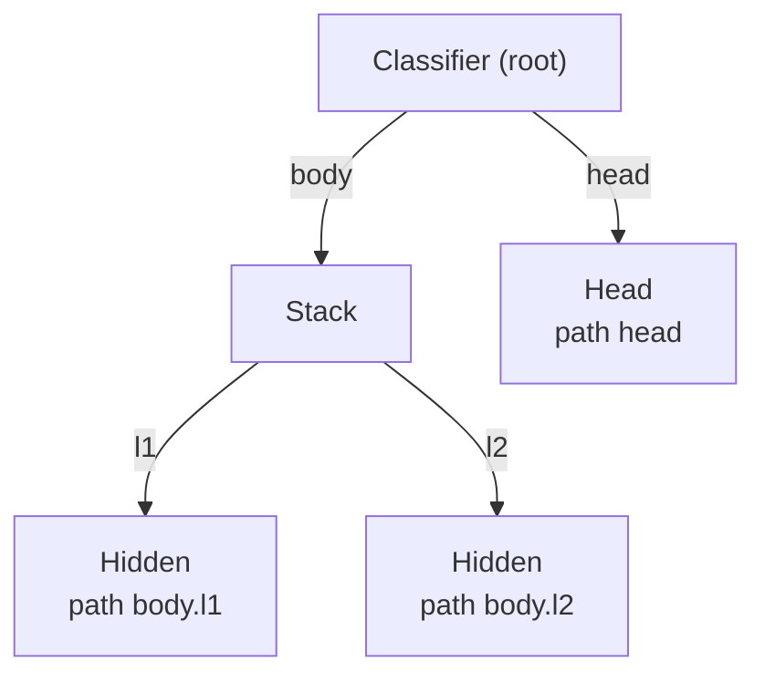
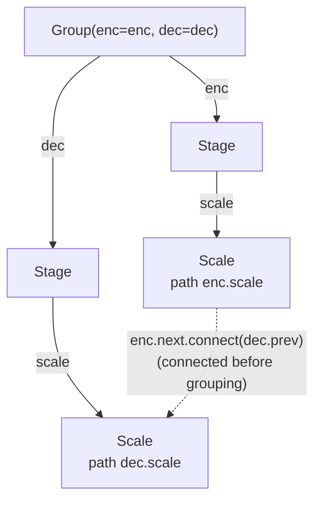
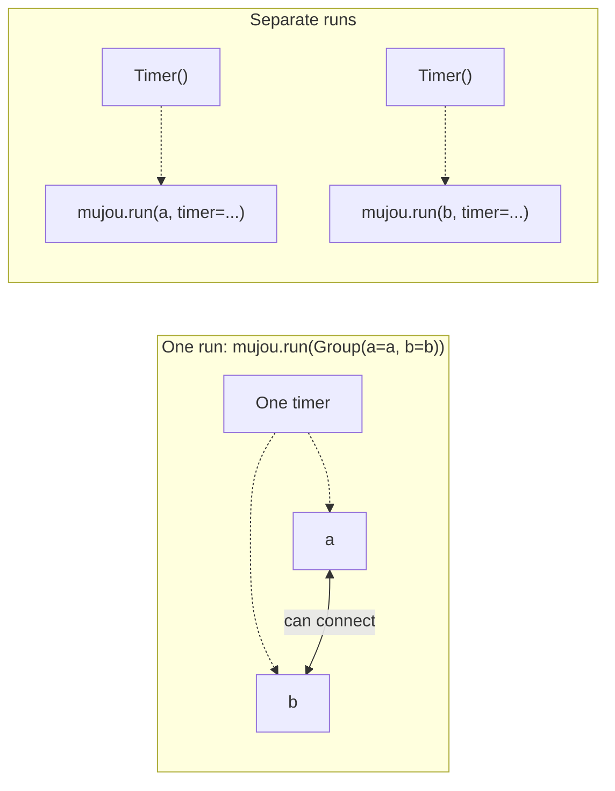
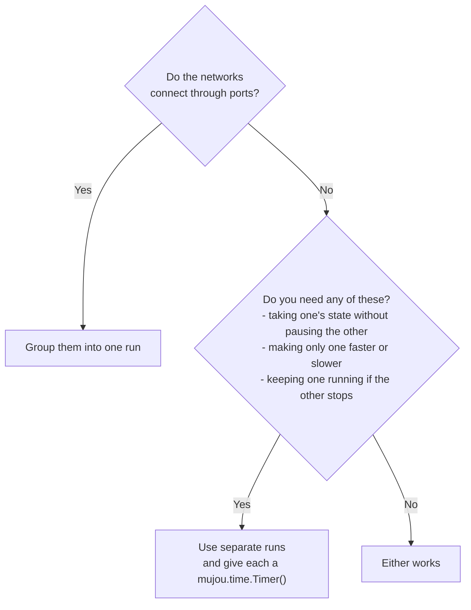

# 🗂️ Groups

`mujou.run` runs one root. To run several networks in one run, put them side by side in a `mujou.Group`.

!!! abstract "On this page"

    - How nodes get their paths
    - How to put several networks in one run with `Group`
    - How to choose between one run and separate runs

## Paths

!!! abstract "In short"

    A node is named by its path: the attribute names from the root, joined with `.`.

```python
class Stack(mujou.Network):
    def __init__(self) -> None:
        super().__init__()
        self.l1 = Hidden(784, 256)
        self.l2 = Hidden(256, 256)
        self.l1.next.connect(self.l2.prev)
        self.prev, self.next = self.l1.prev, self.l2.next


class Classifier(mujou.Network):
    def __init__(self) -> None:
        super().__init__()
        self.body = Stack()  # a network inside a network
        self.head = Head()
        self.body.next.connect(self.head.prev)  # body.next is l2.next itself
        self.prev = self.body.prev  # exposes again a port that the child exposed
```



A run reads the attributes in the order of assignment, and that is the order of the tree: for `Classifier`, `"body.l1"`, `"body.l2"`, then `"head"`. A node given as the root itself is at `""`.

!!! warning "Renaming an attribute breaks restoring a saved state"

    Paths are the keys of the state tree, so a network has the same paths however it is run. Renaming an attribute makes a state saved before the rename impossible to restore.

## Group

!!! abstract "In short"

    `Group(enc=a, dec=b)` puts each network under its keyword. It is only a container and connects nothing.



```python
--8<-- "examples/group.py:group"
```

| Root                      | Path of the node `l1` in `a` |
| ------------------------- | ---------------------------- |
| `a`                       | `"l1"`                       |
| `Group(enc=a, dec=b)`     | `"enc.l1"`                   |
| `node` (a node by itself) | `""`                         |
| `Group(n=node)`           | `"n"`                        |

### Rules for grouping

| Rule                                                   | What it means                                                              |
| ------------------------------------------------------ | -------------------------------------------------------------------------- |
| `Group` connects nothing                               | Connect the networks with `connect`, before or after grouping them         |
| Inputs and outputs stay the networks' own ports        | Use `enc.prev` and `dec.next` as they are for `inputs=` and `read`         |
| Restore with the same keywords                         | The keyword starts the path, which is a key of the state tree              |
| A network that has run alone cannot join a group later | A node runs once. Run them together from the start, or build new instances |

The rule that a node runs once is in [rules a node keeps](../concepts.md#rules-a-node-keeps).

=== "Avoid"

    ```python
    with mujou.run(enc) as run:  # enc ran alone
        ...
    with mujou.run(Group(enc=enc, dec=dec)) as run:  # enc has already run: RuntimeError
        ...
    ```

=== "Write instead"

    ```python
    with mujou.run(Group(enc=enc, dec=dec)) as run:  # run them together from the start
        ...
    ```

## One run or several?

!!! abstract "In short"

    Grouped networks are one run, which shares one timer, one state tree and one ending. If they should not share these, use separate runs and give each its own `Timer`.



| What             | Grouped in one run                                | In separate runs, each on its own `Timer`              |
| ---------------- | ------------------------------------------------- | ------------------------------------------------------ |
| Connecting       | Possible                                          | Not possible: ports of another run cannot be connected |
| Taking the state | Pauses every node, and takes one tree at one time | One tree per run; taking it pauses only that run       |
| Time scale       | The same for every node                           | May differ per run                                     |
| Exceptions       | One node's exception ends every network           | Only the run of the node that raised ends              |

### Choosing



!!! warning "Runs without a timer share the global timer"

    Runs given no `timer` all run on `mujou.time.global_timer`, so taking the state of one pauses the others too. To keep them apart, give each its own `Timer` (see [Time](time.md)).
