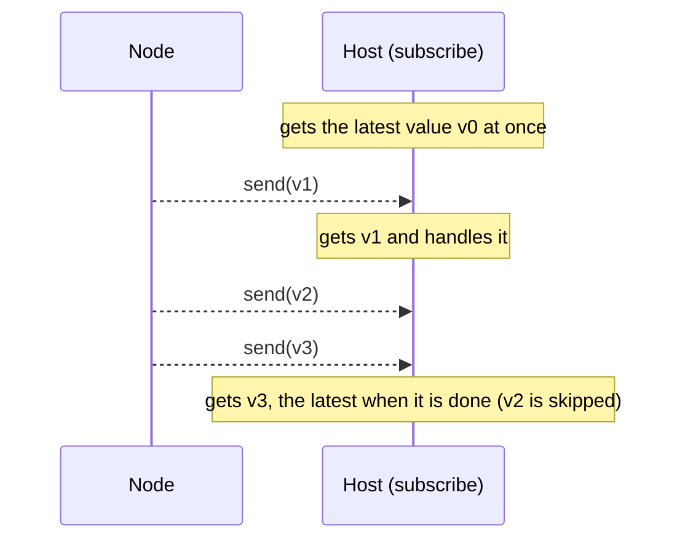

# 🏃 Host I/O

| To                                  | Use                                                                                                                                              | Section                                             |
| ----------------------------------- | ------------------------------------------------------------------------------------------------------------------------------------------------ | --------------------------------------------------- |
| Write an input                      | [`run.write`][mujou.Run.write]                                                                                                                   | [Writing](#write)                                   |
| Show an input from the first update | the `inputs=` of [`mujou.run`][mujou.run]                                                                                                        | [Initial values](#initial-values)                   |
| Show an input for a given time      | [`run.timer.sleep`][mujou.time.Timer.sleep]                                                                                                      | [Showing an input for a while](#show-input)         |
| Read or wait for an output          | [`run.read`][mujou.Run.read], [`read_with_time`][mujou.Run.read_with_time], [`subscribe`][mujou.Run.subscribe], [`wait_for`][mujou.Run.wait_for] | [Reading](#read)                                    |
| Take the state                      | [`run.state_dict`][mujou.Run.state_dict]                                                                                                         | [Save and Resume](../tutorial/6-save-and-resume.md) |
| End the run                         | a `with` block, [`run.shutdown`][mujou.Run.shutdown], [`run.join`][mujou.Run.join]                                                               | [Ending](#shutdown)                                 |

## Writing {#write}

The host writes with [`Run.write`][mujou.Run.write] only to ports that receive and are not connected (nodes write the others).
A written value stays until the next write, and the nodes read it many times.
Write values that belong together, such as an input and its target, in one write (why: [Values that belong together](ports.md#pairs)).

```python
run.write({net.prev: x, net.teacher: y})  # x and y switch together
```

## Initial values {#initial-values}

| Way                                           | Port                   | What a reader gets                                | Its time                |
| --------------------------------------------- | ---------------------- | ------------------------------------------------- | ----------------------- |
| Nothing                                       | —                      | The spec's initial value ([Specs](ports.md#spec)) | `None`                  |
| [`Port(send=..., initial=value)`][mujou.Port] | A port a node sends on | `value`, until the port first sends               | `None`                  |
| `mujou.run(net, inputs={port: value})`        | A port the host writes | `value`, from the first update                    | The time the run starts |
| `run.write({port: value})`                    | A port the host writes | `value`, from the write on                        | What `write` returned   |

=== "Avoid"

    ```python
    with mujou.run(net) as run:  # the nodes start updating as soon as mujou.run returns
        run.write({net.prev: x})  # a few updates before this may read zeros
    ```

=== "Write instead"

    ```python
    with mujou.run(net, inputs={net.prev: x}) as run:  # x from the first update
        ...
    ```

## Showing an input for a while {#show-input}

```python
for x in stream:
    run.write({net.prev: x})
    run.timer.sleep(0.1)  # show x for 0.1 s of the run's time
    y = run.read(net.next)  # the output at the end of the showing time
```

<figure class="mujou-diagram">
<svg viewBox="0 0 640 230" role="img" aria-label="The input steps at the time of write, and the output catches up smoothly after a delay. Reading right after write returns the output for the previous input; reading after sleep returns the output for the new input">
<line class="mujou-axis" x1="90" y1="205" x2="620" y2="205"/>
<text class="mujou-label" x="620" y="222" text-anchor="end">run's timer →</text>
<text class="mujou-label" x="10" y="64">Input</text>
<text class="mujou-label" x="10" y="150">Output</text>
<path d="M 90 80 L 330 80 L 330 45 L 620 45" style="fill: none; stroke: var(--md-typeset-a-color); stroke-width: 2.5"/>
<text class="mujou-note" x="200" y="72" text-anchor="middle">x₁</text>
<text class="mujou-note" x="475" y="37" text-anchor="middle">x₂</text>
<path d="M 90 175 C 140 175 170 137 330 136 C 380 136 410 110 620 108" style="fill: none; stroke: var(--md-accent-fg-color); stroke-width: 2.5"/>
<line class="mujou-lane" x1="330" y1="28" x2="330" y2="198" style="stroke-dasharray: 4 3"/>
<text class="mujou-note" x="330" y="20" text-anchor="middle">write(x₂)</text>
<circle cx="340" cy="136" r="4" style="fill: var(--md-default-fg-color--light)"/>
<text class="mujou-note" x="348" y="158">read right after → output for x₁</text>
<circle cx="560" cy="109" r="4" style="fill: var(--md-default-fg-color--light)"/>
<text class="mujou-note" x="560" y="96" text-anchor="middle">read after sleep</text>
<path class="mujou-brace" d="M 332 186 Q 332 193 340 193 L 552 193 Q 560 193 560 186"/>
<text class="mujou-note" x="446" y="182" text-anchor="middle">showing time of run.timer.sleep</text>
</svg>
<figcaption>The delay of the output depends on the time constants of the nodes and the number of stages. Show the input long enough</figcaption>
</figure>

When you know the output to expect, wait for it with [`wait_for`][mujou.Run.wait_for] instead of sleeping ([Run](../tutorial/1-run.md#run)).

## Reading {#read}

| Way                                              | Suited for                             |
| ------------------------------------------------ | -------------------------------------- |
| [`run.read`][mujou.Run.read]                     | Reading the latest value at any time   |
| [`run.read_with_time`][mujou.Run.read_with_time] | Telling how new the value is           |
| [`run.subscribe`][mujou.Run.subscribe]           | Handling each new output               |
| [`run.wait_for`][mujou.Run.wait_for]             | Waiting until an expected output comes |

The host reads any port of the run that sends, connected or not. Reading a connected port observes a value in the middle of the network without changing it.

### subscribe {#subscribe}



```python
--8<-- "examples/subscribe.py:subscribe"
```

## Ending {#shutdown}

=== "Avoid"

    ```python
    run = mujou.run(net)
    ...  # dropping run does not stop it: it runs until shutdown or the interpreter's exit
    ```

=== "Write instead"

    ```python
    with mujou.run(net) as run:
        ...  # leaving the block calls shutdown()
    ```

What calls on a `Run` do after it has ended is in [Where the host gets it](errors.md#where).
