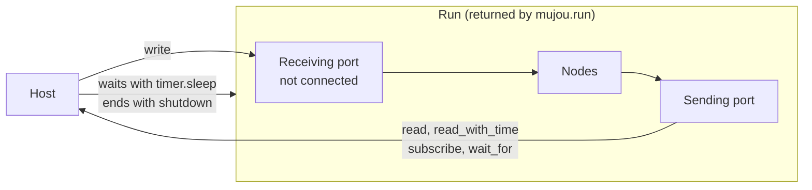
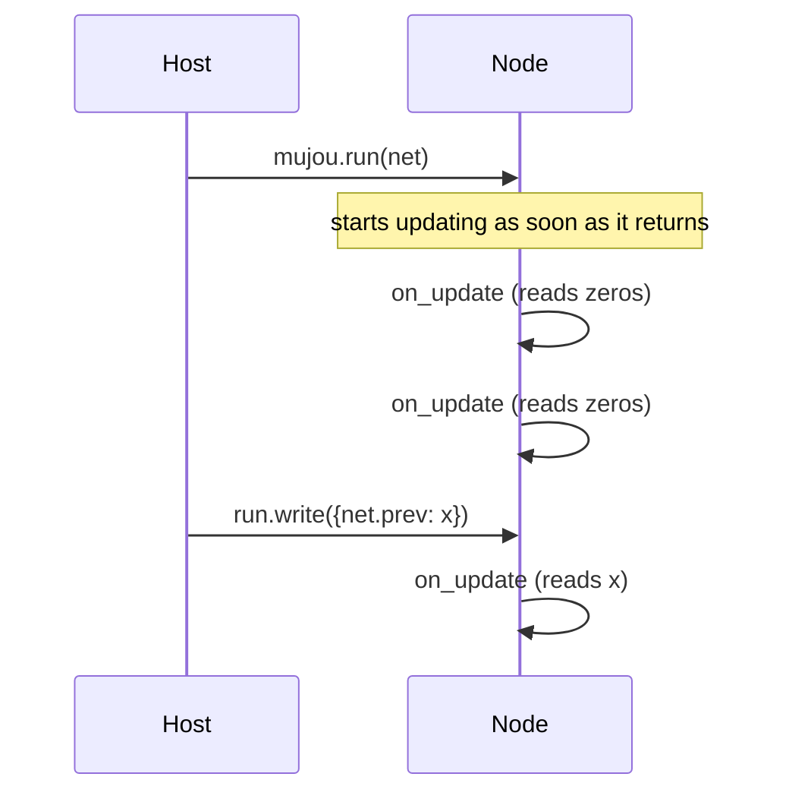
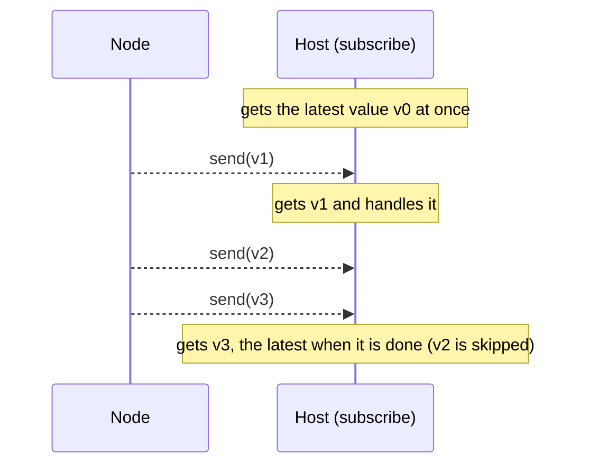
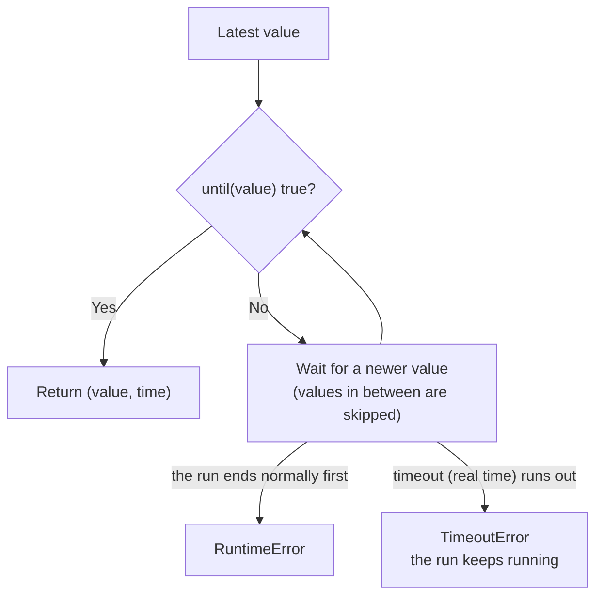
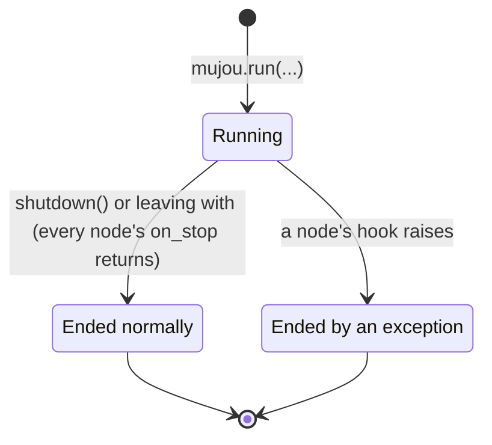

# 🏃 Host I/O

The host is the program that runs the network. It talks to a run through the `Run` that `mujou.run` returns: it writes inputs, reads outputs, waits, and ends the run.



| To                                  | Use                                           | Section                                                       |
| ----------------------------------- | --------------------------------------------- | ------------------------------------------------------------- |
| Write an input                      | `run.write`                                   | [Writing](#writing)                                           |
| Show an input from the first update | `mujou.run(..., inputs=)`                     | [Initial values](#initial-values)                             |
| Show an input for a given time      | `run.timer.sleep`                             | [Showing an input for a while](#showing-an-input-for-a-while) |
| Read or wait for an output          | `run.read`, `subscribe`, `wait_for` and so on | [Reading](#reading)                                           |
| End the run                         | a `with` block, `run.shutdown`, `run.join`    | [Ending](#ending)                                             |

## Writing

!!! abstract "In short"

    The host writes only to a `Port` that receives and is not connected. A written value stays until the next write.

```python
t = run.write({net.prev: x, net.teacher: y})  # returns the time of the write
```

The host writes to the ports of the run that receive and are not connected. Nodes write the others, and writing to any other port raises `ValueError`.

| Property                   | What it means                                                    |
| -------------------------- | ---------------------------------------------------------------- |
| Stays until the next write | An input is a signal over time, and the nodes read it many times |
| Switches together          | The values of one `write` switch at once, with the same time     |
| Is copied                  | Changing the tensor after the write does not reach the network   |

### Values that belong together go in one write

The values of one `write` switch at once, so at any moment a node sees either all of them new or all of them old. A next `write` can still come between two reads of a node, which the times reveal. Write values that belong together, such as an input and its target, in one `write`, or as one `DictSpec` message.

=== "Avoid"

    ```python
    run.write({net.prev: x})
    run.write({net.teacher: y})  # a node may read the new x with the old y
    ```

=== "Write instead"

    ```python
    run.write({net.prev: x, net.teacher: y})  # x and y switch together
    ```

### Values that cannot be written

Writing a value that cannot be written raises one of these exceptions. Each names the port by its path and attribute.

| Value written                                                 | Exception       |
| ------------------------------------------------------------- | --------------- |
| To a port the host cannot write (connected, or not receiving) | `ValueError`    |
| Of a shape or dtype other than the spec's                     | `ValueError`    |
| Of another kind (a tensor for an `IntSpec`, say)              | `TypeError`     |
| A dict with a missing or an extra key                         | `TypeError`     |
| An `int` out of the range of its `IntSpec`                    | `OverflowError` |

## Initial values

!!! abstract "In short"

    The nodes start updating as soon as `mujou.run` returns. To show an input from the first update, pass it as `inputs=`.

| Way                                    | What a reader gets                    | Its time                |
| -------------------------------------- | ------------------------------------- | ----------------------- |
| Nothing                                | Zeros (`0`, `False`, ... for scalars) | `None`                  |
| `Port(send=..., initial=value)`        | `value`, until the port first sends   | `None`                  |
| `mujou.run(net, inputs={port: value})` | `value`, from the first update        | The time the run starts |
| `run.write({port: value})`             | `value`, from the write on            | What `write` returned   |

`initial` is for a port that a node sends on; `inputs` and `write` are for the ports the host writes.



=== "Avoid"

    ```python
    with mujou.run(net) as run:
        run.write({net.prev: x})  # a few updates before this may read zeros
    ```

=== "Write instead"

    ```python
    with mujou.run(net, inputs={net.prev: x}) as run:  # x from the first update
        ...
    ```

## Showing an input for a while

!!! abstract "In short"

    After writing an input, wait for as long as you want to show it with `run.timer.sleep(seconds)`. The output catches up with the input after a delay.

```python
for x in stream:
    run.write({net.prev: x})
    run.timer.sleep(0.1)  # show x for 0.1 s of the run's time
    y = run.read(net.next)  # the output at the end of the showing time
```

<figure class="mujou-diagram">
<svg viewBox="0 0 640 230" role="img" aria-label="The input steps at the time of write, and the output catches up smoothly after a delay. Reading right after write returns the output for the previous input; reading after sleep returns the output for the new input">
<line class="mujou-axis" x1="90" y1="205" x2="620" y2="205"/>
<text class="mujou-label" x="620" y="222" text-anchor="end">run's timer →</text>
<text class="mujou-label" x="10" y="64">Input</text>
<text class="mujou-label" x="10" y="150">Output</text>
<path d="M 90 80 L 330 80 L 330 45 L 620 45" style="fill: none; stroke: var(--md-typeset-a-color); stroke-width: 2.5"/>
<text class="mujou-note" x="200" y="72" text-anchor="middle">x₁</text>
<text class="mujou-note" x="475" y="37" text-anchor="middle">x₂</text>
<path d="M 90 175 C 140 175 170 137 330 136 C 380 136 410 110 620 108" style="fill: none; stroke: var(--md-accent-fg-color); stroke-width: 2.5"/>
<line class="mujou-lane" x1="330" y1="28" x2="330" y2="198" style="stroke-dasharray: 4 3"/>
<text class="mujou-note" x="330" y="20" text-anchor="middle">write(x₂)</text>
<circle cx="340" cy="136" r="4" style="fill: var(--md-default-fg-color--light)"/>
<text class="mujou-note" x="348" y="158">read right after → output for x₁</text>
<circle cx="560" cy="109" r="4" style="fill: var(--md-default-fg-color--light)"/>
<text class="mujou-note" x="560" y="96" text-anchor="middle">read after sleep</text>
<path class="mujou-brace" d="M 332 186 Q 332 193 340 193 L 552 193 Q 560 193 560 186"/>
<text class="mujou-note" x="446" y="182" text-anchor="middle">showing time of run.timer.sleep</text>
</svg>
<figcaption>The input switches at the time of <code>write</code>, and the output catches up after a delay, which the network's dynamics decide</figcaption>
</figure>

`sleep` waits on the run's timer, so it follows the time scale and the pauses of the run. The delay of the output depends on the time constants of the nodes and the number of stages, so choose a showing time long enough. Reading right after `write` returns the output for the earlier input; when you know the output to expect, wait for it with `wait_for`.

## Reading

!!! abstract "In short"

    The host reads any port of the run that sends, connected or not. Each read returns a new copy on the CPU of what the port last sent with `send`.

| Way                         | What it returns                                                         | Suited for                             |
| --------------------------- | ----------------------------------------------------------------------- | -------------------------------------- |
| `run.read(port)`            | The latest value                                                        | Reading whenever it suits the host     |
| `run.read_with_time(port)`  | The latest value and the time it was sent, `(value, Timestamp \| None)` | Telling how new the value is           |
| `run.subscribe(port)`       | An iterator of `(value, Timestamp \| None)`, each newer than the last   | Handling each new output               |
| `run.wait_for(port, until)` | The first `(value, Timestamp \| None)` that meets `until`               | Waiting until an expected output comes |

Reading a connected port observes a value in the middle of the network without changing it. Until the first `send`, a read returns the initial value, with the time `None`.

### subscribe



| When                        | What happens                              |
| --------------------------- | ----------------------------------------- |
| The first time              | Returns the latest value without waiting  |
| After that                  | Waits for each newer value and returns it |
| The host reads slowly       | The values in between are skipped         |
| The run ends normally       | The iteration ends                        |
| You `break` out of the loop | The iteration ends; the run keeps running |
| `timeout=` runs out         | `TimeoutError`; the run keeps running     |

```python
--8<-- "examples/subscribe.py:subscribe"
```

### wait_for



```python
y, t = run.wait_for(net.next, lambda y: torch.equal(y, expected), timeout=5.0)
```

`timeout` is in real seconds, and the default is to wait forever. When it runs out, `TimeoutError` is raised, but the run keeps running. See [Errors and Shutdown](errors.md#timeouts).

## Ending

!!! abstract "In short"

    End each run yourself. Normally, write `with mujou.run(...) as run:`.



| Way                           | What it does                                                                                                                   |
| ----------------------------- | ------------------------------------------------------------------------------------------------------------------------------ |
| `with mujou.run(...) as run:` | Calls `shutdown()` when the block ends. Use this normally                                                                      |
| `run.shutdown(timeout=...)`   | Asks every node to stop, and waits until every `on_stop` has returned                                                          |
| `run.join(timeout=...)`       | Waits until the run ends, without asking it to stop: after another thread called `shutdown`, or to wait for a node's exception |

=== "Avoid"

    ```python
    run = mujou.run(net)
    ...  # dropping run does not stop it: it runs until shutdown or the interpreter's exit
    ```

=== "Write instead"

    ```python
    with mujou.run(net) as run:
        ...  # leaving the block calls shutdown()
    ```

### Calls after the end

| Call               | After a normal end   | After a node's exception |
| ------------------ | -------------------- | ------------------------ |
| `run.shutdown()`   | Does nothing         | `NetworkError`           |
| `run.write(...)`   | `RuntimeError`       | `NetworkError`           |
| `run.state_dict()` | Takes the last state | `NetworkError`           |

Once a node raises, the later calls on the `Run` raise `NetworkError`. See [Errors and Shutdown](errors.md).
