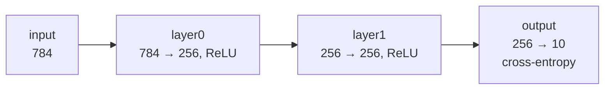
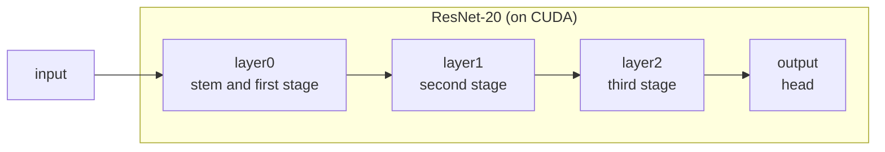

# 📊 PC-ALM Benchmarks

`examples/mnist/` and `examples/cifar10/` learn with a [`pc.Chain`][mujou.pc.Chain] and compare it with BP from the same initial weights on the same batches; below are the results, and how the way the network is cut and `cuda_graph` affect the speed.

## MNIST {#mnist}



| Result (seed 0)              | PC-ALM                                  | BP     |
| ---------------------------- | --------------------------------------- | ------ |
| Test accuracy after 3 epochs | 97.69%                                  | 97.53% |
| Prequential accuracy         | Within 0.11 points of BP in every epoch | —      |
| Compute time per batch (CPU) | About 40 times that of BP               | —      |

```sh
uv run python examples/mnist/main.py            # 3 epochs, about 2 minutes
uv run python examples/mnist/main.py --epochs 1 --watch
```

```python
--8<-- "examples/mnist/main.py:chain"
```

```python
--8<-- "examples/mnist/main.py:run"
```

| Term or option                     | Meaning                                                                                                                                                                                                                       |
| ---------------------------------- | ----------------------------------------------------------------------------------------------------------------------------------------------------------------------------------------------------------------------------- |
| Prequential accuracy (in training) | Measured on the first prediction for each batch, which [`pc.show`][mujou.pc.show] returns. How well the model predicts data it has not seen yet                                                                               |
| Test accuracy                      | The host shows the test batches with every `mask` False, so no node learns from them, and keeps the original `mask` to score with. There is no inference mode to switch to                                                    |
| The last batch                     | `data.batches` pads the last batch with zeros whose `mask` is False, so that every batch has the size of the specs. Only the samples whose original `mask` is True are counted                                                |
| `--watch`                          | Counts the `dt` of each node (`watch.py`), and warns when the updates come later than 1.5 periods (median) or 2 periods (99%). At `--time-scale 2`, 99% of the updates still came within 1.25 periods, with the same accuracy |

| File         | `mnist/`                                 | `cifar10/`                                               |
| ------------ | ---------------------------------------- | -------------------------------------------------------- |
| `main.py`    | Entry point                              | Entry point                                              |
| `data.py`    | Loads the data                           | Loads and augments the data                              |
| `metrics.py` | Measures                                 | Measures                                                 |
| `bp.py`      | Trains the BP baseline                   | Trains the BP baseline                                   |
| `watch.py`   | Counts the `dt` of the nodes (`--watch`) | —                                                        |
| `resnet.py`  | —                                        | Builds the network and says why it is cut into few nodes |

`data.py`, `metrics.py` and `bp.py` do not depend on `mujou.pc`: the data are plain tensors, and the BP baseline is plain PyTorch.

## CIFAR-10 {#cifar-10}



| Result (seed 0)         | PC-ALM | BP       |
| ----------------------- | ------ | -------- |
| Prequential, 3rd epoch  | 57.11% | 55.91%   |
| Test, after 3 epochs    | 59.47% | 61.76%   |
| Prequential, 10th epoch | 73.05% | 73.20%   |
| Test, after 10 epochs   | 73.90% | 74.35%   |
| Time per epoch          | 48 s   | 8 to 9 s |

The learning rate does not decay, so the test accuracy of both moves by a few points from epoch to epoch. The GPU does not compute bit for bit the same in every run.

```sh
uv run python examples/cifar10/main.py              # 3 epochs, about 4 minutes on an RTX 4090
uv run python examples/cifar10/main.py --epochs 10  # about 13 minutes
```

```python
--8<-- "examples/cifar10/main.py:chain"
```

| Setting                         | Details                                                                                                                                                                                                                           |
| ------------------------------- | --------------------------------------------------------------------------------------------------------------------------------------------------------------------------------------------------------------------------------- |
| A node for each stage           | Inside a node, autograd differentiates its module (the blocks, their skip connections and activations included), which is BP; between the nodes, only the messages of PC-ALM flow                                                 |
| 12 periods for each batch       | Batches of 32 samples, each shown for 12 periods; the nodes learn at 0.9 of it. The round trip of the credit from the `Input` to the `Output` and back takes at most 8 periods                                                    |
| On the GPU, twice the real time | `device="cuda"` ([How a message travels](threads-and-devices.md#message-paths)). `tau.h` is 10 ms, so the period is 5 ms of the timer; with `--time-scale 2`, 2.5 ms of real time. The updates came 1.00 periods apart on average |
| A batch of 32                   | An update costs about the same with 32 samples as with 128. BP gains more from a larger batch                                                                                                                                     |
| AdamW                           | Made from the `lr` of Adam with the conversion in [Choosing the optimizer](pc.md#optimizer). The BP baseline binds the same `pc.optim.AdamW` to its whole model and steps it by the showing time once per batch                   |
| GroupNorm                       | Instead of BatchNorm. No running statistics and no mode to switch. The samples of a batch, padded ones included, do not affect each other                                                                                         |

## Fewer nodes, fewer periods {#node-count}

On one GPU, a period of all the nodes costs about the same however the network is cut: launching the kernels from the CPU is the limit (about 1.7 ms per update).

| Cut                | Nodes | Batch | Periods per batch | Period                                 | Result                                                              |
| ------------------ | ----- | ----- | ----------------- | -------------------------------------- | ------------------------------------------------------------------- |
| By stage (default) | 5     | 32    | 12                | 5 ms of the timer, 2.5 ms of real time | The results of [CIFAR-10](#cifar-10)                                |
| By residual block  | 11    | —     | 24                | 2.5 ms of real time                    | The nodes could not keep up with the period                         |
| By residual block  | 11    | 128   | —                 | 5 ms                                   | 3rd epoch: 53.94% prequential, 57.67% test. 17 times the time of BP |

## cuda_graph {#cuda-graph}

```python
layer = pc.Layer(stage, act_spec=spec, tau=tau, optimizer=optimizer, learn_interval=learn_interval, device="cuda", cuda_graph=True)
```

With a small batch on a GPU, an update of a [`pc.Layer`][mujou.pc.Layer] is bound by the CPU launching kernels. `cuda_graph=True` replays the vector-Jacobian product from a CUDA graph: on a vision stage of a ViT with one sample (an RTX 4090), the product took 0.47 ms instead of 2.06 ms.
