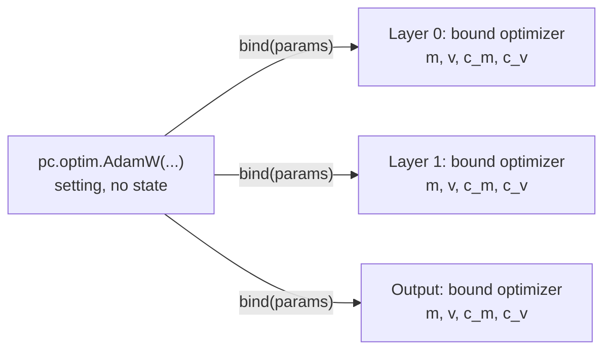

# 🔩 How mujou.pc Works

This page explains what the parts of `mujou.pc` do, how they connect, and what one update computes. After it, the names in "Nodes of your own" of [PC-ALM](pc.md) and in `examples/pc_merge.py` will be familiar. For how to use it, see [5. Learn with PC-ALM](../tutorial/5-learn-with-pc.md).

!!! abstract "What you will learn"

    - What each part of `mujou.pc` does, which parts you use directly and which you use to write nodes of your own
    - The messages that flow between the nodes, and which way the ports face
    - What a `pc.Layer` does in one `on_update(dt)`
    - What the `Tick` that `pc.clock.LearnClock` returns and `pc.TimeConstants` mean
    - How `pc.optim.SGD` and `pc.optim.AdamW` move the weights in time, and `pc.relax.Euler` and `pc.relax.HeavyBall` the deviation `r`

    You should know PyTorch and backpropagation (BP), and the nodes, ports and `dt` of [How Mujou Works](../concepts.md). You need not know predictive coding.

## What a node holds

In PC-ALM every node has its own **activity** `h`, and **predicts** it from the activity of the node before. A `pc.Layer` holds how far its activity is from the prediction, the **deviation** `r`, and sends `h = mu + r`. These are all the quantities you need.

| Quantity | Formula                              | Meaning                                                                                              |
| -------- | ------------------------------------ | ---------------------------------------------------------------------------------------------------- |
| `h_in`   |                                      | The activity that came from the node before                                                          |
| `mu`     | $\mu = f(h_{\mathrm{in}};\theta)$    | The prediction: the output of the node's `module`. $\theta$ are the weights of `module`              |
| `r`      | $r = h - \mu$                        | The deviation from the prediction, which the node holds                                              |
| `h`      | $h = \mu + r$                        | The node's own activity, which it sends to the next node                                             |
| `lam`    | $\tau_\lambda\dot\lambda = r$        | The dual: the deviation summed up over time                                                          |
| `delta`  | $\delta = r + \lambda$               | The node's error                                                                                     |
| `g_in`   | $g_{\mathrm{in}} = -J_h^\top \delta$ | The gradient sent back to the node before ($J_h$ is the Jacobian of `module` with respect to `h_in`) |
| `g`      |                                      | The sum of the `g_in` that came from the next nodes                                                  |

`r` moves to cancel the sum of `delta` and `g`, and decays with the time constant `tau.r`; `lam` keeps growing while `r` remains. When both stop, `r = 0` (`h` is the forward pass) and `lam` equals the credit of BP, $-\partial\ell/\partial h$. The gradients of the weights then equal those of BP too. The theory is in [the PC-ALM article](https://pub.sakana.ai/pc-alm/), whose nodes hold `h`; mujou's hold `r`, so that `h` follows the prediction at once whatever moves it ([section 4](#4-learnclock)).

## 1. The parts

!!! abstract "Key idea"

    You usually use `Chain`, `show`, `TimeConstants`, an optimizer, a loss and `Sample`. You use `LearnClock`, `functional` and `Activity` to write nodes of your own.

| Part                                                    | Kind      | What it does                                                                                                            | Mainly used        |
| ------------------------------------------------------- | --------- | ----------------------------------------------------------------------------------------------------------------------- | ------------------ |
| `pc.Input`                                              | Node      | Sends the `x` the host wrote as it is, as the activity `h`. Holds nothing                                               | When built by hand |
| `pc.Layer`                                              | Node      | Holds one `module`, moves `r` and `lam`, and learns the weights                                                         | When built by hand |
| `pc.Output`                                             | Node      | Holds the last `module` and the loss, gives the prediction `y_hat`, and learns the weights. Holds neither `r` nor `lam` | When built by hand |
| `pc.Chain`                                              | Network   | Makes `Input → Layer → … → Output` and connects them                                                                    | Usually            |
| `pc.show`                                               | Function  | The host writes a sample, shows it for a while, and gets the prediction made before learning                            | Usually            |
| `pc.msg.Sample`, `pc.msg.Activity`, `pc.msg.Prediction` | Messages  | The types of the data that flows ([section 2](#2-connections-and-what-flows))                                           | `Sample` usually   |
| `pc.TimeConstants`                                      | Settings  | Holds the speeds of `r` and `lam` in seconds ([section 5](#5-timeconstants))                                            | Usually            |
| `pc.optim.SGD`, `pc.optim.AdamW`                        | Settings  | The optimizers: how the weights move in time ([section 6](#6-optimizers))                                               | Usually            |
| `pc.loss.MSELoss`, `pc.loss.CrossEntropyLoss`           | Losses    | Return the loss of each sample. Given to `Output`                                                                       | Usually            |
| `pc.clock.LearnClock`                                   | Part      | Decides when to learn ([section 4](#4-learnclock))                                                                      | Nodes of your own  |
| `pc.functional`                                         | Functions | Formulas without state (`vjp`, `loss_vjp`, `relax_`). `Layer` and `Output` are written with them too                    | Nodes of your own  |
| `pc.msg.activity_spec`                                  | Function  | Makes the spec of an `Activity`                                                                                         | Nodes of your own  |

`Layer` and `Output` combine `LearnClock`, `functional` and an optimizer. With the same parts you can also make nodes that `Layer` cannot express, such as a node with two inputs.

## 2. Connections and what flows

!!! abstract "Key idea"

    Activities go forward in an `Activity`, and gradients `g_in` go back. The target `y`, `mask` and time `time` ride in the same message as the activity and are passed on.


Solid lines go forward, dotted lines back. `Input` does not read the `g_in` it gets (`x` is clamped).

| Message             | Fields                         | Flow                                |
| ------------------- | ------------------------------ | ----------------------------------- |
| `pc.msg.Sample`     | `x`, `y`, `mask`               | Host → `Input.prev`                 |
| `pc.msg.Activity`   | `h`, `y`, `mask`, `time`       | `next` → the next node's `prev`     |
| `g_in`              | A tensor (the shape of `h_in`) | `prev` → the previous node's `next` |
| `pc.msg.Prediction` | `y_hat`, `y`, `mask`, `time`   | `Output.next` → host                |

- `mask`: whether each sample has a target. A sample whose `mask` is False adds nothing to the loss, and `Layer` sets the `g_in` of its row to 0. With every `mask` False, `r` and `lam` still relax and only the weights do not learn. Evaluate this way
- `time`: the `Timestamp` at which the host wrote the input. `Timestamp(ns=0)` before the first write

### Port directions

| Node     | Port   | Kind        | Receives                                | Sends        |
| -------- | ------ | ----------- | --------------------------------------- | ------------ |
| `Input`  | `prev` | `Port`      | `Sample` (the host writes it)           | —            |
| `Input`  | `next` | `MultiPort` | `g_in` (not read)                       | `Activity`   |
| `Layer`  | `prev` | `Port`      | `Activity`                              | `g_in`       |
| `Layer`  | `next` | `MultiPort` | `g_in` from each peer (summed into `g`) | `Activity`   |
| `Output` | `prev` | `Port`      | `Activity`                              | `g_in`       |
| `Output` | `next` | `Port`      | —                                       | `Prediction` |

`next` is a `MultiPort`, so several nodes can read the activity of one node.

??? question "Why does the target travel in the same message as the activity?"

    The nodes are asynchronous, and a port holds only the latest value. If the target came through another port, `Output` would read the activity and the target at different moments, and could pair different samples. In the same message, `y` takes the path of `x` with the same delay. Even when the host writes the next sample faster than it propagates, each prediction is paired with its own target.

## 3. One update of a Layer

!!! abstract "Key idea"

    `Layer.on_update(dt)` goes "read → `tick` → `vjp` → send `g_in` → `relax_` → send `Activity` → `optimizer.step_`".

| Step | Part                | Computation                                                                                                                                                                                                                                                       |
| ---- | ------------------- | ----------------------------------------------------------------------------------------------------------------------------------------------------------------------------------------------------------------------------------------------------------------- |
| 1    | `LearnClock.tick`   | Reads the `Activity` from `prev` and gets the `Tick` (`dt`, `new`, `learn`, `elapsed`)                                                                                                                                                                            |
| 2    | `functional.vjp`    | $\mu = f(h_{\mathrm{in}})$, $g_{\mathrm{in}} = -J_h^\top\delta$ and, to learn, $g_\theta = -J_\theta^\top\delta$, in one VJP. Sends `g_in` from `prev`                                                                                                            |
| 3    | `functional.relax_` | $r \leftarrow r - \frac{dt}{\tau_h}\big((1 + \frac{\tau_h}{\tau_r})\,r + \lambda + g\big)$ (as `pc.relax.Euler`, the default relaxer, moves it; [section 7](#7-relaxers)), and then, with the moved `r`, $\lambda \leftarrow \lambda + \frac{dt}{\tau_\lambda} r$ |
| 4    | `Activity`          | Sends from `next` $h = \mu + r$, with the `y`, `mask` and `time` it received                                                                                                                                                                                      |
| 5    | `optimizer.step_`   | Divides $g_\theta$ by the number of samples $B$ and moves the weights by `tick.elapsed` seconds ([section 6](#6-optimizers)). Only when `tick.learn` is True and some `mask` is True                                                                              |

- The `delta` of step 2 is made from `r` and `lam` before step 3
- Gradients are summed over the batch, and only step 5 divides by $B$. So `lam` is the credit of each sample, and the optimizer gets the mean gradient of the batch
- The `delta` of `vjp` is not a value but a function that makes `delta` from `mu` (`mu` is computed inside `vjp`). A node that holds `r` passes `lambda mu: r + lam`
- `vjp` detaches `h_in` before it differentiates, so the graph does not reach the previous node

`Output` holds neither `r` nor `lam`. In step 2 it uses `functional.loss_vjp`, sends the gradient $\partial\ell/\partial h_{\mathrm{in}}$ of the loss $\ell = \sum_b \mathrm{mask}_b\,\ell_b$ as `g_in`, and sends a `Prediction`. When it learns and how (`optimizer.step_`) are as in `Layer`.

??? question "How does sending g_in back differ from backpropagation?"

    `g_in` is computed with the same VJP as one layer of backpropagation ($-J_h^\top\delta$), and at equilibrium `lam` follows the same recursion as the credit of backpropagation. What differs is what is done with `g_in`:

    1. The sender makes `g_in` from its own `delta`: `delta = r + lam` depends on its own state only
    2. The receiver sums the `g_in` it receives into `g`, and uses it in `relax_` (step 3) as a force that moves its own `r`. It does not pass `g` on
    3. As `r` and `lam` move, its own `delta` changes, and so does the `g_in` it sends in its next update. The credit travels back through the relaxation of each node, over time, not in one backward sweep

    There is no forward phase and backward phase, and no node waits for the others: each node updates with the latest `g` it has, which may be old. `vjp` detaches `h_in`, so no computation graph crosses nodes. The gradient equals that of backpropagation only at equilibrium, which is why a node waits `learn_interval` before it learns.

## 4. LearnClock

!!! abstract "Key idea"

    `r` and `lam` move in every update; the weights move only in the updates `LearnClock` chooses. `h = mu + r` follows the prediction in every update, so nothing more is needed when the prediction jumps.

In every update a node calls `tick = self.clock.tick(dt, act["time"], self.timer.now())`. What the returned `Tick` means:

| Field     | Meaning                                                                      | Use                        |
| --------- | ---------------------------------------------------------------------------- | -------------------------- |
| `dt`      | `dt` capped at `max_dt`                                                      | Passed to `relax_`         |
| `new`     | The `time` of the input received differs from last time (a new sample)       | Reset the relaxer          |
| `learn`   | Whether to learn in this update                                              | Whether to call `step_`    |
| `elapsed` | The sum of the capped `dt` since the node last learned, this update included | The time passed to `step_` |

`learn` is True as follows. `learn_interval` is the number of seconds given to `Layer`, `Output`, `Chain` and `LearnClock`.

| `learn_interval` | The updates that learn                                                                                                                                                                             |
| ---------------- | -------------------------------------------------------------------------------------------------------------------------------------------------------------------------------------------------- |
| Positive seconds | The first update at or after `time + learn_interval`, `time + 2 * learn_interval`, … (`time` is when the host wrote the input). But not an update where `new` is True: then the next update learns |
| `None`           | Every update (with a new input too). For a stream whose input changes every frame                                                                                                                  |
| `math.inf`       | Never. This is the only way not to learn: the optimizers reject `tau=math.inf`                                                                                                                     |

- An update where `new` is True does not learn because its `delta` is still that of the input before
- So while one input stays, the node learns every `learn_interval` seconds, and `elapsed` is about `learn_interval`
- When the input changes before the node learned, the time summed in `elapsed` is dropped
- In a node of your own, make it with `pc.clock.LearnClock.of(tau, period=..., learn_interval=...)` and put it in an attribute. That alone puts it in the node's state

??? question "Why count from the time the host wrote the input, not the time the node received it?"

    So that the nodes on a path learn at about the same time, however deep they are. Counted from the time of receipt, deeper nodes would learn later, each from a `delta` that has not yet answered the weights the nodes below have learned. Every node reads the same run's timer, so no barrier is needed.

### Why the node holds r

The prediction `mu` jumps at once with a new sample, and when the node below or the node itself learns. A node that held `h` would keep `h` where it was, and $r = h - \mu$ would suddenly grow: a false error would enter `g_in` and the gradients of the weights. A node that holds `r` sends $h = \mu + r$ with the `mu` of the update, so `h` jumps with the prediction and only `r` and `lam` carry over. A new sample does not reset `r` or `lam` either.

The cost is stability. `h` of a node moves with every `r` below it, so the credit loops back through the Jacobians of the nodes above, and without a decay of `r` a deep chain diverges. `tau.r` is that decay ([section 5](#5-timeconstants)).

## 5. TimeConstants

!!! abstract "Key idea"

    All speeds are set in seconds of the run's timer. Each node moves its equations by the `dt` that actually passed, so nodes with different periods change at the same speed per second.

`pc.TimeConstants(h=, lam=, r=)` holds the time constants of `r` and `lam`, all required. The time constant of the weights belongs to the optimizer ([section 6](#6-optimizers)).

| Value     | The speed of                        | Share moved in one update | With `math.inf`                                                                                                                  |
| --------- | ----------------------------------- | ------------------------- | -------------------------------------------------------------------------------------------------------------------------------- |
| `tau.h`   | The relaxation of the deviation `r` | `dt / tau.h`              | Not allowed (finite and > 0)                                                                                                     |
| `tau.lam` | How fast `lam` sums up `r`          | `dt / tau.lam`            | `lam` stays 0. `r` does not return to 0, and the fixed point does not match BP (plain predictive coding with `tau.r = math.inf`) |
| `tau.r`   | How fast the deviation `r` decays   | `dt / tau.r` of `r` more  | No decay. A deep chain then diverges. `tau.h` is the usual choice; the fixed point stays                                         |

Two values take their defaults from the time constants. `tau.period` (`tau.h / 4`) is the interval between a node's updates, the period of every node of a `Chain` unless it is given `period=`. `tau.max_dt` (`min(tau.h / (2 * (1 + tau.h / tau.r)), 3 * tau.lam)`, `tau.h / 4` with `tau.r = tau.h`) is the longest `dt` one update counts; the time beyond it is dropped from both the relaxation and `elapsed`.

Make the `tau` of the optimizer much larger than `tau.h`. When the weights move more slowly than the activities settle, they learn from the settled `delta` even though inference and learning run at the same time. To choose the values, see [Choosing the time constants](pc.md#choosing-the-time-constants); for the arguments, the [API reference](../api/pc.md).

??? question "Why cap dt at max_dt?"

    `g` is made from `h` as it was when the next node last updated, so the nodes are coupled one step behind. When a load stalls every node and then `dt` grows in all of them at once, this coupling makes the network diverge. Splitting the step inside a node does not prevent it, so the time one update counts is capped.

## 6. Optimizers

!!! abstract "Key idea"

    The weights move in seconds too. An optimizer is a flow in time: its time constants are in seconds, and each step moves it by the `elapsed` seconds the step covers. So how often a node learns does not change how fast its weights move per second.

### A setting, bound in each node

`pc.optim.SGD(tau=)` and `pc.optim.AdamW(tau=, tau_m=, tau_v=, eps=1e-8, weight_decay=1e-2)` are settings: frozen values without state. `Layer`, `Output` and `Chain` take one as the required argument `optimizer=`. Each node binds the setting to its own weights that require gradients, and keeps the **bound optimizer** as `self.optimizer`. The bound optimizer holds the state and moves the weights.



```python
self.optimizer = optimizer.bind(params)  # in __init__, with only the weights that learn
# in on_update, when the node learns:
self.optimizer.step_([g / B for g in g_theta], tick.elapsed)
```

- One setting can be given to every node, as `Chain` does. Each node has its own state, in its bound optimizer
- The bound optimizer is in the node's state under the key `"optimizer"`, as the `LearnClock` is under `"clock"`
- The node divides $g_\theta$ by $B$ before `step_`. The optimizer does not know the batch
- A step with `elapsed == 0` moves nothing: neither the weights nor the state

### SGD and AdamW

With the mean gradient $g = g_\theta / B$:

| Optimizer        | Flow in time                                                                                                                                        | One step of `elapsed` $= \Delta t$ seconds                                                                                                              |
| ---------------- | --------------------------------------------------------------------------------------------------------------------------------------------------- | ------------------------------------------------------------------------------------------------------------------------------------------------------- |
| `pc.optim.SGD`   | $\tau_\theta \dot\theta = -g$                                                                                                                       | $\theta \leftarrow \theta - \frac{\Delta t}{\tau_\theta} g$: SGD with the learning rate $\Delta t / \tau_\theta$                                        |
| `pc.optim.AdamW` | $\tau_m \dot m = g - m$, $\tau_v \dot v = g^2 - v$, $\tau_\theta \dot\theta = -\left(\frac{\hat m}{\sqrt{\hat v} + \varepsilon} + w\,\theta\right)$ | $m \leftarrow m + a_m (g - m)$ with $a_m = 1 - e^{-\Delta t/\tau_m}$, the same for $v$; then $\theta$ steps as AdamW with $\eta = \Delta t/\tau_\theta$ |

- `tau` is $\tau_\theta$, `tau_m` is $\tau_m$ and `tau_v` is $\tau_v$, all in seconds. Each must be finite and > 0. Never to learn, give the node `learn_interval=math.inf`
- `eps` ($\varepsilon$) must be > 0, so that a weight whose gradient has been 0 does not get `0 / 0`
- `weight_decay` ($w$) has no unit. It decays $\theta$ with the time constant $\tau_\theta / w$, as `weight_decay` works with `lr` in `torch.optim.AdamW`
- AdamW moves each weight by about $\eta$ per step, whatever the size of its gradient. To match the `lr` of Adam, take $\Delta t$, the time between two learning steps (the time each input is shown, when a node learns once per input), and set `tau` to $\Delta t$ / `lr`

### The mass c: bias correction in time

$m$ and $v$ start at 0, so at first they are too small. `torch.optim.AdamW` corrects this with the number of steps $t$: it divides $m$ by $1 - \beta_1^t$. `pc.optim.AdamW` counts no steps. Instead it keeps a **mass** $c$ for each moment: the share of the moment made of gradients so far (the rest is the zero it started from). The mass moves with the time constant of its moment.

$$\tau_m \dot c_m = 1 - c_m,\quad c_m(0) = 0,\qquad \hat m = m / c_m$$

A step moves the mass as it moves the moment: $c_m \leftarrow c_m + a_m(1 - c_m)$. After $t$ seconds of gradients, $c_m = 1 - e^{-t/\tau_m}$. With a constant $g$, $m = c_m g$, so $\hat m = g$ from the first step. $v$ has its own mass $c_v$ in the same way.

A step solves the flow exactly for a $g$ held over $\Delta t$. So the moments and masses depend on the seconds the steps add up to, not on how many steps there were. With $\tau_m = 0.1$ s:

| Steps               | $c_m$ of `pc.optim.AdamW` | A step count with $\beta_1 = e^{-0.05/0.1}$, fixed for steps of 0.05 s |
| ------------------- | ------------------------- | ---------------------------------------------------------------------- |
| Two steps of 0.05 s | $1 - e^{-1} = 0.632$      | $1 - \beta_1^2 = 0.632$                                                |
| One step of 0.1 s   | $1 - e^{-1} = 0.632$      | $1 - \beta_1^1 = 0.393$                                                |

When $\Delta t$ is constant, the steps are those of `torch.optim.AdamW(lr=Δt / tau, betas=(exp(-Δt / tau_m), exp(-Δt / tau_v)))`. So from the $\beta$ of torch, $\tau_m = -\Delta t / \ln\beta_1$, with the same $\Delta t$ between two learning steps. Learning every 32 ms, $\beta_1 = 0.9$ is about 0.30 s and $\beta_2 = 0.999$ about 32 s. To choose between SGD and AdamW and their values, see [Choosing the optimizer](pc.md#choosing-the-optimizer).

??? question "Why not use torch.optim?"

    1. Its optimizers count steps, not time. $\beta$ and `lr` are per step, so the speed per second changes with `learn_interval`, and with the uneven `elapsed` of each step
    2. Its count of steps is a float32 tensor, which stops growing after $2^{24}$ steps (about 4.7 days when learning every 24 ms). mujou is for machines that keep learning
    3. Making one imports `torch._dynamo`, which turns the GIL back on in a free-threaded Python (3.14t), for the whole process

### An optimizer of your own

An optimizer of your own is two classes. The setting inherits `pc.optim.Optimizer` and implements `bind(params)`. What `bind` returns inherits `pc.optim.BoundOptimizer` (a `mujou.Stateful`) and implements `step_(grads, elapsed)`, `state_dict()` and `load_state_dict(state)`; a class that leaves one out raises `TypeError` when it is made. Pass `bind` only the weights that learn. The [API reference](../api/pc.md) has an example.

## 7. Relaxers

!!! abstract "Key idea"

    How the deviation `r` moves along the force on it is a setting too. A relaxer is to `r` what an optimizer is to the weights: a setting without state, bound in each node, that moves `r` by `dt` seconds.

`pc.relax.Euler()` and `pc.relax.HeavyBall(tau=)` are settings. `Layer` and `Chain` take one as `relaxer=`, `pc.relax.Euler()` by default. A `Chain` gives the same setting to each of its `Layer`s, which is safe because the setting holds no state. `Output` has no `r` and takes none. Each `Layer` binds the setting to its own `r` and keeps the **bound relaxer** as `self.relaxer`. The bound relaxer holds the state and moves `r`.

```python
self.relaxer = relaxer.bind(self.r)  # in __init__
# in on_update, inside functional.relax_, with the force F:
self.relaxer.step_(r, force, dt, tau.h)
# with a new sample:
self.relaxer.reset_()
```

With the force $F = (1 + \tau_h / \tau_r)\,r + \lambda + g$:

| Relaxer              | One step of `dt` $= \Delta t$ seconds                                                      |
| -------------------- | ------------------------------------------------------------------------------------------ |
| `pc.relax.Euler`     | $r \leftarrow r - \frac{\Delta t}{\tau_h} F$                                               |
| `pc.relax.HeavyBall` | $v \leftarrow e^{-\Delta t/\tau} v + F$, then $r \leftarrow r - \frac{\Delta t}{\tau_h} v$ |

- A relaxer changes how `r` gets to the fixed point, not where it is: at the fixed point $F = 0$ and $v = 0$. The relaxer does not move $\lambda$. $\lambda$ moves after `r`, with the moved `r` ([section 3](#3-one-update-of-a-layer)), whichever relaxer moves `r`
- The velocity of `pc.relax.HeavyBall` starts at 0, so its first step is the step of `pc.relax.Euler`. Each update adds the force $F$ once, not $F\,\Delta t$: in a steady state $v = F / (1 - e^{-\Delta t/\tau})$, so a shorter period gives a larger gain, and a late update (a longer `dt`) forgets more of the velocity, which is on the stable side. A step with `dt == 0` leaves `r` and the velocity as they are
- With a new sample, $r$ and $\lambda$ are kept, but the velocity was built from the forces of the sample before, so the node calls `reset_()` and drops it. A jump of the prediction (the weights of this node or of a node below) does not move `r` or the force, and `reset_` is not called
- The bound relaxer is in the node's state under the key `"relaxer"`: `{"velocity": ...}` for `pc.relax.HeavyBall`, empty for `pc.relax.Euler`
- To choose a relaxer and its value, see [Choosing the relaxer](pc.md#choosing-the-relaxer)

### A relaxer of your own

A relaxer of your own is two classes. The setting inherits `pc.relax.Relaxer` and implements `bind(r)`, which makes the state with the shape, dtype and device of `r`. What `bind` returns inherits `pc.relax.BoundRelaxer` (a `mujou.Stateful`) and implements `step_(r, force, dt, tau_h)`, `reset_()`, `state_dict()` and `load_state_dict(state)`; a class that leaves one out raises `TypeError` when it is made. Its fixed point must be where the force is zero and its own state is at rest, or `lam` is no longer the credit of BP. The [API reference](../api/pc.md) has an example.
