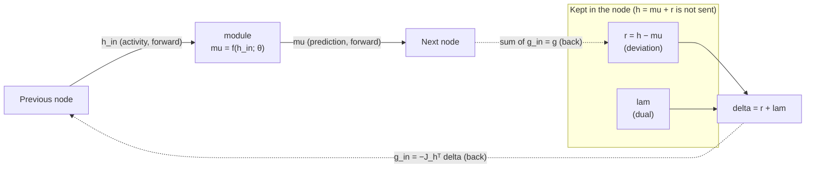
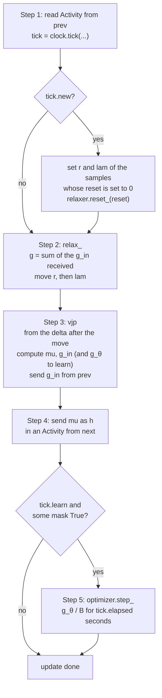
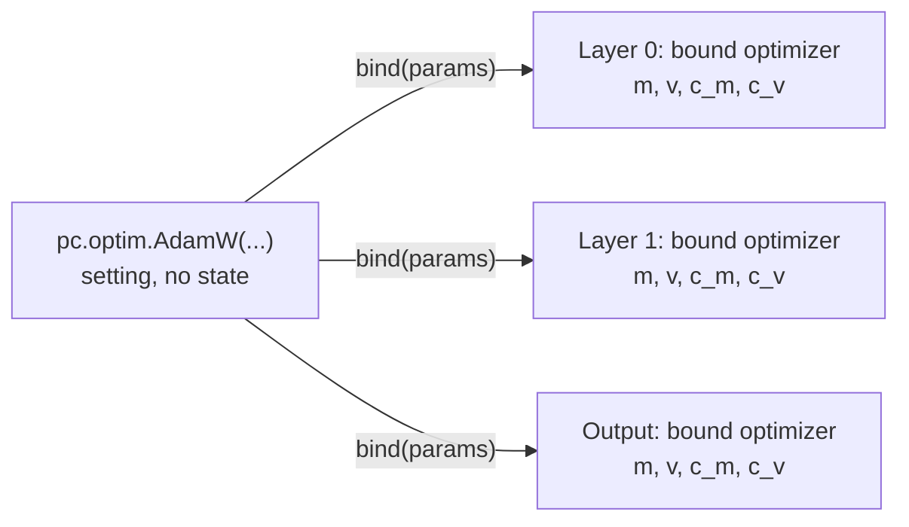

# 🔩 How mujou.pc Works

You should know PyTorch and BP, and the [nodes](../concepts.md#nodes) and [`dt`](../concepts.md#time) of How Mujou Works. You need not know predictive coding.
For how to use it, see [5. Learn with PC-ALM](../tutorial/5-learn-with-pc.md); for how to choose the values, [PC-ALM](pc.md); for the theory, [the PC-ALM article](https://pub.sakana.ai/pc-alm/).

## How it differs from BP {#vs-bp}

| Topic                    | BP in plain PyTorch                                                                     | `mujou.pc`                                                                                                                                                                                                                            |
| ------------------------ | --------------------------------------------------------------------------------------- | ------------------------------------------------------------------------------------------------------------------------------------------------------------------------------------------------------------------------------------- |
| Inference and learning   | Forward, backward and `optimizer.step()`, one by one                                    | At the same time. Every node updates on its own period, and learns while the host shows the input. No modes: a sample whose `mask` is False is not learned from                                                                       |
| The loss                 | Usually the mean over the batch                                                         | `Output` sums the loss of each sample (shaped like the batch)                                                                                                                                                                         |
| Gradients and the graph  | `.backward()` through the whole model                                                   | Only inside each node (`vjp` detaches `h_in`). Neighbors exchange activities and the gradients `g_in` as messages                                                                                                                     |
| How the credit travels   | One backward sweep. A gradient received is multiplied by the VJP and passed straight on | The sum `g` of the `g_in` received moves the node's own `r` and `lam`, and the node sends the `g_in` of the moved `delta`. One node per update toward the input. No phases, no waiting, and the latest `g` at hand (which may be old) |
| Equal to the BP gradient | Always                                                                                  | Only at equilibrium. That is why a node waits `learn_interval` before it learns                                                                                                                                                       |
| Cost of one batch        | One forward and one backward                                                            | Shown for `S` periods, `S` forwards and VJPs in each node (measured in [the PC-ALM experiments](pc-benchmarks.md#mnist))                                                                                                              |

## What a node holds {#quantities}



| Quantity | Formula                              | Meaning                                                                                              |
| -------- | ------------------------------------ | ---------------------------------------------------------------------------------------------------- |
| `h_in`   |                                      | The activity that came from the node before                                                          |
| `mu`     | $\mu = f(h_{\mathrm{in}};\theta)$    | The prediction: the output of the node's `module`. $\theta$ are the weights of `module`              |
| `r`      | $r = h - \mu$                        | The deviation from the prediction, which the node holds                                              |
| `h`      | $h = \mu + r$                        | The node's own activity. It stays in the node: the next node reads `mu`                              |
| `lam`    | $\tau_\lambda\dot\lambda = r$        | The dual: the deviation summed up over time                                                          |
| `delta`  | $\delta = r + \lambda$               | The node's error                                                                                     |
| `g_in`   | $g_{\mathrm{in}} = -J_h^\top \delta$ | The gradient sent back to the node before ($J_h$ is the Jacobian of `module` with respect to `h_in`) |
| `g`      |                                      | The sum of the `g_in` that came from the next nodes                                                  |

At the equilibrium, where both `r` and `lam` stop, `r = 0`, `lam` is the credit of BP $-\partial\ell/\partial h$, and the gradients of the weights equal those of BP ([`pc.Layer`][mujou.pc.Layer]).

### Why the node holds r and sends mu {#r-mu}

| Choice                               | The article's node: holds `h`, sends $\mu + r$                                                    | mujou's node: holds `r`, sends `mu`              |
| ------------------------------------ | ------------------------------------------------------------------------------------------------- | ------------------------------------------------ |
| When `mu` jumps                      | `h` stays, and $r = h - \mu$ suddenly grows. A false error enters `g_in` and the weight gradients | Keeps the deviation `r` as it is                 |
| The activity that flows forward      | $\mu + r$                                                                                         | The forward pass `mu`                            |
| How the credit flows                 | A loop: a move of `r` moves the activities of the nodes above and comes back to the node          | Back only                                        |
| A chain whose forward pass amplifies | Diverges however short the steps                                                                  | A step stable in one node is stable in any chain |
| Equilibrium                          | The same                                                                                          | The same                                         |

The prediction `mu` jumps at once when a new sample comes, when a node below learns and when the node itself learns; a node that holds `r` keeps its deviation in each case.

Sending `mu` instead of $\mu + r$ is the fixed prediction assumption of predictive coding, and cuts the loop through the nodes above back to the node.

## The parts {#parts}

| Part                                                           | Kind      | What it does                                                                                        | Mainly used        |
| -------------------------------------------------------------- | --------- | --------------------------------------------------------------------------------------------------- | ------------------ |
| [`pc.Chain`][mujou.pc.Chain]                                   | Network   | Makes `Input → Layer → … → Output` and connects them                                                | Usually            |
| [`pc.show`][mujou.pc.show]                                     | Function  | Writes a sample, shows it for a while, and returns the prediction made before learning              | Usually            |
| [`pc.TimeConstants`][mujou.pc.TimeConstants]                   | Settings  | How fast `r` and `lam` move ([TimeConstants](#time-constants))                                      | Usually            |
| `SGD`, `RMSProp`, `AdamW` of [`pc.optim`][mujou.pc.optim]      | Settings  | Move the weights in time ([optimizer](#optimizer))                                                  | Usually            |
| `MSELoss`, `CrossEntropyLoss` of [`pc.loss`][mujou.pc.loss]    | Losses    | The loss of each sample. Given to `Output`                                                          | Usually            |
| `Sample`, `Activity`, `Prediction` of [`pc.msg`][mujou.pc.msg] | Messages  | The types of the data that flows ([connections](#messages))                                         | `Sample` usually   |
| [`pc.Input`][mujou.pc.Input]                                   | Node      | Sends the `x` the host wrote as the activity. Holds nothing                                         | When built by hand |
| [`pc.Layer`][mujou.pc.Layer]                                   | Node      | Holds one `module`, moves `r` and `lam`, and learns the weights                                     | When built by hand |
| [`pc.Output`][mujou.pc.Output]                                 | Node      | Holds the last `module` and the loss, sends the prediction, and learns the weights. No `r` or `lam` | When built by hand |
| [`pc.relax.Euler`][mujou.pc.relax.Euler]                       | Settings  | The default relaxer, which moves `r` in time ([relaxer](#relaxer))                                  | Left as default    |
| [`pc.clock.LearnClock`][mujou.pc.clock.LearnClock]             | Part      | Decides when to learn ([LearnClock](#learnclock))                                                   | Nodes of your own  |
| [`pc.functional`][mujou.pc.functional]                         | Functions | Formulas without state (`vjp`, `loss_vjp`, `relax_`)                                                | Nodes of your own  |
| [`pc.msg.activity_spec`][mujou.pc.msg.activity_spec]           | Function  | Makes the spec of an `Activity`                                                                     | Nodes of your own  |

`Layer` and `Output` combine `LearnClock`, `functional` and an optimizer, so the same parts make nodes that `Layer` cannot express, such as a node with two inputs ([Nodes of your own](pc.md#own-node)).

## Connections and what flows {#messages}


| Message                                        | Fields                            | Flow                                |
| ---------------------------------------------- | --------------------------------- | ----------------------------------- |
| [`pc.msg.Sample`][mujou.pc.msg.Sample]         | `x`, `y`, `mask`, `reset`         | Host → `Input.prev`                 |
| [`pc.msg.Activity`][mujou.pc.msg.Activity]     | `h`, `y`, `mask`, `reset`, `time` | `next` → the next node's `prev`     |
| `g_in`                                         | A tensor (the shape of `h_in`)    | `prev` → the previous node's `next` |
| [`pc.msg.Prediction`][mujou.pc.msg.Prediction] | `y_hat`, `y`, `mask`, `time`      | `Output.next` → host                |

| Node     | Port   | Kind        | Receives                                | Sends        |
| -------- | ------ | ----------- | --------------------------------------- | ------------ |
| `Input`  | `prev` | `Port`      | `Sample` (the host writes it)           | —            |
| `Input`  | `next` | `MultiPort` | `g_in` (not read)                       | `Activity`   |
| `Layer`  | `prev` | `Port`      | `Activity`                              | `g_in`       |
| `Layer`  | `next` | `MultiPort` | `g_in` from each peer (summed into `g`) | `Activity`   |
| `Output` | `prev` | `Port`      | `Activity`                              | `g_in`       |
| `Output` | `next` | `Port`      | —                                       | `Prediction` |

Why the target `y`, `mask`, `reset` and the time `time` travel in the same message as the activity is in [Relaying the target](update-rules.md#relay-targets).

## One update of a Layer {#layer-update}



=== "Avoid: sending g_in before relaxing"

    ```python
    # The credit received goes out one update late
    mu, g_in, g_theta = pc.functional.vjp(self.module, act["h"], lambda _: self.r + self.lam, params)
    self.prev.send(g_in)
    pc.functional.relax_(self.r, self.lam, g, tick.dt, tau, self.relaxer)
    ```

=== "Write instead: relax, then send"

    ```python
    # g_in is made from the moved delta, so the credit received goes on in the same update
    pc.functional.relax_(self.r, self.lam, g, tick.dt, tau, self.relaxer)
    mu, g_in, g_theta = pc.functional.vjp(self.module, act["h"], lambda _: self.r + self.lam, params)
    self.prev.send(g_in)
    ```

| Step | `Layer`                          | `Output` (holds neither `r` nor `lam`)                                                                                                          |
| ---- | -------------------------------- | ----------------------------------------------------------------------------------------------------------------------------------------------- |
| 2    | `relax_`                         | None                                                                                                                                            |
| 3    | `vjp`. `g_in = -J_h^T delta`     | `functional.loss_vjp`. Sends the gradient $\partial\ell/\partial h_{\mathrm{in}}$ of the loss $\ell = \sum_b \mathrm{mask}_b\,\ell_b$ as `g_in` |
| 4    | Sends an `Activity`              | Sends a `Prediction`                                                                                                                            |
| 5    | When to learn, `optimizer.step_` | As in `Layer`                                                                                                                                   |

## LearnClock {#learnclock}

<figure class="mujou-diagram">
<svg viewBox="0 0 640 200" role="img" aria-label="The updates in which LearnClock learns. The host writes an input at time; the node updates at a regular interval. It learns in the first update at or after time + L, time + 2L and time + 3L, and the time between two learning updates is elapsed">
<text class="mujou-label" x="10" y="54">Host</text>
<line class="mujou-lane" x1="90" y1="50" x2="620" y2="50"/>
<g class="mujou-tick-b"><line x1="110" y1="38" x2="110" y2="62"/></g>
<text class="mujou-note" x="110" y="30" text-anchor="middle">writes (time)</text>
<text class="mujou-label" x="10" y="114">Node</text>
<line class="mujou-lane" x1="90" y1="110" x2="620" y2="110"/>
<line class="mujou-lane" x1="270" y1="40" x2="270" y2="160" stroke-dasharray="4 3"/>
<line class="mujou-lane" x1="430" y1="40" x2="430" y2="160" stroke-dasharray="4 3"/>
<line class="mujou-lane" x1="590" y1="40" x2="590" y2="160" stroke-dasharray="4 3"/>
<g class="mujou-tick-a"><line x1="130" y1="98" x2="130" y2="122"/><line x1="170" y1="98" x2="170" y2="122"/><line x1="210" y1="98" x2="210" y2="122"/><line x1="250" y1="98" x2="250" y2="122"/><line x1="330" y1="98" x2="330" y2="122"/><line x1="370" y1="98" x2="370" y2="122"/><line x1="410" y1="98" x2="410" y2="122"/><line x1="490" y1="98" x2="490" y2="122"/><line x1="530" y1="98" x2="530" y2="122"/><line x1="570" y1="98" x2="570" y2="122"/></g>
<g class="mujou-tick-b"><line x1="290" y1="92" x2="290" y2="128"/><line x1="450" y1="92" x2="450" y2="128"/><line x1="610" y1="92" x2="610" y2="128"/></g>
<text class="mujou-note" x="130" y="142" text-anchor="middle">new</text>
<text class="mujou-note" x="290" y="142" text-anchor="middle">learns</text>
<text class="mujou-note" x="450" y="142" text-anchor="middle">learns</text>
<text class="mujou-note" x="610" y="142" text-anchor="end">learns</text>
<path class="mujou-brace" d="M 292 90 Q 292 82 300 82 L 440 82 Q 448 82 448 90"/>
<text class="mujou-note" x="370" y="76" text-anchor="middle">elapsed ≈ L</text>
<line class="mujou-axis" x1="90" y1="160" x2="620" y2="160"/>
<text class="mujou-note" x="270" y="176" text-anchor="middle">time + L</text>
<text class="mujou-note" x="430" y="176" text-anchor="middle">time + 2L</text>
<text class="mujou-note" x="590" y="176" text-anchor="middle">time + 3L</text>
<text class="mujou-label" x="90" y="196">run's timer →</text>
</svg>
<figcaption>L is a positive <code>learn_interval</code></figcaption>
</figure>

Each learning step is weighted by the `elapsed` (the time since it last learned) of the [`Tick`][mujou.pc.clock.Tick], so the steps follow the gradient flow, and how far a node learns depends on time, not on how often it updates.

$$W \leftarrow W - \frac{\text{elapsed}}{\tau}\,\nabla \qquad\Longrightarrow\qquad \tau \dot W = -\nabla$$

[`LearnClock`][mujou.pc.clock.LearnClock] counts from the time `time` the host wrote the input, not the time the node received it, so the nodes on a path learn at about the same time, however deep they are (counted from receipt, deeper nodes would learn later, from a `delta` that has not yet answered the weights the nodes below have learned). How not to learn is in [Choosing the optimizer](pc.md#optimizer).

## TimeConstants {#time-constants}

| Value     | The speed of                        | With `math.inf`                                                               |
| --------- | ----------------------------------- | ----------------------------------------------------------------------------- |
| `tau.h`   | The relaxation of the deviation `r` | Not allowed (finite and > 0)                                                  |
| `tau.lam` | How fast `lam` sums up `r`          | `lam` stays 0. `r` does not return to 0, and holds the credit instead         |
| `tau.r`   | How fast the deviation `r` decays   | No decay. Still stable, but `delta` takes more than one update to follow `-g` |

??? question "Why usually `tau.r = tau.h`, `tau.lam = tau.h / 2` and a period of `tau.h / 2`?"

    With these, an update of one period moves `delta = r + lam` to `-g` exactly, without overshooting, and the node sends it back in that same update.
    A longer step overshoots, and the overshoot grows at every node it passes.
    The default period is [`period`][mujou.pc.TimeConstants.period], and the longest `dt` one update counts is [`max_dt`][mujou.pc.TimeConstants.max_dt]; both follow from the time constants.

[`TimeConstants`][mujou.pc.TimeConstants] holds the time constants of `r` and `lam` in seconds; the time constant of the weights belongs to the optimizer. How it relates to `tau.h` is in [Choosing the time constants](pc.md#choose-time-constants), and how long the credit takes to come back in [The credit round trip](pc.md#credit).

## Optimizers {#optimizer}



An optimizer moves the weights as a flow in time, and each step moves it by the `elapsed` seconds the step covers, so how often a node learns does not change how fast its weights move per second.

<figure class="mujou-diagram">
<svg viewBox="0 0 640 220" role="img" aria-label="The mass c_m over time. With τ_m = 0.1 s, c_m = 1 − e^(−t/τ_m). Two steps of 0.05 s and one step of 0.1 s both reach 0.632 at 0.1 s. Counting steps with β fixed for 0.05 s, one step of 0.1 s gives 0.393">
<line class="mujou-axis" x1="80" y1="180" x2="580" y2="180"/>
<line class="mujou-axis" x1="80" y1="180" x2="80" y2="20"/>
<line class="mujou-lane" x1="80" y1="30" x2="580" y2="30" stroke-dasharray="4 3"/>
<text class="mujou-note" x="72" y="34" text-anchor="end">1</text>
<text class="mujou-note" x="72" y="89" text-anchor="end">0.632</text>
<text class="mujou-note" x="72" y="125" text-anchor="end">0.393</text>
<text class="mujou-note" x="72" y="184" text-anchor="end">0</text>
<text class="mujou-note" x="80" y="196" text-anchor="middle">0</text>
<text class="mujou-note" x="200" y="196" text-anchor="middle">0.05</text>
<text class="mujou-note" x="320" y="196" text-anchor="middle">0.1</text>
<text class="mujou-note" x="440" y="196" text-anchor="middle">0.15</text>
<text class="mujou-note" x="560" y="196" text-anchor="middle">0.2</text>
<text class="mujou-label" x="580" y="214" text-anchor="end">total seconds of the steps (s) →</text>
<text class="mujou-label" x="12" y="16">c_m</text>
<path class="mujou-brace" d="M 80 180 L 110 162.7 L 140 146.8 L 170 133.1 L 200 121.0 L 230 110.3 L 260 100.9 L 290 92.6 L 320 85.2 L 380 73.0 L 440 63.5 L 500 56.1 L 560 50.3"/>
<text class="mujou-note" x="420" y="48" text-anchor="middle">c_m = 1 − e^(−t/τ_m), τ_m = 0.1 s</text>
<circle cx="200" cy="121" r="5" style="fill: var(--md-typeset-a-color)"/>
<circle cx="320" cy="85.2" r="5" style="fill: var(--md-typeset-a-color)"/>
<circle cx="320" cy="85.2" r="9" style="fill: none; stroke: var(--md-typeset-a-color); stroke-width: 1.5"/>
<circle cx="320" cy="121" r="5" style="fill: var(--md-accent-fg-color)"/>
<text class="mujou-note" x="336" y="100">0.05 s × 2 and 0.1 s × 1 both give 0.632</text>
<text class="mujou-note" x="336" y="136">counting steps with β fixed, 0.1 s × 1 gives 0.393</text>
</svg>
<figcaption>The mass c_m used for bias correction (the share of the moment made of gradients so far) depends only on the total seconds of the steps. A correction that counts steps drifts when the length of the steps changes</figcaption>
</figure>

| `pc.optim` ($\beta = e^{-\Delta t/\tau}$, $\Delta t$ the time between two learning steps) | The matching torch optimizer                    | Bias correction in torch                          | When the steps match (constant $\Delta t$)                                                       |
| ----------------------------------------------------------------------------------------- | ----------------------------------------------- | ------------------------------------------------- | ------------------------------------------------------------------------------------------------ |
| [`AdamW`][mujou.pc.optim.AdamW]                                                           | `torch.optim.AdamW`                             | Divides by $1 - \beta^t$, $t$ the number of steps | From the first step                                                                              |
| [`SGD`][mujou.pc.optim.SGD] (given `tau_m`)                                               | `torch.optim.SGD` (`momentum=β`, `dampening=β`) | None (the buffer starts from the first gradient)  | Once the mass is 1 (the difference decays as $\beta^t$). For a constant $g$, from the first step |
| [`RMSProp`][mujou.pc.optim.RMSProp]                                                       | `torch.optim.RMSprop` (`alpha=β`)               | None (the mean square starts from 0)              | Once the mass is 1 (the difference decays as $\beta^t$)                                          |

Why not `torch.optim` is in [`mujou.pc.optim`][mujou.pc.optim].

## Relaxers {#relaxer}

|                                  | Optimizer                                                                                  | Relaxer                                                                            |
| -------------------------------- | ------------------------------------------------------------------------------------------ | ---------------------------------------------------------------------------------- |
| What it moves                    | The weights $\theta$, by `elapsed` seconds                                                 | The deviation `r`, by `dt` seconds                                                 |
| Along                            | The gradient                                                                               | The force $F$ on `r` ([`pc.relax`][mujou.pc.relax])                                |
| Base classes for one of your own | [`Optimizer`][mujou.pc.optim.Optimizer], [`BoundOptimizer`][mujou.pc.optim.BoundOptimizer] | [`Relaxer`][mujou.pc.relax.Relaxer], [`BoundRelaxer`][mujou.pc.relax.BoundRelaxer] |
| Default                          | None (required)                                                                            | [`pc.relax.Euler()`][mujou.pc.relax.Euler]                                         |
| `Output`                         | Takes one                                                                                  | Takes none (it has no `r`)                                                         |

Neither `r` nor the force jumps when the prediction jumps, so [`reset_`][mujou.pc.relax.BoundRelaxer.reset_] is called only when the node first sees a sample whose `reset` is set.
