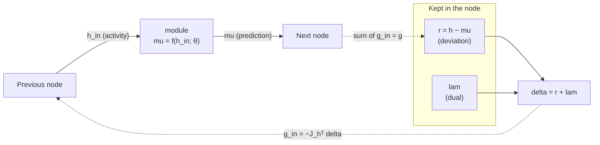
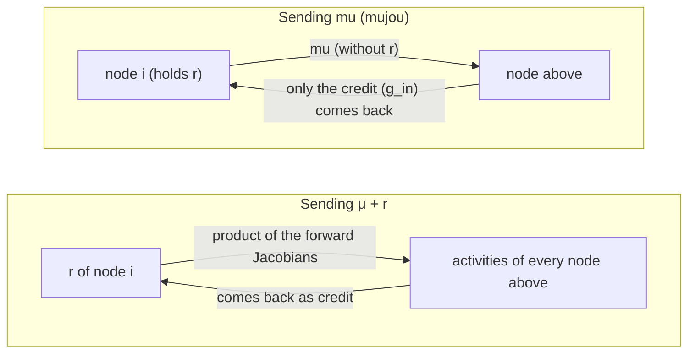
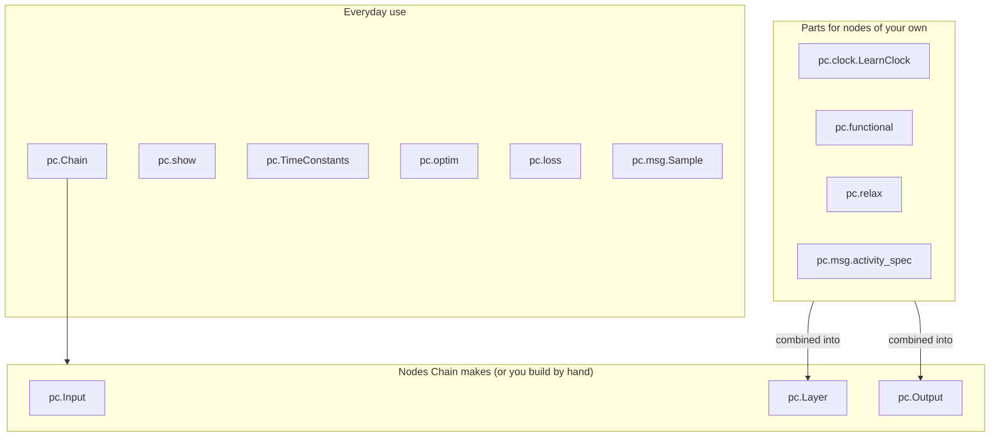
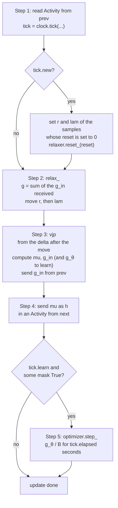
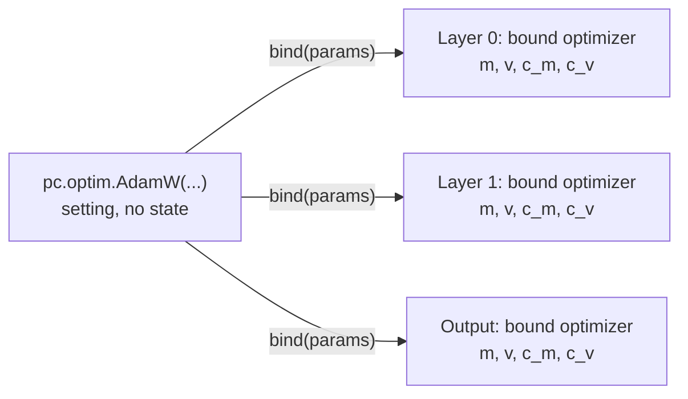

# 🔩 How mujou.pc Works

This page explains what the parts of `mujou.pc` do and what one update computes. After it, the names in "Nodes of your own" of [PC-ALM](pc.md) and in `examples/pc_merge.py` will be familiar. For how to use it, see [5. Learn with PC-ALM](../tutorial/5-learn-with-pc.md).

!!! abstract "What you will learn"

    - What each part of `mujou.pc` does, which parts you use directly and which you use to write nodes of your own
    - The messages that flow between the nodes, and which way the ports face
    - What a `pc.Layer` does in one `on_update(dt)`
    - What the `Tick` that `pc.clock.LearnClock` returns and `pc.TimeConstants` mean
    - How `pc.optim.SGD` and `pc.optim.AdamW` move the weights in time, and `pc.relax.Euler` the deviation `r`

    You should know PyTorch and backpropagation (BP), and the nodes, ports and `dt` of [How Mujou Works](../concepts.md). You need not know predictive coding.

## Sections

| Section                                                        | What it covers                                           |
| -------------------------------------------------------------- | -------------------------------------------------------- |
| [What a node holds](#what-a-node-holds)                        | What `h`, `mu`, `r`, `lam`, `delta`, `g_in` and `g` mean |
| [1. The parts](#1-the-parts)                                   | The parts of `mujou.pc` and when to use them             |
| [2. Connections and what flows](#2-connections-and-what-flows) | The messages and the directions of the ports             |
| [3. One update of a Layer](#3-one-update-of-a-layer)           | The five steps of `on_update(dt)`                        |
| [4. LearnClock](#4-learnclock)                                 | When to learn                                            |
| [5. TimeConstants](#5-timeconstants)                           | How fast `r` and `lam` move                              |
| [6. Optimizers](#6-optimizers)                                 | How the weights move in seconds                          |
| [7. Relaxers](#7-relaxers)                                     | How `r` moves in seconds                                 |

## What a node holds

!!! abstract "Key idea"

    Each node predicts its activity from the activity of the node before. A `pc.Layer` keeps the deviation `r` from the prediction and the dual `lam` to itself, and sends only the prediction `mu` to the next node.

Every node has an **activity** `h`, and **predicts** it from the activity of the node before. A `pc.Layer` holds the **deviation** `r` from the prediction, and sends the prediction `mu` to the next node. All the quantities are in the diagram and the table below.



Solid lines are activities going forward, dotted lines gradients going back. `h = mu + r` stays inside the node.

| Quantity | Formula                              | Meaning                                                                                              |
| -------- | ------------------------------------ | ---------------------------------------------------------------------------------------------------- |
| `h_in`   |                                      | The activity that came from the node before                                                          |
| `mu`     | $\mu = f(h_{\mathrm{in}};\theta)$    | The prediction: the output of the node's `module`. $\theta$ are the weights of `module`              |
| `r`      | $r = h - \mu$                        | The deviation from the prediction, which the node holds                                              |
| `h`      | $h = \mu + r$                        | The node's own activity. It stays in the node: the next node reads `mu`                              |
| `lam`    | $\tau_\lambda\dot\lambda = r$        | The dual: the deviation summed up over time                                                          |
| `delta`  | $\delta = r + \lambda$               | The node's error                                                                                     |
| `g_in`   | $g_{\mathrm{in}} = -J_h^\top \delta$ | The gradient sent back to the node before ($J_h$ is the Jacobian of `module` with respect to `h_in`) |
| `g`      |                                      | The sum of the `g_in` that came from the next nodes                                                  |

`r` and `lam` move in time as follows.

$$
\tau_h \dot r = -(r + \lambda + g) - \frac{\tau_h}{\tau_r}\,r,\qquad
\tau_\lambda \dot\lambda = r
$$

| Quantity | How it moves                                                                |
| -------- | --------------------------------------------------------------------------- |
| `r`      | To cancel the sum of `delta` and `g`. Decays with the time constant `tau.r` |
| `lam`    | Keeps growing while `r` remains                                             |

Where both `r` and `lam` stop (the equilibrium), the following holds.

| At equilibrium           | Value                                        |
| ------------------------ | -------------------------------------------- |
| `r`                      | 0. `h` is the forward pass                   |
| `lam`                    | The credit of BP, $-\partial\ell/\partial h$ |
| Gradients of the weights | Equal to those of BP                         |

The theory is in [the PC-ALM article](https://pub.sakana.ai/pc-alm/). The article's nodes hold `h` and send `h`; mujou's nodes hold `r` and send `mu`. The next section says why.

### Why the node holds r and sends mu

!!! abstract "Key idea"

    Holding `r`, the node gets no false error when the prediction `mu` jumps. Sending `mu`, the credit flows back only, so a step that is stable in one node is stable in any chain.

| Choice                               | The article's node: holds `h`, sends $\mu + r$                                                    | mujou's node: holds `r`, sends `mu`              |
| ------------------------------------ | ------------------------------------------------------------------------------------------------- | ------------------------------------------------ |
| When `mu` jumps                      | `h` stays, and $r = h - \mu$ suddenly grows. A false error enters `g_in` and the weight gradients | Keeps the deviation `r` as it is                 |
| The activity that flows forward      | $\mu + r$                                                                                         | The forward pass `mu`                            |
| How the credit flows                 | A loop: a move of `r` moves the activities of the nodes above and comes back to the node          | Back only                                        |
| A chain whose forward pass amplifies | Diverges however short the steps                                                                  | A step stable in one node is stable in any chain |
| Equilibrium                          | The same                                                                                          | The same                                         |

The prediction `mu` jumps at once (a) when a new sample comes, (b) when a node below learns, and (c) when the node itself learns. As the table shows, a node that holds `r` keeps its deviation in each case.



Sending `mu` instead of $\mu + r$ is the **fixed prediction assumption** of predictive coding. What flows forward is the forward pass, and the credit flows back only. Were $\mu + r$ sent, a move of `r` would move the activity of every node above, through the product of the Jacobians, and come back to the node as credit. In an amplifying chain, that loop diverges however short the steps. Sending `mu` cuts the loop and keeps the equilibrium, so a step that is stable in one node is stable in any chain.

!!! note "How fast the credit comes back"

    With the usual values of [section 5](#5-timeconstants), one update moves `delta` to `-g`, and in the same update the node sends it to the node before ([section 3](#3-one-update-of-a-layer)). So the credit takes at most one period per hop (one connection between two nodes) back.

### A new sample: reset or keep

!!! abstract "Key idea"

    `r` and `lam` are the credit of the samples seen so far. Set them back to 0 for an unrelated next sample; carry them over for a sample that continues the one before.

| Next sample                                       | `reset` the host writes | What each node does for that sample                  |
| ------------------------------------------------- | ----------------------- | ---------------------------------------------------- |
| Unrelated (shuffled batches, for example)         | True                    | Sets `r` and `lam` to 0 when it first sees the write |
| Continues the one before (next frame of a stream) | False                   | Carries `r` and `lam` over                           |

When the next sample has nothing to do with the last, as with shuffled batches, the credit left in `r` and `lam` is wrong for it. So the host sets `reset`, and each node sets `r` and `lam` of that sample to 0.

## 1. The parts

!!! abstract "Key idea"

    You usually use `Chain`, `show`, `TimeConstants`, an optimizer, a loss and `Sample`. You use `LearnClock`, `functional` and `Activity` to write nodes of your own.



| Part                                                    | Kind      | What it does                                                                                                            | Mainly used        |
| ------------------------------------------------------- | --------- | ----------------------------------------------------------------------------------------------------------------------- | ------------------ |
| `pc.Input`                                              | Node      | Sends the `x` the host wrote as it is, as the activity `h`. Holds nothing                                               | When built by hand |
| `pc.Layer`                                              | Node      | Holds one `module`, moves `r` and `lam`, and learns the weights                                                         | When built by hand |
| `pc.Output`                                             | Node      | Holds the last `module` and the loss, gives the prediction `y_hat`, and learns the weights. Holds neither `r` nor `lam` | When built by hand |
| `pc.Chain`                                              | Network   | Makes `Input → Layer → … → Output` and connects them                                                                    | Usually            |
| `pc.show`                                               | Function  | The host writes a sample, shows it for a while, and gets the prediction made before learning                            | Usually            |
| `pc.msg.Sample`, `pc.msg.Activity`, `pc.msg.Prediction` | Messages  | The types of the data that flows ([section 2](#2-connections-and-what-flows))                                           | `Sample` usually   |
| `pc.TimeConstants`                                      | Settings  | Holds the speeds of `r` and `lam` in seconds ([section 5](#5-timeconstants))                                            | Usually            |
| `pc.optim.SGD`, `pc.optim.RMSProp`, `pc.optim.AdamW`    | Settings  | The optimizers: how the weights move in time ([section 6](#6-optimizers))                                               | Usually            |
| `pc.relax.Euler`                                        | Settings  | The relaxer: how `r` moves in time. The default ([section 7](#7-relaxers))                                              | Left as default    |
| `pc.loss.MSELoss`, `pc.loss.CrossEntropyLoss`           | Losses    | Return the loss of each sample. Given to `Output`                                                                       | Usually            |
| `pc.clock.LearnClock`                                   | Part      | Decides when to learn ([section 4](#4-learnclock))                                                                      | Nodes of your own  |
| `pc.functional`                                         | Functions | Formulas without state (`vjp`, `loss_vjp`, `relax_`). `Layer` and `Output` are written with them too                    | Nodes of your own  |
| `pc.msg.activity_spec`                                  | Function  | Makes the spec of an `Activity`                                                                                         | Nodes of your own  |

`Layer` and `Output` combine `LearnClock`, `functional` and an optimizer. With the same parts you can also make nodes that `Layer` cannot express, such as a node with two inputs.

## 2. Connections and what flows

!!! abstract "Key idea"

    Activities (the predictions `mu`) go forward in an `Activity`, and gradients `g_in` go back. The target `y`, `mask`, `reset` and the time `time` ride in the same message as the activity and are passed on.


Solid lines go forward, dotted lines back. `Input` does not read the `g_in` it gets (`x` is clamped).

| Message             | Fields                            | Flow                                |
| ------------------- | --------------------------------- | ----------------------------------- |
| `pc.msg.Sample`     | `x`, `y`, `mask`, `reset`         | Host → `Input.prev`                 |
| `pc.msg.Activity`   | `h`, `y`, `mask`, `reset`, `time` | `next` → the next node's `prev`     |
| `g_in`              | A tensor (the shape of `h_in`)    | `prev` → the previous node's `next` |
| `pc.msg.Prediction` | `y_hat`, `y`, `mask`, `time`      | `Output.next` → host                |

The fields that travel with the activity:

| Field   | Meaning                                       | What each value does                                                                                                                                                                                                              |
| ------- | --------------------------------------------- | --------------------------------------------------------------------------------------------------------------------------------------------------------------------------------------------------------------------------------- |
| `mask`  | Whether each sample has a target              | A False sample adds nothing to the loss. `Layer` sets the `delta` of its row to 0, so the `g_in` of its row is 0 too. With every `mask` False, `r` and `lam` still relax and only the weights do not learn (use this to evaluate) |
| `reset` | Whether each sample starts anew               | When True, a `Layer` sets `r` and `lam` of that row to 0 in the update in which it first sees the write. True for shuffled samples, False for a frame that continues the one before                                               |
| `time`  | When the host wrote the input (a `Timestamp`) | `Timestamp(ns=0)` before the first write                                                                                                                                                                                          |

### Port directions

| Node     | Port   | Kind        | Receives                                | Sends        |
| -------- | ------ | ----------- | --------------------------------------- | ------------ |
| `Input`  | `prev` | `Port`      | `Sample` (the host writes it)           | —            |
| `Input`  | `next` | `MultiPort` | `g_in` (not read)                       | `Activity`   |
| `Layer`  | `prev` | `Port`      | `Activity`                              | `g_in`       |
| `Layer`  | `next` | `MultiPort` | `g_in` from each peer (summed into `g`) | `Activity`   |
| `Output` | `prev` | `Port`      | `Activity`                              | `g_in`       |
| `Output` | `next` | `Port`      | —                                       | `Prediction` |

The `next` of `Input` and `Layer` is a `MultiPort`, so several nodes can read the activity of one node (a `Layer` sums the `g_in` from each peer into `g`).

??? question "Why does the target travel in the same message as the activity?"

    The nodes are asynchronous, and a port holds only the latest value. If the target came through another port, `Output` would read the activity and the target at different moments, and could pair different samples. In the same message, `y` takes the path of `x` with the same delay. Even when the host writes the next sample faster than it propagates, each prediction is paired with its own target (diagram below).

    ```mermaid
    sequenceDiagram
        participant H as Host
        participant I as Input
        participant L as Layer
        participant O as Output
        H->>I: Sample 1 (x₁, y₁)
        I->>L: Activity (x₁, y₁)
        H->>I: Sample 2 (x₂, y₂)
        L->>O: Activity (mu₁, y₁)
        Note over O: prediction and target both belong to sample 1
    ```

## 3. One update of a Layer

!!! abstract "Key idea"

    `Layer.on_update(dt)` goes "read → `tick` → `relax_` → `vjp` → send `g_in` → send `Activity` → `optimizer.step_`". It relaxes with the `g` it has received, then sends back the `g_in` of the `delta` it has just moved.



| Step | Part                | Computation                                                                                                                                                                                                                                                                                                |
| ---- | ------------------- | ---------------------------------------------------------------------------------------------------------------------------------------------------------------------------------------------------------------------------------------------------------------------------------------------------------- |
| 1    | `LearnClock.tick`   | Reads the `Activity` from `prev` and gets the `Tick` (`dt`, `new`, `learn`, `elapsed`). With a new input (`tick.new`), sets `r` and `lam` of the samples whose `reset` is set to 0                                                                                                                         |
| 2    | `functional.relax_` | Sums the `g_in` on `next` into `g`. Then $r \leftarrow r - \frac{dt}{\tau_h}\big((1 + \frac{\tau_h}{\tau_r})\,r + \lambda + g\big)$ (as `pc.relax.Euler`, the default relaxer, moves it; [section 7](#7-relaxers)), and then, with the moved `r`, $\lambda \leftarrow \lambda + \frac{dt}{\tau_\lambda} r$ |
| 3    | `functional.vjp`    | $\mu = f(h_{\mathrm{in}})$, $g_{\mathrm{in}} = -J_h^\top\delta$ and, to learn, $g_\theta = -J_\theta^\top\delta$, in one VJP, with $\delta = r + \lambda$ after step 2 (0 for the samples whose `mask` is False). Sends `g_in` from `prev`                                                                 |
| 4    | `Activity`          | Sends from `next` the prediction $\mu$ as `h`, with the `y`, `mask`, `reset` and `time` it received                                                                                                                                                                                                        |
| 5    | `optimizer.step_`   | Divides $g_\theta$ by the number of samples $B$ and moves the weights by `tick.elapsed` seconds ([section 6](#6-optimizers)). Only when `tick.learn` is True and some `mask` is True                                                                                                                       |

### Keep the order of the steps

The `delta` of step 3 is made from `r` and `lam` after step 2 has moved them. So the credit a node receives goes on to the node before in the same update. Keep this order in a node of your own: a node that sends `g_in` before `relax_` passes on the credit it receives one update later.

=== "Avoid"

    ```python
    # Sends g_in before relaxing: the credit received goes out one update late
    mu, g_in, g_theta = pc.functional.vjp(self.module, act["h"], lambda _: self.r + self.lam, params)
    self.prev.send(g_in)
    pc.functional.relax_(self.r, self.lam, g, tick.dt, tau, self.relaxer)
    ```

=== "Write instead"

    ```python
    # Relax first, then make g_in from the moved delta and send it
    pc.functional.relax_(self.r, self.lam, g, tick.dt, tau, self.relaxer)
    mu, g_in, g_theta = pc.functional.vjp(self.module, act["h"], lambda _: self.r + self.lam, params)
    self.prev.send(g_in)
    ```

### Details

| Topic                    | What happens                                                                                                                                               |
| ------------------------ | ---------------------------------------------------------------------------------------------------------------------------------------------------------- |
| A new input (`tick.new`) | Step 1 also calls `relaxer.reset_(reset)` ([section 7](#7-relaxers))                                                                                       |
| The batch                | Gradients are summed over the batch, and only step 5 divides by $B$. `lam` is the credit of each sample; the optimizer gets the mean gradient of the batch |
| The `delta` of `vjp`     | Not a value but a function that makes `delta` from `mu` (`mu` is computed inside `vjp`). A node that holds `r` passes `lambda mu: r + lam`                 |
| The computation graph    | `vjp` detaches `h_in` before it differentiates, so the graph does not reach the previous node                                                              |

### One update of an Output

`Output` holds neither `r` nor `lam`. It differs from `Layer` as follows.

| Step | `Layer`                          | `Output`                                                                                                                                        |
| ---- | -------------------------------- | ----------------------------------------------------------------------------------------------------------------------------------------------- |
| 2    | `relax_`                         | None                                                                                                                                            |
| 3    | `vjp`. `g_in = -J_h^T delta`     | `functional.loss_vjp`. Sends the gradient $\partial\ell/\partial h_{\mathrm{in}}$ of the loss $\ell = \sum_b \mathrm{mask}_b\,\ell_b$ as `g_in` |
| 4    | Sends an `Activity`              | Sends a `Prediction`                                                                                                                            |
| 5    | When to learn, `optimizer.step_` | As in `Layer`                                                                                                                                   |

??? question "How does sending g_in back differ from backpropagation?"

    `g_in` is computed with the same VJP as one layer of backpropagation ($-J_h^\top\delta$), and at equilibrium `lam` follows the same recursion as the credit of backpropagation. What differs is what is done with `g_in`, as the table shows.

    | Topic                    | BP                                           | `mujou.pc`                                                                                               |
    | ------------------------ | -------------------------------------------- | -------------------------------------------------------------------------------------------------------- |
    | The gradient received    | Multiplied by the VJP and passed straight on | Summed into `g`, and used in `relax_` (step 2) as a force on the node's own `r` and `lam`. Not passed on |
    | The gradient sent        | Made from the gradient received              | Made from the node's own `delta = r + lam`, just moved, and sent in the same update (step 3)             |
    | How the credit travels   | One backward sweep                           | Through the relaxation of each node, one node per update toward the input                                |
    | Forward and backward     | Separate phases                              | No phases, and no node waits for all the others                                                          |
    | The `g` used             | The gradient of this sweep                   | The latest `g` at hand (which may be old)                                                                |
    | The computation graph    | The whole model                              | `vjp` detaches `h_in`, so it never crosses nodes                                                         |
    | Equal to the BP gradient | Always                                       | Only at equilibrium                                                                                      |

    The gradient equals that of BP only at equilibrium, which is why a node waits `learn_interval` before it learns.

## 4. LearnClock

!!! abstract "Key idea"

    `r` and `lam` move in every update; the weights move only in the updates `LearnClock` chooses. The node sends the `mu` of each update, so nothing more is needed when the prediction jumps.

In every update a node calls:

```python
tick = self.clock.tick(dt, act["time"], self.timer.now())
```

What the returned `Tick` means:

| Field     | Meaning                                                                      | Use                               |
| --------- | ---------------------------------------------------------------------------- | --------------------------------- |
| `dt`      | `dt` capped at `max_dt`                                                      | Passed to `relax_`                |
| `new`     | The `time` of the input received differs from last time (a new sample)       | Reset the samples that start anew |
| `learn`   | Whether to learn in this update                                              | Whether to call `step_`           |
| `elapsed` | The sum of the capped `dt` since the node last learned, this update included | The time passed to `step_`        |

`learn` is True as follows. `learn_interval` is the number of seconds given to `Layer`, `Output`, `Chain` and `LearnClock`.

| `learn_interval` | The updates that learn                                                                                                                                                                             |
| ---------------- | -------------------------------------------------------------------------------------------------------------------------------------------------------------------------------------------------- |
| Positive seconds | The first update at or after `time + learn_interval`, `time + 2 * learn_interval`, … (`time` is when the host wrote the input). But not an update where `new` is True: then the next update learns |
| `None`           | Every update (with a new input too). For a stream whose input changes every frame                                                                                                                  |
| `math.inf`       | Never. This is the only way not to learn (the optimizers reject `tau=math.inf`)                                                                                                                    |

<figure class="mujou-diagram">
<svg viewBox="0 0 640 200" role="img" aria-label="The updates in which LearnClock learns. The host writes an input at time; the node updates at a regular interval. It learns in the first update at or after time + L, time + 2L and time + 3L, and the time between two learning updates is elapsed">
<text class="mujou-label" x="10" y="54">Host</text>
<line class="mujou-lane" x1="90" y1="50" x2="620" y2="50"/>
<g class="mujou-tick-b"><line x1="110" y1="38" x2="110" y2="62"/></g>
<text class="mujou-note" x="110" y="30" text-anchor="middle">writes (time)</text>
<text class="mujou-label" x="10" y="114">Node</text>
<line class="mujou-lane" x1="90" y1="110" x2="620" y2="110"/>
<line class="mujou-lane" x1="270" y1="40" x2="270" y2="160" stroke-dasharray="4 3"/>
<line class="mujou-lane" x1="430" y1="40" x2="430" y2="160" stroke-dasharray="4 3"/>
<line class="mujou-lane" x1="590" y1="40" x2="590" y2="160" stroke-dasharray="4 3"/>
<g class="mujou-tick-a"><line x1="130" y1="98" x2="130" y2="122"/><line x1="170" y1="98" x2="170" y2="122"/><line x1="210" y1="98" x2="210" y2="122"/><line x1="250" y1="98" x2="250" y2="122"/><line x1="330" y1="98" x2="330" y2="122"/><line x1="370" y1="98" x2="370" y2="122"/><line x1="410" y1="98" x2="410" y2="122"/><line x1="490" y1="98" x2="490" y2="122"/><line x1="530" y1="98" x2="530" y2="122"/><line x1="570" y1="98" x2="570" y2="122"/></g>
<g class="mujou-tick-b"><line x1="290" y1="92" x2="290" y2="128"/><line x1="450" y1="92" x2="450" y2="128"/><line x1="610" y1="92" x2="610" y2="128"/></g>
<text class="mujou-note" x="130" y="142" text-anchor="middle">new</text>
<text class="mujou-note" x="290" y="142" text-anchor="middle">learns</text>
<text class="mujou-note" x="450" y="142" text-anchor="middle">learns</text>
<text class="mujou-note" x="610" y="142" text-anchor="end">learns</text>
<path class="mujou-brace" d="M 292 90 Q 292 82 300 82 L 440 82 Q 448 82 448 90"/>
<text class="mujou-note" x="370" y="76" text-anchor="middle">elapsed ≈ L</text>
<line class="mujou-axis" x1="90" y1="160" x2="620" y2="160"/>
<text class="mujou-note" x="270" y="176" text-anchor="middle">time + L</text>
<text class="mujou-note" x="430" y="176" text-anchor="middle">time + 2L</text>
<text class="mujou-note" x="590" y="176" text-anchor="middle">time + 3L</text>
<text class="mujou-label" x="90" y="196">run's timer →</text>
</svg>
<figcaption>L is a positive <code>learn_interval</code>. Thin ticks are the node's updates, thick ticks the updates that learn: the first update at or after <code>time + k·L</code></figcaption>
</figure>

| Case                                      | What happens                                                                                                             |
| ----------------------------------------- | ------------------------------------------------------------------------------------------------------------------------ |
| An update where `new` is True             | Does not learn. The `g` it relaxes with is still that of the input before (the next node has not seen the new input yet) |
| While one input stays                     | Learns every `learn_interval` seconds. `elapsed` is about `learn_interval`                                               |
| The input changes before the node learned | The time summed in `elapsed` is dropped                                                                                  |

In a node of your own, make it as follows and put it in an attribute.

```python
self.clock = pc.clock.LearnClock.of(tau, period=self.period, learn_interval=...)
```

Putting the `LearnClock` in an attribute is enough to put it in the node's state (under the key `"clock"`). Without `max_dt`, `LearnClock.of` uses `tau.max_dt` (as `Layer` does).

??? question "Why count from the time the host wrote the input, not the time the node received it?"

    So that the nodes on a path learn at about the same time, however deep they are. Counted from the time of receipt, deeper nodes would learn later, each from a `delta` that has not yet answered the weights the nodes below have learned. Every node reads the same run's timer, so no barrier is needed.

## 5. TimeConstants

!!! abstract "Key idea"

    All speeds are set in seconds of the run's timer. Each node moves its equations by the `dt` that actually passed, so nodes with different periods change at the same speed per second.

```python
tau = pc.TimeConstants(h=4e-3, lam=2e-3, r=4e-3)  # period 2e-3 s
```

`pc.TimeConstants` holds the time constants of `r` and `lam` in seconds. `h`, `lam` and `r` are all required keyword arguments, with no defaults. The time constant of the weights belongs to the optimizer, not to `TimeConstants` ([section 6](#6-optimizers)).

| Value     | The speed of                        | Share moved in one update              | With `math.inf`                                                               |
| --------- | ----------------------------------- | -------------------------------------- | ----------------------------------------------------------------------------- |
| `tau.h`   | The relaxation of the deviation `r` | `dt / tau.h`                           | Not allowed (finite and > 0)                                                  |
| `tau.lam` | How fast `lam` sums up `r`          | `dt / tau.lam`                         | `lam` stays 0. `r` does not return to 0, and holds the credit instead         |
| `tau.r`   | How fast the deviation `r` decays   | A further `dt / tau.r` of `r` toward 0 | No decay. Still stable, but `delta` takes more than one update to follow `-g` |

### Values derived from the time constants

| Value        | Formula                        | With `tau.r = tau.h`                  | Meaning                                                                                                  |
| ------------ | ------------------------------ | ------------------------------------- | -------------------------------------------------------------------------------------------------------- |
| `tau.period` | `tau.h / (1 + tau.h / tau.r)`  | `tau.h / 2`                           | The interval between a node's updates. The period of every node of a `Chain` not given `period=`         |
| `tau.max_dt` | `min(tau.period, 2 * tau.lam)` | `tau.h / 2` if `tau.lam >= tau.h / 4` | The longest `dt` one update counts. The time beyond it is dropped from both the relaxation and `elapsed` |

!!! warning "Keep the period no longer than `max_dt`"

    A node whose period is longer than its own `max_dt` raises `ValueError`.

### The usual values

| Value     | Usual value           |
| --------- | --------------------- |
| `tau.r`   | `tau.h`               |
| `tau.lam` | `tau.h / 2`           |
| Period    | `tau.h / 2` (default) |

These three go together. With them, an update of one period moves `delta = r + lam` to `-g` exactly, without overshooting, and the node sends it back in that same update. A longer step overshoots, and the overshoot grows at every node it passes. With `hops` the number of connections from the `Input` to the `Output`, the credit comes back as follows.

| How the nodes run                                  | Credit back, per hop | Round trip: the input forward to the `Output`, the credit back to the first `Layer` |
| -------------------------------------------------- | -------------------- | ----------------------------------------------------------------------------------- |
| `ManualRun.step(dt)`, every node once in each step | 1 step               | `2 * hops` steps                                                                    |
| A free run, every node with the same period        | At most 1 period     | About `hops` periods                                                                |

### The equilibrium and the speed of the weights

| Setting                         | Equilibrium and behavior                                                                          |
| ------------------------------- | ------------------------------------------------------------------------------------------------- |
| `tau.r` (any value)             | Does not move the equilibrium. `lam` sums up `r`, so `r = 0` at equilibrium                       |
| `tau.lam = tau.r = math.inf`    | Predictive coding with the fixed prediction assumption. The error `r` settles at the credit of BP |
| The optimizer's `tau` ≫ `tau.h` | The weights learn from the `delta` after the activities have settled                              |

Make the `tau` of the optimizer much larger than `tau.h`. When the weights move more slowly than the activities settle, they learn from the settled `delta` even though inference and learning run at the same time. To choose the values, see [Choosing the time constants](pc.md#choosing-the-time-constants); for the arguments, the [API reference](../api/pc.md).

??? question "Why cap dt at max_dt?"

    The steps are explicit: a step much longer than the default overshoots, and `r` and `lam` diverge. After a load stalls a node, its next `dt` grows, so the time one update counts is capped at `max_dt`, and the time beyond it is dropped.

## 6. Optimizers

!!! abstract "Key idea"

    The weights move in seconds too. An optimizer is a flow in time: its time constants are in seconds, and each step moves it by the `elapsed` seconds the step covers. So how often a node learns does not change how fast its weights move per second.

### A setting, bound in each node

| Optimizer setting  | Arguments (defaults)                                        |
| ------------------ | ----------------------------------------------------------- |
| `pc.optim.SGD`     | `tau=`, `tau_m=None`                                        |
| `pc.optim.RMSProp` | `tau=`, `tau_v=`, `eps=1e-8`                                |
| `pc.optim.AdamW`   | `tau=`, `tau_m=`, `tau_v=`, `eps=1e-8`, `weight_decay=1e-2` |

These three are settings: frozen values without state. `Layer`, `Output` and `Chain` take one as the required argument `optimizer=`. Each node binds the setting to its own weights that require gradients, and keeps the **bound optimizer** as `self.optimizer`. The bound optimizer holds the state and moves the weights.



```python
self.optimizer = optimizer.bind(params)  # in __init__, with only the weights that learn
# in on_update, when the node learns:
self.optimizer.step_([g / B for g in g_theta], tick.elapsed)
```

|                    | Setting (`pc.optim.Optimizer`)                | Bound optimizer (`pc.optim.BoundOptimizer`)                                                         |
| ------------------ | --------------------------------------------- | --------------------------------------------------------------------------------------------------- |
| State              | None (frozen)                                 | Yes (the moments and so on)                                                                         |
| Sharing            | One may be given to every node (`Chain` does) | One per node                                                                                        |
| Where it lives     | The argument `optimizer=`                     | `self.optimizer`. The node's state under the key `"optimizer"` (as `LearnClock` is under `"clock"`) |
| Moves the weights? | No                                            | Yes, with `step_(grads, elapsed)`                                                                   |

| `step_` contract | What it means                                                                               |
| ---------------- | ------------------------------------------------------------------------------------------- |
| The batch        | The node divides $g_\theta$ by $B$ before passing it. The optimizer does not know the batch |
| `elapsed == 0`   | Moves nothing: neither the weights nor the state                                            |

### SGD, RMSProp and AdamW

With the mean gradient $g = g_\theta / B$:

| Optimizer                   | Flow in time                                                                                                                                        | One step of `elapsed` $= \Delta t$ seconds                                                                                                              |
| --------------------------- | --------------------------------------------------------------------------------------------------------------------------------------------------- | ------------------------------------------------------------------------------------------------------------------------------------------------------- |
| `pc.optim.SGD`              | $\tau_\theta \dot\theta = -g$                                                                                                                       | $\theta \leftarrow \theta - \frac{\Delta t}{\tau_\theta} g$: SGD with the learning rate $\Delta t / \tau_\theta$                                        |
| `pc.optim.SGD` with `tau_m` | $\tau_m \dot m = g - m$, $\tau_\theta \dot\theta = -\hat m$                                                                                         | $m \leftarrow m + a_m (g - m)$; then $\theta \leftarrow \theta - \frac{\Delta t}{\tau_\theta} \hat m$                                                   |
| `pc.optim.RMSProp`          | $\tau_v \dot v = g^2 - v$, $\tau_\theta \dot\theta = -\frac{g}{\sqrt{\hat v} + \varepsilon}$                                                        | $v \leftarrow v + a_v (g^2 - v)$ with $a_v = 1 - e^{-\Delta t/\tau_v}$; then $\theta \leftarrow \theta - \eta\,\frac{g}{\sqrt{\hat v} + \varepsilon}$   |
| `pc.optim.AdamW`            | $\tau_m \dot m = g - m$, $\tau_v \dot v = g^2 - v$, $\tau_\theta \dot\theta = -\left(\frac{\hat m}{\sqrt{\hat v} + \varepsilon} + w\,\theta\right)$ | $m \leftarrow m + a_m (g - m)$ with $a_m = 1 - e^{-\Delta t/\tau_m}$, the same for $v$; then $\theta$ steps as AdamW with $\eta = \Delta t/\tau_\theta$ |

The arguments and their symbols:

| Argument       | Symbol        | Unit    | Condition                                          | Meaning                                                                                                            |
| -------------- | ------------- | ------- | -------------------------------------------------- | ------------------------------------------------------------------------------------------------------------------ |
| `tau`          | $\tau_\theta$ | seconds | Finite and > 0                                     | The time constant of the weights. Never to learn, give the node `learn_interval=math.inf`                          |
| `tau_m`        | $\tau_m$      | seconds | Finite and > 0 (for SGD, also `None`: no momentum) | The time constant of the first moment                                                                              |
| `tau_v`        | $\tau_v$      | seconds | Finite and > 0                                     | The time constant of the second moment                                                                             |
| `eps`          | $\varepsilon$ | —       | > 0                                                | Keeps a weight whose gradient has been 0 from getting `0 / 0`                                                      |
| `weight_decay` | $w$           | none    | Finite and >= 0                                    | Decays $\theta$ with the time constant $\tau_\theta / w$, as `weight_decay` works with `lr` in `torch.optim.AdamW` |

How each optimizer behaves:

| Optimizer         | Behavior                                                                                                                                                         |
| ----------------- | ---------------------------------------------------------------------------------------------------------------------------------------------------------------- |
| SGD with momentum | Averages $g$ and keeps the learning rate. With a constant $g$, $\hat m = g$ and the step is that of SGD without momentum. $\tau_m \to 0$ is SGD without momentum |
| RMSProp           | AdamW without the first moment and the weight decay: $g$ in place of $\hat m$                                                                                    |
| AdamW             | Moves each weight by about $\eta$ per step, whatever the size of its gradient                                                                                    |

To match the `lr` of Adam, take $\Delta t$, the time between two learning steps (the time each input is shown, when a node learns once per input), and set `tau` to $\Delta t$ / `lr`.

### The mass c: bias correction in time

!!! abstract "Key idea"

    The moments start at 0, so at first they are too small. Instead of counting steps, `pc.optim` corrects them with a "mass" $c$ for each moment, which moves in time.

| Correction     | `torch.optim.AdamW`       | `pc.optim.AdamW`                 |
| -------------- | ------------------------- | -------------------------------- |
| What it counts | The number of steps $t$   | Time: a mass $c$ for each moment |
| Correcting $m$ | Divide by $1 - \beta_1^t$ | $\hat m = m / c_m$               |

The mass $c$ is the share of the moment made of gradients so far (the rest is the zero it started from), and it moves with the time constant of its moment (below).

$$\tau_m \dot c_m = 1 - c_m,\quad c_m(0) = 0,\qquad \hat m = m / c_m$$

A step moves the mass as it moves the moment: $c_m \leftarrow c_m + a_m(1 - c_m)$. After $t$ seconds of gradients, $c_m = 1 - e^{-t/\tau_m}$. With a constant $g$, $m = c_m g$, so $\hat m = g$ from the first step. $v$ has its own mass $c_v$ in the same way. A step solves the flow exactly for a $g$ held over $\Delta t$, so the moments and masses depend on the seconds the steps add up to, not on how many steps there were. The table and figure below show $\tau_m = 0.1$ s.

| Steps               | $c_m$ of `pc.optim.AdamW` | A step count with $\beta_1 = e^{-0.05/0.1}$, fixed for steps of 0.05 s |
| ------------------- | ------------------------- | ---------------------------------------------------------------------- |
| Two steps of 0.05 s | $1 - e^{-1} = 0.632$      | $1 - \beta_1^2 = 0.632$                                                |
| One step of 0.1 s   | $1 - e^{-1} = 0.632$      | $1 - \beta_1^1 = 0.393$                                                |

<figure class="mujou-diagram">
<svg viewBox="0 0 640 220" role="img" aria-label="The mass c_m over time. With τ_m = 0.1 s, c_m = 1 − e^(−t/τ_m). Two steps of 0.05 s and one step of 0.1 s both reach 0.632 at 0.1 s. Counting steps with β fixed for 0.05 s, one step of 0.1 s gives 0.393">
<line class="mujou-axis" x1="80" y1="180" x2="580" y2="180"/>
<line class="mujou-axis" x1="80" y1="180" x2="80" y2="20"/>
<line class="mujou-lane" x1="80" y1="30" x2="580" y2="30" stroke-dasharray="4 3"/>
<text class="mujou-note" x="72" y="34" text-anchor="end">1</text>
<text class="mujou-note" x="72" y="89" text-anchor="end">0.632</text>
<text class="mujou-note" x="72" y="125" text-anchor="end">0.393</text>
<text class="mujou-note" x="72" y="184" text-anchor="end">0</text>
<text class="mujou-note" x="80" y="196" text-anchor="middle">0</text>
<text class="mujou-note" x="200" y="196" text-anchor="middle">0.05</text>
<text class="mujou-note" x="320" y="196" text-anchor="middle">0.1</text>
<text class="mujou-note" x="440" y="196" text-anchor="middle">0.15</text>
<text class="mujou-note" x="560" y="196" text-anchor="middle">0.2</text>
<text class="mujou-label" x="580" y="214" text-anchor="end">total seconds of the steps (s) →</text>
<text class="mujou-label" x="12" y="16">c_m</text>
<path class="mujou-brace" d="M 80 180 L 110 162.7 L 140 146.8 L 170 133.1 L 200 121.0 L 230 110.3 L 260 100.9 L 290 92.6 L 320 85.2 L 380 73.0 L 440 63.5 L 500 56.1 L 560 50.3"/>
<text class="mujou-note" x="420" y="48" text-anchor="middle">c_m = 1 − e^(−t/τ_m), τ_m = 0.1 s</text>
<circle cx="200" cy="121" r="5" style="fill: var(--md-typeset-a-color)"/>
<circle cx="320" cy="85.2" r="5" style="fill: var(--md-typeset-a-color)"/>
<circle cx="320" cy="85.2" r="9" style="fill: none; stroke: var(--md-typeset-a-color); stroke-width: 1.5"/>
<circle cx="320" cy="121" r="5" style="fill: var(--md-accent-fg-color)"/>
<text class="mujou-note" x="336" y="100">0.05 s × 2 and 0.1 s × 1 both give 0.632</text>
<text class="mujou-note" x="336" y="136">counting steps with β fixed, 0.1 s × 1 gives 0.393</text>
</svg>
<figcaption>The mass depends only on the total seconds of the steps. A correction that counts steps drifts when the length of the steps changes</figcaption>
</figure>

The momentum of SGD has its mass $c_m$, and RMSProp its mass $c_v$, as AdamW does.

#### Matching torch.optim

Let $\Delta t$ be the time between two learning steps. When $\Delta t$ is constant, the steps of `pc.optim` match the torch optimizers in the table below. So from the $\beta$ of torch, $\tau_m = -\Delta t / \ln\beta_1$. Learning every 32 ms, $\beta_1 = 0.9$ is about 0.30 s and $\beta_2 = 0.999$ about 32 s.

| `pc.optim`           | The matching torch optimizer ($\beta = e^{-\Delta t/\tau_m}$)                | When they match                                                                                                   |
| -------------------- | ---------------------------------------------------------------------------- | ----------------------------------------------------------------------------------------------------------------- |
| `AdamW`              | `torch.optim.AdamW(lr=Δt / tau, betas=(exp(-Δt / tau_m), exp(-Δt / tau_v)))` | From the first step, with a constant $\Delta t$                                                                   |
| `SGD` (with `tau_m`) | `torch.optim.SGD(lr=Δt / tau, momentum=β, dampening=β)`                      | Once the mass is 1. The difference decays as the power $t$ of `momentum`. For a constant $g$, from the first step |
| `RMSProp`            | `torch.optim.RMSprop(lr=Δt / tau, alpha=exp(-Δt / tau_v), eps=eps)`          | Once the mass is 1. The difference decays as the power $t$ of `alpha`                                             |

`torch.optim.SGD` and `torch.optim.RMSprop` have no bias correction, so they match only once the mass is 1. To choose between SGD and AdamW and their values, see [Choosing the optimizer](pc.md#choosing-the-optimizer).

??? question "Why not use torch.optim?"

    | Reason                 | Details                                                                                                                                                      |
    | ---------------------- | ------------------------------------------------------------------------------------------------------------------------------------------------------------ |
    | It counts steps        | Not time. $\beta$ and `lr` are per step, so the speed per second changes with `learn_interval`, and with the uneven `elapsed` of each step                   |
    | Its step count stops   | The count is a float32 tensor, which stops growing after $2^{24}$ steps (about 4.7 days when learning every 24 ms). mujou is for machines that keep learning |
    | It brings the GIL back | Making one imports `torch._dynamo`, which turns the GIL back on in a free-threaded Python (3.14t), for the whole process                                     |

### An optimizer of your own

| Class                                     | Inherits                                       | Implements                                                        |
| ----------------------------------------- | ---------------------------------------------- | ----------------------------------------------------------------- |
| The setting                               | `pc.optim.Optimizer`                           | `bind(params)`                                                    |
| What `bind` returns (the bound optimizer) | `pc.optim.BoundOptimizer` (a `mujou.Stateful`) | `step_(grads, elapsed)`, `state_dict()`, `load_state_dict(state)` |

An optimizer of your own is these two classes. A class that leaves out one of the methods raises `TypeError` when it is made. Pass `bind` only the weights that learn. The [API reference](../api/pc.md) has an example.

## 7. Relaxers

!!! abstract "Key idea"

    How the deviation `r` moves along the force on it is a setting too. A relaxer is to `r` what an optimizer is to the weights: a setting without state, bound in each node, that moves `r` by `dt` seconds.

Side by side with the optimizer:

|                           | Optimizer                                 | Relaxer                                                           |
| ------------------------- | ----------------------------------------- | ----------------------------------------------------------------- |
| What it moves             | The weights $\theta$                      | The deviation `r`                                                 |
| Along                     | The gradient                              | The force $F$                                                     |
| Time per step             | `elapsed`                                 | `dt`                                                              |
| Base of the setting       | `pc.optim.Optimizer`                      | `pc.relax.Relaxer`                                                |
| Binding                   | `optimizer.bind(params)`                  | `relaxer.bind(r)`                                                 |
| What binding gives        | `pc.optim.BoundOptimizer`                 | `pc.relax.BoundRelaxer`                                           |
| Node attribute, state key | `self.optimizer`, `"optimizer"`           | `self.relaxer`, `"relaxer"`                                       |
| Taken by                  | `Layer`, `Output`, `Chain` (`optimizer=`) | `Layer`, `Chain` (`relaxer=`). `Output` has no `r`, so takes none |
| Default                   | None (required)                           | `pc.relax.Euler()`                                                |
| What mujou has            | `SGD`, `RMSProp`, `AdamW`, `TimeScaled`   | `Euler` only. Others are your own                                 |

A relaxer setting holds no state, so it is safe to share, and `Chain` gives the same setting to each `Layer`. Each `Layer` binds the setting to its own `r` and keeps the **bound relaxer** as `self.relaxer`. The bound relaxer holds the state and moves `r`.

```python
self.relaxer = relaxer.bind(self.r)  # in __init__
# in on_update, inside functional.relax_, with the force F:
self.relaxer.step_(r, force, dt, tau.h)
# with a new input, for the samples whose reset is set:
self.relaxer.reset_(act["reset"])
```

With the force $F = (1 + \tau_h / \tau_r)\,r + \lambda + g$, one step of `pc.relax.Euler` of `dt` $= \Delta t$ seconds is:

$$r \leftarrow r - \frac{\Delta t}{\tau_h} F$$

| Case                                                         | What the node and the relaxer do                                                                                                      |
| ------------------------------------------------------------ | ------------------------------------------------------------------------------------------------------------------------------------- |
| The fixed point                                              | $F = 0$, and the state of the relaxer is at rest. A relaxer changes how `r` gets to the fixed point, not where it is                  |
| Updating $\lambda$                                           | The relaxer does not move it. Whichever relaxer moves `r`, $\lambda$ moves with the moved `r` ([section 3](#3-one-update-of-a-layer)) |
| A new input, for samples whose `reset` is set                | Sets $r$ and $\lambda$ to 0 and calls `reset_(reset)`. A relaxer that remembers forces (a velocity, say) drops them for those samples |
| A new input, for samples that continue                       | Keeps $r$, $\lambda$ and the state of the relaxer                                                                                     |
| The prediction jumps (the weights of this node or one below) | Neither $r$ nor the force jumps, so `reset_` is not called                                                                            |

The bound relaxer is in the node's state under the key `"relaxer"`. `pc.relax.Euler` has no state, so its state is empty and its `reset_` does nothing. To choose a relaxer and its value, see [Choosing the relaxer](pc.md#choosing-the-relaxer).

### A relaxer of your own

| Class                                   | Inherits                                     | Implements                                                                                |
| --------------------------------------- | -------------------------------------------- | ----------------------------------------------------------------------------------------- |
| The setting                             | `pc.relax.Relaxer`                           | `bind(r)`, which makes the state with the shape, dtype and device of `r`                  |
| What `bind` returns (the bound relaxer) | `pc.relax.BoundRelaxer` (a `mujou.Stateful`) | `step_(r, force, dt, tau_h)`, `reset_(samples)`, `state_dict()`, `load_state_dict(state)` |

A relaxer of your own is these two classes. A class that leaves out one of the methods raises `TypeError` when it is made. The [API reference](../api/pc.md) has an example.

!!! warning "The fixed point is where the force is zero"

    The fixed point of a relaxer of your own must be where the force $F$ is 0 and the relaxer's own state is at rest. Otherwise `lam` is no longer the credit of BP.
