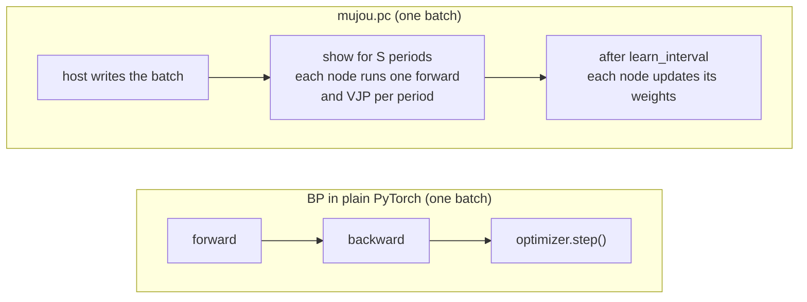
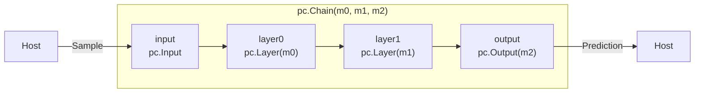
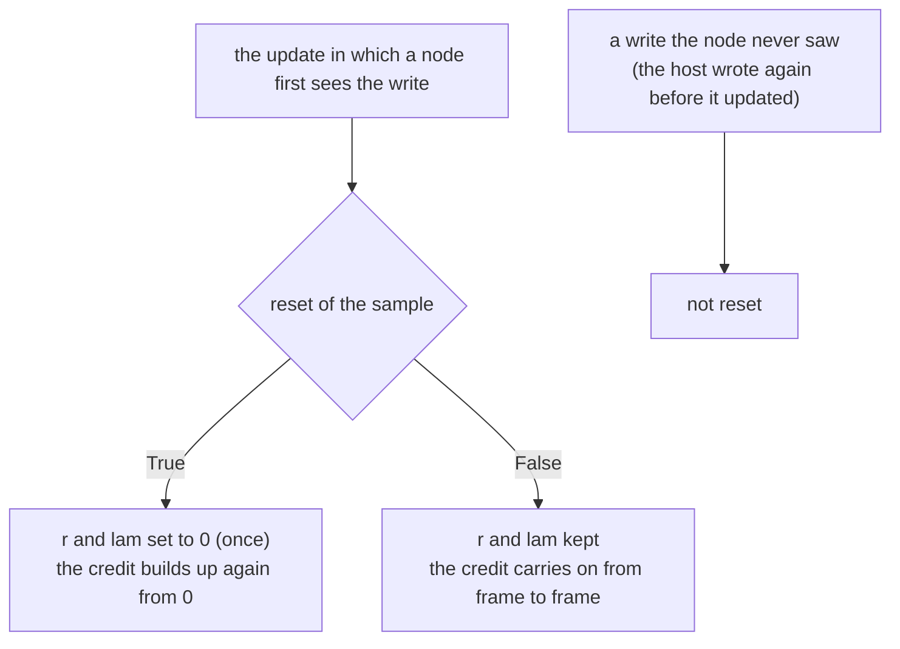
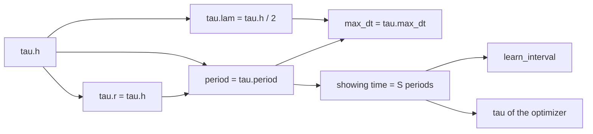
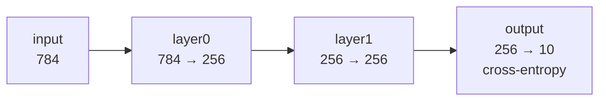
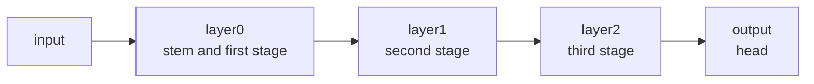
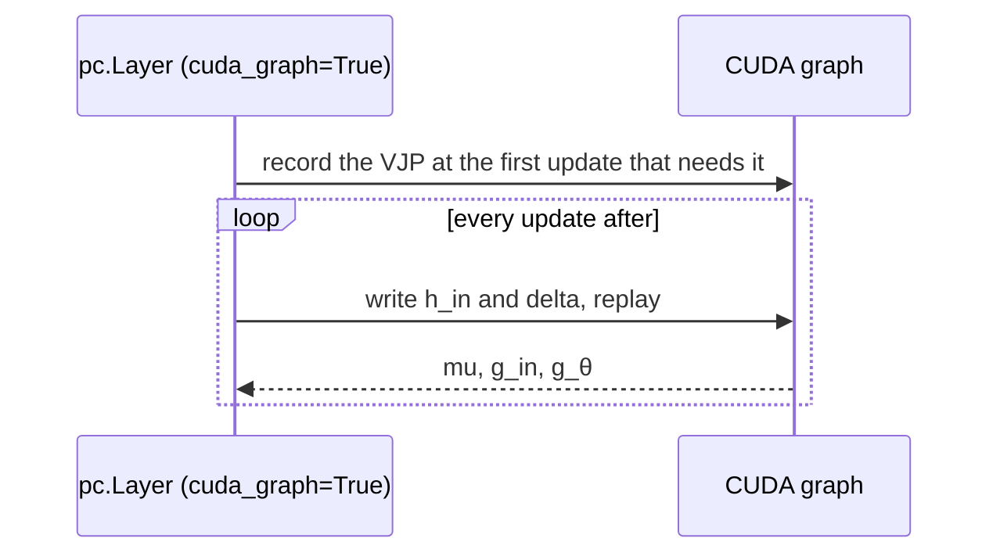
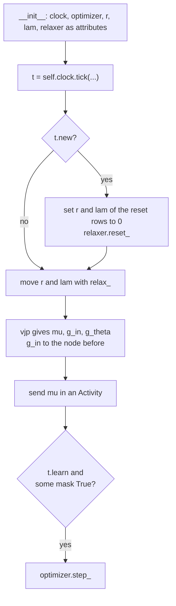
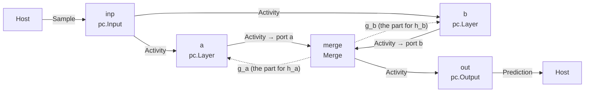

# 🧠 PC-ALM

The module `mujou.pc` learns a PyTorch model split into nodes with PC-ALM (Augmented Lagrangian Predictive Coding, <https://pub.sakana.ai/pc-alm/>). [5. Learn with PC-ALM](../tutorial/5-learn-with-pc.md) builds a chain with `pc.Chain` and shows it batches with `pc.show`. This page covers how to choose the time constants, the optimizer and the relaxer, how it differs from BP, the pitfalls, MNIST and CIFAR-10, and nodes of your own.

!!! abstract "What you will learn"

    - How it differs from BP, and the nodes `pc.Chain` makes
    - `reset` for samples that start anew
    - How to choose the time constants, `learn_interval`, the optimizer and the relaxer
    - The MNIST and CIFAR-10 examples, and `cuda_graph` for faster updates on a GPU
    - The batch, and how to run one stream as a batch
    - The pitfalls, and how to write nodes of your own

    The names of the parts (`mu`, `r`, `lam`, `g_in`, `Tick`) and what one update computes are explained in [How mujou.pc Works](pc-concepts.md).

## How it differs from BP

!!! abstract "Key idea"

    BP runs forward, backward and `optimizer.step()` in turn. In `mujou.pc` each node updates on its own period, and inference and learning go on together while the host shows a batch.



| Topic                     | BP in plain PyTorch                                  | `mujou.pc`                                                                                                                 |
| ------------------------- | ---------------------------------------------------- | -------------------------------------------------------------------------------------------------------------------------- |
| Inference and learning    | Forward, backward and `optimizer.step()`, one by one | At the same time. Every node updates on its own period, and learns while the input is shown                                |
| One training step         | One batch                                            | The host shows a batch for a while (`S` periods). The nodes relax towards the target, then update their weights            |
| The target                | Passed to the loss with the batch                    | Written with the input, and carried in the activity from node to node until the output node                                |
| Training and test         | `model.train()` / `model.eval()`                     | No modes. A sample whose `mask` is False is not learned from, so the test batches go through the same running nodes        |
| The loss                  | Usually the batch mean                               | The loss of each sample, of the shape of the batch. The output node sums it                                                |
| Where gradients are taken | `.backward()` through the whole model                | Inside each node only. A node exchanges activities and energy gradients with its neighbors as messages                     |
| Cost                      | One forward and backward per batch                   | One forward and VJP per node per period, so `S` of them per batch. On the CPU, MNIST takes about 40 times longer per batch |

## The nodes

!!! abstract "Key idea"

    `pc.Chain` connects `Input → Layer → … → Output`. A `Layer` sends the prediction `mu`, and keeps the deviation `r` and the dual `lam` to itself.



The last module becomes a `pc.Output`, and each module before it a `pc.Layer`. The child names `input`, `layer0`, …, `output` are also the paths in `run.state_dict()`.

| Node        | What it holds                                          | Ports                                                                                                                                                                           |
| ----------- | ------------------------------------------------------ | ------------------------------------------------------------------------------------------------------------------------------------------------------------------------------- |
| `pc.Input`  | Nothing                                                | `prev`: the host writes a `pc.msg.Sample` (`x`, `y`, `mask`, `reset`). `next`: sends `x` as the `h` of a `pc.msg.Activity`, with `y`, `mask`, `reset` and the time of the write |
| `pc.Layer`  | A module, its deviation `r`, the dual `lam`, its clock | `prev` and `next`. `next` sends its prediction `mu` as the `h` of a `pc.msg.Activity`, with the `y`, `mask`, `reset` and `time` that came with its input                        |
| `pc.Output` | The last module, the loss, its clock                   | `prev`. `next` sends a `pc.msg.Prediction` (`y_hat`, `y`, `mask`, `time`) for the host to read                                                                                  |

A `pc.msg.Activity` carries `h`, `y`, `mask`, `reset` and `time`. A `pc.Layer` holds the deviation `r = h - mu` of its activity from its prediction `mu = module(h_in)` and the dual `lam`, and sends `mu`: what flows forward is the forward pass, and the credit flows back only. Whatever moves `mu` (a new sample, the learning of the nodes below, its own learning), `r` and `lam` keep their values and go on relaxing, unless the sample starts anew ([Starting anew](#starting-anew-reset)).

### Building the nodes one by one

`pc.Chain` runs every node on the same period: `tau.period` unless it is given `period=` (`tau.h / 2` with `tau.r = tau.h`). For a different period per node, or another shape, build the nodes one by one:

1. Give `pc.Input` the specs `x` and `y`, and a `period`
2. Give each `pc.Layer` and `pc.Output` the `act_spec` of the node before it (the spec of the `pc.msg.Activity` it receives)
3. Along the chain, connect the `next` of each node to the `prev` of the next
4. To show it samples with `pc.show`, inherit `pc.Shown` as well as `mujou.Network`, and expose the `prev` of the `Input` and the `next` of the `Output` as your own `prev` and `next`

### Modules to put in a node

| Kind                  | Module                                                                                                          | Why, or what to watch                     |
| --------------------- | --------------------------------------------------------------------------------------------------------------- | ----------------------------------------- |
| Fine                  | Any `nn.Module` that treats each sample of the batch on its own: one layer, a stack of layers, a residual block | —                                         |
| Fine                  | `LayerNorm`                                                                                                     | —                                         |
| Not usable            | `Dropout`, `BatchNorm`                                                                                          | In training mode they drop or mix samples |
| Weight initialization | Do it when you make the modules                                                                                 | The nodes do not initialize               |
| `requires_grad=False` | That parameter                                                                                                  | Does not learn                            |

## Starting anew: `reset`

!!! abstract "Key idea"

    `r` and `lam` are the credit of the samples a node has seen. The host writes `reset` for each sample: samples that start anew set them back to 0, samples that continue the one before carry them over.

`reset` is a bool for each sample, of the shape of `mask`. With it the host says whether each sample it writes starts anew. The values for each kind of data:

| Data                                           | `reset`                                          |
| ---------------------------------------------- | ------------------------------------------------ |
| Shuffled batches, independent samples          | True for every sample                            |
| A stream, each frame continuing the one before | False, and True at the first frame of an episode |
| The test batches                               | True, as for training                            |



A sample with `reset` True keeps no credit of an unrelated sample: its credit starts at 0, and builds up as it comes back from the output. A sample with `reset` False keeps `r` and `lam`, so the credit carries on from frame to frame. A write that a node never sees (the host wrote again before the node updated) does not reset it.

```python
new = torch.ones_like(mask)  # shuffled: every sample starts anew
p = pc.show(run, net, pc.msg.Sample(x=x, y=y, mask=mask, reset=new), seconds=shown)
```

## Choosing the time constants

!!! abstract "Key idea"

    Every speed is a time constant in seconds of the run's timer: the shorter it is, the faster the value moves. Choose `tau.h` first; the others follow from it.



Choose them in the order of this table.

| Value            | What it sets                                    | How to choose it                                                                                                                                                              | MNIST                    |
| ---------------- | ----------------------------------------------- | ----------------------------------------------------------------------------------------------------------------------------------------------------------------------------- | ------------------------ |
| `tau.h`          | How fast each deviation `r` relaxes             | First. The others follow from it                                                                                                                                              | 4 ms                     |
| `tau.r`          | How fast the deviation `r = h - mu` decays      | `tau.h`. Required, with no default. `math.inf` turns the decay off                                                                                                            | 4 ms                     |
| `tau.lam`        | How fast the dual `lam` follows                 | `tau.h / 2`                                                                                                                                                                   | 2 ms                     |
| The period       | How often each node updates                     | `tau.period` (`tau.h / 2` with `tau.r = tau.h`), the default of `Layer`, `Output` and `pc.Chain` (`period=`). With the two above, the credit takes at most one period per hop | 2 ms                     |
| `relaxer`        | How `r` moves along the force on it             | The default `pc.relax.Euler()`. See [Choosing the relaxer](#choosing-the-relaxer)                                                                                             |                          |
| The showing time | How long the host shows each batch              | `S` periods, with `S` a few periods more than `2 * hops`, the longest round trip of the credit                                                                                | 16 periods, 32 ms        |
| `learn_interval` | When the weights update, counted from the write | Longer than half of the showing time, shorter than the showing time, and longer than `2 * hops * period`. MNIST uses 3/4 of the showing time                                  | 24 ms                    |
| `optimizer`      | How fast the weights learn                      | `pc.optim.SGD(tau=showing time / lr)`, with `lr` the learning rate per batch. See [Choosing the optimizer](#choosing-the-optimizer)                                           | `pc.optim.SGD(tau=0.32)` |
| `max_dt`         | The longest `dt` one update counts              | The default, `tau.max_dt`: 1 period here. See "The period and `max_dt`" below                                                                                                 | 2 ms                     |

### The time within one batch

What happens while one batch is shown, with the values of MNIST (a period of 2 ms, 3 hops, shown for 16 periods):

<figure class="mujou-diagram">
<svg viewBox="0 0 640 210" role="img" aria-label="The 32 ms for which MNIST shows one batch. The host writes at 0 ms and writes the next at 32 ms. The node updates every 2 ms. The round trip of the credit takes at most 12 ms. learn_interval goes between 16 ms, half of the showing time, and 32 ms, the showing time; MNIST learns at 24 ms">
<text class="mujou-label" x="10" y="54">Host</text>
<line class="mujou-lane" x1="90" y1="50" x2="620" y2="50"/>
<g class="mujou-tick-b"><line x1="90" y1="38" x2="90" y2="62"/><line x1="602" y1="38" x2="602" y2="62"/></g>
<text class="mujou-note" x="94" y="30">writes</text>
<text class="mujou-note" x="602" y="30" text-anchor="end">writes the next</text>
<text class="mujou-label" x="10" y="114">Node</text>
<rect x="346" y="94" width="256" height="32" style="fill: var(--md-accent-fg-color--transparent)"/>
<line class="mujou-lane" x1="90" y1="110" x2="620" y2="110"/>
<g class="mujou-tick-a"><line x1="122" y1="100" x2="122" y2="120"/><line x1="154" y1="100" x2="154" y2="120"/><line x1="186" y1="100" x2="186" y2="120"/><line x1="218" y1="100" x2="218" y2="120"/><line x1="250" y1="100" x2="250" y2="120"/><line x1="282" y1="100" x2="282" y2="120"/><line x1="314" y1="100" x2="314" y2="120"/><line x1="346" y1="100" x2="346" y2="120"/><line x1="378" y1="100" x2="378" y2="120"/><line x1="410" y1="100" x2="410" y2="120"/><line x1="442" y1="100" x2="442" y2="120"/><line x1="506" y1="100" x2="506" y2="120"/><line x1="538" y1="100" x2="538" y2="120"/><line x1="570" y1="100" x2="570" y2="120"/><line x1="602" y1="100" x2="602" y2="120"/></g>
<g class="mujou-tick-b"><line x1="474" y1="90" x2="474" y2="130"/></g>
<text class="mujou-note" x="474" y="144" text-anchor="middle">learns (24 ms)</text>
<path class="mujou-brace" d="M 92 92 Q 92 84 100 84 L 274 84 Q 282 84 282 92"/>
<text class="mujou-note" x="186" y="78" text-anchor="middle">credit round trip ≤ 2 × 3 × 2 ms = 12 ms</text>
<line class="mujou-axis" x1="90" y1="160" x2="620" y2="160"/>
<text class="mujou-note" x="90" y="176" text-anchor="middle">0</text>
<text class="mujou-note" x="282" y="176" text-anchor="middle">12 ms</text>
<text class="mujou-note" x="346" y="176" text-anchor="middle">S/2 = 16 ms</text>
<text class="mujou-note" x="602" y="176" text-anchor="end">S = 32 ms</text>
<text class="mujou-note" x="474" y="196" text-anchor="middle">range for learn_interval</text>
<text class="mujou-label" x="90" y="206">run's timer →</text>
</svg>
<figcaption>Thin ticks are the node's updates (every 2 ms), the thick tick the update that learns. The shaded range is where <code>learn_interval</code> goes</figcaption>
</figure>

### The period and `max_dt`

| Value                     | Default                                             | Note                                                                         |
| ------------------------- | --------------------------------------------------- | ---------------------------------------------------------------------------- |
| The period (`tau.period`) | `tau.h / (1 + tau.h / tau.r)`                       | —                                                                            |
| `max_dt` (`tau.max_dt`)   | `tau.period` or `2 * tau.lam`, whichever is shorter | A `max_dt` shorter than the period raises `ValueError` when the node is made |

With `tau.lam >= tau.period / 2`, the default `max_dt` is the default period.

### The learning rate

With `pc.optim.SGD`, a weight update moves the weights by `elapsed / tau` times the mean gradient of the batch, with `elapsed` the time since the node last learned. With one update per batch, `elapsed` is the showing time, so `pc.optim.SGD(tau=showing time / lr)` gives the learning rate `lr` per batch. `elapsed` is the sum of the `dt` of the updates in between, each capped at `max_dt`; updates on time have a `dt` of one period, so it is counted in full.

The **mean gradient** is the sum of the per-sample gradients divided by `B`, the number of samples in the batch (1 without a batch). A sample whose `mask` is False adds nothing to the sum but still counts in `B`.

### The range of `learn_interval`

| `learn_interval`                                          | Result                                                                                             |
| --------------------------------------------------------- | -------------------------------------------------------------------------------------------------- |
| Shorter than half of the showing time                     | Learns twice or more per batch                                                                     |
| Longer than half of the showing time, but shorter than it | Learns once per batch (the recommended range)                                                      |
| As long as the showing time or longer                     | The next batch is written first, and the node never learns                                         |
| Shorter than `2 * hops * period`                          | Not checked. Learns before the credit is back: the nodes near the input learn from only part of it |

`learn_interval` is counted from the time the host wrote the input (the `time` of the activity), not from when a node received it, so the nodes learn at about the same time however deep they are. A node learns `learn_interval` after the write, and again every `learn_interval` while the batch is still shown. That is why the ranges are as in the table.

### The round trip of the credit

A node never learns in the update in which it first sees an input, and the credit needs time to go down the path and back. The input moves forward, and the credit back, at most one period per hop. `hops` is the number of connections from the `Input` to the `Output`: in a `pc.Chain`, as many as its modules (3 for MNIST). The round trip takes at most `2 * hops * period` (6 periods for MNIST). How long it takes in each kind of run:

| How the nodes run                            | Time for the round trip                                                           |
| -------------------------------------------- | --------------------------------------------------------------------------------- |
| `run.step(dt)` of a `ManualRun`              | Exactly `2 * hops` steps                                                          |
| `mujou.run`, every node with the same period | About half of it, `hops * period`                                                 |
| Different periods                            | Only the bound holds: a hop waits at most about one period of the node it goes to |

A `learn_interval` longer than `2 * hops * period` is recommended, so that the credit is back in either run. Each period of every node costs a forward and a VJP, so fewer, larger nodes need fewer periods for a batch.

### A stream whose input changes at every frame

Pass `learn_interval=None`. The node then learns in every update, whether or not the input changed, and `1 / tau` of `pc.optim.SGD` is the learning rate per second. Good values for streams have not been measured yet.

### The decay of `r`

`tau.r` adds `-(tau.h / tau.r) * r` to `tau.h * dr/dt`. `lam` integrates `r`, so `r = 0` at the fixed point whatever `tau.r` is, and `lam` is still the credit of BP there. The pull on `r` is `1 + tau.h / tau.r` times as hard, so the default period shrinks by that factor.

??? question "Why these values?"

    With `tau.r = tau.h`, `tau.lam = tau.h / 2` and the period `tau.h / 2`, one update moves `delta = r + lam` to `-g` exactly, and the node sends the `g_in` of that `delta` in the same update: the credit takes at most one period per hop, and does not overshoot. The nodes send `mu`, so the credit flows back only, and the steps are as stable in a deep chain as in one node, whatever the Jacobians of the modules. Longer steps (`dt = tau.h = tau.lam`, without the decay) overshoot `delta` by 2 times, and the overshoot grows at every node it passes. Shorter steps are stable but need more periods.

## Choosing the optimizer

!!! abstract "Key idea"

    `optimizer=` is required. It is a setting without state, so `pc.Chain` gives the same one to every node; each node binds it to its own weights and holds the state. The time constants are in seconds, not steps.

| Optimizer                                                                    | One learning step of `elapsed` seconds                                                                                  | State                  |
| ---------------------------------------------------------------------------- | ----------------------------------------------------------------------------------------------------------------------- | ---------------------- |
| `pc.optim.SGD(tau=...)`                                                      | `p -= (elapsed / tau) * g`                                                                                              | None                   |
| `pc.optim.SGD(tau=..., tau_m=...)`                                           | `p -= (elapsed / tau) * m_hat`, with the momentum `m`, the gradient averaged with the time constant `tau_m`             | `m`, `c_m`             |
| `pc.optim.RMSProp(tau=..., tau_v=..., eps=1e-8)`                             | RMSProp with the learning rate `elapsed / tau`. The mean square `v` decays with the time constant `tau_v`               | `v`, `c_v`             |
| `pc.optim.AdamW(tau=..., tau_m=..., tau_v=..., eps=1e-8, weight_decay=1e-2)` | AdamW with the learning rate `elapsed / tau`. The moments `m` and `v` decay with the time constants `tau_m` and `tau_v` | `m`, `v`, `c_m`, `c_v` |
| `pc.optim.TimeScaled(optimizer, scale=...)`                                  | A step of `elapsed * scale` seconds of `optimizer`                                                                      | That of `optimizer`    |

The optimizer sets how a node moves its weights with the mean gradient `g` of the batch when it learns. **Time, not steps**: every `tau` is in seconds. `elapsed` is the time since the node last learned, so the `elapsed` of the steps in one batch add up to the showing time, however many steps there are. With `pc.optim.SGD`, the weights thus move as far per batch whether the nodes learn once or twice per batch.

### Choosing, and converting from torch

`Δt` is the time between two learning steps: the showing time when the nodes learn once per batch.

| Optimizer         | Behavior                                                                                                                                         | Converting from torch                                                                                                                                                                    | Values for `mujou.pc` |
| ----------------- | ------------------------------------------------------------------------------------------------------------------------------------------------ | ---------------------------------------------------------------------------------------------------------------------------------------------------------------------------------------- | --------------------- |
| SGD               | What MNIST uses                                                                                                                                  | `tau` = the showing time / the learning rate per batch (as in the table of the time constants)                                                                                           | Used by MNIST         |
| SGD with momentum | Averages the gradient over about the last `tau_m` seconds and keeps the learning rate: with a constant gradient, it moves as without momentum    | From `torch.optim.SGD(lr, momentum=beta, dampening=beta)`, `tau = Δt / lr` and `tau_m = -Δt / ln(beta)`. To match torch's default `dampening=0`, `tau = (1 - beta) * Δt / lr`            | Not measured yet      |
| RMSProp           | Divides the gradient by the root of its mean square, without momentum or weight decay. Moves each weight by up to about `elapsed / tau` per step | From `torch.optim.RMSprop(lr, alpha, eps)`, `tau = Δt / lr` and `tau_v = -Δt / ln(alpha)`                                                                                                | Not measured yet      |
| AdamW             | Moves each weight by about `elapsed / tau` per step, whatever the size of its gradient                                                           | From `lr` and `betas` of `torch.optim.AdamW`, `tau = Δt / lr`, `tau_m = -Δt / ln(beta1)` and `tau_v = -Δt / ln(beta2)`. With a constant `Δt`, the steps are those of `torch.optim.AdamW` | Not measured yet      |

With torch's default `dampening=0`, the SGD steps become `1 / (1 - beta)` times larger once the buffer has filled (the `(1 - beta)` in the table matches this). As an example for AdamW, with one step every 32 ms, `beta1 = 0.9` is `tau_m` ≈ 0.30 s and `beta2 = 0.999` is `tau_v` ≈ 32 s (the code below).

```python
# lr=1e-3, betas=(0.9, 0.999) of torch, rounded, for one step per batch of 32 ms.
optimizer = pc.optim.AdamW(tau=0.032 / 1e-3, tau_m=0.3, tau_v=32.0)
```

### Rules for the values, and the state

| Topic                       | Rule                                                                                                                                                      |
| --------------------------- | --------------------------------------------------------------------------------------------------------------------------------------------------------- |
| `weight_decay`              | Has no unit, as in `torch.optim.AdamW`. Decays the weights with the time constant `tau / weight_decay`                                                    |
| Invalid values              | Every `tau` (`tau_m` of SGD when given) and `eps` must be finite and > 0, and `weight_decay` finite and >= 0; otherwise the optimizer raises `ValueError` |
| Only the weights that learn | The nodes bind the parameters with `requires_grad=True` only. A frozen parameter gets no weight decay either                                              |

For a node that never learns, pass `learn_interval=math.inf`, not an infinite `tau`.

=== "Avoid"

    ```python
    optimizer = pc.optim.SGD(tau=math.inf)  # ValueError
    ```

=== "Write instead"

    ```python
    # Give it to that pc.Layer or pc.Output. pc.Chain gives one learn_interval to every node
    layer = pc.Layer(module, act_spec=spec, tau=tau, optimizer=optimizer, learn_interval=math.inf)
    ```

The state of a node's optimizer is in `run.state_dict()["nodes"][path]["state"]["optimizer"]`, and is saved and restored with the rest of the run. What it holds:

| Optimizer                      | Contents of `"optimizer"`                           |
| ------------------------------ | --------------------------------------------------- |
| `pc.optim.AdamW`               | A dict with the keys `"m"`, `"v"`, `"c_m"`, `"c_v"` |
| `pc.optim.RMSProp`             | `"v"`, `"c_v"`                                      |
| `pc.optim.SGD` with `tau_m`    | `"m"`, `"c_m"`                                      |
| `pc.optim.SGD` without `tau_m` | An empty dict                                       |

??? question "Why not `torch.optim`?"

    Its optimizers count steps, not time, so the time constant that `betas` gives depends on how often a node learns. Making one also brings the GIL back in a free-threaded Python.

## Choosing the relaxer

!!! abstract "Key idea"

    A relaxer sets how the deviation `r` moves along the force on it: it is to `r` what the optimizer is to the weights. It is optional, and `pc.relax.Euler()` is the default.

`pc.Layer` and `pc.Chain` take `relaxer=`. It sets how the deviation `r` moves along the force `F = (1 + tau.h / tau.r) * r + lam + g` on it. A relaxer is a setting without state, so `pc.Chain` gives the same one to every `pc.Layer`. Each `pc.Layer` binds it to its own `r` and holds the state of its `r` itself. `pc.Output` has no `r`, so it takes none.

In one step of `dt` seconds, `pc.relax.Euler()` moves `r` as follows, and has no state.

```python
r -= (dt / tau.h) * F
```

| Topic       | Details                                                                                                                                                                          |
| ----------- | -------------------------------------------------------------------------------------------------------------------------------------------------------------------------------- |
| Fixed point | A relaxer changes how `r` gets to the fixed point, not where it is. At the fixed point `F = 0`, and `lam` is the credit of BP                                                    |
| `lam`       | Moves with the moved `r`, whichever relaxer moves `r`                                                                                                                            |
| State       | `run.state_dict()["nodes"][path]["state"]["relaxer"]`: an empty dict for `pc.relax.Euler`, and whatever a relaxer of your own holds. Saved and restored with the rest of the run |
| `reset_`    | The node calls `reset_(reset)` with each new input. A relaxer that remembers forces forgets them for the samples that start anew only                                            |
| Your own    | Inherit `pc.relax.Relaxer` and `pc.relax.BoundRelaxer`, as for an optimizer of your own ([How mujou.pc Works](pc-concepts.md#7-relaxers))                                        |

!!! warning "The fixed point of a relaxer of your own"

    `lam` is the credit only where `F = 0`, so the fixed point of a relaxer of your own must be there.

## MNIST

!!! abstract "Key idea"

    `examples/mnist/` learns a 784-256-256-10 ReLU network in a `pc.Chain`, and compares it with BP from the same initial weights on the same batches. After 3 epochs the test accuracy is about the same as BP's.



| Result (seed 0)              | PC-ALM                                  | BP     |
| ---------------------------- | --------------------------------------- | ------ |
| Test accuracy after 3 epochs | 97.69%                                  | 97.53% |
| Prequential accuracy         | Within 0.11 points of BP in every epoch | —      |

```sh
uv run python examples/mnist/main.py            # 3 epochs, about 2 minutes
uv run python examples/mnist/main.py --epochs 1 --watch
```

```python
--8<-- "examples/mnist/main.py:chain"
```

```python
--8<-- "examples/mnist/main.py:run"
```

| Term or option                     | Meaning                                                                                                                                                                                                                       |
| ---------------------------------- | ----------------------------------------------------------------------------------------------------------------------------------------------------------------------------------------------------------------------------- |
| Prequential accuracy (in training) | Measured on the first prediction for each batch, which `pc.show` returns, made before any node has learned from it. How well the model predicts data it has not seen yet                                                      |
| Test accuracy                      | The host shows the test batches with every `mask` False, so no node learns from them, and keeps the original `mask` to score with. There is no inference mode to switch to                                                    |
| The last batch                     | `data.batches` pads the last batch with zeros whose `mask` is False, so that every batch has the size of the specs. Only the samples whose original `mask` is True are counted                                                |
| `--watch`                          | Counts the `dt` of each node (`watch.py`), and warns when the updates come later than 1.5 periods (median) or 2 periods (99%). At `--time-scale 2`, 99% of the updates still came within 1.25 periods, with the same accuracy |
| `data.py`, `metrics.py`, `bp.py`   | Do not depend on `mujou.pc`. The data are plain tensors, and the BP baseline is plain PyTorch                                                                                                                                 |

## CIFAR-10

!!! abstract "Key idea"

    `examples/cifar10/` learns CIFAR-10 with a ResNet-20 on CUDA, with a node for each stage, and compares it with BP on the GPU from the same initial weights, on the same batches, with the same `pc.optim.AdamW`.



After the `Input` of the `pc.Chain` come four modules, each a node: the stem with the first stage, the second stage, the third stage, and the head. With the `Input`, that is five nodes (diagram above). The results with batches of 32, each shown for 12 periods (seed 0):

| Result (seed 0)         | PC-ALM | BP       |
| ----------------------- | ------ | -------- |
| Prequential, 3rd epoch  | 57.11% | 55.91%   |
| Test, after 3 epochs    | 59.47% | 61.76%   |
| Prequential, 10th epoch | 73.05% | 73.20%   |
| Test, after 10 epochs   | 73.90% | 74.35%   |
| Time per epoch          | 48 s   | 8 to 9 s |

The learning rate does not decay, so the test accuracy of both moves by a few points from epoch to epoch. The GPU does not compute bit for bit the same in every run either.

```sh
uv run python examples/cifar10/main.py            # 3 epochs, about 4 minutes on an RTX 4090
uv run python examples/cifar10/main.py --epochs 10  # about 13 minutes
```

```python
--8<-- "examples/cifar10/main.py:chain"
```

| Setting                         | Details                                                                                                                                                                                                                                                                                                                                        |
| ------------------------------- | ---------------------------------------------------------------------------------------------------------------------------------------------------------------------------------------------------------------------------------------------------------------------------------------------------------------------------------------------- |
| A node for each stage           | Inside a node, autograd differentiates its module (the blocks, their skip connections and activations included), which is BP; between the nodes, only the messages of PC-ALM flow                                                                                                                                                              |
| 12 periods for each batch       | The nodes learn at 0.9 of it. The credit takes at most one period per hop, so the round trip from the `Input` to the `Output` and back takes at most 8 periods                                                                                                                                                                                 |
| On the GPU, twice the real time | `device="cuda"` makes every node compute on the GPU, and the messages between them stay there ([Devices](threads-and-devices.md#devices)). `tau.h` is 10 ms, so the period is 5 ms of the timer. The timer goes twice as fast as real time (`--time-scale` 2), so that is 2.5 ms of real time. The updates came within 1.00 periods on average |
| A batch of 32                   | An update costs about the same with 32 samples as with 128. BP gains more from a larger batch                                                                                                                                                                                                                                                  |
| AdamW                           | Made from the `lr` of Adam as in [Choosing the optimizer](#choosing-the-optimizer). The BP baseline binds the same `pc.optim.AdamW` to its whole model and steps it by the showing time once per batch                                                                                                                                         |
| GroupNorm                       | Instead of BatchNorm. No running statistics and no mode to switch. The samples of a batch, padded ones included, do not affect each other                                                                                                                                                                                                      |

The time a node steps in one learning step (the time since it last learned) is close to the showing time. So for the same gradients, the BP baseline moves the weights by about the same steps as PC-ALM.

### Fewer nodes, fewer periods

On one GPU, a period of all the nodes costs about the same however the network is cut: launching the kernels from the CPU is the limit, and an update takes about 1.7 ms. The results for each way of cutting:

| Cut                | Nodes | Batch | Periods per batch | Period                                 | Result                                                              |
| ------------------ | ----- | ----- | ----------------- | -------------------------------------- | ------------------------------------------------------------------- |
| By stage (default) | 5     | 32    | 12                | 5 ms of the timer, 2.5 ms of real time | The results above                                                   |
| By residual block  | 11    | —     | 24                | 2.5 ms of real time                    | The nodes could not keep up with the period                         |
| By residual block  | 11    | 128   | —                 | 5 ms                                   | 3rd epoch: 53.94% prequential, 57.67% test. 17 times the time of BP |

## Faster updates on a GPU: `cuda_graph`

!!! abstract "Key idea"

    With a small batch on a GPU, an update of a `pc.Layer` is bound by the CPU launching kernels. `cuda_graph=True` records the VJP in a CUDA graph and replays it, removing the launch cost without changing the results by a single bit.



With a small batch on a GPU, an update of a `pc.Layer` is bound by the CPU launching the kernels of its vector-Jacobian product, not by the GPU. `cuda_graph=True` records that product in a CUDA graph at the node's first update and replays it in every update after. The update stays the same bit for bit; only the launches go.

```python
layer = pc.Layer(
    stage,  # on CUDA
    act_spec=spec,
    tau=tau,
    optimizer=optimizer,
    learn_interval=learn_interval,
    device="cuda",
    cuda_graph=True,
)
```

| Topic                           | Details                                                                                                                                                                                                        |
| ------------------------------- | -------------------------------------------------------------------------------------------------------------------------------------------------------------------------------------------------------------- |
| The same kernels on every input | The shapes come from the spec, so they are fixed. The module must not synchronize with the host (`.item()`, a branch on a tensor's value), and its parameters must change in place, as `pc.optim` changes them |
| An example of the gain          | On a vision stage of a ViT with one sample (an RTX 4090), the product took 0.47 ms instead of 2.06 ms                                                                                                          |
| State                           | The graph is not part of the state. A node made again from a state dict records its graph anew                                                                                                                 |

## The batch

!!! abstract "Key idea"

    The batch is the shape that every tensor of the messages starts with. Give it as `batch` to `pc.Chain`, `pc.Input` or `pc.msg.activity_spec`, and start the specs `x` and `y` with it too.

`pc.Layer` and `pc.Output` take the batch from the `act_spec` they receive. The shapes with 784 inputs and one class:

| `batch`        | `x` (784 inputs) | `y` (one class) | `mask`   | For                                             |
| -------------- | ---------------- | --------------- | -------- | ----------------------------------------------- |
| `()` (default) | `(784,)`         | `()`            | `()`     | One sample at a time, as from a sensor          |
| `64`           | `(64, 784)`      | `(64,)`         | `(64,)`  | 64 samples                                      |
| `(8, 4)`       | `(8, 4, 784)`    | `(8, 4)`        | `(8, 4)` | 4 agents in each of 8 environments, for example |

| Rule                          | Details                                                                                                                                                                                                                                                      |
| ----------------------------- | ------------------------------------------------------------------------------------------------------------------------------------------------------------------------------------------------------------------------------------------------------------ |
| Independent samples           | The module computes each sample on its own, along every dimension of the batch. A dimension that the module mixes, such as the time of a sequence, belongs to the sample, not the batch: 64 sequences of `T` steps are `batch=64` with `x` of `(64, T, 784)` |
| A batch of several dimensions | Learns as the same samples in one dimension: `(8, 4)` as `32`                                                                                                                                                                                                |
| The loss                      | The losses take the batch too: `pc.loss.MSELoss(batch)` and `pc.loss.CrossEntropyLoss(batch)`                                                                                                                                                                |
| `y` of `CrossEntropyLoss`     | The classes (int64, of the shape of `y_hat` without its class dimension), or the probabilities of the classes (of the shape of `y_hat`)                                                                                                                      |
| The class dimension           | Right after the batch in `y_hat`, as in `nn.CrossEntropyLoss`. The dimensions after it (such as the pixels of an image) are averaged                                                                                                                         |

## One stream as a batch of consecutive samples {#one-stream-as-a-batch-of-consecutive-samples}

!!! abstract "Key idea"

    Showing `c` consecutive samples as one batch runs a long stream faster. Wrap the optimizer in `pc.optim.TimeScaled(optimizer, scale=c)`, which scales only the time of the weights by `c`.

To go through one long stream faster, show `c` consecutive samples of it as one batch: the samples `t` to `t + c - 1` at once, then the next `c` (the table below shows `c = 4`). Each learning step then covers `c` samples of the stream: each second of the run is `c` seconds of the stream, and the weights must learn as much as in those `c` seconds. `pc.optim.TimeScaled(optimizer, scale=c)` does this: it steps `optimizer` by `c` times the elapsed time.

| Batch (`c = 4`) | Row 0 | Row 1 | Row 2 | Row 3 |
| --------------- | ----- | ----- | ----- | ----- |
| 1st             | 0     | 1     | 2     | 3     |
| 2nd             | 4     | 5     | 6     | 7     |
| 3rd             | 8     | 9     | 10    | 11    |

The numbers are the indices of the samples in the stream. Each row continues from the sample `c` before it (the same row of the previous batch).

### Setting it up

| Step | Setting                                                                                                                                                                                        | Why, or what to watch                                                                                                                                                                                                                                                                                          |
| ---- | ---------------------------------------------------------------------------------------------------------------------------------------------------------------------------------------------- | -------------------------------------------------------------------------------------------------------------------------------------------------------------------------------------------------------------------------------------------------------------------------------------------------------------- |
| 1    | Show each batch for the time of one sample of the stream. This is the showing time                                                                                                             | Showing it `c` times as long as well would scale the time twice: the weights would learn `c` times too fast                                                                                                                                                                                                    |
| 2    | Write the time constants of `optimizer` in the stream's seconds, as for a run of one sample at a time                                                                                          | `TimeScaled` divides each of them by `c` (`tau`, `tau_m`, `tau_v`, and those of an optimizer of your own that uses `elapsed` only as `elapsed / tau`), so none is forgotten. `weight_decay` has no unit and stays as it is; the time constant of the decay, `tau / weight_decay`, is divided by `c` with `tau` |
| 3    | Wrap the optimizer of every node that learns (each `pc.Layer` and the `pc.Output`, or the `optimizer=` of a `pc.Chain`) with the same `scale=c`                                                | A node with another `scale` learns faster or slower than the rest                                                                                                                                                                                                                                              |
| 4    | Choose `tau.h`, `tau.r`, `tau.lam`, the period and `learn_interval` from this showing time, as for a run of one sample at a time ([Choosing the time constants](#choosing-the-time-constants)) | They all stay in the run's seconds. `TimeScaled` changes only the time of the weights                                                                                                                                                                                                                          |

```python
# A stream of one sample per 32 ms, shown as batches of 8 consecutive samples,
# each batch for 32 ms. The time constants are lr=1e-3 and betas=(0.9, 0.999)
# of torch for one step per sample of the stream.
optimizer = pc.optim.TimeScaled(
    pc.optim.AdamW(tau=0.032 / 1e-3, tau_m=0.3, tau_v=32.0), scale=8
)
```

### How it differs from a run of one sample at a time

`TimeScaled` converts the time and nothing else. Expect the differences in the table below from a run of one sample at a time, and check them against one.

| Difference                            | Details                                                                                                                                                                                                                                                                                                                                                                                | What to do                                                                                                                                                                                                                          |
| ------------------------------------- | -------------------------------------------------------------------------------------------------------------------------------------------------------------------------------------------------------------------------------------------------------------------------------------------------------------------------------------------------------------------------------------- | ----------------------------------------------------------------------------------------------------------------------------------------------------------------------------------------------------------------------------------- |
| Larger steps with RMSProp and AdamW   | The gradient is the mean over the batch, taken with one set of weights. `v` is that of the mean gradient, whose noise has a variance `c` times smaller than that of one sample. The step of one batch is at least about as large as the sum of `c` steps of one sample: about as large when the mean gradient dominates, up to about `sqrt(c)` times as large when the noise dominates | If the steps are too large, lengthen `tau`, by a factor between 1 and about `sqrt(c)` depending on the share of the noise; good values have not been measured yet. With `pc.optim.SGD` the step is that of `c` steps to first order |
| `r` and `lam` from `c` samples before | Each row of the batch keeps its own `r` and `lam` (and the state of the relaxer). With `reset` False, a row continues from the sample `c` before it in the stream (the same row of the previous batch), not from the one just before                                                                                                                                                   | —                                                                                                                                                                                                                                   |
| Possible instability with a large `c` | The weights take one step over `c` times the time instead of `c` steps                                                                                                                                                                                                                                                                                                                 | A large `c` can lag behind the single stream, or learn too fast and become unstable                                                                                                                                                 |

## Pitfalls

!!! abstract "Key idea"

    There are six common pitfalls. The table sums up their symptoms and fixes; each is explained below.

| Pitfall                                       | Symptom                                                                                            | Fix                                                                           |
| --------------------------------------------- | -------------------------------------------------------------------------------------------------- | ----------------------------------------------------------------------------- |
| The batch given to only the chain or the loss | Given to neither, the credit of each sample is 1/64 (with 64 samples). Given to one only, an error | The same `batch` to `pc.Chain` (or `pc.Input`) and to the loss                |
| A loss that averages over the batch           | `pc.Output` raises `ValueError`                                                                    | A loss that returns the loss of each sample, such as `pc.loss.MSELoss(batch)` |
| Reading predictions from a `Layer`'s `next`   | It does not hold the prediction of the network                                                     | The `next` of `pc.Output` (`net.next` of a `pc.Chain`)                        |
| Reading before the first sample arrives       | A prediction with `mask` all False                                                                 | Match `time` with the time `write` returned (as `pc.show` does)               |
| Heavy load                                    | Divergence, or a drop in accuracy                                                                  | Lower the time scale. Run on an otherwise idle machine                        |
| No `reset` for shuffled samples               | The nodes near the input learn from the credit of unrelated samples                                | `reset` True for samples that do not continue the one before                  |

!!! warning "Give the batch to the chain and to the loss"

    The default `batch` is `()`, one sample, and the batch is never read from the shapes of the specs. With specs of 64 samples and no `batch` anywhere, the chain takes the 64 samples as one sample and `pc.loss.MSELoss()` averages over them: it still runs, but the credit of each sample is 1/64 of what it should be. Pass the same `batch` to `pc.Chain` (or `pc.Input`) and to the loss. If only one of them has it, `pc.Output` raises an error.

=== "Avoid"

    ```python
    net = pc.Chain(*modules, x=TensorSpec((64, 784)), y=y_spec, loss=pc.loss.MSELoss(), ...)
    ```

=== "Write instead"

    ```python
    net = pc.Chain(*modules, x=TensorSpec((64, 784)), y=y_spec, batch=64, loss=pc.loss.MSELoss(64), ...)
    ```

!!! warning "The loss returns the loss of each sample"

    Pass `pc.loss.MSELoss(batch)`, `pc.loss.CrossEntropyLoss(batch)`, or your own function `(y_hat, y)` that returns the shape of the batch. A loss that averages over the batch, such as `nn.MSELoss()`, makes `pc.Output` raise `ValueError`. `pc.loss.MSELoss` averages over every dimension of each sample (all but the batch), as `nn.MSELoss` does, with no `0.5`: the weights follow the gradient of `nn.MSELoss()` on the batch.

=== "Avoid"

    ```python
    out = pc.Output(module, act_spec=spec, loss=nn.MSELoss(), ...)  # ValueError
    ```

=== "Write instead"

    ```python
    out = pc.Output(module, act_spec=spec, loss=pc.loss.MSELoss(B), ...)
    ```

!!! warning "Read predictions from the output node"

    Predictions come only from the `next` of `pc.Output` (`net.next` of a `pc.Chain`). A `Layer`'s `next` sends its own prediction `mu` as `h` with the `y`, `mask`, `reset` and `time` it passes on, but not the prediction of the network. To watch `lam` of a layer, read it from `run.state_dict()["nodes"]["layer0"]["state"]["lam"]`; reading the node's attributes while it runs races with its updates.

!!! warning "The activity is zeros until the first sample arrives"

    Before the host's first write reaches a node, the activity it receives has `time` 0 and `mask` all False, so `run.read(net.next)` returns a prediction with `mask` all False, and the nodes do not learn. To get the prediction of a batch you wrote, match its `time` with the time `write` returned, as `pc.show` does.

!!! warning "Heavy load can make the network diverge"

    The nodes exchange messages while each one updates. If a node runs late, its neighbors keep learning from its old messages, and the network can diverge or lose accuracy. MNIST stops when `y_hat` is not finite; a run that diverges with finite predictions shows only as a falling accuracy. Two causes are known, as in the table below.

    | Cause                         | Observed                                                                                                                                                                                                                                                                                                                                              | Fix                                                                                                             |
    | ----------------------------- | ----------------------------------------------------------------------------------------------------------------------------------------------------------------------------------------------------------------------------------------------------------------------------------------------------------------------------------------------------- | --------------------------------------------------------------------------------------------------------------- |
    | A time scale that is too fast | The examples speed up the run's timer with `--time-scale`. Too fast, and the slowest node takes longer than its period to compute. In CIFAR-10 with a node for each residual block, at a period of 2 ms of real time, the updates came 1.1 to 1.3 periods apart on average with stalls of up to 100 periods, and the accuracy fell by about 20 points | Run one epoch with `--watch` (MNIST) and take the highest time scale that gives no warning and does not diverge |
    | Other processes on the cores  | A node that waits for a core lets its neighbors run ahead. On 32 cores at time scale 1, one epoch ran through beside 26 busy loops and diverged beside 32; at 0.5 it ran through beside 32                                                                                                                                                            | Run on an otherwise idle machine, or lower the time scale                                                       |

    `max_dt` does not prevent this. It caps the time each single update counts, and the time beyond it is dropped: from the relaxation and from the next weight update alike.

!!! warning "Set `reset` for shuffled samples"

    Written with `reset` False, a sample keeps the `r` and `lam` of the sample before it in each node until its own credit comes back from the output. With shuffled batches, that is the credit of an unrelated sample: until then the nodes near the input hold the wrong credit, and learn from it if they learn early. Set `reset` True for every sample that does not continue the one before.

=== "Avoid"

    ```python
    sample = pc.msg.Sample(x=x, y=y, mask=mask, reset=torch.zeros_like(mask))  # shuffled batch
    ```

=== "Write instead"

    ```python
    sample = pc.msg.Sample(x=x, y=y, mask=mask, reset=torch.ones_like(mask))  # every sample starts anew
    ```

## Nodes of your own

!!! abstract "Key idea"

    Write a node that `pc.Layer` cannot express (one with several inputs, say) by combining the formulas of `pc.functional` with `pc.clock.LearnClock`, an optimizer and a relaxer. Like `pc.Layer`, it holds `r` and sends `mu`.

| Part                     | What it does                                                                |
| ------------------------ | --------------------------------------------------------------------------- |
| `pc.functional.vjp`      | The gradients of the node's energy (the prediction `mu`, `g_in`, `g_theta`) |
| `pc.functional.loss_vjp` | The gradient of the loss of an output node                                  |
| `pc.functional.relax_`   | One step of `r` and `lam`                                                   |
| optimizer                | Moves the weights                                                           |
| relaxer                  | Moves `r`                                                                   |

The names here (`mu`, `r`, `lam`, `g_in`, `Tick`) are explained in [How mujou.pc Works](pc-concepts.md). Write the node in these steps.



1. In `__init__`, after the module is on its device, hold the following as attributes. Each is then in the node's state by itself
    - The clock: `self.clock = pc.clock.LearnClock.of(tau, period=self.period, learn_interval=...)`. It takes the default `max_dt` of `tau`, as `pc.Layer` does
    - The bound optimizer: `self.optimizer = optimizer.bind(params)`, with `params` the parameters that learn. Bind in each node: two nodes must not hold the same bound optimizer
    - The deviation `r` and the dual `lam`: zeros of the shape of `mu`
    - If `r` should move as a relaxer of your own says, the bound relaxer: `self.relaxer = relaxer.bind(self.r)`, also one per node. Without it, `relax_` takes the plain step
2. In each update, call `t = self.clock.tick(dt, act["time"], self.timer.now())`. When `t.new` is True, set `r` and `lam` of the samples whose `reset` is set to 0 (`self.r.masked_fill_(rows, 0.0)`, with `rows` the `reset` shaped to `r`), and call `self.relaxer.reset_(act["reset"])` if the node has a relaxer
3. With `g` the sum of what the next nodes sent, move `r` and `lam` with `pc.functional.relax_(self.r, self.lam, g, t.dt, tau, self.relaxer)`
4. Make `delta = r + lam` from the `r` and `lam` just moved (zero for the samples whose `mask` is False), and pass it to `pc.functional.vjp` with the bound `params` in the same order. Find the prediction `mu`, `g_in` and, to learn, `g_theta`, and send `g_in` to the node before
5. Send `mu` as the `h` of a `pc.msg.Activity`, with the `y`, `mask`, `reset` and `time` of the activity you received
6. When `t.learn` is True and the `mask` of some sample is True, learn with `self.optimizer.step_([g / B for g in g_theta], t.elapsed)`, with `B` the number of samples in the batch. The optimizer does not know the batch, so the node divides by `B`

Relax first: the `g_in` then carries the credit the node received in this update, and the credit goes back one hop per update. With `vjp` before `relax_`, it waits one more update at every hop.

Hold `r`, not `h`, and send `mu`, not `mu + r`, as `pc.Layer` does. Then `r` and `lam` carry over whatever moves `mu`, and the credit flows back only, which keeps the steps stable in any chain ([How mujou.pc Works](pc-concepts.md#why-the-node-holds-r-and-sends-mu)).

To connect with the nodes of `mujou.pc`, declare the ports with the `act_spec` of the node before, or with `pc.msg.activity_spec(h, y, batch)`. The arguments are in the [API reference](../api/pc.md). A rule other than PC that learns across nodes is in [Update Rules](update-rules.md).

### Example: a node with two inputs

`Merge` in `examples/pc_merge.py` predicts from the activities of two towers (`pc.Layer`) side by side. It learns in every update (`learn_interval=None`). The shape of the network is below (dotted lines are the `g_in` sent back).



```python
--8<-- "examples/pc_merge.py:merge"
```

It differs from `pc.Layer` in two things only:

| Differs from `pc.Layer` in | `Merge`                                                                                       |
| -------------------------- | --------------------------------------------------------------------------------------------- |
| Ports                      | One for each input (`a` and `b`)                                                              |
| `g_in`                     | Split by the widths of `h_a` and `h_b` into `g_a` and `g_b`, each sent back from its own port |
