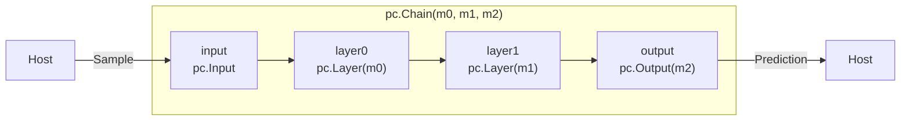
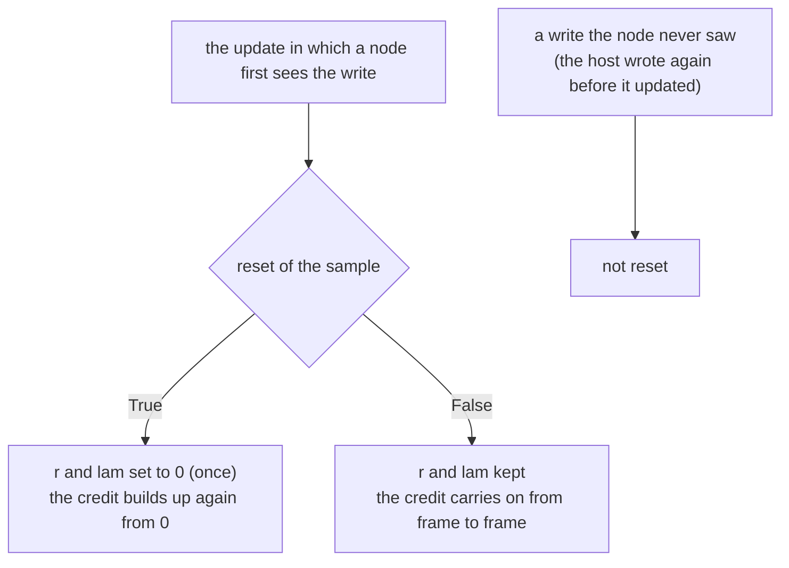
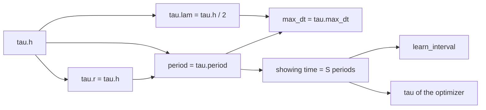
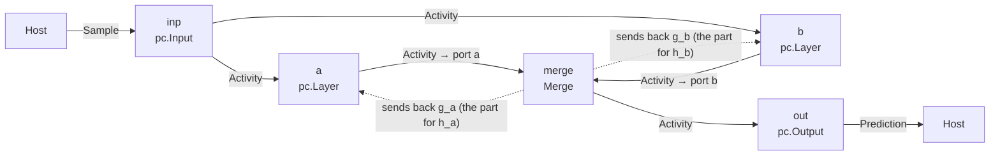

# 🧠 PC-ALM

`mujou.pc` splits a PyTorch model into nodes and learns it with PC-ALM (Augmented Lagrangian Predictive Coding, <https://pub.sakana.ai/pc-alm/>). How it works is in [How mujou.pc Works](pc-concepts.md) and how to use it in [5. Learn with PC-ALM](../tutorial/5-learn-with-pc.md); this page covers how to choose the values.

## The nodes {#nodes}



The child names `input`, `layer0`, …, `output` of a [`pc.Chain`][mujou.pc.Chain] are also the paths in `run.state_dict()`.

### Building the nodes one by one {#build-by-hand}

`pc.Chain` runs every node on the same period. For a different period per node, or a shape other than a chain, build `pc.Input`, `pc.Layer` and `pc.Output` one by one and connect them. To show it samples with `pc.show`, inherit [`pc.Shown`][mujou.pc.Shown] as well as `mujou.Network`, and expose the `prev` of the `Input` and the `next` of the `Output` as the network's `prev` and `next`.

### Modules to put in a node {#modules}

| Module                                                                                              | Use                             | Why, or what to watch                     |
| --------------------------------------------------------------------------------------------------- | ------------------------------- | ----------------------------------------- |
| An `nn.Module` that treats each sample of the batch on its own (a layer, a stack, a residual block) | Fine                            | —                                         |
| `LayerNorm`                                                                                         | Fine                            | —                                         |
| `Dropout`, `BatchNorm`                                                                              | Not usable                      | In training mode they drop or mix samples |
| A parameter that must not learn                                                                     | Set `requires_grad=False`       | —                                         |
| Weight initialization                                                                               | Do it when you make the modules | The nodes do not initialize               |

## Starting anew: `reset` {#reset}

| Data                                           | [`reset`][mujou.pc.msg.Sample]                   |
| ---------------------------------------------- | ------------------------------------------------ |
| Shuffled batches, independent samples          | True for every sample                            |
| A stream, each frame continuing the one before | False, and True at the first frame of an episode |
| The test batches                               | True, as for training                            |



## Choosing the time constants {#choose-time-constants}



| Value (meaning in [TimeConstants](pc-concepts.md#time-constants)) | How to choose it                                                                                                                                           | MNIST                    |
| ----------------------------------------------------------------- | ---------------------------------------------------------------------------------------------------------------------------------------------------------- | ------------------------ |
| `tau.h`                                                           | First. The others follow from it                                                                                                                           | 4 ms                     |
| `tau.r`                                                           | `tau.h`                                                                                                                                                    | 4 ms                     |
| `tau.lam`                                                         | `tau.h / 2`                                                                                                                                                | 2 ms                     |
| The period                                                        | The default [`tau.period`][mujou.pc.TimeConstants.period] (`tau.h / 2` with `tau.r = tau.h`)                                                               | 2 ms                     |
| `max_dt`                                                          | The default [`tau.max_dt`][mujou.pc.TimeConstants.max_dt] (1 period with the values above)                                                                 | 2 ms                     |
| The showing time                                                  | `S` periods, with `S` a few periods more than the [round trip of the credit](#credit), `2 × hops` periods                                                  | 16 periods, 32 ms        |
| `learn_interval`                                                  | Longer than half of the showing time, shorter than the showing time, and longer than `2 × hops × period` (table below). MNIST uses 3/4 of the showing time | 24 ms                    |
| `tau` of the optimizer                                            | Much longer than `tau.h` (the weights learn from the settled `delta`). For values, see the [conversion table](#optimizer)                                  | `pc.optim.SGD(tau=0.32)` |

<figure class="mujou-diagram">
<svg viewBox="0 0 640 210" role="img" aria-label="The 32 ms for which MNIST shows one batch. The host writes at 0 ms and writes the next at 32 ms. The node updates every 2 ms. The round trip of the credit takes at most 12 ms. learn_interval goes between 16 ms, half of the showing time, and 32 ms, the showing time; MNIST learns at 24 ms">
<text class="mujou-label" x="10" y="54">Host</text>
<line class="mujou-lane" x1="90" y1="50" x2="620" y2="50"/>
<g class="mujou-tick-b"><line x1="90" y1="38" x2="90" y2="62"/><line x1="602" y1="38" x2="602" y2="62"/></g>
<text class="mujou-note" x="94" y="30">writes</text>
<text class="mujou-note" x="602" y="30" text-anchor="end">writes the next</text>
<text class="mujou-label" x="10" y="114">Node</text>
<rect x="346" y="94" width="256" height="32" style="fill: var(--md-accent-fg-color--transparent)"/>
<line class="mujou-lane" x1="90" y1="110" x2="620" y2="110"/>
<g class="mujou-tick-a"><line x1="122" y1="100" x2="122" y2="120"/><line x1="154" y1="100" x2="154" y2="120"/><line x1="186" y1="100" x2="186" y2="120"/><line x1="218" y1="100" x2="218" y2="120"/><line x1="250" y1="100" x2="250" y2="120"/><line x1="282" y1="100" x2="282" y2="120"/><line x1="314" y1="100" x2="314" y2="120"/><line x1="346" y1="100" x2="346" y2="120"/><line x1="378" y1="100" x2="378" y2="120"/><line x1="410" y1="100" x2="410" y2="120"/><line x1="442" y1="100" x2="442" y2="120"/><line x1="506" y1="100" x2="506" y2="120"/><line x1="538" y1="100" x2="538" y2="120"/><line x1="570" y1="100" x2="570" y2="120"/><line x1="602" y1="100" x2="602" y2="120"/></g>
<g class="mujou-tick-b"><line x1="474" y1="90" x2="474" y2="130"/></g>
<text class="mujou-note" x="474" y="144" text-anchor="middle">learns (24 ms)</text>
<path class="mujou-brace" d="M 92 92 Q 92 84 100 84 L 274 84 Q 282 84 282 92"/>
<text class="mujou-note" x="186" y="78" text-anchor="middle">credit round trip ≤ 2 × 3 × 2 ms = 12 ms</text>
<line class="mujou-axis" x1="90" y1="160" x2="620" y2="160"/>
<text class="mujou-note" x="90" y="176" text-anchor="middle">0</text>
<text class="mujou-note" x="282" y="176" text-anchor="middle">12 ms</text>
<text class="mujou-note" x="346" y="176" text-anchor="middle">S/2 = 16 ms</text>
<text class="mujou-note" x="602" y="176" text-anchor="end">S = 32 ms</text>
<text class="mujou-note" x="474" y="196" text-anchor="middle">range for learn_interval</text>
<text class="mujou-label" x="90" y="206">run's timer →</text>
</svg>
</figure>

| `learn_interval`                                          | Result                                                                                                                |
| --------------------------------------------------------- | --------------------------------------------------------------------------------------------------------------------- |
| Shorter than half of the showing time                     | Learns twice or more per batch                                                                                        |
| Longer than half of the showing time, but shorter than it | Learns once per batch (the recommended range)                                                                         |
| As long as the showing time or longer                     | The next batch is written first, and the node never learns                                                            |
| Shorter than `2 × hops × period`                          | Not checked. Learns before the credit is back: the nodes near the input learn from only part of it                    |
| `None`                                                    | Learns in every update. For a stream whose input changes at every frame. Good values for streams are not measured yet |

`hops` is the number of connections from the `Input` to the `Output`: in a `pc.Chain`, as many as its modules (3 for MNIST). Every node computes one forward and one VJP per period, so fewer, larger nodes need fewer periods per batch ([Fewer nodes, fewer periods](pc-benchmarks.md#node-count)).

### The round trip of the credit {#credit}

| How the nodes run                                                       | Time for the credit to go back one hop      | Round trip (the input to the `Output`, the credit back to the first `Layer`) |
| ----------------------------------------------------------------------- | ------------------------------------------- | ---------------------------------------------------------------------------- |
| [`ManualRun.step(dt)`][mujou.ManualRun.step] (every node once per step) | 1 step                                      | Exactly `2 × hops` steps                                                     |
| [`mujou.run`][mujou.run], every node with the same period               | At most 1 period                            | About `hops` periods (at most `2 × hops` periods)                            |
| Different periods                                                       | Up to about 1 period of the node it goes to | Only a bound                                                                 |

## Choosing the optimizer {#optimizer}

| Optimizer                                                                    | One learning step of `elapsed` seconds                                                                                            |
| ---------------------------------------------------------------------------- | --------------------------------------------------------------------------------------------------------------------------------- |
| [`pc.optim.SGD(tau=..., tau_m=None)`][mujou.pc.optim.SGD]                    | `p -= (elapsed / tau) * g`. With `tau_m`, `m_hat` (momentum, the gradient averaged with the time constant `tau_m`) instead of `g` |
| [`pc.optim.RMSProp(tau=..., tau_v=..., eps=1e-8)`][mujou.pc.optim.RMSProp]   | RMSProp with the learning rate `elapsed / tau`. The mean square `v` decays with the time constant `tau_v`                         |
| [`pc.optim.AdamW(tau=..., tau_m=..., tau_v=..., ...)`][mujou.pc.optim.AdamW] | AdamW with the learning rate `elapsed / tau`. The moments `m` and `v` decay with the time constants `tau_m` and `tau_v`           |
| [`pc.optim.TimeScaled(optimizer, scale=...)`][mujou.pc.optim.TimeScaled]     | Steps `optimizer` by `elapsed * scale` seconds ([one stream](#one-stream-as-a-batch-of-consecutive-samples))                      |

`Δt` is the time between two learning steps: the showing time when the nodes learn once per batch.

| Optimizer         | Behavior                                                                                                                                         | Converting from torch                                                                                                                                                                    | Measured with `mujou.pc`              |
| ----------------- | ------------------------------------------------------------------------------------------------------------------------------------------------ | ---------------------------------------------------------------------------------------------------------------------------------------------------------------------------------------- | ------------------------------------- |
| SGD               | Moves in proportion to the gradient                                                                                                              | `tau` = the showing time / the learning rate per batch                                                                                                                                   | [MNIST](pc-benchmarks.md#mnist)       |
| SGD with momentum | Averages the gradient over about the last `tau_m` seconds and keeps the learning rate: with a constant gradient, it moves as without momentum    | From `torch.optim.SGD(lr, momentum=beta, dampening=beta)`, `tau = Δt / lr` and `tau_m = -Δt / ln(beta)`. To match torch's default `dampening=0`, `tau = (1 - beta) * Δt / lr`            | Not measured yet                      |
| RMSProp           | Divides the gradient by the root of its mean square, without momentum or weight decay. Moves each weight by up to about `elapsed / tau` per step | From `torch.optim.RMSprop(lr, alpha, eps)`, `tau = Δt / lr` and `tau_v = -Δt / ln(alpha)`                                                                                                | Not measured yet                      |
| AdamW             | Moves each weight by about `elapsed / tau` per step, whatever the size of its gradient                                                           | From `lr` and `betas` of `torch.optim.AdamW`, `tau = Δt / lr`, `tau_m = -Δt / ln(beta1)` and `tau_v = -Δt / ln(beta2)`. With a constant `Δt`, the steps are those of `torch.optim.AdamW` | [CIFAR-10](pc-benchmarks.md#cifar-10) |

For a node that never learns, pass `learn_interval=math.inf`, not an infinite `tau` of the optimizer.

=== "Avoid"

    ```python
    optimizer = pc.optim.SGD(tau=math.inf)  # ValueError
    ```

=== "Write instead"

    ```python
    # Give it to that pc.Layer or pc.Output. pc.Chain gives one learn_interval to every node
    layer = pc.Layer(module, act_spec=spec, tau=tau, optimizer=optimizer, learn_interval=math.inf)
    ```

## Choosing the relaxer {#choose-relaxer}

`relaxer=` of `pc.Layer` and `pc.Chain` is optional, and the default is [`pc.relax.Euler`][mujou.pc.relax.Euler]. `pc.Output` has no `r`, so it takes no relaxer. How relaxers work, and how to write your own, is in [How mujou.pc Works](pc-concepts.md#relaxer).

## The batch {#batch}

| [`batch`][mujou.pc.Chain] | `x` (784 inputs) | `y` (one class) | `mask`   | For                                                                                              |
| ------------------------- | ---------------- | --------------- | -------- | ------------------------------------------------------------------------------------------------ |
| `()` (default)            | `(784,)`         | `()`            | `()`     | One sample at a time, as from a sensor                                                           |
| `64`                      | `(64, 784)`      | `(64,)`         | `(64,)`  | 64 samples                                                                                       |
| `(8, 4)`                  | `(8, 4, 784)`    | `(8, 4)`        | `(8, 4)` | 4 agents in each of 8 environments, for example. Learns as `batch=32`                            |
| `64`                      | `(64, T, 784)`   | `(64,)`         | `(64,)`  | 64 sequences of `T` steps. The time the module mixes is a dimension of the sample, not the batch |

## One stream as a batch of consecutive samples {#one-stream-as-a-batch-of-consecutive-samples}

| Batch (`c = 4`; the numbers are the indices of the samples in the stream) | Row 0 | Row 1 | Row 2 | Row 3 |
| ------------------------------------------------------------------------- | ----- | ----- | ----- | ----- |
| 1st                                                                       | 0     | 1     | 2     | 3     |
| 2nd                                                                       | 4     | 5     | 6     | 7     |
| 3rd                                                                       | 8     | 9     | 10    | 11    |

| Step | Setting                                                                                                                                                            | Why                                                                                                         | Difference from a run of one sample at a time                                                                                                                                                                       |
| ---- | ------------------------------------------------------------------------------------------------------------------------------------------------------------------ | ----------------------------------------------------------------------------------------------------------- | ------------------------------------------------------------------------------------------------------------------------------------------------------------------------------------------------------------------- |
| 1    | Show each batch for the time of one sample of the stream. This is the showing time                                                                                 | Showing it `c` times as long as well would scale the time twice: the weights would learn `c` times too fast | —                                                                                                                                                                                                                   |
| 2    | Write the time constants of `optimizer` in the stream's seconds, as for a run of one sample at a time                                                              | `TimeScaled` divides them by `c`, so none is forgotten                                                      | Compared with the sum of `c` steps of one sample, the step of one batch is the same to first order with `pc.optim.SGD`, and 1 to about `√c` times as large with RMSProp and AdamW (the mean gradient is less noisy) |
| 3    | Wrap the optimizer of every node that learns in the same [`pc.optim.TimeScaled(optimizer, scale=c)`][mujou.pc.optim.TimeScaled] (the `optimizer=` of a `pc.Chain`) | A node with another `scale` learns faster or slower than the rest                                           | The weights take one step over `c` times the time instead of `c` steps. A large `c` can lag behind, or learn too fast and become unstable                                                                           |
| 4    | Choose `tau.h`, `tau.r`, `tau.lam`, the period and `learn_interval` from this showing time, as in [Choosing the time constants](#choose-time-constants)            | They all stay in the run's seconds. `TimeScaled` changes only the time of the weights                       | With `reset` False, each row continues from the sample `c` before it (the same row of the previous batch), not from the one just before                                                                             |

If the steps of RMSProp or AdamW are too large, lengthen `tau`. Good factors have not been measured yet.

## Pitfalls {#pitfalls}

| Pitfall                                                                                  | Symptom                                                                                                                                                 | Fix                                                                                                    |
| ---------------------------------------------------------------------------------------- | ------------------------------------------------------------------------------------------------------------------------------------------------------- | ------------------------------------------------------------------------------------------------------ |
| The batch given to only the chain or the loss (`batch` is not read from the spec shapes) | Given to neither, the credit of each sample is 1/64 (with 64 samples). Given to one only, an error                                                      | The same `batch` to `pc.Chain` (or `pc.Input`) and to the loss                                         |
| A loss that averages over the batch (`nn.MSELoss()` and the like)                        | `pc.Output` raises `ValueError`                                                                                                                         | A loss that returns the loss of each sample, such as [`pc.loss.MSELoss(batch)`][mujou.pc.loss.MSELoss] |
| Reading predictions from a `Layer`'s `next`                                              | It does not hold the prediction of the network                                                                                                          | The `next` of `pc.Output` (`net.next` of a `pc.Chain`)                                                 |
| Reading before the first sample arrives                                                  | A prediction with `mask` all False                                                                                                                      | Match `time` with the time `write` returned (as `pc.show` does)                                        |
| Heavy load                                                                               | Divergence, or a drop in accuracy. MNIST stops when `y_hat` is not finite; a run that diverges with finite predictions shows only as a falling accuracy | Lower the time scale. Run on an otherwise idle machine (table below)                                   |
| No `reset` for shuffled samples                                                          | The nodes near the input learn from the credit of unrelated samples                                                                                     | `reset` True for samples that do not continue the one before ([reset](#reset))                         |

=== "Avoid"

    ```python
    net = pc.Chain(*modules, x=TensorSpec((64, 784)), y=y_spec, loss=pc.loss.MSELoss(), ...)  # credit 1/64
    out = pc.Output(module, act_spec=spec, loss=nn.MSELoss(), ...)  # ValueError
    ```

=== "Write instead"

    ```python
    net = pc.Chain(*modules, x=TensorSpec((64, 784)), y=y_spec, batch=64, loss=pc.loss.MSELoss(64), ...)
    out = pc.Output(module, act_spec=spec, loss=pc.loss.MSELoss(64), ...)
    ```

If a node runs late, its neighbors keep learning from its old messages. Two causes are known. `max_dt` does not prevent this: it caps the time one update counts, and the time beyond it is dropped from the relaxation and from the weight update alike.

| Cause of the load             | Observed                                                                                                                                                                                                                                                                                                                                              | Fix                                                                                                             |
| ----------------------------- | ----------------------------------------------------------------------------------------------------------------------------------------------------------------------------------------------------------------------------------------------------------------------------------------------------------------------------------------------------- | --------------------------------------------------------------------------------------------------------------- |
| A time scale that is too fast | The examples speed up the run's timer with `--time-scale`. Too fast, and the slowest node takes longer than its period to compute. In CIFAR-10 with a node for each residual block, at a period of 2 ms of real time, the updates came 1.1 to 1.3 periods apart on average with stalls of up to 100 periods, and the accuracy fell by about 20 points | Run one epoch with `--watch` (MNIST) and take the highest time scale that gives no warning and does not diverge |
| Other processes on the cores  | A node that waits for a core lets its neighbors run ahead. On 32 cores at time scale 1, one epoch ran through beside 26 busy loops and diverged beside 32; at 0.5 it ran through beside 32                                                                                                                                                            | Run on an otherwise idle machine, or lower the time scale                                                       |

## Nodes of your own {#own-node}

Write a node that `pc.Layer` cannot express (one with several inputs, say) by combining the formulas of [`pc.functional`][mujou.pc.functional] with [`pc.clock.LearnClock`][mujou.pc.clock.LearnClock], an optimizer and a relaxer. Keep the stages of one update as in [One update of a Layer](pc-concepts.md#layer-update), bind the optimizer and the relaxer in each node, and do not share a bound one between nodes.



```python
--8<-- "examples/pc_merge.py:merge"
```

| Differs from `pc.Layer` in | `Merge` (`examples/pc_merge.py`)                                                              |
| -------------------------- | --------------------------------------------------------------------------------------------- |
| Ports                      | One for each input (`a` and `b`)                                                              |
| `g_in`                     | Split by the widths of `h_a` and `h_b` into `g_a` and `g_b`, each sent back from its own port |
