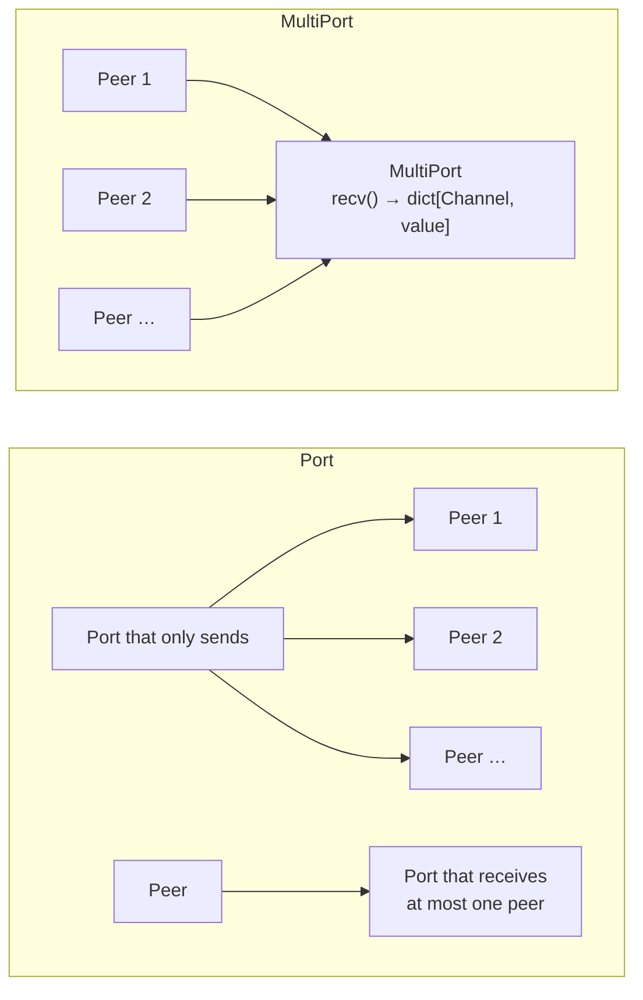
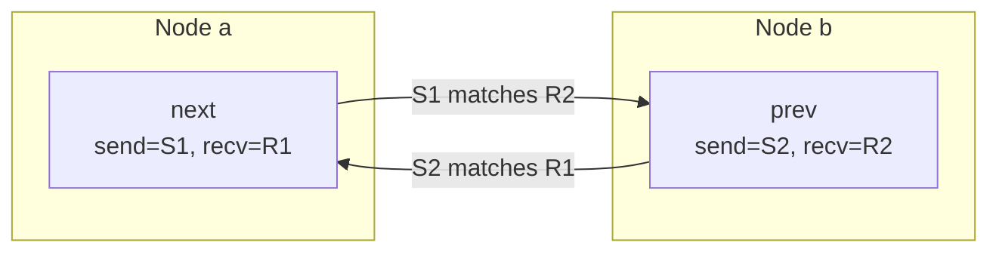
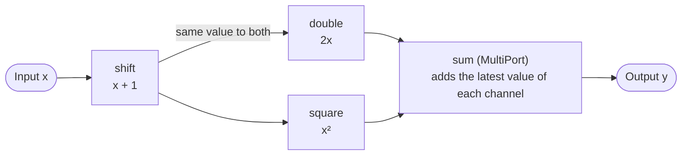
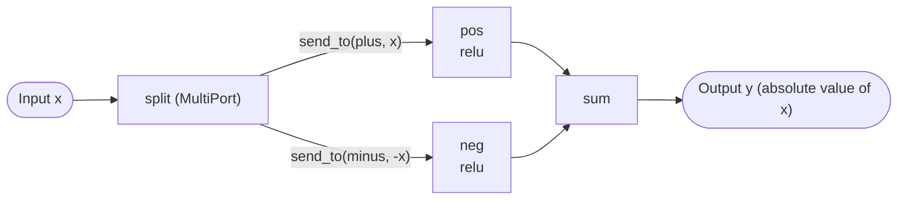
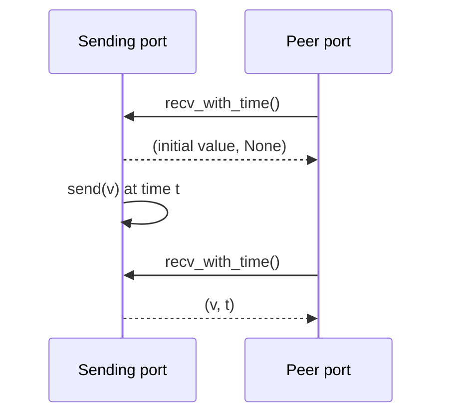
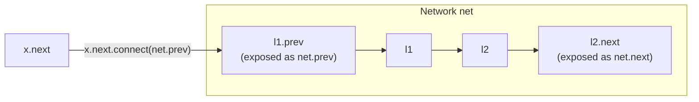

# 🔌 Ports and Channels

A port is a connection point of a node. `connect` joins two ports with one channel.

!!! abstract "On this page"

    - How `Port` and `MultiPort` differ, and how to declare them
    - The kinds of specs, and the values a spec makes
    - The rules of `connect`
    - Fan-out, merging, and sending to one channel only
    - What a port holds before anyone sends
    - How a network exposes the ports of its children

## The kinds of ports

!!! abstract "In short"

    A `Port` receives from at most one peer, but may send to any number. To combine peers of one kind, use a `MultiPort`.



| Kind        | Peers                                                   | `recv()` returns                             |
| ----------- | ------------------------------------------------------- | -------------------------------------------- |
| `Port`      | At most one if it receives; any number if it only sends | The value                                    |
| `MultiPort` | Any number, of one kind                                 | A `dict[Channel, value]`, in `connect` order |

### Declaring ports

Declare each port as an attribute of its own in `__init__`, after `super().__init__()`. A run reads the attributes of the instance when it starts. A run raises `TypeError` for a port kept in a list, a tuple or a dict, and the class statement raises it for a port declared as a class attribute. To combine peers of one kind, use a `MultiPort`.

=== "Avoid"

    ```python
    class Bad(Node):
        prev = Port(recv=VECTOR)  # class attribute: the class statement raises TypeError

        def __init__(self) -> None:
            super().__init__()
            self.inputs = [Port(recv=VECTOR), Port(recv=VECTOR)]  # list: the run raises TypeError
    ```

=== "Write instead"

    ```python
    class Good(Node):
        def __init__(self) -> None:
            super().__init__()  # declare ports after this
            self.a = Port(recv=VECTOR)  # one attribute per port
            self.b = Port(recv=VECTOR)
            self.many = MultiPort(recv=VECTOR)  # any number of peers of one kind
    ```

### Separate ports for separate roles

Inputs of different roles, such as an input and its teacher signal, or a prediction and an error, go to separate `Port`s, each named after its role. A `MultiPort` is for peers of one kind that the node combines the same way.

=== "Avoid"

    ```python
    self.prev = MultiPort(recv=VECTOR)  # input and teacher signal mixed in one
    ```

=== "Write instead"

    ```python
    self.prev = Port(recv=VECTOR)     # input
    self.teacher = Port(recv=VECTOR)  # teacher signal
    ```

## Specs

!!! abstract "In short"

    A port takes the spec of what it sends as `send=` and of what it receives as `recv=`. A one-way port leaves out the one it does not use.

```python
self.prev = Port(recv=TensorSpec((32, 784)))  # receives only
self.next = MultiPort(send=TensorSpec((32, 256)), recv=TensorSpec((32, 256)))  # both ways
```

| Spec                            | Value it carries                            | Initial value             |
| ------------------------------- | ------------------------------------------- | ------------------------- |
| `TensorSpec(shape, dtype)`      | One tensor                                  | Zeros                     |
| `IntSpec(bits=64, signed=True)` | `int` of 8, 16, 32 or 64 bits               | `0`                       |
| `FloatSpec()`                   | `float` (64 bits)                           | `0.0`                     |
| `BoolSpec()`                    | `bool`                                      | `False`                   |
| `TimestampSpec()`               | `mujou.time.Timestamp`                      | `Timestamp(ns=0)`         |
| `DictSpec(TypedDict, ...)`      | A `TypedDict` with one of the above per key | The initial value per key |

### Tensors

`TensorSpec(shape, dtype)` is the spec of one tensor. Its dtype is `torch.float32` unless given, whatever `torch.get_default_dtype()` is. A value sent must match the spec in shape and dtype: no dtype is converted. The dtypes a spec takes are in `TensorSpec.dtypes`.

A spec makes values of its shape and dtype, for the state of a node or for a test.

| Method                           | Value it makes               | Specs that have it       |
| -------------------------------- | ---------------------------- | ------------------------ |
| `spec.zeros()`                   | A tensor of zeros            | `TensorSpec`, `DictSpec` |
| `spec.empty()`                   | A tensor with unset contents | `TensorSpec`, `DictSpec` |
| `TensorSpec.rand(generator=...)` | A tensor uniform in \[0, 1)  | `TensorSpec`             |

The `zeros()` and `empty()` of a `DictSpec` return a dict with a value per key. Scalar keys get `0`, `0.0`, `False` or `Timestamp(ns=0)` from both.

### Scalars

A count, a flag or a time travels as a Python scalar (`IntSpec`, `FloatSpec`, `BoolSpec`, `TimestampSpec`), not as a tensor, so the receiver reads it without `int(...)`. An `IntSpec` has a number of bits. A message has a fixed size, so an `int` out of range raises `OverflowError` when it is sent, and is never wrapped. A scalar spec has no shape and makes no values: when you need one, write `0` or `False`.

### Values that belong together: DictSpec

!!! warning "Values on two ports arrive separately"

    A reader may see a new value on one port with an old value on the other. Send values that belong together, such as an input and its target, as one message.

A `DictSpec` gives a spec for each key of a `TypedDict`. The whole dict arrives at once, and type checkers know the type of each key. To use the spec of one key, take it with its kind (`SAMPLE.field("x", TensorSpec).shape`); another kind raises `TypeError`.

```python
class Sample(TypedDict):
    x: torch.Tensor
    y: torch.Tensor


SAMPLE = DictSpec(Sample, x=TensorSpec((32, 4)), y=TensorSpec((32, 2)))

self.next = Port(send=SAMPLE)  # in the sender: self.next.send({"x": x, "y": y})
self.prev = Port(recv=SAMPLE)  # in the receiver: sample = self.prev.recv(); sample["x"]
```

### Type annotations

Type checkers infer the type of a port from its specs. Write an annotation only when you need one (for an argument of a helper, say), in one of these forms.

| Form                 | Meaning                                                             |
| -------------------- | ------------------------------------------------------------------- |
| `Port[S, R]`         | A `Port` that sends `S` and receives `R`                            |
| `MultiPort[S, R]`    | A `MultiPort` that sends `S` and receives `R`                       |
| A direction left out | `Never`. A type checker rejects `send` on a port that sends nothing |
| `MessageSpec[T]`     | Any spec whose values are `T`. For a function that takes any spec   |

```python
from typing import Never

from mujou import MessageSpec, MultiPort, Port


def mean_of(port: MultiPort[Never, torch.Tensor]) -> torch.Tensor:
    return torch.stack(list(port.recv().values())).mean(0)


def sender[T](spec: MessageSpec[T]) -> Port[T]:
    return Port(send=spec)
```

## Connecting

!!! abstract "In short"

    `a.next.connect(b.prev)` joins two ports and returns the `Channel`. The specs must match in both directions.



Nodes and networks have no `connect` of their own: you connect ports. A node may have several inputs and outputs, and naming both ports makes the path readable.

| Case                                          | Result                                                       |
| --------------------------------------------- | ------------------------------------------------------------ |
| The specs do not match in one direction       | `connect` raises `TypeError`                                 |
| A second peer for a `Port` that receives      | `ValueError`. To receive from several, use a `MultiPort`     |
| Connecting the same two ports again           | Returns the channel they already have                        |
| Connecting two ports of the same node         | Allowed                                                      |
| A cycle, or receiving from a node you send to | Allowed (the nodes of `mujou.pc` do this with two-way ports) |
| A port outside the tree of nodes being run    | `mujou.run` raises `ValueError`                              |

## Fan-out and merging

!!! abstract "In short"

    A `Port` that only sends delivers each value to all its peers. To merge, use a `MultiPort`: its `recv()` returns the latest value of each channel.

The diamond network `shift → (double, square) → sum` computes $y = 2(x + 1) + (x + 1)^2$. The send-only port of `shift` delivers the same value to `double` and `square`, and the `MultiPort` of `sum` merges the two.



```python
--8<-- "examples/branching.py:fan-out"
```

In the `recv()` of a `MultiPort`, the value of a peer that has never sent is the initial value of the peer's port. The receiving node decides how to combine the values: sum them, average them, weight each peer.

### Treating peers differently

To treat peers differently, keep the `Channel` that `connect` returned as an attribute of the receiving node, and use it as a key into the dict of `recv()`.

```python
# the network
self.sum.from_double = self.double.next.connect(self.sum.prev)

# the receiving node (sum)
x = self.prev.recv()[self.from_double]
```

## Sending to one channel

!!! abstract "In short"

    A `MultiPort` sends to every peer with `send`, and only to the peer at the end of one channel with `send_to`. The network hands the node the channels that `connect` returned.

`split` sends $x$ to the `plus` channel and $-x$ to the `minus` channel. Passing each through relu and adding them gives $y = \mathrm{relu}(x) + \mathrm{relu}(-x) = |x|$.



| How                       | Where it goes                            | What `Run.read` returns |
| ------------------------- | ---------------------------------------- | ----------------------- |
| `send(value)`             | The same value to every peer             | This value              |
| `send_to(channel, value)` | Only to the peer at the end of `channel` | Unchanged               |

```python
--8<-- "examples/branching.py:send-to"
```

### Handing over channels

The network hands the node the channels that `connect` returned, as attributes (`self.split.plus = ...`). Picking them by their order in `self.next.channels` instead means that swapping two `connect` calls swaps the destinations without any error. An attribute that holds a `Channel` is not part of the state.

=== "Avoid"

    ```python
    # swapping the connect calls silently swaps plus and minus
    self.split.plus, self.split.minus = self.split.next.channels
    ```

=== "Write instead"

    ```python
    self.split.plus = self.split.next.connect(self.pos.prev)
    self.split.minus = self.split.next.connect(self.neg.prev)
    ```

### What the host can read

| Port and way of sending       | Can the host read it with `Run.read`?         |
| ----------------------------- | --------------------------------------------- |
| A port that sends with `send` | Yes. Its initial value until the first `send` |
| A value sent with `send_to`   | No                                            |
| A port that only receives     | No                                            |

## Before anyone sends

!!! abstract "In short"

    Until a port first sends, its peers and the host get the port's initial value. Its time is `None`.



| Port declaration                 | Value until it first sends                               |
| -------------------------------- | -------------------------------------------------------- |
| `Port(send=spec)`                | Zeros (for scalars, the initial value in the spec table) |
| `Port(send=spec, initial=value)` | `value`                                                  |

```python
self.next = Port(send=TensorSpec((32, 256)), initial=torch.full((32, 256), 0.5))
```

`initial` must match the `send` spec. A run copies `initial` when it starts, and checks it against the spec.

### Telling a new value from the same one read again

`recv_with_time()` returns the value with the time it was sent (a `mujou.time.Timestamp`). The time is `None` until the first send. Compare it with the time you read last to tell a new value from the same one read again.

```python
value, t = self.prev.recv_with_time()
if t is not None and t != self.last_t:  # a new value arrived since the last read
    self.last_t = t
```

A port that the host writes (a receiving port that is not connected) counts as sent from the `inputs=` of the run, or from the host's first `write`. See [Host I/O](host-io.md#initial-values).

## Exposed ports

!!! abstract "In short"

    A network exposes a child's port by assigning it to an attribute of its own. The outside connects to it as to a node's port.



```python
self.prev = self.l1.prev  # the port of the first node
self.next = self.l2.next  # the port of the last node
```

The exposed attribute is only a reference: the port still belongs to the child node. By convention, a network exposes the port of its first node as `prev` and that of its last as `next`, so that it connects like a node.
