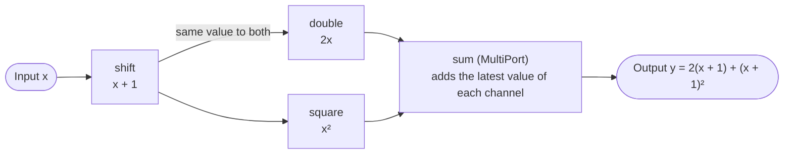
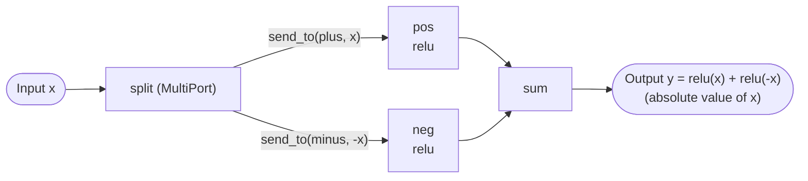

# 🔌 Ports and Channels

## The kinds of ports {#kinds}

| Kind                           | Peers                                                   | `recv()` returns                             |
| ------------------------------ | ------------------------------------------------------- | -------------------------------------------- |
| [`Port`][mujou.Port]           | At most one if it receives; any number if it only sends | The value                                    |
| [`MultiPort`][mujou.MultiPort] | Any number, of one role                                 | A `dict[Channel, value]`, in `connect` order |

Inputs of different roles, such as an input and its teacher signal, or a prediction and an error, go to separate `Port`s, each named after its role. A `MultiPort` is for peers of one role that the node combines the same way.

=== "Avoid"

    ```python
    class Bad(Node):
        prev = Port(recv=VECTOR)  # class attribute: the class statement raises TypeError

        def __init__(self) -> None:
            super().__init__()
            self.inputs = [Port(recv=VECTOR), Port(recv=VECTOR)]  # list: the run raises TypeError
    ```

=== "Write instead"

    ```python
    class Good(Node):
        def __init__(self) -> None:
            super().__init__()  # declare ports after this
            self.a = Port(recv=VECTOR)  # one attribute per port
            self.b = Port(recv=VECTOR)
            self.many = MultiPort(recv=VECTOR)  # any number of peers of one role
    ```

## Specs {#spec}

| Spec                                                                                                                             | Used for                                                                    | Initial value                          |
| -------------------------------------------------------------------------------------------------------------------------------- | --------------------------------------------------------------------------- | -------------------------------------- |
| [`TensorSpec`][mujou.TensorSpec]                                                                                                 | One tensor, such as an activity or an error                                 | Zeros                                  |
| [`IntSpec`][mujou.IntSpec], [`FloatSpec`][mujou.FloatSpec], [`BoolSpec`][mujou.BoolSpec], [`TimestampSpec`][mujou.TimestampSpec] | A count, a flag, a time                                                     | `0`, `0.0`, `False`, `Timestamp(ns=0)` |
| [`DictSpec`][mujou.DictSpec]                                                                                                     | Values to deliver together, such as an input and its target (a `TypedDict`) | The initial value per key              |

A count, a flag or a time travels as a Python scalar with a scalar spec, not wrapped in a tensor, so the receiver uses it without `int(...)`.

### Values that belong together: DictSpec {#pairs}

Values on two ports arrive separately, so a reader may pair a new value on one with an old value on the other. Put values that belong together, such as an input and its target, in one `DictSpec`, and the whole dict arrives at once.

```python
class Sample(TypedDict):
    x: torch.Tensor
    y: torch.Tensor


SAMPLE = DictSpec(Sample, x=TensorSpec((32, 4)), y=TensorSpec((32, 2)))

self.next = Port(send=SAMPLE)  # in the sender: self.next.send({"x": x, "y": y})
self.prev = Port(recv=SAMPLE)  # in the receiver: sample = self.prev.recv(); sample["x"]
```

### Type annotations {#typing}

Type checkers infer the type of a port from its specs. Annotate only when you need to (for an argument of a helper, say), as `Port[S, R]` or `MultiPort[S, R]` (sends `S`, receives `R`); a direction left out is `Never`, so a type checker rejects `send` on a port that sends nothing. Annotate a function that takes any spec with [`MessageSpec`][mujou.MessageSpec].

```python
def mean_of(port: MultiPort[Never, torch.Tensor]) -> torch.Tensor:
    return torch.stack(list(port.recv().values())).mean(0)
```

## Connecting {#connect}

[`connect`][mujou.Port.connect] joins ports only: nodes and networks have no `connect` of their own. A node may have many inputs and outputs, and naming both ports makes the path readable.
Cycles (the nodes of `mujou.pc` make them with two-way ports) and two ports of the same node are allowed. A port connected to one outside the tree being run makes [`mujou.run`][mujou.run] raise `ValueError`.

## Fan-out and merging {#fan-out}



```python
--8<-- "examples/branching.py:fan-out"
```

The receiving node decides how to combine the values: sum them, average them, weight each peer.

### Treating peers differently {#per-channel}

To treat peers differently, keep the `Channel` that `connect` returned as an attribute of the receiving node, and use it as a key into the dict of `recv()`.

```python
# the network
self.sum.from_double = self.double.next.connect(self.sum.prev)

# the receiving node (sum)
x = self.prev.recv()[self.from_double]
```

## Sending to one channel {#send-to}



```python
--8<-- "examples/branching.py:send-to"
```

The network hands [`send_to`][mujou.MultiPort.send_to] its channels by assigning what `connect` returned to attributes of the node. An attribute that holds a `Channel` is not part of the state.

=== "Avoid"

    ```python
    # swapping the connect calls silently swaps plus and minus
    self.split.plus, self.split.minus = self.split.next.channels
    ```

=== "Write instead"

    ```python
    self.split.plus = self.split.next.connect(self.pos.prev)
    self.split.minus = self.split.next.connect(self.neg.prev)
    ```

## A new value, or the same one again {#new-or-reread}

```python
value, t = self.prev.recv_with_time()
if t is not None and t != self.last_t:  # a new value arrived since the last read
    self.last_t = t
```

Until the sender first sends, [`recv_with_time`][mujou.Port.recv_with_time] returns the initial value with the time `None`. The initial values of ports the host writes are in [Initial values](host-io.md#initial-values).
