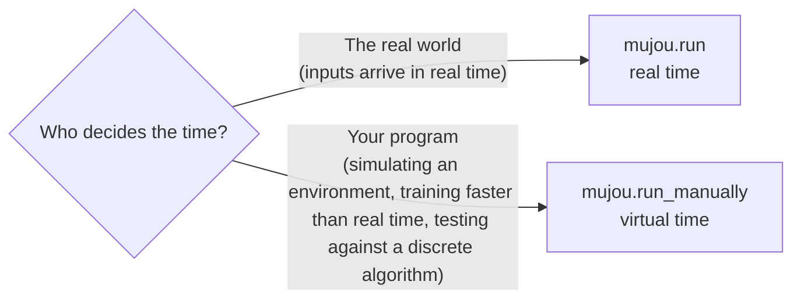
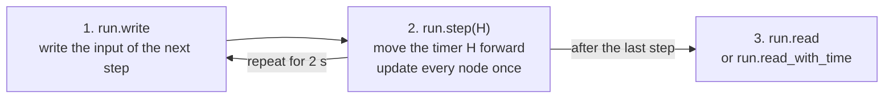

# 🕹️ Simulation

`mujou.run` runs a network in real time, for the real world. `mujou.run_manually` runs it in virtual time, as fast as the machine computes, for simulations and tests. This page covers when to use which, the two kinds of step, the threads, and what keeps a simulation deterministic.

!!! abstract "What you will learn"

    - Which of `mujou.run` and `mujou.run_manually` to use
    - What `step(dt)` and `step(dt, *nodes)` update, and what each node reads
    - What keeps a simulation the same, bit for bit, every time

    You should know [runs](../concepts.md#5-runs) and [time](time.md).

## Two ways to run

!!! abstract "Key idea"

    Use `mujou.run` when the network meets the real world, and `mujou.run_manually` when you decide the time.



|                     | `mujou.run`                                   | `mujou.run_manually`                                         |
| ------------------- | --------------------------------------------- | ------------------------------------------------------------ |
| For                 | Deploying to the real world (sensors, robots) | Simulations and tests                                        |
| Time                | Real time (`global_timer` by default)         | Virtual time: a `VirtualTimer` that only `step` moves        |
| When a node updates | Every `period` on average, on its own         | Once in each `run.step` that updates it; `period` is ignored |
| `dt`                | The time that actually passed                 | Exactly the time that was stepped                            |
| Speed               | Sleeps to follow the clock                    | No sleeping: as fast as the machine computes                 |
| Results             | Vary from run to run                          | The same, bit for bit, every time                            |
| Returns             | `Run`                                         | `ManualRun`, a `Run` with `step`                             |

Use `mujou.run` when the network meets the real world: real inputs arrive in real time, and the network must keep up. Use `mujou.run_manually` when you decide the time: to simulate an environment, to train faster than real time, or to test a node against the discrete algorithm.

`mujou.run_manually` takes the same arguments as `mujou.run`. Only `timer` differs.

| Argument                     | In `mujou.run_manually`                                                                        |
| ---------------------------- | ---------------------------------------------------------------------------------------------- |
| `timer`                      | Must be a `VirtualTimer`. By default a new one at time 0 (or at the time of `state`, if given) |
| `inputs`, `state`, `workers` | The same as in `mujou.run`                                                                     |

??? question "Why not `mujou.run` with a large time scale?"

    A `Timer` with `time_scale=10` runs ten times faster, but the nodes still update when the machine lets them: `dt` varies, and so do the results. It also cannot go faster than the time scale, however fast the machine is. A `ManualRun` moves the time only when the last step is done.

## A simulation loop

!!! abstract "Key idea"

    One pass of the loop is "write, then step". Read between steps.

This loop feeds a sine wave to the `LeakyChain` of [Write a Node](../tutorial/2-node.md) for 2 s of virtual time, in steps of 1 ms:

```python
--8<-- "examples/simulation.py:simulate"
```



1. The host writes the input of the next step with `run.write`.
2. `run.step(H)` moves the timer `H` forward, then updates every node once. It returns when every update has ended.
3. Between steps (here, after the last one), the host reads with `run.read` or `run.read_with_time`.

The 2 s of virtual time take well under a second of real time.

## The two kinds of step

!!! abstract "Key idea"

    `step(dt)` updates every node at once, each reading the values from the start of the step. `step(dt, *nodes)` updates the given nodes one after another, each reading what the earlier ones sent.

|                      | `run.step(dt)`                                          | `run.step(dt, *nodes)`                              |
| -------------------- | ------------------------------------------------------- | --------------------------------------------------- |
| Which nodes update   | Every node of the run                                   | Only the given nodes                                |
| How                  | In parallel, on the run's workers and dedicated threads | One after another, in the given order               |
| What a node reads    | The values from the start of the step                   | The values sent by the nodes before it in this step |
| When a send is seen  | Once every update has ended                             | As soon as the sender's update ends                 |
| Known in numerics as | Jacobi                                                  | Gauss-Seidel                                        |

Both move the timer `dt` forward first, then update. Use `step(dt)` unless the order matters to you, as when you compare a node with an algorithm that updates `a`, then `b`.

=== "`run.step(h)`"

    ```mermaid
    sequenceDiagram
        participant H as Host
        participant R as ManualRun
        participant A as net.a
        participant B as net.b
        H->>R: run.step(h)
        R->>R: moves the virtual timer h forward
        par on the workers, in parallel
            R->>A: on_update(h)
        and
            R->>B: on_update(h), reading a's value from the start of the step
        end
        Note over A,B: what a and b sent becomes visible now
        R-->>H: returns
    ```

=== "`run.step(h, net.a, net.b)`"

    ```mermaid
    sequenceDiagram
        participant H as Host
        participant R as ManualRun
        participant A as net.a
        participant B as net.b
        H->>R: run.step(h, net.a, net.b)
        R->>R: moves the virtual timer h forward
        R->>A: on_update(h)
        A-->>B: send (visible at once)
        R->>B: on_update(h), reading a's new value
        R-->>H: returns
    ```

### Matching an order

!!! abstract "Key idea"

    Giving every node is not always the same as `step(dt)`. It is when the network has no loop and you give the nodes from the output side back.

Compare three ways to step the chain `u → a → b`:

```python
--8<-- "examples/simulation.py:orders"
```

| Way to step             | The `a` that `b` reads           | Result                |
| ----------------------- | -------------------------------- | --------------------- |
| `step(h)`               | The `a` of the start of the step | Reference             |
| `step(h, net.b, net.a)` | The old `a` (`b` updates first)  | The same as `step(h)` |
| `step(h, net.a, net.b)` | The `a` sent in this step        | Different             |

| Shape of the network                                                | Order that gives the result of `step(dt)` |
| ------------------------------------------------------------------- | ----------------------------------------- |
| Flows one way only (no loop; a chain, say)                          | From the output side back to the input    |
| Also flows back (a loop `a ↔ b`, a `pc.Chain` of PC-ALM, and so on) | In general, none                          |

## Rules of every step

!!! abstract "Key idea"

    A node updates once in each step that updates it, whatever its period. Its `dt` is the time since its own last update.

| Item                                               | Rule                                                                                                                                                   |
| -------------------------------------------------- | ------------------------------------------------------------------------------------------------------------------------------------------------------ |
| `period`                                           | Does not apply. Once in each step that updates the node                                                                                                |
| `dt`                                               | The time since the node's own last update; the first one, since the start of the run. The time of steps the node was left out of adds to its next `dt` |
| A node given twice in one step                     | Updates once (the second time, its time has not moved). For the same reason, `step(0)` right after the start updates no node                           |
| The time of messages sent in a step                | All have the time of the step                                                                                                                          |
| A port connected to a port of the same node        | Read in the same update, it gives the value from before the step                                                                                       |
| A `VirtualTimer` passed to several runs (`timer=`) | One time axis: a step of one run moves the time of the others too                                                                                      |

<figure class="mujou-diagram">
<svg viewBox="0 0 640 170" role="img" aria-label="Three steps. net.a updates in each, with dt equal to h. net.b updates only in the third, with dt equal to 3h, the time since the start of the run">
<line class="mujou-axis" x1="110" y1="150" x2="620" y2="150"/>
<text class="mujou-note" x="130" y="166" text-anchor="middle">start</text>
<text class="mujou-note" x="270" y="166" text-anchor="middle">h</text>
<text class="mujou-note" x="410" y="166" text-anchor="middle">2h</text>
<text class="mujou-note" x="550" y="166" text-anchor="middle">3h</text>
<text class="mujou-label" x="10" y="54">net.a</text>
<line class="mujou-lane" x1="110" y1="50" x2="620" y2="50"/>
<g class="mujou-tick-a"><line x1="270" y1="38" x2="270" y2="62"/><line x1="410" y1="38" x2="410" y2="62"/><line x1="550" y1="38" x2="550" y2="62"/></g>
<text class="mujou-note" x="200" y="30" text-anchor="middle">dt = h</text>
<text class="mujou-note" x="340" y="30" text-anchor="middle">dt = h</text>
<text class="mujou-note" x="480" y="30" text-anchor="middle">dt = h</text>
<text class="mujou-label" x="10" y="114">net.b</text>
<line class="mujou-lane" x1="110" y1="110" x2="620" y2="110"/>
<g class="mujou-tick-b"><line x1="550" y1="98" x2="550" y2="122"/></g>
<path class="mujou-brace" d="M 132 98 Q 132 90 140 90 L 540 90 Q 548 90 548 98"/>
<text class="mujou-note" x="340" y="84" text-anchor="middle">dt = 3h (the time of the two steps it missed adds up)</text>
</svg>
<figcaption>Steps 1 and 2 are <code>step(h, net.a)</code>, step 3 is <code>step(h)</code>. Each vertical line is an update. The first update of <code>net.b</code> gets the time since the start of the run as its <code>dt</code></figcaption>
</figure>

## Workers and threads

!!! abstract "Key idea"

    `step(dt)` runs in parallel, but its result depends neither on the number of workers nor on which thread runs which node.

`step(dt)` runs the updates on the run's `workers` (by default the same as in `mujou.run`; see [workers](threads-and-devices.md#the-workers)) and on the threads of the nodes with `dedicated_thread=True`. The result does not depend on the number of workers or on which thread runs which node. While the GIL is enabled, one thread runs Python code at a time, so the updates overlap only inside torch operations; the result is still the same.

!!! warning "Keep torch's threads few"

    On the CPU, each worker that runs a torch operation starts further threads of torch's own. With many workers, those threads compete for the cores and the step slows down. The host sets them once, before the run:

    ```python
    --8<-- "examples/simulation.py:threads"
    ```

    The rule of thumb is in [Threads and Devices](threads-and-devices.md#settings-of-the-whole-process).

## Keeping it deterministic

!!! abstract "Key idea"

    Keep these four rules, and a `ManualRun` gives the same result, bit for bit, every time.

| Rule                                                     | Why                                                                                        |
| -------------------------------------------------------- | ------------------------------------------------------------------------------------------ |
| Draw random numbers from `self.generator`, with a `seed` | The global generator is shared by every node, in an order that varies                      |
| Move the time only with `step`                           | Advancing the timer yourself (`run.timer.advance`) gives the nodes a `dt` you did not plan |
| Call `write` between steps                               | A write during a step reaches some nodes in that step and others in the next               |
| Do not share Python objects between nodes                | Nodes that append to one list, say, do it in a different order each time                   |

### Calls of the host

!!! abstract "Key idea"

    The host calls `write`, `step` and `read` in turn, on one thread: the thread that steps.

| Call                                            | Rule                                                                                                                                                                                                          |
| ----------------------------------------------- | ------------------------------------------------------------------------------------------------------------------------------------------------------------------------------------------------------------- |
| `write`, `read`, `read_with_time`, `state_dict` | Call them between steps. While `step(dt)` runs, `read` from another thread returns the value from before the step; while `step(dt, *nodes)` runs, it may return what a node already updated in this step sent |
| `wait_for`, `subscribe`, `run.timer.sleep`      | Do not call them on the thread that steps: nothing new is sent and no time passes until the next step, so they wait until their timeout (forever without one). Use `read` instead                             |

=== "Avoid"

    ```python
    run.step(H)
    # Nothing is sent and no time passes until the next step: without a timeout, this waits forever
    y, _ = run.wait_for(net.next, lambda v: bool(v > 0.5))
    ```

=== "Write instead"

    ```python
    run.step(H)
    y = run.read(net.next)  # read between steps
    ```

## Step boundaries are only for simulation

!!! abstract "Key idea"

    An update rule must not rely on step boundaries. A network that works only under `run.step(dt)` fails when it is deployed with `mujou.run`.

|                               | Between two steps of a `ManualRun` | `mujou.run`                             |
| ----------------------------- | ---------------------------------- | --------------------------------------- |
| Updates of every node         | Finished                           | Each node at its own times, out of step |
| Time                          | Stands still                       | Keeps moving                            |
| `dt`                          | The time that was stepped          | Varies by node and by update            |
| A moment when all nodes align | Yes                                | No                                      |

??? question "Is waiting for every node not against the rules a node keeps?"

    A node never waits for another node ([rules a node keeps](../concepts.md#rules-a-node-keeps)). A step boundary is not part of any node: it happens while the run's timer stands still, as a pause to take the state does. A node does not know that it runs in a `ManualRun`; it reads only its own state and its neighbors' latest values.

## Saving, resuming and errors

!!! abstract "Key idea"

    Take the state between steps and go on from it with new instances. An exception in a node stops the run, and `step` raises `NetworkError`.

| Situation                                                             | What happens                                                                                                                                                                                    |
| --------------------------------------------------------------------- | ----------------------------------------------------------------------------------------------------------------------------------------------------------------------------------------------- |
| `run.state_dict()`                                                    | Takes the state between steps                                                                                                                                                                   |
| `mujou.run_manually(new_instances, state=tree)`                       | Goes on, on a new `VirtualTimer` that starts at the time of the state. The steps after it give the same result as a run that did not stop ([Save and Resume](../tutorial/6-save-and-resume.md)) |
| A node raises during a step                                           | The updates already running finish, and the nodes not started yet do not update. The run stops ([Errors and Shutdown](errors.md))                                                               |
| ↳ What `step` raises                                                  | `NetworkError`, with the node's exception as its `__cause__`. Under `step(dt)`, what the nodes sent in that step is not published                                                               |
| A node not in the run; a `dt` that is negative or not finite          | `ValueError`                                                                                                                                                                                    |
| After a normal stop, while the timer is paused, or from a node's hook | `RuntimeError`                                                                                                                                                                                  |

To test a node with `mujou.run_manually`, see [Test a Node](../tutorial/3-test.md).
