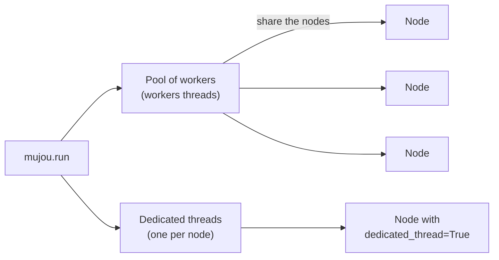
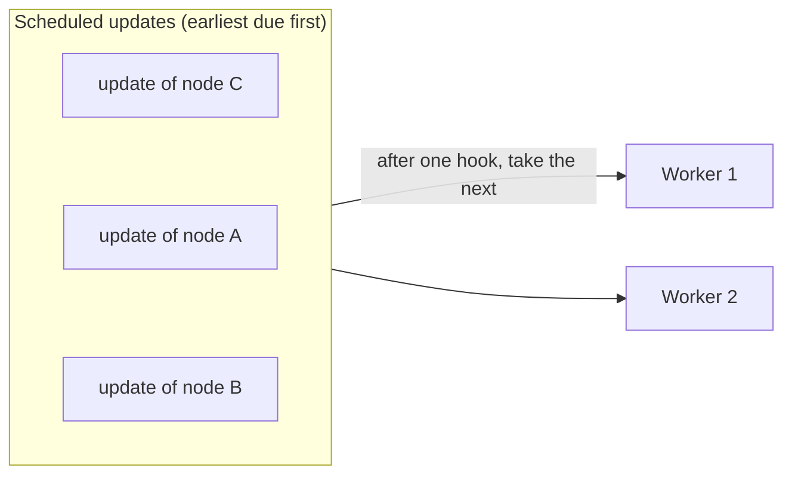
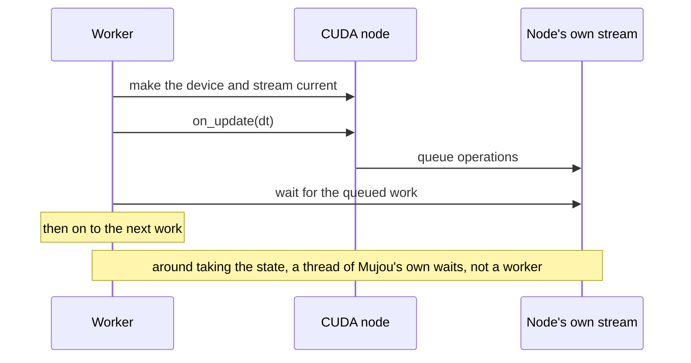
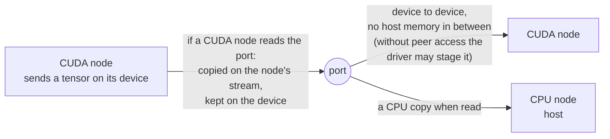

# 🧵 Threads and Devices



## The workers {#workers}



A run does not start a thread per node, so with many nodes the threads stay few, and the OS does not spend its time switching between them. The number of workers and its default are under `workers` of [`mujou.run`][mujou.run].

??? question "Why is the default halved while the GIL is enabled?"

    While the GIL is enabled (on a build of Python with it, or on the free-threaded build with `PYTHON_GIL=1`), one thread runs Python code at a time, so the nodes run in parallel only inside torch operations. More workers than half the CPUs mostly contend for the GIL, which is why the default is half. For nodes that spend most of their time in Python, even fewer are about as fast.

## A thread of its own {#dedicated}

Pass [`dedicated_thread=True`][mujou.Node.dedicated_thread] to a node whose hooks block, waiting for a device, a socket or a lock, or that relies on per-thread state set once in `on_start`.

```python
class Camera(Node):
    def __init__(self) -> None:
        super().__init__(period=1 / 30, dedicated_thread=True)
```

## Per-thread settings {#per-thread}

| Setting                                                                        | On the workers                                                                                                                  | How to write it                             |
| ------------------------------------------------------------------------------ | ------------------------------------------------------------------------------------------------------------------------------- | ------------------------------------------- |
| `threading.local`, `threading.current_thread()`, `threading.get_ident()`       | May differ from hook to hook                                                                                                    | For a setting made once, a dedicated thread |
| Per-thread settings of torch (`torch.autocast`, gradient recording, and so on) | Left behind, they leak into the next node on the same worker                                                                    | Keep them inside a `with` in the hook       |
| `contextvars`                                                                  | Carry over. Each node runs its hooks in a `contextvars.Context` of its own, which starts empty (it does not inherit the host's) | Use as is                                   |
| The current CUDA device and stream                                             | Mujou sets them before each hook of a CUDA node. This is the only thing Mujou itself sets                                       | —                                           |

=== "Avoid"

    ```python
    @override
    def on_update(self, dt: float) -> None:
        super().on_update(dt)
        torch.set_grad_enabled(False)  # left behind, it leaks into the next node on the worker
        ...
    ```

=== "Write instead"

    ```python
    @override
    def on_update(self, dt: float) -> None:
        super().on_update(dt)
        with torch.no_grad():  # set back before the hook returns
            ...
    ```

## Seeds and random numbers {#seed}

`seed` reproduces only the node's own generator, [`self.generator`][mujou.Node.generator], so initialize `nn.Linear` and the like again from it (the default initialization uses the generator every node shares).

=== "Avoid"

    ```python
    super().__init__(seed=0)
    torch.manual_seed(0)  # changes the random numbers of the other nodes too
    self.model = nn.Linear(4, 2)  # initialized from the generator every node shares
    ```

=== "Write instead"

    ```python
    super().__init__(seed=0)
    self.model = nn.Linear(4, 2)
    nn.init.normal_(self.model.weight, std=0.1, generator=self.generator)
    nn.init.zeros_(self.model.bias)
    ```

## Devices {#devices}

Received messages arrive on the node's [`device`][mujou.Node.device], so allocate tensors with `device=self.device`. A state tree taken from CUDA nodes restores only into CUDA nodes (on another machine with a GPU too; why is in [`Node.load_state_dict`][mujou.Node.load_state_dict]).

### What Mujou does for a CUDA node {#cuda}



Each CUDA node has a stream of its own, and Mujou switches to it and waits for it, so the node writes no synchronization.

### How a message travels {#message-paths}



The full rules are in [`Port.send`][mujou.Port.send], and the host's writes in [`Run.write`][mujou.Run.write]. A node that reads messages from a CUDA node on another device (a node on the CPU, or on another GPU) copies them on a stream of its own on that device, which Mujou makes current in each of its hooks too. A node on the CPU that reads no CUDA node does not touch CUDA, nor does it use the stream of a CUDA node left on the worker.

### Synchronization and streams {#streams}

=== "Avoid"

    ```python
    torch.cuda.synchronize()  # waits for the whole device, the other nodes' work included
    ```

=== "Write instead"

    ```python
    torch.cuda.current_stream().record_event().synchronize()  # only your own stream
    ```

Streams come from a pool of 32 per device, counting the nodes' streams and the copy streams of the nodes that read another device. Past 32, some nodes share a stream: the results stay correct, but a reader that shares the writer's stream also waits for what the writer queued after it sent, which may slow it down (a node on the CPU waits for it on the host).

!!! tip "Create CUDA tensors and modules in `on_start`"

    Tensors and modules made on CUDA in `__init__` work, since `mujou.run` synchronizes the host's stream before it starts the nodes. Still, create them in `on_start` or later. PyTorch's caching allocator ties memory to the stream current when it was allocated, so memory allocated in `__init__` stays tied to the host's stream; when the node drops such a tensor, the memory may be reused by the host before the node's work on it has finished. A restore loads the state after `on_start`, so state made there is restored too.

    === "Avoid"

        ```python
        def __init__(self) -> None:
            super().__init__(device="cuda:0")
            self.w = torch.zeros(256, 256, device=self.device)  # tied to the host's stream
        ```

    === "Write instead"

        ```python
        @override
        def on_start(self) -> None:
            super().on_start()
            self.w = torch.zeros(256, 256, device=self.device)  # allocated on the node's stream
        ```

## Settings of the whole process {#process-settings}

Do not change settings the whole process shares in a node. The host sets them once, before `mujou.run`.

| Kind                         | Settings and operations                                                                        |
| ---------------------------- | ---------------------------------------------------------------------------------------------- |
| Random numbers               | `torch.manual_seed` and the default random generator                                           |
| Behavior of torch            | `torch.set_num_threads`, `torch.use_deterministic_algorithms`, the flags of `torch.backends.*` |
| Operations on a whole device | `torch.cuda.synchronize()`, `torch.cuda.empty_cache()`, and so on                              |

```python
--8<-- "examples/online_learning.py:threads"
```

!!! tip "Rule of thumb for the number of threads"

    **(workers + nodes with `dedicated_thread=True`) × `n` ≤ physical cores**

    `n` is the value of `torch.set_num_threads(n)`. With many nodes on small matrices, `n = 1` is enough.
