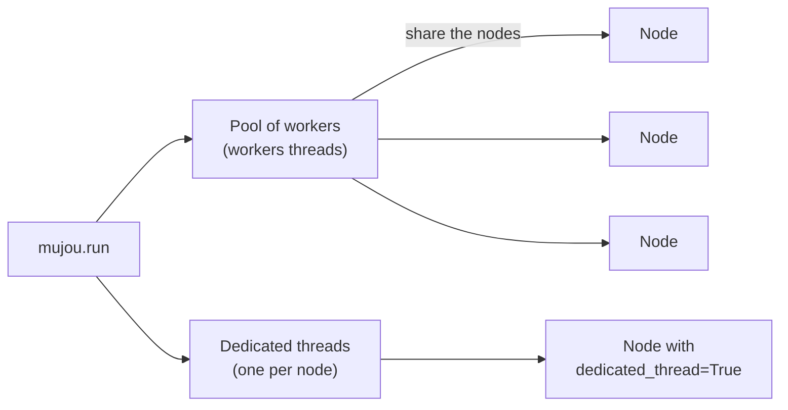
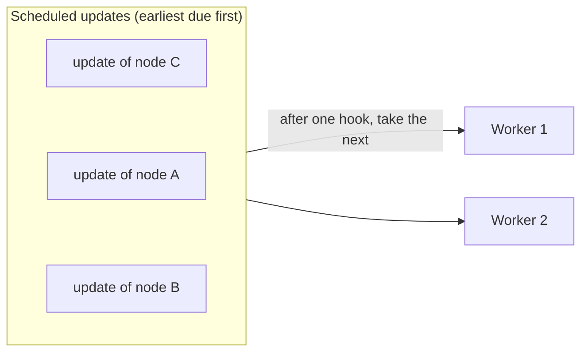
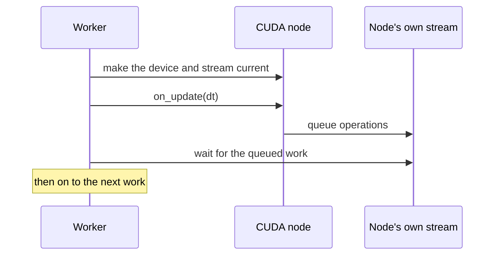
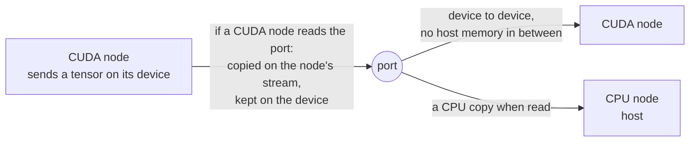

# 🧵 Threads and Devices

This page covers the threads a run computes on, the settings of a node (`device`, `seed`, `dedicated_thread`), CUDA, and the settings of torch that the whole process shares.

!!! abstract "What you will learn"

    - Which thread a node runs on (the workers or a thread of its own)
    - How to keep per-thread settings and random numbers from leaking into other nodes
    - The stream of a CUDA node, and the way a message travels
    - The torch settings the host makes once, before the run



## The arguments of `Node`

!!! abstract "Key idea"

    The keyword arguments of `super().__init__` set the period, the random numbers, the device and the thread. All are optional.

| Argument           | Meaning                                                                | Default                       |
| ------------------ | ---------------------------------------------------------------------- | ----------------------------- |
| `period`           | The time between two updates on average, in seconds of the run's timer | `0.01`                        |
| `seed`             | The seed of the node's own random generator `self.generator`           | `None` (different every time) |
| `device`           | Where the node computes: `"cpu"` or a CUDA device                      | `"cpu"`                       |
| `dedicated_thread` | Run the node on a thread of its own instead of the run's workers       | `False`                       |

The node reads them back as the read-only properties `period`, `generator`, `device` and `dedicated_thread`.

## The workers

!!! abstract "Key idea"

    A run does not start a thread per node. A few workers share the nodes, taking the updates due earliest first.



A worker runs one hook of one node, then takes the next work, the updates due earliest first. With many nodes, the threads stay few, and the OS does not spend its time switching between them.

| Number of workers (`mujou.run(net, workers=n)`) | Default                                                                                                           |
| ----------------------------------------------- | ----------------------------------------------------------------------------------------------------------------- |
| GIL disabled                                    | The number of CPUs the process may use (the logical cores, or fewer when the CPU affinity or a quota limits them) |
| GIL enabled                                     | Half of it (at least 1)                                                                                           |
| Either way                                      | Never more than the nodes on the workers                                                                          |

| For a node on the workers | What holds                                                                                                                    |
| ------------------------- | ----------------------------------------------------------------------------------------------------------------------------- |
| Hooks at the same time    | The hooks of one node never run at the same time                                                                              |
| Values between hooks      | Each hook sees what the previous one wrote                                                                                    |
| Which worker runs it      | May change from one hook to the next                                                                                          |
| A hook that blocks        | Holds its worker meanwhile, and the other nodes' `dt` grows (see the [rules a node keeps](../concepts.md#rules-a-node-keeps)) |

??? question "Why is the default halved while the GIL is enabled?"

    While the GIL is enabled (on a build of Python with it, or on the free-threaded build with `PYTHON_GIL=1`), one thread runs Python code at a time, so the nodes run in parallel only inside torch operations. More workers than half the CPUs mostly contend for the GIL, which is why the default is half. For nodes that spend most of their time in Python, even fewer are about as fast.

## A thread of its own

!!! abstract "Key idea"

    Pass `dedicated_thread=True` to a node that would hold a worker, or that sets something per thread once.

| When                                                      | Why                                                                |
| --------------------------------------------------------- | ------------------------------------------------------------------ |
| Its hooks block, waiting for a device, a socket or a lock | On a worker, the wait would hold the worker                        |
| It relies on per-thread state set once                    | Its `on_start` runs on its own thread, so make such settings there |

```python
class Camera(Node):
    def __init__(self) -> None:
        super().__init__(period=1 / 30, dedicated_thread=True)
```

## Per-thread settings

!!! abstract "Key idea"

    On the workers, what a hook sets on its thread may be seen by its next hook, and by another node that runs next on the same worker. Keep such settings inside the hook.

On the workers, each hook of a node may run on a different thread, and the thread runs other nodes in between. So whether the next hook sees what a hook set per thread depends on the schedule, and the next node on the same worker may see it too.

| Setting                                                                        | On the workers                                                                                                                  | How to write it                             |
| ------------------------------------------------------------------------------ | ------------------------------------------------------------------------------------------------------------------------------- | ------------------------------------------- |
| `threading.local`, `threading.current_thread()`, `threading.get_ident()`       | May differ from hook to hook                                                                                                    | For a setting made once, a dedicated thread |
| Per-thread settings of torch (`torch.autocast`, gradient recording, and so on) | Left behind, they leak into the next node on the same worker                                                                    | Keep them inside a `with` in the hook       |
| `contextvars`                                                                  | Carry over. Each node runs its hooks in a `contextvars.Context` of its own, which starts empty (it does not inherit the host's) | Use as is                                   |
| The current CUDA device and stream                                             | Mujou sets them before each hook of a CUDA node. This is the only thing Mujou itself sets                                       | —                                           |

=== "Avoid"

    ```python
    @override
    def on_update(self, dt: float) -> None:
        super().on_update(dt)
        torch.set_grad_enabled(False)  # left behind, it leaks into the next node on the worker
        ...
    ```

=== "Write instead"

    ```python
    @override
    def on_update(self, dt: float) -> None:
        super().on_update(dt)
        with torch.no_grad():  # set back before the hook returns
            ...
    ```

## Seeds and random numbers

!!! abstract "Key idea"

    Draw random numbers from the node's own generator, `self.generator`. `seed` reproduces only this generator.

```python
nn.init.normal_(self.model.weight, std=0.1, generator=self.generator)
noise = torch.randn(4, generator=self.generator, device=self.device)
```

`self.generator` is made from `seed`, on the node's device. It can be used right after `super().__init__()`, in `__init__` too. Its state is in the node's state, so a resumed run goes on with the same random sequence.

| Do                                                              | Why                                                             |
| --------------------------------------------------------------- | --------------------------------------------------------------- |
| Draw random numbers from `self.generator`                       | `seed` reproduces only this one                                 |
| Initialize `nn.Linear` and the like again from `self.generator` | The default initialization uses the generator every node shares |
| Do not call `torch.manual_seed` in a node                       | It changes the random numbers of the other nodes too            |

=== "Avoid"

    ```python
    super().__init__(seed=0)
    torch.manual_seed(0)  # changes the random numbers of the other nodes too
    self.model = nn.Linear(4, 2)  # initialized from the generator every node shares
    ```

=== "Write instead"

    ```python
    super().__init__(seed=0)
    self.model = nn.Linear(4, 2)
    nn.init.normal_(self.model.weight, std=0.1, generator=self.generator)
    nn.init.zeros_(self.model.bias)
    ```

## Devices

!!! abstract "Key idea"

    `device` is the CPU or a CUDA device. Received messages arrive on the node's device, so allocate tensors with `device=self.device`.

| Value of `device`                      | Result                                               |
| -------------------------------------- | ---------------------------------------------------- |
| `"cpu"` (default)                      | Computes on the CPU                                  |
| A CUDA device (`"cuda:0"`, say)        | Computes on that device                              |
| `"cuda"` without an index              | The host's current CUDA device when the node is made |
| Anything else (`"mps"`, `"meta"`, ...) | `ValueError`                                         |
| CUDA where CUDA is not available       | `ValueError`                                         |

### What Mujou does for a CUDA node

!!! abstract "Key idea"

    Each CUDA node has a stream of its own, and Mujou makes it current and waits for it. The node writes no synchronization.

| When                                        | What Mujou does                                                                                                         |
| ------------------------------------------- | ----------------------------------------------------------------------------------------------------------------------- |
| In each hook                                | Makes the node's device and the node's own CUDA stream current, so every operation of the node goes on that stream      |
| After each `on_update`, and after a restore | Waits for the work queued on that stream. The worker waits meanwhile, as in a hook that blocks                          |
| Before and after `state_dict`               | Waits, on a thread of Mujou's own instead of a worker (on the host's thread once the run has ended), so no worker waits |



### How a message travels

!!! abstract "Key idea"

    When a CUDA node reads the port, the tensor stays on the device. A node on the CPU, and the host, get a CPU copy when they read it.



| Tensor sent, and who reads it                                                     | Path                                                                                                                                                      |
| --------------------------------------------------------------------------------- | --------------------------------------------------------------------------------------------------------------------------------------------------------- |
| A tensor on the node's device, on a port a CUDA node reads                        | Stays on the device. `send` copies it on the node's stream and waits for that stream before the peers can read it                                         |
| ↳ A CUDA peer                                                                     | Copies device to device, without host memory in between (between two GPUs without peer access, the CUDA driver may still stage the copy through the host) |
| ↳ A node on the CPU, the host (`run.read`, `subscribe`, `wait_for`, `state_dict`) | Gets a CPU copy when it reads                                                                                                                             |
| On a port that only nodes on the CPU (or only the host) read                      | Through host memory (faster for them)                                                                                                                     |
| A tensor on another device than the node's                                        | Through host memory                                                                                                                                       |
| While the hook has made another device current (`torch.cuda.device(...)`)         | Still stays on the device                                                                                                                                 |

A node that reads messages from a CUDA node on another device (a node on the CPU, or on another GPU) copies them on a stream of its own on that device, which Mujou makes current in each of its hooks too. A node on the CPU that reads no CUDA node does not touch CUDA, nor does it use the stream of a CUDA node that the worker ran just before.

### Writes of the host

| Tensor of `run.write` (and `inputs=`)                                                    | Path                                                                                                                                                                    |
| ---------------------------------------------------------------------------------------- | ----------------------------------------------------------------------------------------------------------------------------------------------------------------------- |
| On the CUDA device of the port's node                                                    | Stays on that device. It is copied on the host's current stream of that device, which is then waited for, so the host need not synchronize, whichever device is current |
| Anything else (a write to a node on the CPU, a tensor on another device than the node's) | Through host memory                                                                                                                                                     |

Either way, no node waits for the GPU work the host queues after it writes.

### Synchronization and streams

!!! abstract "Key idea"

    To synchronize yourself, wait only for your own stream, never for the whole device.

=== "Avoid"

    ```python
    torch.cuda.synchronize()  # waits for the whole device, the other nodes' work included
    ```

=== "Write instead"

    ```python
    torch.cuda.current_stream().record_event().synchronize()  # only your own stream
    ```

| About the streams   | What holds                                                                                                                          |
| ------------------- | ----------------------------------------------------------------------------------------------------------------------------------- |
| Pool                | 32 streams per device                                                                                                               |
| What counts         | The nodes' streams, and the copy streams of the nodes that read another device                                                      |
| Past 32             | Some nodes share a stream. It stays correct but may slow a node down                                                                |
| Waiting when shared | A reader that shares the writer's stream waits for what the writer queued after it sent; a node on the CPU waits for it on the host |

!!! tip "Create CUDA tensors and modules in `on_start`"

    Tensors and modules made on CUDA in `__init__` work, since `mujou.run` synchronizes the host's stream before it starts the nodes. Still, create them in `on_start` or later. PyTorch's caching allocator ties memory to the stream current when it was allocated, so memory allocated in `__init__` stays tied to the host's stream; when the node drops such a tensor, the memory may be reused by the host before the node's work on it has finished. A restore loads the state after `on_start`, so state made there is restored too.

    === "Avoid"

        ```python
        def __init__(self) -> None:
            super().__init__(device="cuda:0")
            self.w = torch.zeros(256, 256, device=self.device)  # tied to the host's stream
        ```

    === "Write instead"

        ```python
        @override
        def on_start(self) -> None:
            super().on_start()
            self.w = torch.zeros(256, 256, device=self.device)  # allocated on the node's stream
        ```

### The state tree and CUDA

| Item                      | What holds                                                                                           |
| ------------------------- | ---------------------------------------------------------------------------------------------------- |
| The state tree            | Holds CPU copies, also of the nodes on CUDA                                                          |
| Default `load_state_dict` | Copies them back to the node's device                                                                |
| Where it restores         | A tree saved from nodes on CUDA restores only into nodes on CUDA (on another machine with a GPU too) |
| Why                       | The state of a random generator differs between the CPU and CUDA                                     |

## Settings of the whole process

!!! abstract "Key idea"

    Do not change settings the whole process shares in a node. The host sets them once, before `mujou.run`.

| Kind                         | Settings and operations                                                                        |
| ---------------------------- | ---------------------------------------------------------------------------------------------- |
| Random numbers               | `torch.manual_seed` and the default random generator                                           |
| Behavior of torch            | `torch.set_num_threads`, `torch.use_deterministic_algorithms`, the flags of `torch.backends.*` |
| Operations on a whole device | `torch.cuda.synchronize()`, `torch.cuda.empty_cache()`, and so on                              |

On the CPU, a torch operation uses further threads of its own for each thread that computes. With too many, the nodes compete for the cores and everything slows down, so the host keeps them few:

```python
--8<-- "examples/online_learning.py:threads"
```

!!! tip "Rule of thumb for the number of threads"

    **(workers + nodes with `dedicated_thread=True`) × `n` ≤ physical cores**

    `n` is the value of `torch.set_num_threads(n)`. With many nodes on small matrices, `n = 1` is enough.
