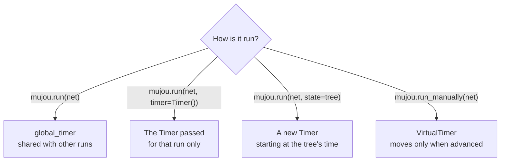
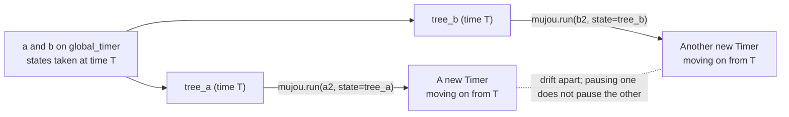

# ⏱️ Time

Each run has one time axis: every node's `dt`, every message's time and every pause are on the run's timer (why nodes update by `dt` is in [Time in How Mujou Works](../concepts.md#time)).

## The timers {#timers}



The timer types (Timer, VirtualTimer, ReadOnlyTimer, Timestamp, global_timer) are in [`mujou.time`][mujou.time].

### What the host and a node can do {#host-and-node}

| Operation                                                            | Host (`run.timer`) | Node ([`self.timer`][mujou.Node.timer])   |
| -------------------------------------------------------------------- | ------------------ | ----------------------------------------- |
| `now()`, `time_scale()`                                              | Yes                | Yes                                       |
| `is_paused()`                                                        | Yes                | No such method                            |
| `sleep`, `pause`, `resume`, `set_time_scale`, `VirtualTimer.advance` | Yes                | No such method; in a hook, `RuntimeError` |

=== "Avoid"

    ```python
    def on_update(self, dt: float) -> None:
        super().on_update(dt)
        global_timer.sleep(0.1)  # RuntimeError in a hook
    ```

=== "Write instead"

    ```python
    def __init__(self) -> None:
        super().__init__(period=0.1)  # updates every 0.1 s on average
    ```

## Units {#units}

| Unit                       | Used by                                                                                                      |
| -------------------------- | ------------------------------------------------------------------------------------------------------------ |
| Seconds of the run's timer | `dt`, `period`, `Timer.sleep`, `VirtualTimer.advance`, `pc.show(seconds=)`, the time constants of `mujou.pc` |
| Real seconds               | Every `timeout`                                                                                              |

??? question "Why is a timeout in real time?"

    So that a stuck run is given up on, whatever its time scale and pauses.

## Timestamp {#timestamp}

A [`Timestamp`][mujou.time.Timestamp] does not record which timer it is on, so compare only times of one timer (those of one run and its `run.timer.now()`, say).

```python
--8<-- "examples/timers.py:timestamp"
```

```python
t_in = run.write({net.prev: x})
run.timer.sleep(0.1)
y, t_out = run.read_with_time(net.next)
if t_out is not None and t_out >= t_in:  # y was sent after x was written
    print(t_out - t_in)  # seconds from the write until y was sent
```

## A timer of a run's own and its scale {#own-timer}

Scaling or pausing the [`Timer`][mujou.time.Timer] passed to `mujou.run` does not affect other runs (whether to split runs or join them into one is in [Groups](groups.md#one-or-many)).

```python
--8<-- "examples/timers.py:own-timer"
```

The [`global_timer`][mujou.time.global_timer] can be scaled too, which changes every run on it.

```python
--8<-- "examples/timers.py:global-scale"
```

## Pausing the time {#pause}

<figure class="mujou-diagram">
<svg viewBox="0 0 640 175" role="img" aria-label="A node updates at regular intervals, but not between pause and resume. The first dt after resume does not include the paused time">
<rect x="260" y="28" width="160" height="112" style="fill: var(--md-default-fg-color--lightest)"/>
<text class="mujou-note" x="260" y="20" text-anchor="middle">pause()</text>
<text class="mujou-note" x="420" y="20" text-anchor="middle">resume()</text>
<text class="mujou-label" x="340" y="52" text-anchor="middle">Time stops</text>
<text class="mujou-note" x="340" y="70" text-anchor="middle">no updates, sleep does not return</text>
<text class="mujou-label" x="10" y="104">Node</text>
<line class="mujou-lane" x1="90" y1="100" x2="620" y2="100"/>
<g class="mujou-tick-a"><line x1="100" y1="88" x2="100" y2="112"/><line x1="160" y1="88" x2="160" y2="112"/><line x1="220" y1="88" x2="220" y2="112"/><line x1="450" y1="88" x2="450" y2="112"/><line x1="510" y1="88" x2="510" y2="112"/><line x1="570" y1="88" x2="570" y2="112"/></g>
<path class="mujou-brace" d="M 222 118 Q 222 126 230 126 L 442 126 Q 450 126 450 118"/>
<text class="mujou-note" x="336" y="142" text-anchor="middle">the next dt counts only the time before and after the pause</text>
<line class="mujou-axis" x1="90" y1="152" x2="620" y2="152"/>
<text class="mujou-label" x="620" y="168" text-anchor="end">real time →</text>
</svg>
</figure>

From [`Timer.pause`][mujou.time.Timer.pause] until resume, every run on that timer stops (`global_timer.pause()` stops every run on the global timer).
Your pause and the pause for taking the state ([Save and Resume](../tutorial/6-save-and-resume.md#pause)) are separate switches.

!!! warning "A pause is for taking the state and for observing"

    Do not make it part of how a network learns.

### Taking the states of several runs at one time {#multi-run-state}

```python
--8<-- "examples/timers.py:pause"
```

=== "Avoid"

    ```python
    global_timer.pause()
    tree_a = run_a.state_dict()
    tree_b = run_b.state_dict()
    global_timer.resume()  # an exception in between leaves the time stopped
    ```

=== "Write instead"

    ```python
    global_timer.pause()
    try:
        tree_a = run_a.state_dict()
        tree_b = run_b.state_dict()
    finally:
        global_timer.resume()  # resumes even on an exception
    ```

## The timer of a resumed run {#restored-timer}



```python
--8<-- "examples/timers.py:restore"
```

Runs that must stay on one time axis after a resume run as one run in a [`Group`][mujou.Group] from the start (`mujou.run(Group(a=a, b=b))`; the tree of one run resumes onto one timer).
