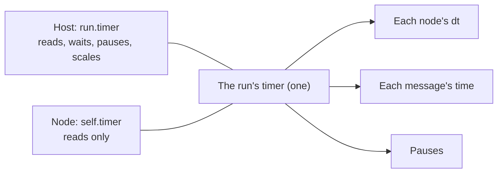
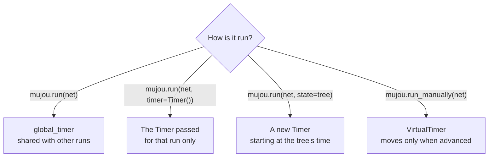
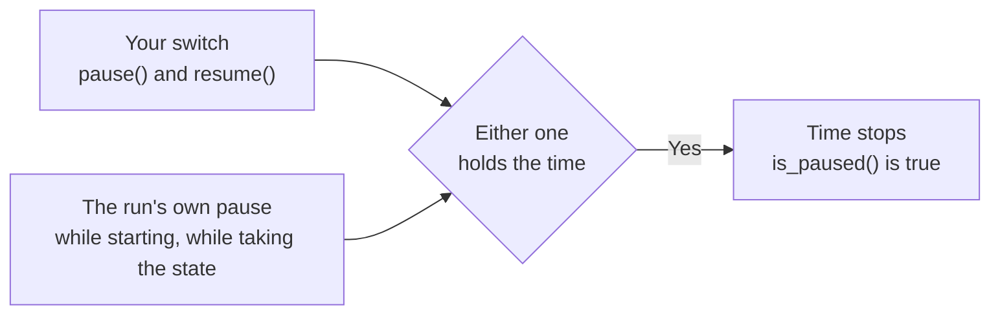
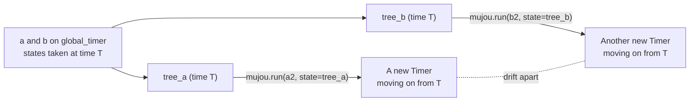

# ⏱️ Time

Each run has one time axis: the run's timer. Every node's `dt`, every message's time and every pause are on it.



!!! abstract "On this page"

    - Which timer a run runs on
    - The units of time (seconds of the run's timer and real seconds)
    - How to compare `Timestamp`s
    - How to change the time scale and how to stop the time
    - The timer of a resumed run
    - Time as a node sees it

## The timers

!!! abstract "In short"

    Runs given no `timer` share the `global_timer`. Pass a `Timer()` to give a run its own; a run resumed with `state=` runs on a new `Timer`.



| Name                        | What it is                                                                                                       |
| --------------------------- | ---------------------------------------------------------------------------------------------------------------- |
| `mujou.time.global_timer`   | The timer of every run not given one of its own. It starts at 0 when the process first uses it                   |
| `mujou.time.Timer()`        | A timer for one run of its own (`mujou.run(net, timer=Timer())`). It starts at `start` (0) with `time_scale` (1) |
| `mujou.time.VirtualTimer()` | A `Timer` that moves only when advanced (`advance(seconds)`). `mujou.run_manually` uses one                      |
| `mujou.time.ReadOnlyTimer`  | A view that only reads a timer. A node's `self.timer` is one                                                     |
| `mujou.time.Timestamp`      | A time on a timer                                                                                                |

### What the host and a node can do

| Operation               | Host (`run.timer`) | Node (`self.timer`) |
| ----------------------- | ------------------ | ------------------- |
| `now()`                 | Yes                | Yes                 |
| `time_scale()`          | Yes                | Yes                 |
| `sleep(seconds)`        | Yes                | No                  |
| `pause()`, `resume()`   | Yes                | No                  |
| `is_paused()`           | Yes                | No                  |
| `set_time_scale(scale)` | Yes                | No                  |

## Units

!!! abstract "In short"

    Only a `timeout` is in real seconds. Every other second is a second of the run's timer.

| Unit                       | Used by                                                                                                      |
| -------------------------- | ------------------------------------------------------------------------------------------------------------ |
| Seconds of the run's timer | `dt`, `period`, `Timer.sleep`, `VirtualTimer.advance`, `pc.show(seconds=)`, the time constants of `mujou.pc` |
| Real seconds               | Every `timeout`                                                                                              |

??? question "Why is a timeout in real time?"

    So that a stuck run is given up on, whatever its time scale and pauses.

## Timestamp

!!! abstract "In short"

    A `Timestamp` is a time on a timer. Compare two to see which came first, and subtract them for the seconds between. Compare only times of the same timer.

```python
--8<-- "examples/timers.py:timestamp"
```

| Expression           | Result                                                          |
| -------------------- | --------------------------------------------------------------- |
| `float(t)`           | Seconds                                                         |
| `t.ns`               | Nanoseconds (the exact value)                                   |
| `a - b`              | Seconds from `b` to `a` (a `float`); negative if `a` is earlier |
| `a < b` and the like | Which time is earlier                                           |

`write`, `read_with_time`, `subscribe`, `wait_for`, `recv_with_time` and `now()` return `Timestamp`s. The time of a value not sent yet is `None`.

!!! warning "Compare only times of the same timer"

    A `Timestamp` does not record which timer it is on. Compare only times of one timer, such as those of one run and its `run.timer.now()`.

```python
t_in = run.write({net.prev: x})
run.timer.sleep(0.1)
y, t_out = run.read_with_time(net.next)
if t_out is not None and t_out >= t_in:  # y was sent after x was written
    print(t_out - t_in)  # seconds from the write until y was sent
```

## A timer of a run's own

!!! abstract "In short"

    `mujou.run(net, timer=Timer(...))` gives the run a time axis of its own. Scaling or pausing it does not affect other runs.

| When to use it                                   | Example                                           |
| ------------------------------------------------ | ------------------------------------------------- |
| To speed up or slow down only that run           | Debugging, trials faster than real time           |
| To keep it from pausing together with other runs | Taking the state of one without pausing the other |

```python
--8<-- "examples/timers.py:own-timer"
```

### Time scale

`time_scale` is how many seconds of the timer pass per real second. It must be a finite number greater than 0; anything else raises `ValueError`. To stop the time, do not set it to 0: use `pause`.

| `time_scale`  | Seconds of the timer per real second |
| ------------- | ------------------------------------ |
| `1` (default) | 1                                    |
| `10`          | 10                                   |
| `0.5`         | 0.5                                  |

The global timer can be scaled too, which changes every run on it.

```python
--8<-- "examples/timers.py:global-scale"
```

## Pausing the time

!!! abstract "In short"

    From `timer.pause()` until `timer.resume()`, the time of every run on that timer stops. Use it to take the states of several runs at one time.

<figure class="mujou-diagram">
<svg viewBox="0 0 640 175" role="img" aria-label="A node updates at regular intervals, but not between pause and resume. The first dt after resume does not include the paused time">
<rect x="260" y="28" width="160" height="112" style="fill: var(--md-default-fg-color--lightest)"/>
<text class="mujou-note" x="260" y="20" text-anchor="middle">pause()</text>
<text class="mujou-note" x="420" y="20" text-anchor="middle">resume()</text>
<text class="mujou-label" x="340" y="52" text-anchor="middle">Time stops</text>
<text class="mujou-note" x="340" y="70" text-anchor="middle">no updates, sleep does not return</text>
<text class="mujou-label" x="10" y="104">Node</text>
<line class="mujou-lane" x1="90" y1="100" x2="620" y2="100"/>
<g class="mujou-tick-a"><line x1="100" y1="88" x2="100" y2="112"/><line x1="160" y1="88" x2="160" y2="112"/><line x1="220" y1="88" x2="220" y2="112"/><line x1="450" y1="88" x2="450" y2="112"/><line x1="510" y1="88" x2="510" y2="112"/><line x1="570" y1="88" x2="570" y2="112"/></g>
<path class="mujou-brace" d="M 222 118 Q 222 126 230 126 L 442 126 Q 450 126 450 118"/>
<text class="mujou-note" x="336" y="142" text-anchor="middle">the next dt counts only the time before and after the pause</text>
<line class="mujou-axis" x1="90" y1="152" x2="620" y2="152"/>
<text class="mujou-label" x="620" y="168" text-anchor="end">real time →</text>
</svg>
<figcaption>Each vertical line is an update of the node. While paused, the node does not update, and the first <code>dt</code> after <code>resume</code> does not count the pause</figcaption>
</figure>

| While paused                        | What happens                                                          |
| ----------------------------------- | --------------------------------------------------------------------- |
| The nodes of every run on the timer | Do not update. The first `dt` after `resume` does not count the pause |
| Notice to the nodes                 | None. `on_pause` and `on_resume` run only around taking the state     |
| `sleep` on the timer                | Does not return until `resume`                                        |
| `VirtualTimer.advance`              | `RuntimeError`                                                        |
| `run.state_dict()`                  | Still works, and gives the state at the time of the pause             |

`global_timer.pause()` stops every run on the global timer.

### pause and taking the state



Taking the state also pauses the run's timer, apart from your `pause`. `pause` is a switch, not a count: calling it twice is undone by one `resume`. `resume` does not end a pause for taking the state, and your `pause` still holds after the state is taken.

### Taking the states of several runs at one time

To take the states of several runs on one timer, pause the timer, then take them one by one.

| How                                | Time of the states taken                  |
| ---------------------------------- | ----------------------------------------- |
| `run.state_dict()` one by one      | Each state taken later is of a later time |
| `pause` the timer, then one by one | All at the time of the pause, T           |

```python
--8<-- "examples/timers.py:pause"
```

=== "Avoid"

    ```python
    global_timer.pause()
    tree_a = run_a.state_dict()
    tree_b = run_b.state_dict()
    global_timer.resume()  # an exception in between leaves the time stopped
    ```

=== "Write instead"

    ```python
    global_timer.pause()
    try:
        tree_a = run_a.state_dict()
        tree_b = run_b.state_dict()
    finally:
        global_timer.resume()  # resumes even on an exception
    ```

!!! warning "A pause is for taking the state and for observing"

    Do not make it part of how a network learns.

## The timer of a resumed run

!!! abstract "In short"

    A run resumed with `mujou.run(net, state=tree)` runs on a new `Timer` that starts at the time and the time scale of the tree. The global timer and the other runs do not go back.



```python
--8<-- "examples/timers.py:restore"
```

| What you do                                    | Result                                                                                     |
| ---------------------------------------------- | ------------------------------------------------------------------------------------------ |
| Pass `timer=` with `state=`                    | `ValueError`                                                                               |
| `global_timer.pause()`                         | Does not pause a resumed run. Pause its `run.timer`                                        |
| Resume separately from trees taken at one time | They share no time axis: the timers drift apart, and pausing one does not pause the others |

Runs that must stay on one time axis after a resume run as one run from the start (`mujou.run(Group(a=a, b=b))`). The tree of one run resumes onto one timer.

=== "From trees of separate runs"

    ```python
    # resuming from trees of separate runs gives separate timers
    run_a = mujou.run(Clock(), state=tree_a)
    run_b = mujou.run(Clock(), state=tree_b)
    ```

=== "From the tree of one run"

    ```python
    # the tree of one run resumes onto one timer
    with mujou.run(Group(a=Clock(), b=Clock()), state=tree) as run:
        ...
    ```

## Nodes only read the time

!!! abstract "In short"

    A node's `self.timer` is a read-only `ReadOnlyTimer`, readable only in hooks. Only the host moves the time.

| Where it is read from         | `self.timer`                           |
| ----------------------------- | -------------------------------------- |
| Any hook, `on_start` included | Readable                               |
| `__init__`                    | `RuntimeError`                         |
| The host                      | `RuntimeError`                         |
| `on_exception`, `on_stop`     | Stands still at the time the run ended |

Only the host moves the time. Calling `sleep`, `pause`, `resume`, `set_time_scale` or `VirtualTimer.advance` in a node's hook raises `RuntimeError` (see [rules a node keeps](../concepts.md#rules-a-node-keeps)). To update at intervals, give the node a `period`.

=== "Avoid"

    ```python
    def on_update(self, dt: float) -> None:
        super().on_update(dt)
        global_timer.sleep(0.1)  # RuntimeError in a hook
    ```

=== "Write instead"

    ```python
    def __init__(self) -> None:
        super().__init__(period=0.1)  # updates every 0.1 s on average
    ```
