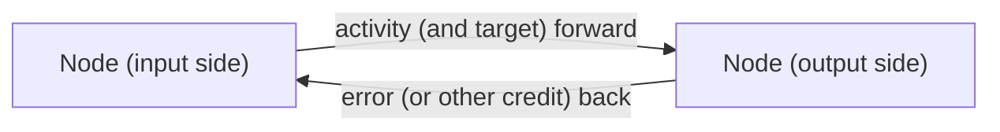

# 🧮 Update Rules

An update rule (a learning rule) is what a node writes in `on_update(dt)`. Mujou builds no rule into nodes, ports or the scheduler, so each node chooses its own, and the same network can swap them. This page shows how to write a rule that learns across nodes, with feedback alignment as the example.

!!! abstract "What you will learn"

    - What a rule that learns across nodes sends as messages
    - Two-way ports, relaying the target, and telling a new sample
    - `pc.clock.LearnClock`, which decides when to learn

| Where it learns            | Example              | Page                                                   |
| -------------------------- | -------------------- | ------------------------------------------------------ |
| Inside one node            | Backpropagation (BP) | [4. Learn in a Node](../tutorial/4-learn-in-a-node.md) |
| Across nodes (`mujou.pc`)  | PC-ALM               | [PC-ALM](pc.md)                                        |
| Across nodes (other rules) | Feedback alignment   | This page                                              |

## Within a node, across nodes

!!! abstract "Key idea"

    No computation graph is joined across nodes. A rule that learns across nodes sends what each node needs as messages.

|                     | Within a node                           | Across nodes                                   |
| ------------------- | --------------------------------------- | ---------------------------------------------- |
| What can be used    | Anything PyTorch computes (BP included) | Only the messages on the ports                 |
| Computation graph   | Joined                                  | Not joined: a port sends a detached copy       |
| What it learns from | The node's state                        | Its own state and its neighbors' messages only |



## Feedback alignment

!!! abstract "Key idea"

    `hidden` does not know `W2`, so instead of the BP credit $W_2^\top e$ it uses $B e$, with a fixed random matrix $B$ of its own. It learns anyway.

`examples/feedback_alignment.py` learns $\hat y = W_2 \tanh(W_1 x)$ with two nodes, `hidden` and `output`. `hidden` sends its activity forward, and `output` sends the error $e = \hat y - y$ back. With $B e$, it still learns, as $W_2$ comes to align with $B^\top$ ([Lillicrap et al., 2016](https://doi.org/10.1038/ncomms13276)).


|                         | BP                 | Feedback alignment                               |
| ----------------------- | ------------------ | ------------------------------------------------ |
| Credit `hidden` uses    | $W_2^\top e$       | $B e$ ($B$ is a fixed random matrix of `hidden`) |
| `hidden` must know `W2` | Yes                | No                                               |
| Why it learns           | It is the gradient | $W_2$ comes to align with $B^\top$               |

```sh
uv run python examples/feedback_alignment.py
```

```python
--8<-- "examples/feedback_alignment.py:hidden"
```

```python
--8<-- "examples/feedback_alignment.py:output"
```

The program prints the loss of `output` on each batch before learning from it (results below).

| Condition        | Loss of `output`                          |
| ---------------- | ----------------------------------------- |
| Both nodes learn | Falls from about 1.5 to about 0.02 in 6 s |
| `hidden` frozen  | Stays above 0.15                          |

## Two-way ports

!!! abstract "Key idea"

    One connection carries the activity forward and the error back.

| Port          | `send`     | `recv`     |
| ------------- | ---------- | ---------- |
| `hidden.next` | `ACTIVITY` | `ERROR`    |
| `output.prev` | `ERROR`    | `ACTIVITY` |

Connections may form cycles, so the error could as well come back on ports of its own.

## Relaying the target

!!! abstract "Key idea"

    Carry the target `y` and the time `time` of the write in the same message as the activity. Sent on a port of its own, a target could be paired with the prediction of another sample.

=== "Avoid: the target on a port of its own"

    ```mermaid
    sequenceDiagram
        participant H as hidden
        participant O as output
        H->>O: activity h (sample 2)
        Note over O: the target port still holds y of sample 1
        O->>O: compares the prediction for sample 2 with y of sample 1
        H->>O: target y (sample 2)
    ```

=== "Write instead: one message"

    ```mermaid
    sequenceDiagram
        participant H as hidden
        participant O as output
        H->>O: h, y, time (sample 2)
        O->>O: compares the prediction with its own target
        O->>H: e, time
        H->>H: learns only from the error whose time is that of the input it holds
    ```

Values on two ports travel independently, so put them in one message (the nodes of [PC-ALM](pc.md#the-nodes) in `mujou.pc` carry `y`, `mask` and `time` in their `pc.msg.Activity` the same way). Then `output` always compares a prediction with its own target, and `hidden` learns only from the error whose `time` is that of the input it holds.

## Telling what is new

!!! abstract "Key idea"

    `recv()` returns the latest value whether or not it is new. A node that learns once from each sample tells a new one by its time.

| Time used                           | Time before anyone sends                                    |
| ----------------------------------- | ----------------------------------------------------------- |
| The time `recv_with_time()` returns | `None`                                                      |
| A time the message carries          | Its initial value (`Timestamp(ns=0)` for a `TimestampSpec`) |

```python
sample, t = self.prev.recv_with_time()
if t is None:  # nobody has written yet
    return
```

## `pc.clock.LearnClock`

!!! abstract "Key idea"

    A `pc.clock.LearnClock` decides when to learn. It is a part of `mujou.pc`, but any rule can use it.

```python
tick = self.clock.tick(dt, t, self.timer.now())  # dt, the time the input was written, the time now
if tick.learn:
    self.optimizer.step_([grad], tick.elapsed)  # weighted by the time since it last learned
```

In each update, `tick(dt, time, now)` takes the `dt`, the time the input was written at and the time now, and returns a `pc.clock.Tick` (its fields below).

| Field of `Tick` | Meaning                                                             |
| --------------- | ------------------------------------------------------------------- |
| `new`           | The input is new (its time is not the one seen last)                |
| `learn`         | Learn in this update                                                |
| `elapsed`       | The time since the clock last learned, each `dt` capped at `max_dt` |
| `dt`            | The `dt` capped at `max_dt`                                         |

| `learn_interval` | Updates where `learn` is true                                                                                                                    |
| ---------------- | ------------------------------------------------------------------------------------------------------------------------------------------------ |
| Seconds          | The first update `learn_interval` after each write, then every `learn_interval` while the input stays. Never the update that first sees an input |
| `None`           | Every update                                                                                                                                     |
| `math.inf`       | Never                                                                                                                                            |

<figure class="mujou-diagram">
<svg viewBox="0 0 640 190" role="img" aria-label="Updates of a node after an input is written. The update right after the write is new and does not learn; the first update learn_interval after the write learns, and then every learn_interval. elapsed is the time since it last learned">
<line class="mujou-axis" x1="90" y1="170" x2="620" y2="170"/>
<text class="mujou-label" x="620" y="186" text-anchor="end">the run's timer →</text>
<line class="mujou-lane" x1="120" y1="40" x2="120" y2="170"/>
<text class="mujou-note" x="120" y="186" text-anchor="middle">write</text>
<text class="mujou-label" x="10" y="104">updates</text>
<line class="mujou-lane" x1="90" y1="100" x2="620" y2="100"/>
<g class="mujou-tick-a"><line x1="130" y1="88" x2="130" y2="112"/><line x1="160" y1="88" x2="160" y2="112"/><line x1="190" y1="88" x2="190" y2="112"/><line x1="220" y1="88" x2="220" y2="112"/><line x1="250" y1="88" x2="250" y2="112"/><line x1="310" y1="88" x2="310" y2="112"/><line x1="340" y1="88" x2="340" y2="112"/><line x1="370" y1="88" x2="370" y2="112"/><line x1="400" y1="88" x2="400" y2="112"/><line x1="460" y1="88" x2="460" y2="112"/><line x1="490" y1="88" x2="490" y2="112"/><line x1="520" y1="88" x2="520" y2="112"/><line x1="550" y1="88" x2="550" y2="112"/></g>
<g class="mujou-tick-b"><line x1="280" y1="84" x2="280" y2="116"/><line x1="430" y1="84" x2="430" y2="116"/><line x1="580" y1="84" x2="580" y2="116"/></g>
<text class="mujou-note" x="130" y="132" text-anchor="middle">new</text>
<text class="mujou-note" x="130" y="146" text-anchor="middle">(no learning)</text>
<text class="mujou-note" x="280" y="132" text-anchor="middle">learn</text>
<text class="mujou-note" x="430" y="132" text-anchor="middle">learn</text>
<text class="mujou-note" x="580" y="132" text-anchor="middle">learn</text>
<path class="mujou-brace" d="M 122 72 Q 122 64 130 64 L 262 64 Q 270 64 270 72"/>
<text class="mujou-note" x="196" y="58" text-anchor="middle">learn_interval</text>
<path class="mujou-brace" d="M 272 72 Q 272 64 280 64 L 412 64 Q 420 64 420 72"/>
<text class="mujou-note" x="346" y="58" text-anchor="middle">learn_interval</text>
<path class="mujou-brace" d="M 284 30 Q 284 22 292 22 L 420 22 Q 428 22 428 30"/>
<text class="mujou-note" x="356" y="16" text-anchor="middle">elapsed (since it last learned)</text>
</svg>
<figcaption>One node while its input stays. Each vertical line is an update; the longer lines in another color are the <code>learn</code> updates. It learns in the first update after each multiple of <code>learn_interval</code> from the write. <code>elapsed</code> is the time since it last learned (each <code>dt</code> capped at <code>max_dt</code>)</figcaption>
</figure>

Weigh the step with `elapsed`.

|                          | Formula                                                |
| ------------------------ | ------------------------------------------------------ |
| One learning step        | $W \leftarrow W - \frac{\text{elapsed}}{\tau}\,\nabla$ |
| Gradient flow it follows | $\tau \dot W = -\nabla$                                |

With this weight, how far a node learns depends on time, not on how often it updates. The clock is a `mujou.Stateful`, so an attribute that holds it is in the node's state by itself. The nodes on a path read the one timer of the run, so they learn at about the same time after each write, however deep they are.
