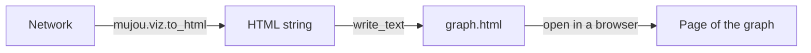
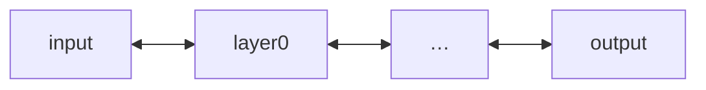

# 🔭 Visualize a Network

`mujou.viz.to_html` draws the graph of a network as a page of HTML. The page starts at the top of the network: click a network to open it, and a node to see its ports. This page shows how to write the page and how to read it.

!!! abstract "What you will learn"

    - How to write the page of a network, without running it
    - What the boxes, rows and arrows of the page mean
    - How to open the networks inside, and see the specs of a node's ports

    You should know [Ports and Channels](ports.md) and the [paths](groups.md#paths) of a network.

## Write the page

!!! abstract "In short"

    `mujou.viz.to_html(net)` returns the page as a string. Save it and open it in a browser.

```python
--8<-- "examples/visualize.py:viz"
```



`to_html` reads the network as `mujou.run` does, but runs nothing (the differences below). So it shows the nodes by the same paths as a run.

|                                                                            | `mujou.run`          | `mujou.viz.to_html`   |
| -------------------------------------------------------------------------- | -------------------- | --------------------- |
| Hooks                                                                      | Called               | Not called            |
| Threads                                                                    | Started              | Not started           |
| Paths of the nodes                                                         | The paths of the run | The same as a run     |
| A network it refuses (a port connected to a node outside the network, say) | Raises               | Raises the same error |

| The page       | What holds                                                 |
| -------------- | ---------------------------------------------------------- |
| File           | One file, with nothing to download                         |
| Where it opens | Offline too; you can send it to someone as it is           |
| Import         | Not imported by `import mujou`: `import mujou.viz` by name |

## Try it

!!! abstract "In short"

    Below is the very page that the program above writes. Click the boxes to open them, and select a node.

<iframe class="mujou-viz" src="../../assets/viz/plant.html" title="The page of Plant" loading="lazy"></iframe>

[Open in a new tab](../../assets/viz/plant.html){ target="_blank" }

## Read the page

!!! abstract "In short"

    A network is a box with a `+` until you open it. A node is a white box with a row per port. An arrow is a channel, pointing to the end that receives.


| On the page                      | What it is                                                                             |
| -------------------------------- | -------------------------------------------------------------------------------------- |
| The outer frame (`Plant`)        | The root you passed to `to_html`                                                       |
| A box with `+` (`left`, `right`) | A closed network. Its rows are the ports it exposes (`self.prev = self.fast.prev`)     |
| A white box (`monitor`)          | A node, its attribute name in bold and its class below                                 |
| A row                            | A port. The mark is what it does: `→` sends, `←` receives, `⇄` both                    |
| The text at the right of a row   | The shape of its spec: `(2,)`. `in … · out …` when what it receives differs            |
| `host`                           | An unconnected `Port` that receives: the host writes it with `Run.write`               |
| An arrow                         | A channel. The head is at the end that receives; a channel that goes both ways has two |
| `×3` on an arrow                 | Three channels between the same two rows, drawn as one                                 |

## Open a network

!!! abstract "In short"

    Click a closed network to open it, and its header to close it again. A channel to a node inside a closed network goes to the network's box.


=== "`left` closed"

    ```mermaid
    flowchart LR
        L["left (closed box)"] --> M["monitor"]
        R["right (closed box)"] --> M
    ```

=== "`left` open"

    ```mermaid
    flowchart LR
        subgraph L["left (dashed frame)"]
            direction LR
            F["fast"] --> S["slow"]
        end
        S -->|"left.next = slow.next"| M["monitor"]
        R["right (closed box)"] --> M
    ```

Opening `left` shows its two nodes, `fast` and `slow`, in a dashed frame. The channel from `left` to `monitor` now starts at `slow.next`, the port that `left.next` refers to. `right` is still closed, so its channel still starts at the box of `right`.

| Layout                  | How it is decided                                                          |
| ----------------------- | -------------------------------------------------------------------------- |
| Unit                    | Each network on its own                                                    |
| Columns (left to right) | The order of the channels: a node that sends before the node that receives |
| Within a column         | The order of assignment                                                    |

## See a node

!!! abstract "In short"

    Click a node to see its path, period and device, and the full spec and peers of each port.


Hovering over a box highlights its channels. The panel shows what the box leaves out:

| In the panel | What it is                                                              |
| ------------ | ----------------------------------------------------------------------- |
| path         | The path of the node in the run (`left.slow`), as in `Run.state_dict()` |
| period       | `Node(period=...)`, in seconds of the run's timer                       |
| device       | `Node(device=...)`                                                      |
| send, recv   | The full specs of the port, dtype included                              |
| peers        | The ports at the other ends of its channels, or "the host writes it"    |

## Move around

!!! abstract "In short"

    Buttons open, close and fit the graph; drag to move and scroll to zoom.

| To                          | Do                            |
| --------------------------- | ----------------------------- |
| Open or close every network | `Expand all` / `Collapse all` |
| Show the whole graph        | `Fit`                         |
| Move the view               | Drag the background           |
| Zoom                        | Scroll                        |
| Light or dark theme         | Follows the browser's setting |

## A `pc.Chain`

!!! abstract "In short"

    `to_html` draws any network, the networks of `mujou.pc` included.

```python
--8<-- "examples/visualize.py:chain"
```



A `pc.Chain` shows `input`, `layer0`, ..., `output` in a row, each connected to the next by a channel that goes both ways: the activity goes forward and the feedback comes back. See [the page it writes](../../assets/viz/chain.html){ target="_blank" }.

??? question "Why HTML, and not an image?"

    A network of many nodes does not fit in one image that you can read. The page shows only the top of the network at first, and you open what you want to see. It needs nothing but a browser, and no package beyond Mujou.
