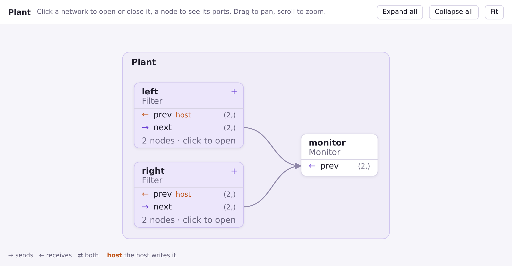
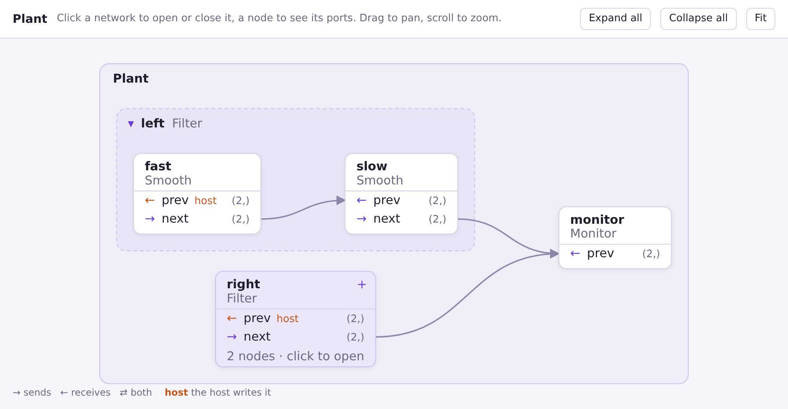
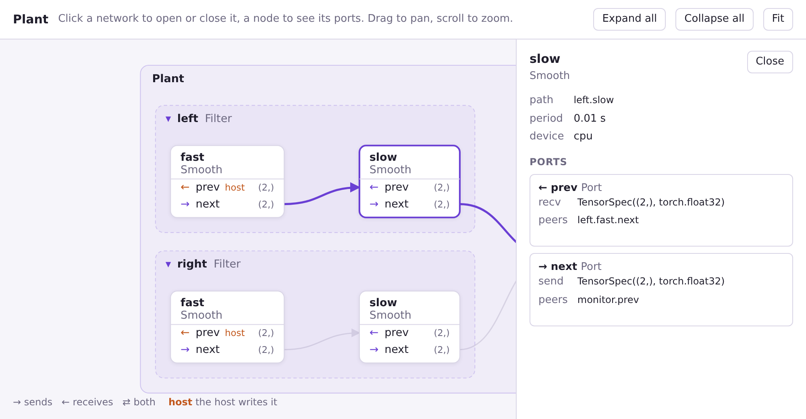

# 🔭 Visualize a Network

## Write the page {#export}

```python
--8<-- "examples/visualize.py:viz"
```

[`to_html`][mujou.viz.to_html] reads the network tree as [`mujou.run`][mujou.run] does, but calls no hooks, starts no threads and runs nothing. So it shows the nodes by the same paths as a run ([Networks and paths](../concepts.md#networks)).

The page is one HTML file with nothing to download, so it opens offline too, and you can send it to someone as it is.

## Try it {#try}

<iframe class="mujou-viz" src="../../assets/viz/plant.html" title="The page of Plant" loading="lazy"></iframe>

[Open in a new tab](../../assets/viz/plant.html){ target="_blank" }

## Read the page {#legend}



| On the page                      | What it is                                                                                                                                    |
| -------------------------------- | --------------------------------------------------------------------------------------------------------------------------------------------- |
| The outer frame (`Plant`)        | The root you passed to `to_html`                                                                                                              |
| A box with `+` (`left`, `right`) | A closed network. Its rows are the ports it exposes (`self.prev = self.fast.prev`). A channel to a node inside goes to this box               |
| A white box (`monitor`)          | A node, its attribute name in bold and its class below                                                                                        |
| A row                            | A port. The mark is what it does: `→` sends, `←` receives, `⇄` both                                                                           |
| The text at the right of a row   | The shape of its spec: `(2,)`. `in … · out …` when what it receives differs                                                                   |
| `host`                           | An unconnected `Port` that receives: the host writes it with [`Run.write`][mujou.Run.write]                                                   |
| An arrow                         | A channel. The head is at the end that receives; a channel that goes both ways has two. `×3` is three between the same two rows, drawn as one |

## Open a network {#open}



| Layout                  | How it is decided                                                          |
| ----------------------- | -------------------------------------------------------------------------- |
| Unit                    | Each network on its own                                                    |
| Columns (left to right) | The order of the channels: a node that sends before the node that receives |
| Within a column         | The order of assignment                                                    |

## See a node {#inspect}



| Panel (click a node to open) | What it is                                                                                      |
| ---------------------------- | ----------------------------------------------------------------------------------------------- |
| path                         | The path of the node in the run (`left.slow`), as in [`Run.state_dict()`][mujou.Run.state_dict] |
| period                       | [`Node(period=...)`][mujou.Node], in seconds of the run's timer                                 |
| device                       | `Node(device=...)`                                                                              |
| send, recv                   | The full specs of the port, dtype included                                                      |
| peers                        | The ports at the other ends of its channels, or "the host writes it"                            |

## Move around {#controls}

| To                         | Do                                                                                                 |
| -------------------------- | -------------------------------------------------------------------------------------------------- |
| Open or close a network    | Click a closed box, or the header of an open frame. For all of them, `Expand all` / `Collapse all` |
| Highlight a box's channels | Hover over the box                                                                                 |
| Move the view              | Drag the background, scroll to zoom, `Fit` for the whole graph                                     |
| Light or dark theme        | Follows the browser's setting                                                                      |

## A `pc.Chain` {#pc-chain}

```python
--8<-- "examples/visualize.py:chain"
```

[Open the chain.html it writes](../../assets/viz/chain.html){ target="_blank" }

??? question "Why HTML, and not an image?"

    A network of many nodes does not fit in one image that you can read. The page shows only the top of the network at first, and you open what you want to see. It needs nothing but a browser, and no package beyond Mujou.
