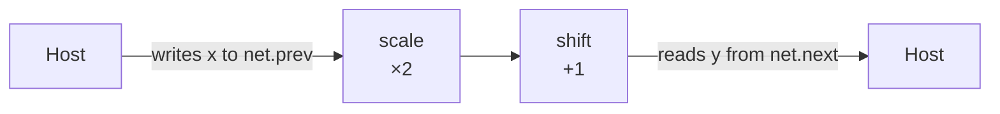
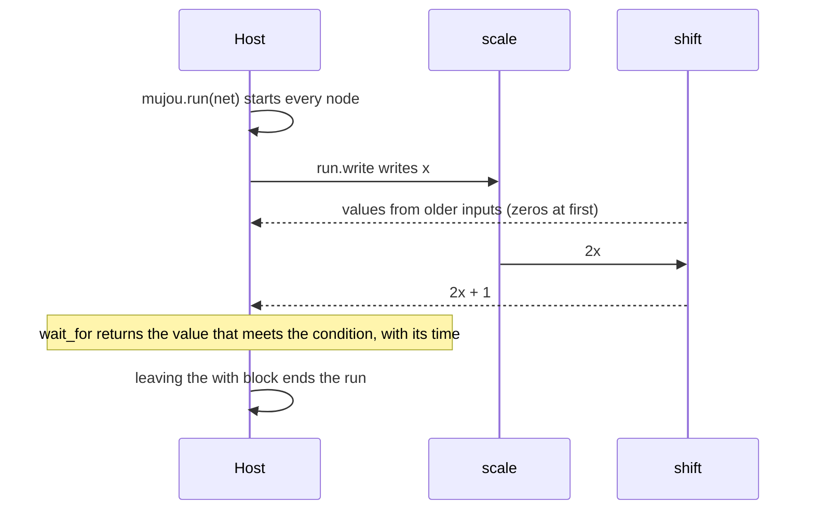

# 🚀 1. Run a Network

This page runs `examples/quickstart.py`, the smallest program, two nodes that compute $y = 2x + 1$, and shows how to write a node, a network and a run.



## Run it {#program}

```python title="examples/quickstart.py"
--8<-- "examples/quickstart.py"
```

=== "From a source checkout"

    From the root of the repository:

    ```sh
    uv run python examples/quickstart.py
    ```

=== "Installed from PyPI"

    Copy [`examples/quickstart.py`](https://github.com/Geson-anko/mujou/blob/main/examples/quickstart.py) to your machine, then:

    ```sh
    python quickstart.py
    ```

```text
y = tensor([3., 5., 7.]) at t = 0.017 s
```

`t` is the time, in seconds of [the run's timer](../topics/time.md#timers), at which `shift` sent `y`. It changes every run.

## The node {#node}

`Affine` inherits from [`Node`][mujou.Node] and creates its ports as attributes in `__init__`. By convention the port that receives from the previous node is `prev` and the one that sends to the next is `next`; `a` and `b` are settings from the arguments, not state.

One step of work goes in [`on_update(dt)`][mujou.Node.on_update], which mujou calls again and again: it reads with [`recv`][mujou.Port.recv] and sends with [`send`][mujou.Port.send].

## The network {#network}

| What `Pipeline` ([`Network`][mujou.Network]) does | Code                                                      |
| ------------------------------------------------- | --------------------------------------------------------- |
| Holds nodes as attributes                         | `self.scale = Affine(2.0, 0.0)`                           |
| Connects ports ([`connect`][mujou.Port.connect])  | `self.scale.next.connect(self.shift.prev)`                |
| Exposes the ports the outside uses                | `self.prev, self.next = self.scale.prev, self.shift.next` |

## The run {#run}



In the [`with mujou.run(net) as run:`][mujou.run] block, the output right after a write is computed from older inputs, so wait for an output that meets the condition with [`wait_for`][mujou.Run.wait_for], not [`read`][mujou.Run.read].

## Next

- Write a node whose state changes over time: [2. Write a Node](2-node.md)
- Branching (fan-out) and merging with `MultiPort`: [Ports and Channels](../topics/ports.md#fan-out)
- The host's other ways to write and read: [Host I/O](../topics/host-io.md)
