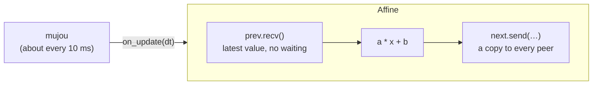
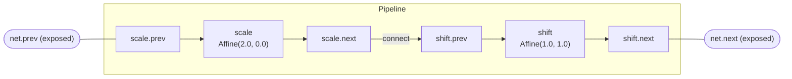
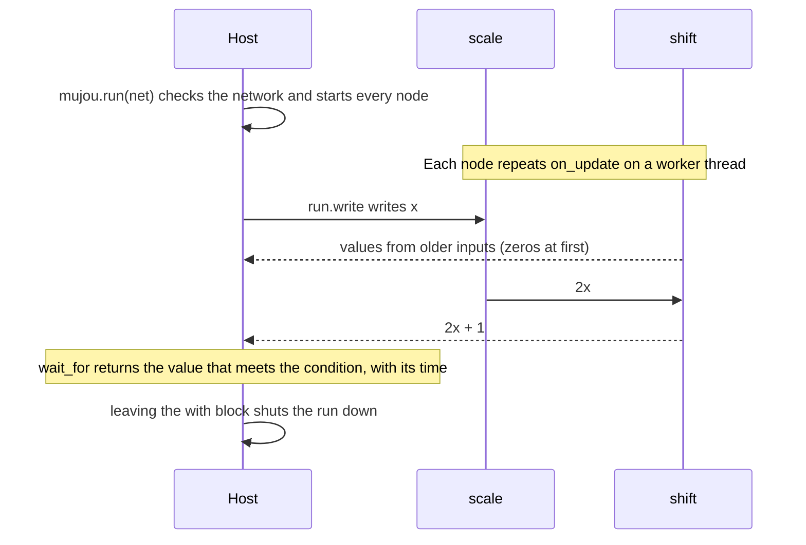
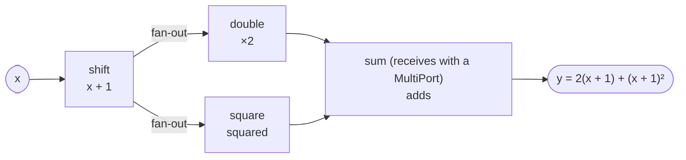

# 🚀 1. Run a Network

This page runs the smallest program, two nodes that compute $y = 2x + 1$, and explains it line by line. Then it branches and merges a network.

!!! abstract "On this page"

    - The three parts, node, network and run, and what you write in each
    - How the host writes an input and waits for the output
    - How to branch a network (fan-out) and merge it with `MultiPort`


| Part    | In the program               | What you write                                   | Section                 |
| ------- | ---------------------------- | ------------------------------------------------ | ----------------------- |
| Node    | `class Affine(Node)`         | One step of work (`on_update`)                   | [A node](#a-node)       |
| Network | `class Pipeline(Network)`    | How the nodes connect, and the ports for outside | [A network](#a-network) |
| Run     | `with mujou.run(net) as run` | Write the input, wait for the output, finish     | [The run](#the-run)     |

## The program

!!! abstract "In short"

    A program in one file. It prints `y` and the time it was sent, on one line.

```python title="examples/quickstart.py"
--8<-- "examples/quickstart.py"
```

1. Run it from the root of the repository

    ```sh
    uv run python examples/quickstart.py
    ```

2. It prints one line like this

    ```text
    y = tensor([3., 5., 7.]) at t = 0.017 s
    ```

| Printed | Meaning                                                                                 |
| ------- | --------------------------------------------------------------------------------------- |
| `y`     | $2x + 1$ for `x = [1, 2, 3]`                                                            |
| `t`     | The time at which `shift` sent `y`, in seconds of the run's timer. It changes every run |

## A node

!!! abstract "In short"

    A node is a class that inherits from `mujou.Node`. `__init__` declares its ports, and `on_update(dt)` holds one step of its work.

```python
--8<-- "examples/quickstart.py:node"
```



| Code                            | Role                                                                                                 |
| ------------------------------- | ---------------------------------------------------------------------------------------------------- |
| `class Affine(Node)`            | A class that inherits from `mujou.Node`                                                              |
| `self.a, self.b = a, b`         | Settings: numbers set from the arguments, not state                                                  |
| `self.prev = Port(recv=VECTOR)` | A port that receives float32 vectors of 3. On the side of the previous node, so `prev` by convention |
| `self.next = Port(send=VECTOR)` | A port that sends the same vectors. On the side of the next node, so `next` by convention            |
| `on_update(dt)`                 | One step of work. Mujou calls it again and again, about every 10 ms                                  |
| `recv()`                        | Returns the latest value the peer sent, without waiting                                              |
| `send()`                        | Sends a copy to every peer                                                                           |

As in any subclass, `__init__` and each hook call the same method of `super()` first.

=== "Avoid"

    ```python
    def __init__(self, a: float, b: float) -> None:
        self.a, self.b = a, b  # super().__init__() is not called
        ...

    def on_update(self, dt: float) -> None:
        self.next.send(self.a * self.prev.recv() + self.b)  # super() is not called
    ```

=== "Write this"

    ```python
    def __init__(self, a: float, b: float) -> None:
        super().__init__()  # call it first
        self.a, self.b = a, b
        ...

    def on_update(self, dt: float) -> None:
        super().on_update(dt)  # first in a hook, too
        self.next.send(self.a * self.prev.recv() + self.b)
    ```

## A network

!!! abstract "In short"

    A network holds nodes as attributes, connects their ports with `connect`, and exposes the ports the outside uses as attributes of its own.

```python
--8<-- "examples/quickstart.py:network"
```



| To do                             | Code                                                      |
| --------------------------------- | --------------------------------------------------------- |
| Hold nodes as attributes          | `self.scale = Affine(2.0, 0.0)`                           |
| Connect ports                     | `self.scale.next.connect(self.shift.prev)`                |
| Expose the ports the outside uses | `self.prev, self.next = self.scale.prev, self.shift.next` |

`connect` checks the specs before it connects.

| The spec each sends and the spec the other receives | Result of `connect` |
| --------------------------------------------------- | ------------------- |
| Match                                               | Connected           |
| Do not match                                        | Raises `TypeError`  |

## The run

!!! abstract "In short"

    `mujou.run(net)` runs every node in the background and returns a `Run`. With the `Run`, the host writes the input and waits until an output that meets a condition arrives.

```python
--8<-- "examples/quickstart.py:run"
```



| Call                                             | What it does                                                             | Note                                                                  |
| ------------------------------------------------ | ------------------------------------------------------------------------ | --------------------------------------------------------------------- |
| `mujou.run(net)`                                 | Checks the network, starts every node, and returns a `Run` once they run | Nodes repeat `on_update` on worker threads; the host's thread goes on |
| `run.write({net.prev: x})`                       | Writes `x` to the unconnected port `net.prev`                            | The value stays until the next write                                  |
| `run.wait_for(net.next, condition, timeout=5.0)` | Returns the first output that meets the condition, with its time         | Raises `TimeoutError` after 5 seconds of real time                    |
| Leaving the `with` block                         | Shuts the run down                                                       | An exception of a node reaches the host here at the latest            |

??? question "Why wait with `wait_for` and not `read`?"

    `recv()` never waits, so until `x` has passed through `scale`, `shift` keeps sending values computed from older inputs (zeros at first). A read right after the write need not give `2x + 1`. `wait_for` returns the first output that meets the condition (here, `y` equals `2x + 1`), with the time it was sent.

## Branching and merging

!!! abstract "In short"

    A `Port` that only sends takes any number of peers, and each gets every value it sends (fan-out). To merge, use a `MultiPort`.



|                        | A receiving `Port` | `MultiPort`                                                                  |
| ---------------------- | ------------------ | ---------------------------------------------------------------------------- |
| Peers it receives from | One only           | Any number                                                                   |
| Value of `recv()`      | One value          | One value per channel, as a `dict[Channel, value]` in the order of `connect` |
| How to combine         | ―                  | The node decides (`Sum` adds)                                                |

```python
--8<-- "examples/branching.py:fan-out"
```

`Diamond` computes $y = 2(x + 1) + (x + 1)^2$. `shift` sends to both branches (`double` and `square`), and `sum` adds the values of the two. A receiving `Port` takes one peer only, because its `recv()` returns one value; to receive from several peers, use a `MultiPort`.

```sh
uv run python examples/branching.py
```

!!! info "Sending a different value to each peer"

    The second half of the same program (`examples/branching.py`) sends a different value to each peer. [Ports and Channels](../topics/ports.md#sending-to-one-channel) explains it.

## Next

- Write a node whose state changes over time: [2. Write a Node](2-node.md)
- The host's other ways to write and read: [Host I/O](../topics/host-io.md)
