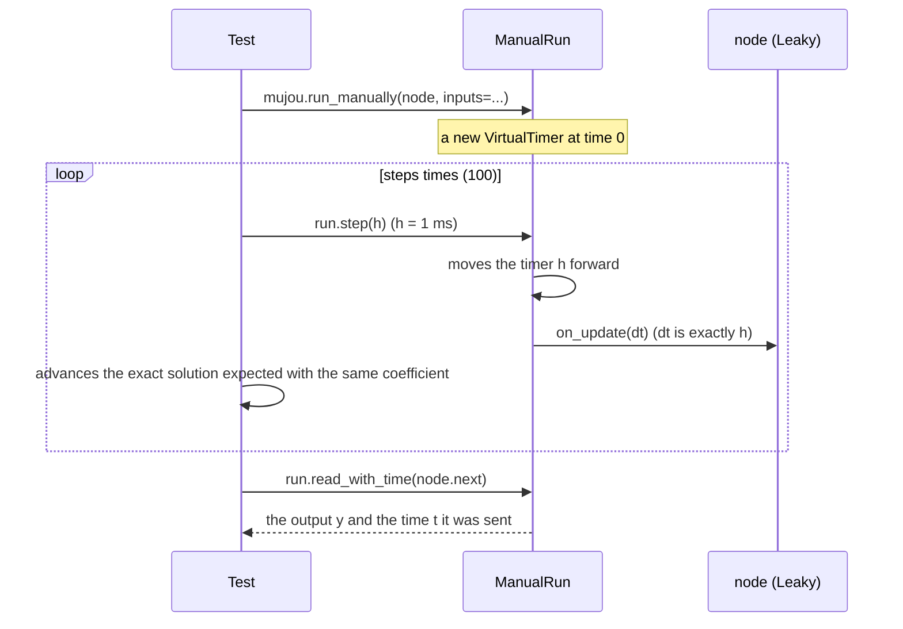
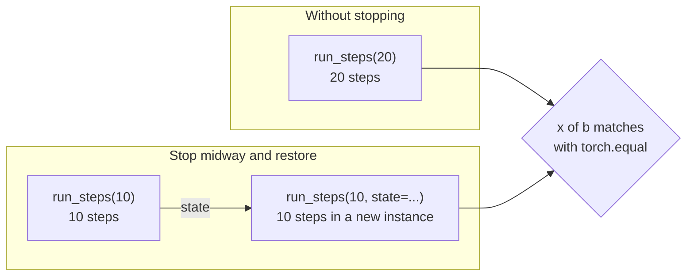
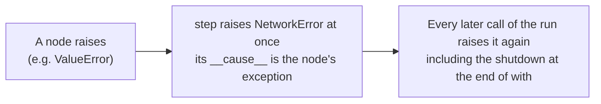

# 🧪 3. Test a Node

In a run started with `mujou.run`, `dt` follows the real time that passes, and the order of the updates differs every time, so the results differ slightly from run to run. This page runs the node of [2. Write a Node](2-node.md) with `mujou.run_manually` and tests it with the same result every time.

!!! abstract "On this page"

    - How to test a node by moving the time by hand with `mujou.run_manually` and `ManualRun.step`
    - How the values a node reads differ between `step(dt)` and `step(dt, *nodes)`
    - Saving and restoring, exceptions, and the other conditions for determinism

|                  | `mujou.run`                      | `mujou.run_manually`  |
| ---------------- | -------------------------------- | --------------------- |
| Time moves by    | The real time that passes        | `step`                |
| `dt`             | Set by the real time that passes | The time `step` moved |
| Order of updates | Differs every time               | Set by `step`         |
| Period           | Used                             | Not used              |
| Result           | Differs slightly every time      | The same every time   |

## The tools

!!! abstract "In short"

    `mujou.run_manually` returns a `ManualRun`, and `ManualRun.step` moves the time, then updates nodes once each.

| Name                            | Role                                                                                                                                                                                                     |
| ------------------------------- | -------------------------------------------------------------------------------------------------------------------------------------------------------------------------------------------------------- |
| `mujou.run_manually(root, ...)` | Runs the tree with the `timer`, `inputs`, `state` and `workers` of `mujou.run` and returns a `ManualRun`. No node updates until `step` updates it. It runs on a new `mujou.time.VirtualTimer` by default |
| `ManualRun.step(dt)`            | Moves the timer `dt` seconds forward, then updates every node once, all at once                                                                                                                          |
| `ManualRun.step(dt, *nodes)`    | Moves the timer `dt` seconds forward, then updates only the given nodes once each, one after another in the given order                                                                                  |
| `ManualRun.timer`               | The run's `VirtualTimer`                                                                                                                                                                                 |

`ManualRun` is a `Run`, so `write`, `read`, `state_dict` and the rest work as with `mujou.run`.

## A test

!!! abstract "In short"

    Move the time `h` seconds at a time with `run.step(h)`, and compare the output with the exact solution computed with the same coefficient.

```python
--8<-- "examples/test_leaky.py:test"
```

```sh
uv run pytest examples/test_leaky.py
```



| Point              | What happens                                                                                          |
| ------------------ | ----------------------------------------------------------------------------------------------------- |
| `inputs`           | The values of the input ports from the start                                                          |
| Each `run.step(h)` | Moves the time `h` seconds forward, then updates every node once. The node's `dt` is exactly `h`      |
| The value `y`      | Compared with the exact solution, computed with the same coefficient, by `torch.testing.assert_close` |
| The time `t`       | Exactly `steps` milliseconds (`t.ns == steps * 1_000_000`): no real time enters a manual run          |

!!! tip "`assert_close` and `torch.equal`"

    When the reference does the same operations as the node in the same order, compare bit for bit with `torch.equal` instead of `assert_close`. The test in the next section, "The order of the updates", does this.

## The order of the updates

!!! abstract "In short"

    `step(dt)` updates every node at the same time; `step(dt, *nodes)` updates the given nodes in the given order. What a later node reads differs.

```python
--8<-- "examples/test_leaky.py:chain"
```

=== "step(h)"

    ```mermaid
    sequenceDiagram
        participant R as ManualRun
        participant A as net.a
        participant B as net.b
        R->>R: moves the timer h forward
        par at the same time
            R->>A: on_update(h)
        and
            R->>B: on_update(h), reads a's value from the start of the step
        end
        Note over A,B: what they send in this step arrives in the next
    ```

=== "step(h, net.a, net.b)"

    ```mermaid
    sequenceDiagram
        participant R as ManualRun
        participant A as net.a
        participant B as net.b
        R->>R: moves the timer h forward
        R->>A: on_update(h)
        A-->>B: the value sent in this step
        R->>B: on_update(h), reads what a sent in this step
    ```

=== "step(h, net.b, net.a)"

    ```mermaid
    sequenceDiagram
        participant R as ManualRun
        participant A as net.a
        participant B as net.b
        R->>R: moves the timer h forward
        R->>B: on_update(h), reads what a sent in the step before
        R->>A: on_update(h)
    ```

| Call               | Nodes it updates                                           | Values they read                                                                                         |
| ------------------ | ---------------------------------------------------------- | -------------------------------------------------------------------------------------------------------- |
| `step(dt)`         | Every node, at the same time (on the run's workers)        | The values from the start of the step. What a node sends in the step reaches the others in the next step |
| `step(dt, *nodes)` | Only the given nodes, one after another in the given order | A later node reads what an earlier one sent in this step                                                 |

Passing every node to `step(dt, *nodes)` is not the same as `step(dt)`.

| How the messages flow                            | Order that matches `step(dt)`                                                                    |
| ------------------------------------------------ | ------------------------------------------------------------------------------------------------ |
| A chain whose messages go only toward the output | From the output back to the input (`test_a_step_without_nodes_equals_the_order_from_the_output`) |
| Messages also go back                            | In general, no order                                                                             |

| Detail                            | Behavior                                                               |
| --------------------------------- | ---------------------------------------------------------------------- |
| A node's `dt`                     | The time since its last update; the first from the start of the run    |
| A node passed twice in one `step` | Updates once. The second time is skipped, since its time has not moved |
| A node's period                   | Not used in a manual run                                               |

## Save and restore

!!! abstract "In short"

    A run that takes the state midway and goes on in a new instance matches a run that went on without stopping, to the last bit.



```python
--8<-- "examples/test_leaky.py:restore"
```

A run restored from a state runs on a `VirtualTimer` of its own, which starts not at 0 but at the time of the state.

## Exceptions

!!! abstract "In short"

    When a node raises, `step` raises `NetworkError`. Put `pytest.raises` in the same `with` statement, around the whole block.



=== "Avoid"

    ```python
    with mujou.run_manually(net) as run:
        with pytest.raises(NetworkError):
            run.step(0.001)  # a node raises ValueError here
    # the shutdown at the end of the with block raises the same NetworkError again
    ```

=== "Write this"

    ```python
    from mujou import NetworkError

    with pytest.raises(NetworkError) as info, mujou.run_manually(net) as run:
        run.step(0.001)  # a node raises ValueError here
    assert isinstance(info.value.__cause__, ValueError)
    ```

When a node raises, `step` raises `NetworkError` at once, whose `__cause__` is the node's exception. Every later call of the run raises it again, including the `shutdown` at the end of the `with` block. So put `pytest.raises` in the same `with` statement, around the whole block.

## Other conditions for determinism

!!! abstract "In short"

    Control the random numbers, the shared objects, how the time moves, and the timers of several runs.

| Condition                  | Do this                                                                                                                                        | Why, or what to watch                                                                                                         |
| -------------------------- | ---------------------------------------------------------------------------------------------------------------------------------------------- | ----------------------------------------------------------------------------------------------------------------------------- |
| Random numbers             | Give the nodes a `seed`, and draw from `self.generator` (see [Threads and Devices](../topics/threads-and-devices.md#seeds-and-random-numbers)) | ―                                                                                                                             |
| Python objects that change | Do not share them between nodes. If they must be shared, update the nodes in a fixed order with `step(dt, *nodes)`                             | `step(dt)` updates the nodes at the same time, so the result would depend on which ran first                                  |
| Time                       | Move it only with `step`                                                                                                                       | Nothing is sent unless `step` is called. `wait_for` or `subscribe` without a `timeout` on the thread that steps waits forever |
| Several runs               | Make one `mujou.time.VirtualTimer()` and pass it to each run                                                                                   | They share one time axis: a `step` of one moves the others too                                                                |

=== "Avoid"

    ```python
    with mujou.run_manually(node, inputs={node.prev: one}) as run:
        # waits without a timeout on the thread that steps: nothing is sent, it never ends
        y, t = run.wait_for(node.next, lambda y: y.item() > 0.5)
    ```

=== "Write this"

    ```python
    with mujou.run_manually(node, inputs={node.prev: one}) as run:
        while run.read(node.next).item() <= 0.5:
            run.step(0.001)  # the time moves only with step
    ```

```python
timer = mujou.time.VirtualTimer()  # several runs share one time axis
with (
    mujou.run_manually(a, timer=timer) as run_a,
    mujou.run_manually(b, timer=timer) as run_b,
):
    run_a.step(0.001)  # run_b's timer moves 1 ms too
```

## Next

- A node that learns: [4. Learn in a Node](4-learn-in-a-node.md)
- How a manual run works, and how to run a simulation with it: [Simulation](../topics/simulation.md)
