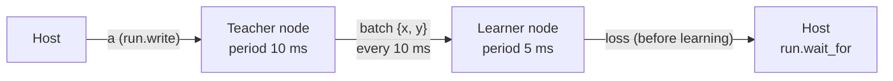
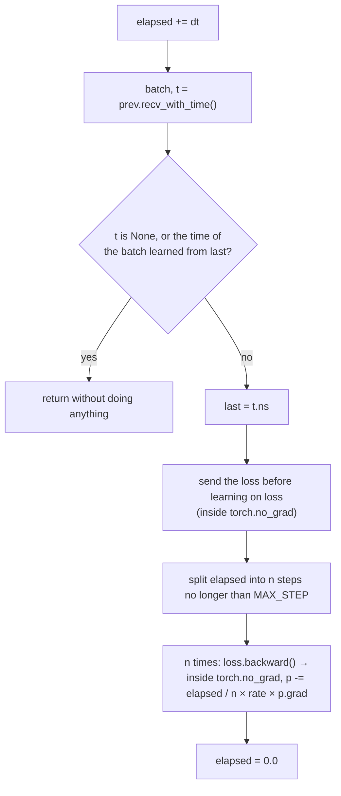
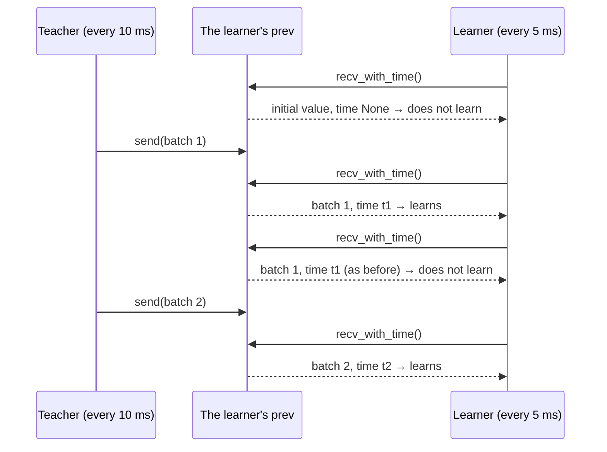
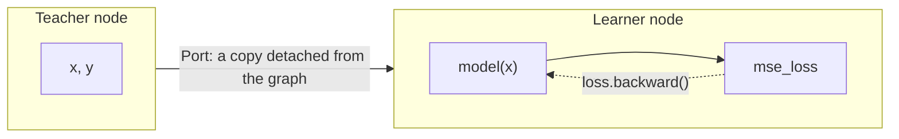
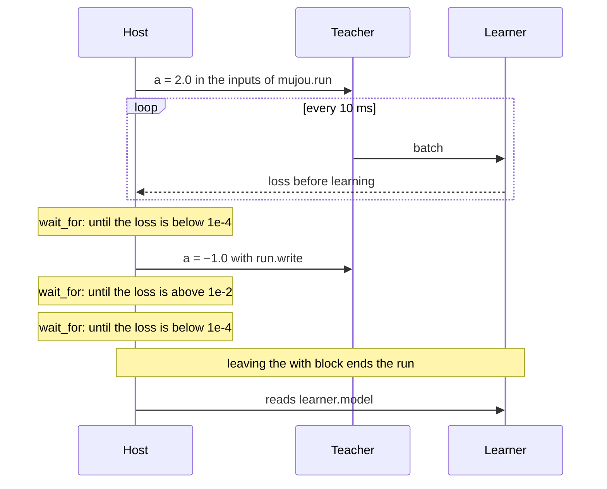

# 🔥 4. Learn in a Node

This page writes a node that learns with backpropagation (BP) inside itself, from a stream whose target changes while it runs. There is no training phase and no inference phase: the node predicts and learns from each new batch as it comes.

!!! abstract "On this page"

    - How to write a node that keeps learning from a stream with BP inside it (`loss.backward()`)
    - How to set how far it learns by the elapsed time, not by the number of batches
    - The state of a learning node (its module, its seed, `register_state`)
    - How the host changes the target during the run and follows the loss

    It builds on [2. Write a Node](2-node.md).

## The program

!!! abstract "In short"

    A teacher node sends batches from $y = a x + b$, and the host changes `a` during the run. The learner keeps learning, with no mode to switch.



The teacher sends a batch from $y = a x + b$ (8 samples, b = 0.5) every 10 ms, with the `a` the host writes. The host changes `a` from 2.0 to −1.0 while the network runs. The learner's loss falls, jumps when the target changes, and falls again.

```sh
uv run python examples/online_learning.py
```

```text
t = 0.48 s: loss = 0.000090  (learned a = 2.0)
t = 0.49 s: loss = 3.405589  (a changed at 0.48 s)
t = 0.97 s: loss = 0.000095  (learned a = -1.0)
the learner's weight = -0.988, bias = 0.498
```

<figure class="mujou-diagram">
<svg viewBox="0 0 640 190" role="img" aria-label="The loss before learning over time. It starts high and falls as the learner learns a = 2.0. At 0.48 s the host changes a to -1.0, the loss jumps, and it falls again as the learner learns a = -1.0">
<line class="mujou-axis" x1="70" y1="150" x2="620" y2="150"/>
<line class="mujou-axis" x1="70" y1="24" x2="70" y2="150"/>
<text class="mujou-label" x="76" y="20">loss before learning</text>
<line class="mujou-lane" x1="322" y1="34" x2="322" y2="150" style="stroke-dasharray: 4 3"/>
<text class="mujou-note" x="330" y="40">the host changes a to −1.0</text>
<path class="mujou-brace" style="stroke: var(--md-typeset-a-color); stroke-width: 2.5" d="M 76 44 C 126 132, 206 145, 320 147 L 325 48 C 375 132, 455 145, 574 147"/>
<text class="mujou-label" x="190" y="96" text-anchor="middle">learns a = 2.0</text>
<text class="mujou-label" x="455" y="96" text-anchor="middle">learns a = −1.0</text>
<line class="mujou-axis" x1="320" y1="150" x2="320" y2="156"/>
<line class="mujou-axis" x1="574" y1="150" x2="574" y2="156"/>
<text class="mujou-note" x="70" y="170" text-anchor="middle">0</text>
<text class="mujou-note" x="320" y="170" text-anchor="middle">0.48 s</text>
<text class="mujou-note" x="574" y="170" text-anchor="middle">0.97 s</text>
<text class="mujou-label" x="620" y="186" text-anchor="end">the run's timer →</text>
</svg>
<figcaption>A sketch drawn from the output above. Once the loss falls below 1e-4, the host changes <code>a</code>, and the same node learns again</figcaption>
</figure>

## The learner

!!! abstract "In short"

    Write BP in `on_update`, as in plain PyTorch. How far the node learns is set by the time since it last learned, not by the number of batches.

```python
--8<-- "examples/online_learning.py:node"
```

One `on_update(dt)` goes like this:



### What is state

| Attribute        | What it holds                                    | How it enters the state                     |
| ---------------- | ------------------------------------------------ | ------------------------------------------- |
| `self.model`     | `nn.Linear(1, 1)`, a `mujou.Stateful`            | By itself (as a tensor attribute)           |
| `self.generator` | The node's own random generator, `seed=0`        | By itself                                   |
| `self.last`      | The time (ns) of the batch learned from last     | Registered with `register_state("last")`    |
| `self.elapsed`   | Seconds since the node last learned              | Registered with `register_state("elapsed")` |
| `self.rate`      | How fast it learns; a setting that never changes | Not in the state                            |

`last` and `elapsed` change while the node runs, but they are neither tensors nor modules. Registered with `register_state`, they are saved and restored with the rest of the state.

### Initialize the weights from self.generator

`self.generator` is the node's own random generator, seeded with `seed=0`, and the seed reproduces only this generator. The default initialization of `nn.Linear` draws from the global generator that every node shares, so initialize the weights again from `self.generator`.

=== "Avoid"

    ```python
    self.model = nn.Linear(1, 1)  # initialized from the generator every node shares
    ```

=== "Write"

    ```python
    self.model = nn.Linear(1, 1)
    nn.init.normal_(self.model.weight, std=0.1, generator=self.generator)
    nn.init.zeros_(self.model.bias)
    ```

### Learn once from each new batch



`recv_with_time()` returns the batch with the time it was sent. The time is `None` until the teacher first sends, and stays the same until the teacher sends again, so the learner learns once from each batch.

### Gradients as in plain PyTorch

| Computation                          | How to write it                               | Graph                                  |
| ------------------------------------ | --------------------------------------------- | -------------------------------------- |
| The loss before learning (only sent) | Inside `torch.no_grad()`                      | Not needed                             |
| The loss to learn from               | Computed as usual, then `loss.backward()`     | Recorded; fills `p.grad`               |
| The parameter update                 | `p -= ...` in place, inside `torch.no_grad()` | Not needed; `p.grad = None` afterwards |



The hooks record gradients as plain PyTorch does. BP stays inside the node: a port sends a copy detached from the graph, so no gradient crosses nodes.

### By the time, not by the batch

The learner does not take a fixed step per batch. It follows the gradient flow for the time `elapsed` since it last learned, so how far it learns depends on time, not on how often the node runs. The learning speed `rate` is 5.0 here.

$$
\frac{dW}{dt} = -\text{rate}\,\frac{\partial L}{\partial W}
$$

|                             | A fixed step per batch           | Moves by the elapsed time `elapsed` (this example) |
| --------------------------- | -------------------------------- | -------------------------------------------------- |
| How far one update moves    | A fixed learning rate × gradient | `elapsed` × `rate` × gradient                      |
| What sets how far it learns | How often the node runs          | The time that passed                               |
| A long interval             | —                                | Split into `n` steps no longer than `MAX_STEP`     |

<figure class="mujou-diagram">
<svg viewBox="0 0 640 130" role="img" aria-label="An elapsed of 25 milliseconds split into 3 equal steps, each no longer than MAX_STEP of 10 milliseconds">
<path class="mujou-brace" d="M 80 38 Q 80 30 88 30 L 572 30 Q 580 30 580 38"/>
<text class="mujou-label" x="330" y="22" text-anchor="middle">elapsed = 25 ms (for example)</text>
<line class="mujou-axis" x1="80" y1="70" x2="580" y2="70"/>
<g class="mujou-tick-a"><line x1="80" y1="58" x2="80" y2="82"/><line x1="247" y1="58" x2="247" y2="82"/><line x1="413" y1="58" x2="413" y2="82"/><line x1="580" y1="58" x2="580" y2="82"/></g>
<text class="mujou-note" x="163" y="54" text-anchor="middle">step 1 ≈ 8.3 ms</text>
<text class="mujou-note" x="330" y="54" text-anchor="middle">step 2 ≈ 8.3 ms</text>
<text class="mujou-note" x="497" y="54" text-anchor="middle">step 3 ≈ 8.3 ms</text>
<path class="mujou-brace" d="M 80 92 Q 80 100 88 100 L 272 100 Q 280 100 280 92"/>
<text class="mujou-note" x="180" y="118" text-anchor="middle">MAX_STEP = 10 ms</text>
<text class="mujou-label" x="440" y="118" text-anchor="middle">n = ceil(25 / 10) = 3</text>
</svg>
<figcaption>Split into <code>n = max(1, ceil(elapsed / MAX_STEP))</code> equal steps, each one step of explicit Euler</figcaption>
</figure>

??? question "Why split into steps?"

    Explicit Euler can diverge when a step is too long. A long `elapsed` is split into steps no longer than `MAX_STEP` (0.01 s), so the node does not diverge even when its updates fall behind and `elapsed` grows.

## Settings of torch

!!! abstract "In short"

    The host sets the settings of the whole process before the run. A node changes only the settings of its own thread.

```python
--8<-- "examples/online_learning.py:threads"
```

| Setting                                                | Who sets it | When                                                    |
| ------------------------------------------------------ | ----------- | ------------------------------------------------------- |
| The whole process (the number of torch's threads, ...) | The host    | Before the run                                          |
| Settings of its own thread                             | The node    | Changed in a hook, and set back before the hook returns |

??? question "Why one thread?"

    The nodes compute on the run's worker threads, and torch adds threads of its own on top of them. To keep the threads few, the host calls `torch.set_num_threads(1)` before the run. See [Threads and Devices](../topics/threads-and-devices.md).

## The run

!!! abstract "In short"

    The host follows the loss with `run.wait_for` and changes the target midway with `run.write`. There is nothing to switch the learning phase.

```python
--8<-- "examples/online_learning.py:run"
```



| What `run.wait_for` waits for | Condition   | `timeout`        |
| ----------------------------- | ----------- | ---------------- |
| Learning `a = 2.0`            | loss < 1e-4 | 5 s of real time |
| The jump after `a` changes    | loss > 1e-2 | 5 s of real time |
| Learning `a = -1.0`           | loss < 1e-4 | 5 s of real time |

`run.wait_for` follows the loss port until the condition holds, and returns the value with the time it was sent. The port starts at inf, and its time is `None` until a loss computed on a teacher's batch arrives. Since how fast the learner learns depends on time, each phase gets up to 5 s of real time. After the run, the nodes' attributes are the host's to read: `learner.model` is the module the learner learned, with weight = −0.988 and bias = 0.498 in the output above (the target is a = −1.0, b = 0.5).

## Next

- A rule that learns across nodes, with a target that travels along the path: [Update Rules](../topics/update-rules.md)
- PC-ALM, the nodes of `mujou.pc`: [5. Learn with PC-ALM](5-learn-with-pc.md)
