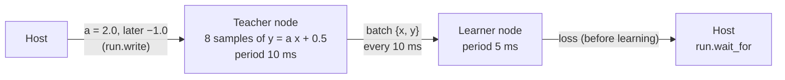
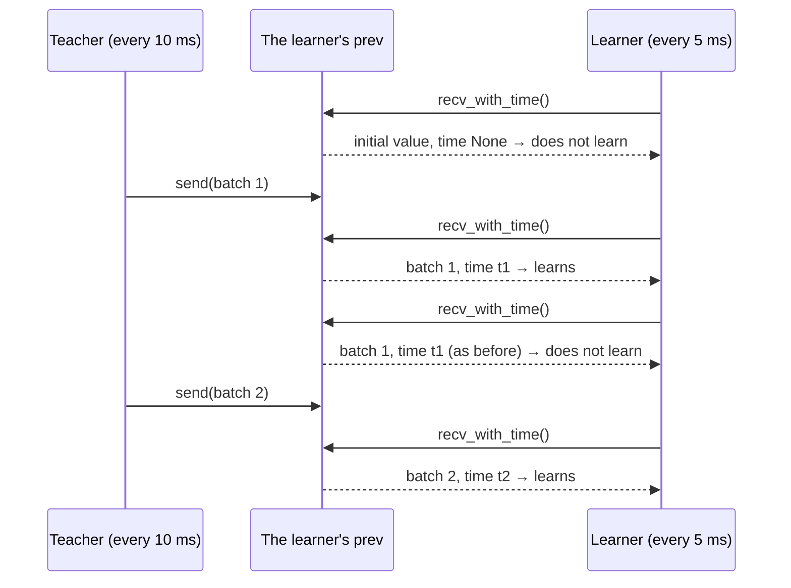

# 🔥 4. Learn in a Node

This page writes a node that keeps learning, with backpropagation (BP, `loss.backward()`) inside itself, from a stream whose target changes while it runs. How far it learns is set by time, not by the number of batches. It builds on [2. Write a Node](2-node.md).

## The program {#program}



```sh
uv run python examples/online_learning.py
```

```text
t = 0.48 s: loss = 0.000090  (learned a = 2.0)
t = 0.49 s: loss = 3.405589  (a changed at 0.48 s)
t = 0.97 s: loss = 0.000095  (learned a = -1.0)
the learner's weight = -0.988, bias = 0.498
```

## The learner {#node}

```python
--8<-- "examples/online_learning.py:node"
```

| How this example writes it                                                                                                                    | Why                                                                                                                 | More                                                                 |
| --------------------------------------------------------------------------------------------------------------------------------------------- | ------------------------------------------------------------------------------------------------------------------- | -------------------------------------------------------------------- |
| `model` and `generator` enter the state by themselves; `last` and `elapsed` are registered with [`register_state`][mujou.Node.register_state] | So that a resumed run continues learning where it left off                                                          | [Values of your own in the state](6-save-and-resume.md#custom-state) |
| The weights are initialized again from `self.generator`                                                                                       | The default initialization of `nn.Linear` draws from the global generator every node shares, and does not reproduce | [Seeds and random numbers](../topics/threads-and-devices.md#seed)    |
| It compares the time from [`recv_with_time`][mujou.Port.recv_with_time] with the last one, and learns once from each new batch                | The learner runs faster than the teacher and reads the same batch more than once                                    | [New value or re-read](../topics/ports.md#new-or-reread)             |
| Gradients come from plain PyTorch, and the graph stays inside one update                                                                      | A graph that crosses nodes breaks locality                                                                          | [Rules a node keeps](../concepts.md#rules)                           |



### Learn by time {#learn-by-time}

The learner does not take a fixed step per batch: it follows the gradient flow for the time `elapsed` since it last learned, so how far it learns depends on the time that passed, not on how often it runs (here `rate` = 5.0 and `MAX_STEP` = 0.01 s).

$$
\frac{dW}{dt} = -\text{rate}\,\frac{\partial L}{\partial W}
$$

<figure class="mujou-diagram">
<svg viewBox="0 0 640 130" role="img" aria-label="An elapsed of 25 milliseconds split into 3 equal steps, each no longer than MAX_STEP of 10 milliseconds">
<path class="mujou-brace" d="M 80 38 Q 80 30 88 30 L 572 30 Q 580 30 580 38"/>
<text class="mujou-label" x="330" y="22" text-anchor="middle">elapsed = 25 ms (for example)</text>
<line class="mujou-axis" x1="80" y1="70" x2="580" y2="70"/>
<g class="mujou-tick-a"><line x1="80" y1="58" x2="80" y2="82"/><line x1="247" y1="58" x2="247" y2="82"/><line x1="413" y1="58" x2="413" y2="82"/><line x1="580" y1="58" x2="580" y2="82"/></g>
<text class="mujou-note" x="163" y="54" text-anchor="middle">step 1 ≈ 8.3 ms</text>
<text class="mujou-note" x="330" y="54" text-anchor="middle">step 2 ≈ 8.3 ms</text>
<text class="mujou-note" x="497" y="54" text-anchor="middle">step 3 ≈ 8.3 ms</text>
<path class="mujou-brace" d="M 80 92 Q 80 100 88 100 L 272 100 Q 280 100 280 92"/>
<text class="mujou-note" x="180" y="118" text-anchor="middle">MAX_STEP = 10 ms</text>
<text class="mujou-label" x="440" y="118" text-anchor="middle">n = ceil(25 / 10) = 3</text>
</svg>
<figcaption>Split into <code>n = max(1, ceil(elapsed / MAX_STEP))</code> equal steps, each one step of explicit Euler</figcaption>
</figure>

## The run {#run}

```python
--8<-- "examples/online_learning.py:run"
```

The host follows the loss with [`wait_for`][mujou.Run.wait_for] and changes the target `a` midway with [`write`][mujou.Run.write]. There is no mode to switch between learning and inference.

The number of torch's threads (here `torch.set_num_threads(1)`) is a setting of the whole process, so the host sets it before the run ([Settings of the whole process](../topics/threads-and-devices.md#process-settings)).

## Next

- A rule that learns across nodes, with a target that travels along the path: [Update Rules](../topics/update-rules.md)
- Learning with the nodes of `mujou.pc`: [5. Learn with PC-ALM](5-learn-with-pc.md)
