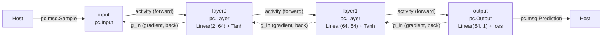

# 🧠 5. Learn with PC-ALM

[`mujou.pc`][mujou.pc] splits a PyTorch model into nodes and learns it with PC-ALM (Augmented Lagrangian Predictive Coding, <https://pub.sakana.ai/pc-alm/>). Each node holds a part of the model and learns from its neighbors' messages only. This page learns a regression with `pc.Chain`. It builds on [4. Learn in a Node](4-learn-in-a-node.md).

## The program {#program}

The chain learns $y = \sin(2 x_1)\cos(x_2)$ from a stream of batches of 32 samples, and the loss before learning falls from about 0.4 to below 0.01.

```sh
uv run python examples/pc_regression.py
```

```text
batch   1: loss 0.4157 (the mean of the last 1)
batch  50: loss 0.1686 (the mean of the last 50)
...
batch 300: loss 0.0043 (the mean of the last 50)
```

## The chain {#chain}

```python
--8<-- "examples/pc_regression.py:chain"
```



The `batch=B` of [`pc.Chain`][mujou.pc.Chain] is the shape the specs of `x` and `y` start with; given the same `B`, `loss` returns the loss of each sample, of shape `(B,)` ([The batch](../topics/pc.md#batch)).

## Choosing the values {#values}

| Value                        | What it sets                                                             | Here                                                                  | How to choose                                                        |
| ---------------------------- | ------------------------------------------------------------------------ | --------------------------------------------------------------------- | -------------------------------------------------------------------- |
| `tau`                        | How fast the activities `h`, the duals `lam` and the deviations `r` move | `pc.TimeConstants(h=4e-3, lam=2e-3, r=4e-3)`                          | [Choosing the time constants](../topics/pc.md#choose-time-constants) |
| `optimizer`                  | How fast the weights move                                                | `pc.optim.SGD(tau=SHOWN / 0.3)`: a learning rate Δt/τ = 0.3 per batch | [Choosing the optimizer](../topics/pc.md#optimizer)                  |
| `learn_interval`             | When to learn while a batch is shown                                     | `0.75 * SHOWN`: after 24 ms from the write                            | [Choosing the time constants](../topics/pc.md#choose-time-constants) |
| How long to show (`seconds`) | How long each batch is shown                                             | `SHOWN = 0.032`                                                       | [Choosing the time constants](../topics/pc.md#choose-time-constants) |

<figure class="mujou-diagram">
<svg viewBox="0 0 640 175" role="img" aria-label="The 32 milliseconds of showing one batch. The batch is written at 0 ms, every node updates every 2 ms, the first prediction arrives before learning, the nodes learn at the first update after 24 ms, and pc.show returns at 32 ms">
<line class="mujou-axis" x1="70" y1="140" x2="615" y2="140"/>
<g class="mujou-tick-a"><line x1="80" y1="40" x2="80" y2="140"/><line x1="464" y1="40" x2="464" y2="140"/><line x1="592" y1="22" x2="592" y2="140"/></g>
<text class="mujou-label" x="86" y="34">write</text>
<text class="mujou-label" x="464" y="34" text-anchor="middle">learn</text>
<text class="mujou-label" x="592" y="16" text-anchor="end">pc.show returns</text>
<text class="mujou-note" x="96" y="66">the first prediction arrives (nothing learned yet)</text>
<text class="mujou-note" x="10" y="99">each node</text>
<line class="mujou-lane" x1="80" y1="95" x2="600" y2="95"/>
<g class="mujou-tick-b"><line x1="112" y1="85" x2="112" y2="105"/><line x1="144" y1="85" x2="144" y2="105"/><line x1="176" y1="85" x2="176" y2="105"/><line x1="208" y1="85" x2="208" y2="105"/><line x1="240" y1="85" x2="240" y2="105"/><line x1="272" y1="85" x2="272" y2="105"/><line x1="304" y1="85" x2="304" y2="105"/><line x1="336" y1="85" x2="336" y2="105"/><line x1="368" y1="85" x2="368" y2="105"/><line x1="400" y1="85" x2="400" y2="105"/><line x1="432" y1="85" x2="432" y2="105"/><line x1="496" y1="85" x2="496" y2="105"/><line x1="528" y1="85" x2="528" y2="105"/><line x1="560" y1="85" x2="560" y2="105"/></g>
<path class="mujou-brace" d="M 112 110 Q 112 116 118 116 L 138 116 Q 144 116 144 110"/>
<text class="mujou-note" x="150" y="126">tau.period = 2 ms</text>
<text class="mujou-note" x="80" y="156" text-anchor="middle">0</text>
<text class="mujou-note" x="464" y="156" text-anchor="middle">24 ms</text>
<text class="mujou-note" x="592" y="156" text-anchor="middle">32 ms</text>
<text class="mujou-label" x="615" y="172" text-anchor="end">the run's timer →</text>
</svg>
<figcaption>The 32 ms (<code>SHOWN</code>) during which this example shows one batch. The nodes learn once, at the first update after <code>learn_interval</code> = 24 ms has passed since the write</figcaption>
</figure>

The weights are set when the modules are made (here by `torch.manual_seed(0)` in the host, before the run); the nodes of `mujou.pc` do not initialize them again.

## Show and learn {#show}

```python
--8<-- "examples/pc_regression.py:run"
```

[`pc.show`][mujou.pc.show] returns the prediction made before any node learned from the batch, so the example's loss is the loss on data the chain has not seen yet.

=== "Learn"

    ```python
    every = torch.ones(B, dtype=torch.bool)
    sample = pc.msg.Sample(x=x, y=y, mask=every, reset=every)
    ```

=== "Evaluate"

    ```python
    every = torch.ones(B, dtype=torch.bool)
    none = torch.zeros(B, dtype=torch.bool)
    sample = pc.msg.Sample(x=x, y=y, mask=none, reset=every)  # no weight moves
    ```

With every `mask` False, the same running chain evaluates without learning; there is no inference mode to switch to. This example draws each batch afresh, so no sample continues the one before, and `reset=every` (all True) makes the nodes set the `r` and `lam` they held for the previous batch back to 0 ([Starting anew](../topics/pc.md#reset)).

A node's state can be taken by its path, as `run.state_dict()["nodes"]["layer0"]["state"]` at the end of the example; its keys are in [`pc.Layer`][mujou.pc.Layer].

## Next

- How the parts connect, and what a node does in one update: [How mujou.pc Works](../topics/pc-concepts.md)
- How to choose the values, the pitfalls, and nodes of your own: [PC-ALM](../topics/pc.md)
- Comparing with BP on MNIST and CIFAR-10: [PC-ALM Benchmarks](../topics/pc-benchmarks.md)
