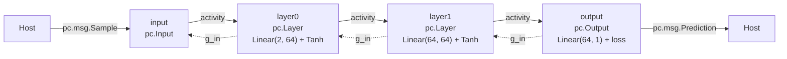
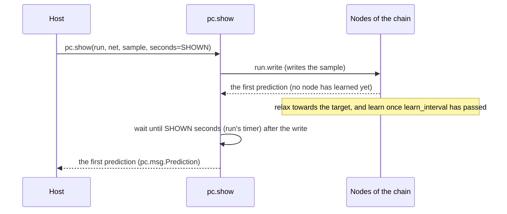

# 🧠 5. Learn with PC-ALM

The module `mujou.pc` splits a PyTorch model into nodes and learns it with PC-ALM (Augmented Lagrangian Predictive Coding, <https://pub.sakana.ai/pc-alm/>). Each node holds a part of the model and learns from its neighbors' messages only; at equilibrium, its gradients are those of backpropagation (BP). This page learns a regression with it.

!!! abstract "On this page"

    - How `pc.Chain` turns modules, in the order of `nn.Sequential`, into a chain of PC-ALM nodes
    - The values you choose (time constants, the optimizer of the weights, when to learn, how long to show) and what they mean
    - How `pc.show` shows a batch for the chain to learn from, and how to measure the loss with the prediction made before learning

    It builds on [4. Learn in a Node](4-learn-in-a-node.md).

Besides the model, the specs and the loss, you choose only these four values:

| What you choose                        | Argument                       | Here                                         |
| -------------------------------------- | ------------------------------ | -------------------------------------------- |
| Time constants of activities and duals | `pc.Chain(tau=...)`            | `pc.TimeConstants(h=4e-3, lam=2e-3, r=4e-3)` |
| The optimizer of the weights           | `pc.Chain(optimizer=...)`      | `pc.optim.SGD(tau=SHOWN / 0.3)`              |
| When the nodes learn                   | `pc.Chain(learn_interval=...)` | `0.75 * SHOWN`                               |
| How long each batch is shown           | `pc.show(..., seconds=...)`    | `SHOWN = 0.032` (seconds)                    |

## The program

!!! abstract "In short"

    The chain learns $y = \sin(2 x_1)\cos(x_2)$ from a stream of batches of 32 samples. The loss before learning falls from about 0.4 to below 0.01.

```sh
uv run python examples/pc_regression.py
```

```text
batch   1: loss 0.4157 (the mean of the last 1)
batch  50: loss 0.1686 (the mean of the last 50)
...
batch 300: loss 0.0043 (the mean of the last 50)
```

## The chain

!!! abstract "In short"

    `pc.Chain` makes one node for each module and connects them in the order `nn.Sequential` computes them.

```python
--8<-- "examples/pc_regression.py:chain"
```



Solid lines send activities forward; dotted lines send the gradient `g_in` back. Each node talks only with its neighbors, through messages.

| Child (path in the state) | Class       | What it holds                      |
| ------------------------- | ----------- | ---------------------------------- |
| `input`                   | `pc.Input`  | Takes the samples                  |
| `layer0`                  | `pc.Layer`  | The first module; `net.layers[0]`  |
| `layer1`                  | `pc.Layer`  | The second module; `net.layers[1]` |
| `output`                  | `pc.Output` | The last module and the loss       |

Every module but the last becomes a `pc.Layer`, and the last becomes a `pc.Output` with the loss. The children's names `input`, `layer0`, `layer1` and `output` are also their paths in the state, and `net.layers` gives the layers in order.

### Arguments

| Argument         | Meaning                                                             | Here                                         | Default                                  |
| ---------------- | ------------------------------------------------------------------- | -------------------------------------------- | ---------------------------------------- |
| `x`, `y`         | Specs of the inputs and the targets                                 | `TensorSpec((B, 2))`, `TensorSpec((B, 1))`   | No default                               |
| `batch`          | The shape the specs start with                                      | `B` (32 samples)                             | `()` (one sample at a time)              |
| `loss`           | The loss of each sample, of the shape of the batch                  | `pc.loss.MSELoss(B)`                         | No default                               |
| `tau`            | Time constants of activities and duals (seconds of the run's timer) | `pc.TimeConstants(h=4e-3, lam=2e-3, r=4e-3)` | No default                               |
| `optimizer`      | How a node moves its weights when it learns                         | `pc.optim.SGD(tau=SHOWN / 0.3)`              | No default                               |
| `learn_interval` | When the nodes learn, counted from each write                       | `0.75 * SHOWN`                               | No default (pass even `None` explicitly) |

### batch and loss

|               | `batch=B` (this example)              | Without `batch`                    |
| ------------- | ------------------------------------- | ---------------------------------- |
| What it takes | `B` samples                           | One sample at a time               |
| `x`           | `TensorSpec((B, 2))`                  | `TensorSpec((2,))`                 |
| `y`           | `TensorSpec((B, 1))`                  | `TensorSpec((1,))`                 |
| `loss`        | `pc.loss.MSELoss(B)`, of shape `(B,)` | `pc.loss.MSELoss()`, of shape `()` |

| Loss                          | What it returns                                                                          |
| ----------------------------- | ---------------------------------------------------------------------------------------- |
| `pc.loss.MSELoss(B)`          | The mean squared error of each sample, averaged over its dimensions as `nn.MSELoss` does |
| `pc.loss.CrossEntropyLoss(B)` | The cross entropy of each sample                                                         |
| A function of your own        | The loss of each sample, of the same shape (the shape of the batch)                      |

Give the loss the same batch as the chain. See [the batch](../topics/pc.md#the-batch).

### tau: the time constants of activities and duals

| Field     | Time constant of            | Here            |
| --------- | --------------------------- | --------------- |
| `h`       | The activities              | 4e-3 s          |
| `lam`     | The duals                   | 2e-3 s          |
| `r`       | The decay of the deviations | 4e-3 s          |
| (weights) | Held by the optimizer       | `optimizer.tau` |

Every node of the chain updates once every `tau.period`. With `tau.r = tau.h`, `tau.period` is `tau.h / 2`: 2 ms here. With these values, the credit takes at most one period to go back one hop (one connection between nodes). The time constant of the weights is held by the optimizer, not by `tau`.

### optimizer: how the weights move

$$
\theta \leftarrow \theta - \frac{\Delta t}{\tau}\,\bar g
$$

| Symbol            | Meaning                                            | Here                               |
| ----------------- | -------------------------------------------------- | ---------------------------------- |
| $\Delta t$        | The time since the node last learned               | `SHOWN` (it learns once per batch) |
| $\tau$            | The time constant of the weights (`optimizer.tau`) | `SHOWN / 0.3`                      |
| $\bar g$          | The mean gradient of the batch                     | —                                  |
| $\Delta t / \tau$ | The learning rate per batch                        | 0.3                                |

| Optimizer               | What it is                                                                          |
| ----------------------- | ----------------------------------------------------------------------------------- |
| `pc.optim.SGD(tau=...)` | Gradient descent; `tau` is the time constant of the weights                         |
| `pc.optim.AdamW`        | The other choice ([Choosing the optimizer](../topics/pc.md#choosing-the-optimizer)) |

Every node binds the optimizer to its own weights, so one `pc.optim.SGD` serves the whole chain. `optimizer` has no default.

### learn_interval: when to learn

| Value                         | When a node learns                                                                                                | Suited to                                                                 |
| ----------------------------- | ----------------------------------------------------------------------------------------------------------------- | ------------------------------------------------------------------------- |
| Seconds (here `0.75 * SHOWN`) | The first update once that time has passed since each write; then at that interval while the input stays the same | Showing each batch for a fixed time; here, once per batch                 |
| `None`                        | Every update                                                                                                      | A stream whose input changes at every frame; good values not yet measured |

<figure class="mujou-diagram">
<svg viewBox="0 0 640 175" role="img" aria-label="The 32 milliseconds of showing one batch. The batch is written at 0 ms, every node updates every 2 ms, the first prediction arrives before learning, the nodes learn at the first update after 24 ms, and pc.show returns at 32 ms">
<line class="mujou-axis" x1="70" y1="140" x2="615" y2="140"/>
<g class="mujou-tick-a"><line x1="80" y1="40" x2="80" y2="140"/><line x1="464" y1="40" x2="464" y2="140"/><line x1="592" y1="22" x2="592" y2="140"/></g>
<text class="mujou-label" x="86" y="34">write</text>
<text class="mujou-label" x="464" y="34" text-anchor="middle">learn</text>
<text class="mujou-label" x="592" y="16" text-anchor="end">pc.show returns</text>
<text class="mujou-note" x="96" y="66">the first prediction arrives (nothing learned yet)</text>
<text class="mujou-note" x="10" y="99">each node</text>
<line class="mujou-lane" x1="80" y1="95" x2="600" y2="95"/>
<g class="mujou-tick-b"><line x1="112" y1="85" x2="112" y2="105"/><line x1="144" y1="85" x2="144" y2="105"/><line x1="176" y1="85" x2="176" y2="105"/><line x1="208" y1="85" x2="208" y2="105"/><line x1="240" y1="85" x2="240" y2="105"/><line x1="272" y1="85" x2="272" y2="105"/><line x1="304" y1="85" x2="304" y2="105"/><line x1="336" y1="85" x2="336" y2="105"/><line x1="368" y1="85" x2="368" y2="105"/><line x1="400" y1="85" x2="400" y2="105"/><line x1="432" y1="85" x2="432" y2="105"/><line x1="496" y1="85" x2="496" y2="105"/><line x1="528" y1="85" x2="528" y2="105"/><line x1="560" y1="85" x2="560" y2="105"/></g>
<path class="mujou-brace" d="M 112 110 Q 112 116 118 116 L 138 116 Q 144 116 144 110"/>
<text class="mujou-note" x="150" y="126">tau.period = 2 ms</text>
<text class="mujou-note" x="80" y="156" text-anchor="middle">0</text>
<text class="mujou-note" x="464" y="156" text-anchor="middle">24 ms</text>
<text class="mujou-note" x="592" y="156" text-anchor="middle">32 ms</text>
<text class="mujou-label" x="615" y="172" text-anchor="end">the run's timer →</text>
</svg>
<figcaption>The 32 ms (<code>SHOWN</code>) during which this example shows one batch. The nodes learn at the first update once <code>learn_interval</code> = 24 ms has passed since the write: once while the batch is shown</figcaption>
</figure>

!!! tip "A rule of thumb for `learn_interval`"

    Make it longer than the time the credit takes to go through the chain and back, `2 * len(modules) * period`. Here that is 2 × 3 × 2 ms = 12 ms, and 24 ms is longer.

### Initializing the weights

Inside a node, the module is differentiated by autograd, as in BP. Initialize the weights when you make the modules (here from `torch.manual_seed(0)` in the host, before the run); the nodes do not initialize them.

## Show and learn

!!! abstract "In short"

    `pc.show` writes a batch, shows it for `seconds` seconds of the run's timer, and returns the prediction made before learning. Meanwhile, the nodes relax and learn.

```python
--8<-- "examples/pc_regression.py:run"
```



The prediction `pc.show` returns comes before any node has learned from the batch. Its loss measures how well the model predicts data it has not seen yet (the prequential loss).

### Sample: what you write

| Field   | Meaning                     | Here                                  | Other uses                                                      |
| ------- | --------------------------- | ------------------------------------- | --------------------------------------------------------------- |
| `x`     | The input                   | `(B, 2)`                              | —                                                               |
| `y`     | The target                  | `(B, 1)`                              | —                                                               |
| `mask`  | Which samples have a target | All True                              | All False to evaluate: no weight moves, the activities still do |
| `reset` | Which samples start anew    | All True (each batch is drawn afresh) | False for a stream whose frames continue each other             |

=== "Learn"

    ```python
    every = torch.ones(B, dtype=torch.bool)
    sample = pc.msg.Sample(x=x, y=y, mask=every, reset=every)
    ```

=== "Evaluate"

    ```python
    every = torch.ones(B, dtype=torch.bool)
    none = torch.zeros(B, dtype=torch.bool)
    sample = pc.msg.Sample(x=x, y=y, mask=none, reset=every)  # no weight moves
    ```

A sample whose `mask` is False adds nothing to the loss, and with every `mask` False no weight moves (the activities still do). This is how to evaluate the same running chain; there is no inference mode to switch to. For a sample whose `reset` is True, the nodes drop what they held of the batch before ([Starting anew](../topics/pc.md#starting-anew-reset)).

### Prediction: what comes back

| Field               | What it holds                                            |
| ------------------- | -------------------------------------------------------- |
| `y_hat`             | The prediction                                           |
| `y`, `mask`, `time` | The target, mask and time of the sample it was made from |

A `pc.msg.Prediction` holds `y_hat` with the `y`, `mask` and `time` of the sample it was made from, so a prediction always pairs with its own target.

### Looking into a node's state

```python
run.state_dict()["nodes"]["layer0"]["state"]  # the state of the first layer
```

| Key           | What it holds                                                 |
| ------------- | ------------------------------------------------------------- |
| `"r"`         | The deviation of the activity from its prediction             |
| `"lam"`       | The dual; at equilibrium, the credit of backpropagation       |
| `"module"`    | The module                                                    |
| `"clock"`     | The clock (decides when to learn)                             |
| `"optimizer"` | The optimizer                                                 |
| `"relaxer"`   | The relaxer                                                   |
| `"generator"` | The state of the node's random generator (every node has one) |

What the node sends, its prediction `mu`, is not in the node's state but in the state of its port `next` ([How mujou.pc Works](../topics/pc-concepts.md#what-a-node-holds)).

## Next

- How the parts connect, and what a node does in one update: [How mujou.pc Works](../topics/pc-concepts.md)
- A 784-256-256-10 network that learns MNIST with `pc.Chain` and compares itself with BP: `examples/mnist/` (`uv run python examples/mnist/main.py`), explained in [PC-ALM](../topics/pc.md#mnist)
- A ResNet-20 that learns CIFAR-10 on the GPU with `pc.Chain` and compares itself with BP: `examples/cifar10/` (`uv run python examples/cifar10/main.py`), explained in [PC-ALM](../topics/pc.md#cifar-10)
- How to choose the time constants, the optimizer and `learn_interval`, the pitfalls, and nodes of your own: [PC-ALM](../topics/pc.md)
