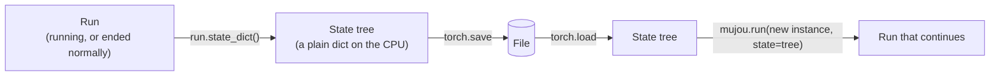
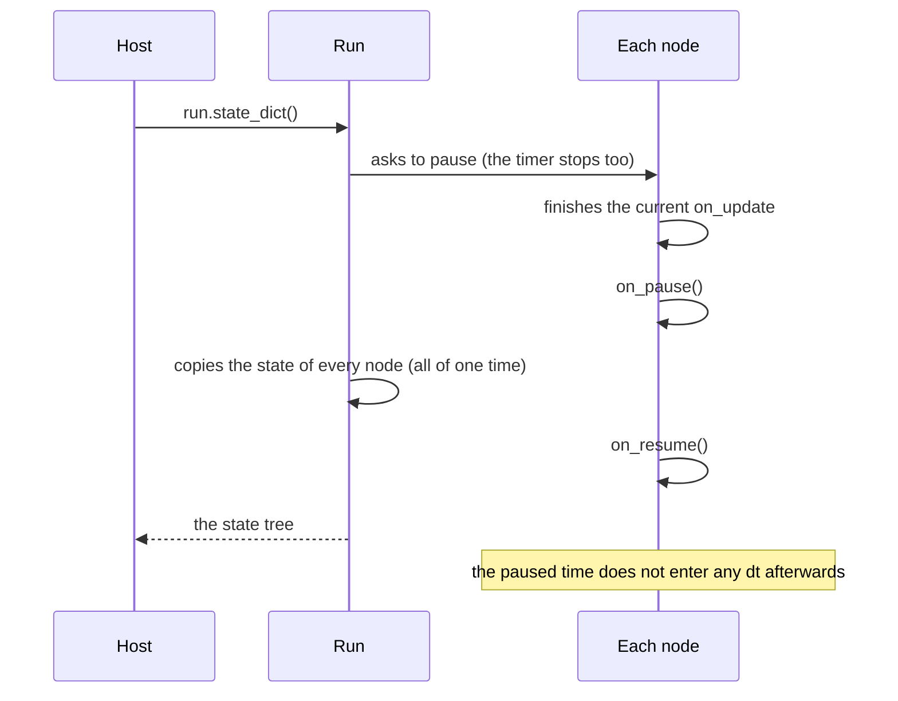
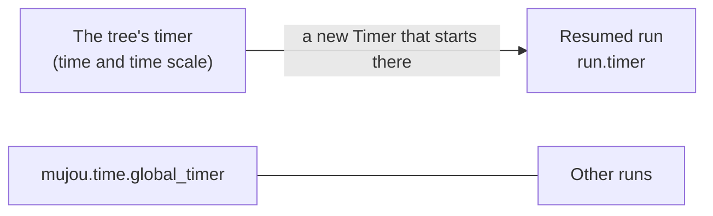
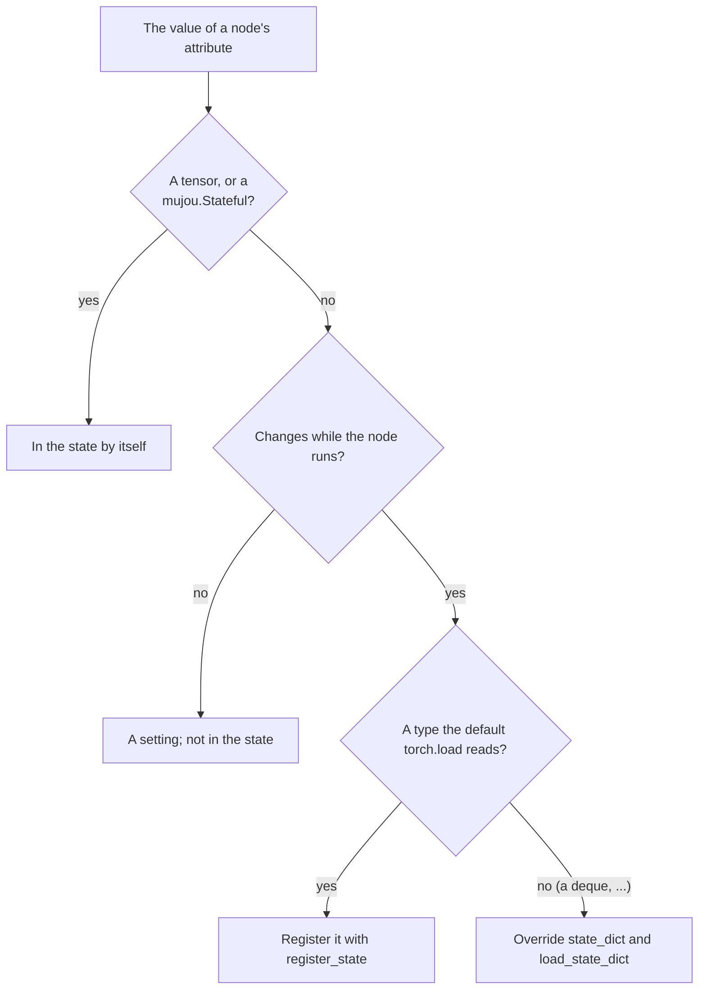
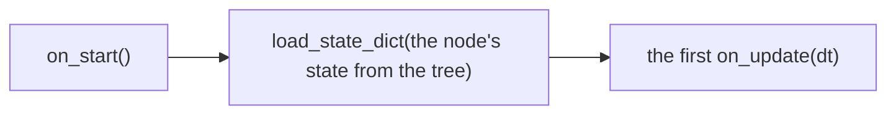
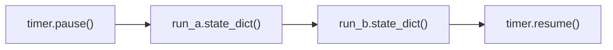

# 💾 6. Save and Resume

This page takes the state of a run, saves it to a file, and resumes from it in a new run. What the state holds is in [How Mujou Works](../concepts.md#7-state).

!!! abstract "On this page"

    - How to take and save the state of a run, and resume from it in a new run
    - What the state tree holds, and how the run pauses while you take it
    - What resuming requires, and the errors raised when it fails
    - How to put values that are not collected by themselves into the state, and how to read the file

## The steps

!!! abstract "In short"

    Take the tree with `run.state_dict()` and save it with `torch.save`. To resume, pass the tree to a new instance of the same network.



```python
--8<-- "examples/save_and_restore.py"
```

| #   | Step                                                       | In the example                                 | Note                                                                                                      |
| --- | ---------------------------------------------------------- | ---------------------------------------------- | --------------------------------------------------------------------------------------------------------- |
| 1   | Keep the state in attributes                               | `self.x` (a tensor), `self.readout` (a module) | Collected by themselves, with the state of the node's random generator                                    |
| 2   | Create it in `__init__`, update it in place in `on_update` | `self.x += dt * self.prev.recv()`              | Other references to it (from an optimizer, say) keep pointing at the state ([2. Write a Node](2-node.md)) |
| 3   | Take the tree                                              | `tree = run.state_dict()`                      | While the run runs, or after it ended normally (here, after the `with` block)                             |
| 4   | Save it                                                    | `torch.save(tree, file)`                       | —                                                                                                         |
| 5   | Resume in a new instance                                   | `mujou.run(restored, ..., state=loaded)`       | A **new instance** of the same network                                                                    |

!!! warning "The network the tree came from cannot resume"

    A network runs once. Running the network you took the tree from again makes `mujou.run` raise an exception. To resume, build a new instance of the same network. See [rules a node keeps](../concepts.md#rules-a-node-keeps).

## The tree

!!! abstract "In short"

    The tree is a plain `dict` of copies on the CPU, keyed by the paths of the nodes.

```python
{
    "timer": {"time_ns": int, "time_scale": float},
    "nodes": {
        "integrator": {
            "state": ...,  # the node's state_dict()
            "last_update_ns": int,
            "ports": {...},
        },
    },
}
```

| Key                                   | What it holds                                      |
| ------------------------------------- | -------------------------------------------------- |
| `"timer"`                             | The time and the time scale of the timer           |
| `"nodes"` → path → `"state"`          | The state of each node (the node's `state_dict()`) |
| `"nodes"` → path → `"last_update_ns"` | The time of each node's last update                |
| `"nodes"` → path → `"ports"`          | The latest message on each channel, with its time  |

The exact shape is in the API reference of [`Run.state_dict`](../api/run.md#mujou.Run.state_dict).

### The pause while taking it



Each node stops between two updates, never in the middle of one, so every value in the tree is of the same time. The paused time does not enter any `dt` afterwards. `on_pause` and `on_resume` let a node hold its I/O meanwhile.

|                         | The pause of `run.state_dict()` | A pause of the timer (`run.timer.pause()`) |
| ----------------------- | ------------------------------- | ------------------------------------------ |
| Purpose                 | Taking the state                | Stopping the time                          |
| `on_pause`, `on_resume` | Called                          | Not called                                 |

### When you take it, and what you get

| When you take it       | What you get                                                                                                                         |
| ---------------------- | ------------------------------------------------------------------------------------------------------------------------------------ |
| While the network runs | The state at that time                                                                                                               |
| After a normal end     | The values as the nodes left them after `on_stop`, at the time `shutdown` asked the run to stop                                      |
| After an exception     | Nothing: `state_dict` raises `NetworkError`. Take the state you want to keep while the network runs, and regularly during a long run |

## When you resume

!!! abstract "In short"

    A resumed run has a timer of its own. Its network and the state of each node must match those the tree came from.

### A timer of its own



| What you do                    | Effect on the resumed run                                  |
| ------------------------------ | ---------------------------------------------------------- |
| `run.timer.pause()`            | Pauses it                                                  |
| `global_timer.pause()`         | Does not pause it                                          |
| Passing `timer=` with `state=` | `ValueError`                                               |
| Resuming                       | Does not set back `global_timer` or the time of other runs |

### What must match, and what happens when it does not

| What must match                                | When it does not                                                                                                                                      | Those instances                                                  |
| ---------------------------------------------- | ----------------------------------------------------------------------------------------------------------------------------------------------------- | ---------------------------------------------------------------- |
| The network: node paths, ports and connections | `mujou.run` raises `ValueError`, listing what is missing and what is in excess                                                                        | Nothing has started yet; once the tree is fixed, they can resume |
| The state of each node: its keys and shapes    | The default `load_state_dict` raises `ValueError` while the node starts, and `mujou.run` raises `NetworkError` (its `__cause__` is that `ValueError`) | Do not run again; build new ones                                 |

!!! warning "Renaming an attribute changes a path"

    The paths of the nodes come from the attribute names, so a tree saved before a rename no longer resumes.

### Inputs

| What you pass to `mujou.run` | The values of the inputs                    |
| ---------------------------- | ------------------------------------------- |
| `state=` only                | Those of the tree                           |
| `state=` and `inputs=`       | Those of `inputs` replace those of the tree |

## Values of your own in the state

!!! abstract "In short"

    Tensors, `mujou.Stateful` objects and random generators are collected by themselves. Register a plain value that changes while the node runs with `register_state`; for anything else, override `state_dict` and `load_state_dict`.



| Value                                                                                                             | In the state?                         |
| ----------------------------------------------------------------------------------------------------------------- | ------------------------------------- |
| A tensor                                                                                                          | By itself                             |
| A `mujou.Stateful` (every `nn.Module`, `pc.clock.LearnClock`, a class of your own that inherits `mujou.Stateful`) | By itself                             |
| The state of `self.generator`                                                                                     | By itself                             |
| Numbers, strings, lists or dicts of tensors                                                                       | No: register it with `register_state` |
| An object that only has methods named `state_dict` and `load_state_dict`                                          | No: inherit `mujou.Stateful`          |

=== "Avoid"

    ```python
    class Counter:  # methods of the same names alone do not put it in the state
        def state_dict(self) -> dict[str, int]: ...
        def load_state_dict(self, state: Mapping[str, int]) -> None: ...
    ```

=== "Write"

    ```python
    class Counter(mujou.Stateful):  # inherited: in the state by itself as an attribute
        def state_dict(self) -> dict[str, int]: ...
        def load_state_dict(self, state: Mapping[str, int]) -> None: ...
    ```

### register_state

```python
self.elapsed = 0.0
self.register_state("elapsed")
```

| Rule                                    | What it says                                                                                                                   |
| --------------------------------------- | ------------------------------------------------------------------------------------------------------------------------------ |
| Where to call it                        | In `__init__`, after assigning the attribute                                                                                   |
| A name not assigned yet                 | `AttributeError`                                                                                                               |
| A value assigned to the attribute later | Goes into the state too                                                                                                        |
| The type of the value                   | A type the default `torch.load` reads (`int`, `float`, `bool`, `str`, `None`, and lists, tuples and dicts of them, or tensors) |

=== "Avoid"

    ```python
    self.register_state("elapsed")  # AttributeError: not assigned yet
    self.elapsed = 0.0
    ```

=== "Write"

    ```python
    self.elapsed = 0.0
    self.register_state("elapsed")
    ```

### Overriding state_dict and load_state_dict

For a value the default `torch.load` cannot read, such as a `deque`, override both `state_dict` and `load_state_dict`: extend what `super().state_dict()` returns, and pass `super().load_state_dict` the state without the keys you added.

```python
from collections import deque
from collections.abc import Mapping
from typing import Any, override

import torch

from mujou import Node


class Recent(Node):
    """Keeps the last 8 inputs in a deque."""

    def __init__(self) -> None:
        super().__init__()
        self.recent: deque[torch.Tensor] = deque(maxlen=8)

    @override
    def state_dict(self) -> dict[str, Any]:
        return {**super().state_dict(), "recent": list(self.recent)}

    @override
    def load_state_dict(self, state: Mapping[str, Any]) -> None:
        self.recent = deque((x.clone() for x in state["recent"]), maxlen=8)  # a copy of the tree's
        super().load_state_dict({k: v for k, v in state.items() if k != "recent"})
```

| Method            | When it is called                                       | What to keep in mind                                                     |
| ----------------- | ------------------------------------------------------- | ------------------------------------------------------------------------ |
| `state_dict`      | While the node is paused                                | Its ports refuse to receive and send there. Mujou copies what it returns |
| `load_state_dict` | Once, after `on_start` and before the first `on_update` | Do not keep the tree's tensors as they are; keep copies                  |



The ports refuse to receive and send inside `state_dict` so that taking the state is not seen by the other nodes.

## Files

!!! abstract "In short"

    What Mujou puts in the tree loads with the default `torch.load` (`weights_only=True`). Do not read files you do not trust with `weights_only=False` or `pickle.load`.

| How you read it                                    | What it reads                                                | Note                                                                                            |
| -------------------------------------------------- | ------------------------------------------------------------ | ----------------------------------------------------------------------------------------------- |
| `torch.load(f)` (the default `weights_only=True`)  | A tree of tensors, numbers, strings, dicts, lists and tuples | Does not read a tree holding objects of your own classes (from `register_state` or an override) |
| `torch.load(f, weights_only=False)`, `pickle.load` | Objects of your own classes too                              | Can run code from the file. Do not read files you do not trust                                  |

| Operation                                        | What it requires of the device                                                                                                |
| ------------------------------------------------ | ----------------------------------------------------------------------------------------------------------------------------- |
| Reading the tree with `torch.load`               | Nothing: a machine without a GPU can read a tree saved from nodes on CUDA                                                     |
| The default `load_state_dict` restoring a tensor | Copies each tensor to the node's device                                                                                       |
| Restoring the state of a random generator        | The format differs between the CPU and CUDA: it restores only into a node on the same kind of device as the one that saved it |

Since every node's state holds the state of its random generator, a tree restores only into nodes on the same kind of device (CPU or CUDA) as the ones that saved it.

## Several runs at one time

!!! abstract "In short"

    To take the states of several runs on one timer at one time, pause the timer first.



`run.state_dict()` takes the state of one run at one time. Taken one by one without pausing, the runs' states are of different times. See [Time](../topics/time.md#pausing-the-time).

## Next

- The topics go deeper into each part, starting with [Ports and Channels](../topics/ports.md)
