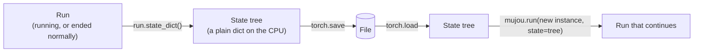
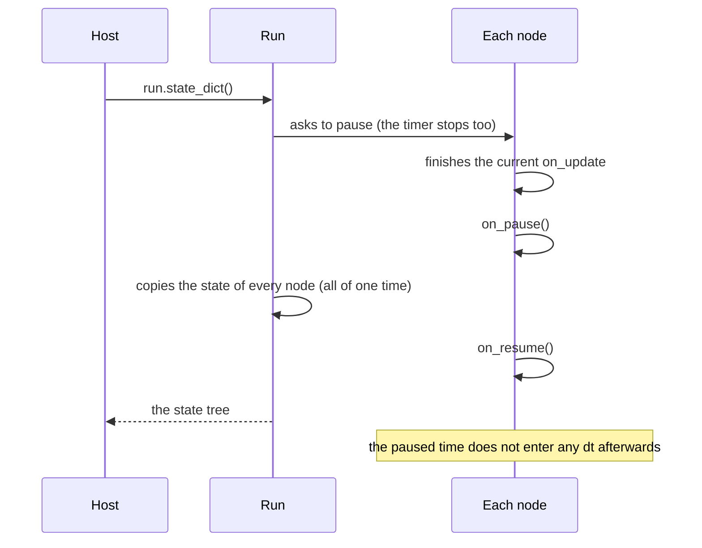
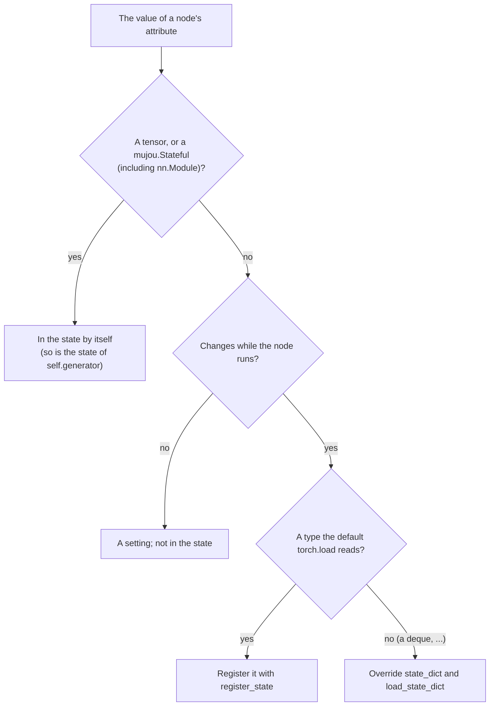

# 💾 6. Save and Resume

This page takes the state of a run, saves it to a file, and resumes from it in a new instance of the same network.

## The steps {#steps}



```python
--8<-- "examples/save_and_restore.py"
```

The shape of the tree is in [`Run.state_dict`][mujou.Run.state_dict]. A network runs once, so the instance you took the tree from cannot resume; build a new instance of the same network ([Rules a node keeps](../concepts.md#rules)).

## The pause while taking it {#pause}



[`on_pause`][mujou.Node.on_pause] and `on_resume` let a node hold its I/O meanwhile. A run that ended with an exception has no state to take, so take it regularly during a long run ([The state after an exception](../topics/errors.md#state)).

## When you resume {#restore}

| What to mind              | In the resumed run                                                                                       | More                                                           |
| ------------------------- | -------------------------------------------------------------------------------------------------------- | -------------------------------------------------------------- |
| The timer                 | Runs on a timer of its own that starts at the tree's time                                                | [The timer of a resumed run](../topics/time.md#restored-timer) |
| The network and its state | Must have the paths, ports and connections, and the state keys and shapes, of the one the tree came from | `state` of [`mujou.run`][mujou.run]                            |
| Inputs                    | `inputs` are written after the state and replace the tree's values                                       | `inputs` of `mujou.run`                                        |

!!! warning "Renaming an attribute changes a path"

    The paths of the nodes come from the attribute names, so a tree saved before a rename no longer resumes.

## Values of your own in the state {#custom-state}



A class of your own does not enter the state just by having `state_dict` and `load_state_dict`; inherit [`Stateful`][mujou.Stateful] (the rules for registering a plain value are in [`register_state`][mujou.Node.register_state]).

=== "Avoid"

    ```python
    class Counter:  # methods of the same names alone do not put it in the state
        def state_dict(self) -> dict[str, int]: ...
        def load_state_dict(self, state: Mapping[str, int]) -> None: ...
    ```

=== "Write"

    ```python
    class Counter(mujou.Stateful):  # inherited: in the state by itself as an attribute
        def state_dict(self) -> dict[str, int]: ...
        def load_state_dict(self, state: Mapping[str, int]) -> None: ...
    ```

### Overriding state_dict and load_state_dict {#override}

`state_dict` returns `super().state_dict()` extended with your keys; `load_state_dict` passes `super().load_state_dict` the state without them, and keeps copies (`clone`) of the tree's tensors.

```python
from collections import deque
from collections.abc import Mapping
from typing import Any, override

import torch

from mujou import Node


class Recent(Node):
    """Keeps the last 8 inputs in a deque."""

    def __init__(self) -> None:
        super().__init__()
        self.recent: deque[torch.Tensor] = deque(maxlen=8)

    @override
    def state_dict(self) -> dict[str, Any]:
        return {**super().state_dict(), "recent": list(self.recent)}

    @override
    def load_state_dict(self, state: Mapping[str, Any]) -> None:
        self.recent = deque((x.clone() for x in state["recent"]), maxlen=8)  # a copy of the tree's
        super().load_state_dict({k: v for k, v in state.items() if k != "recent"})
```

## Files {#files}

| How you read it                                    | What it reads                                                | Note                                                                                            |
| -------------------------------------------------- | ------------------------------------------------------------ | ----------------------------------------------------------------------------------------------- |
| `torch.load(f)` (the default `weights_only=True`)  | A tree of tensors, numbers, strings, dicts, lists and tuples | Does not read a tree holding objects of your own classes (from `register_state` or an override) |
| `torch.load(f, weights_only=False)`, `pickle.load` | Objects of your own classes too                              | Can run code from the file. Do not read files you do not trust                                  |

## Next

- Taking the states of several runs on one timer at one time: [Time](../topics/time.md#multi-run-state)
- The topics go deeper into each part, starting with [Ports and Channels](../topics/ports.md)
