# 🧠 Mujou の仕組み

mujou でプログラムを書くのに要る 9 つの考え方を、出会う順に図とコードで説明する。最後の節はノードが守る規則。手を動かして試すのは[チュートリアル](tutorial/1-run.md)で。

!!! abstract "このページで分かること"

    - ノードに 1 回分の更新だけを書き、mujou がそれを繰り返し呼ぶ仕組み
    - ノード同士が互いを待たず、最新の値だけでやり取りする仕組み
    - その上に実行・時間・状態・テスト・学習がどう組み立てられているか

    前提は PyTorch の `nn.Module` とテンソルを使ったことがあること。

## 全体像

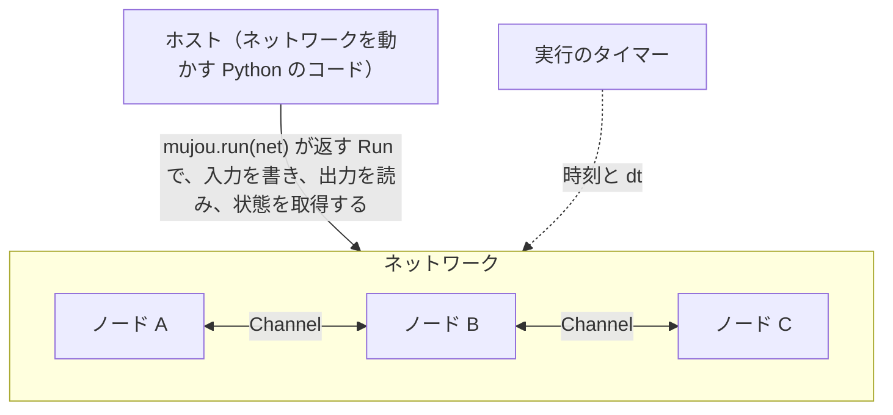

図の部品と、それを説明する節の対応。

| 部品            | ひとことで                                             | 節                                                                                                            |
| --------------- | ------------------------------------------------------ | ------------------------------------------------------------------------------------------------------------- |
| ノード          | 1 回分の更新を書くクラス。繰り返し呼ぶのは mujou       | [1. ノード](#1-%E3%83%8E%E3%83%BC%E3%83%89)                                                                   |
| Port と Channel | ノードの接続口と、2 つの口をつなぐ線                   | [2. Port と Channel](#2-port-%E3%81%A8-channel)                                                               |
| spec            | Port が送受信するテンソルの shape と dtype             | [3. メッセージの型](#3-%E3%83%A1%E3%83%83%E3%82%BB%E3%83%BC%E3%82%B8%E3%81%AE%E5%9E%8Bspec)                   |
| ネットワーク    | ノードを組み立てる入れ物。中のノードはパスで指す       | [4. ネットワークとパス](#4-%E3%83%8D%E3%83%83%E3%83%88%E3%83%AF%E3%83%BC%E3%82%AF%E3%81%A8%E3%83%91%E3%82%B9) |
| 実行            | `mujou.run` が全ノードを動かし、ホストに `Run` を返す  | [5. 実行](#5-%E5%AE%9F%E8%A1%8C)                                                                              |
| 時間            | 実行ごとに 1 本のタイマー。更新は経過時間 `dt` に比例  | [6. 時間](#6-%E6%99%82%E9%96%93)                                                                              |
| 状態            | 実行全体の状態を 1 つの dict で取得し、続きから再開    | [7. 状態](#7-%E7%8A%B6%E6%85%8B)                                                                              |
| テスト          | 仮想のタイマーで時間を手で進め、決定的に走らせる       | [8. テスト](#8-%E3%83%86%E3%82%B9%E3%83%88)                                                                   |
| 学習            | 更新則はノードの中。学習と推論のモードもエポックも無い | [9. 学習](#9-%E5%AD%A6%E7%BF%92)                                                                              |

### PyTorch との対応

PyTorch を知っていれば、次の対応から入ると早い。

| PyTorch                                 | mujou                                                         |
| --------------------------------------- | ------------------------------------------------------------- |
| モデルの `forward` を自分のループで呼ぶ | ノードの `on_update(dt)` を mujou が呼ぶ。ループは書かない    |
| `forward` の引数と戻り値                | Port の `recv()` と `send()`                                  |
| 親のモジュールの属性に子を代入する      | `Network` の属性にノードを代入する                            |
| `model.train()` と `model.eval()`       | 無い。推論と学習を同時に行う                                  |
| `loss.backward()` がモデル全体に届く    | 勾配はノードの中だけ。ノードの間はメッセージ                  |
| `model.state_dict()`                    | ノードごとの `state_dict()` と、実行全体の `run.state_dict()` |

## 1. ノード

!!! abstract "要点"

    ノードは 1 回分の更新を `on_update(dt)` に書くクラス。ループは書かず、繰り返し呼ぶのは mujou。

ノードは計算の単位で、`mujou.Node` を継承したクラスとして書く。次は受け取った値を `a * x + b` にして送るノード。

```python
--8<-- "examples/quickstart.py:node"
```

`__init__` で Port を作り、`on_update(dt)` で読み、計算し、送る。ノードの状態は自分の属性に持つ。

### hook の呼ばれる順

`on_update` のほかの hook も mujou が呼ぶ。1 つの実行の中でノードが通る主な流れは次のとおり。

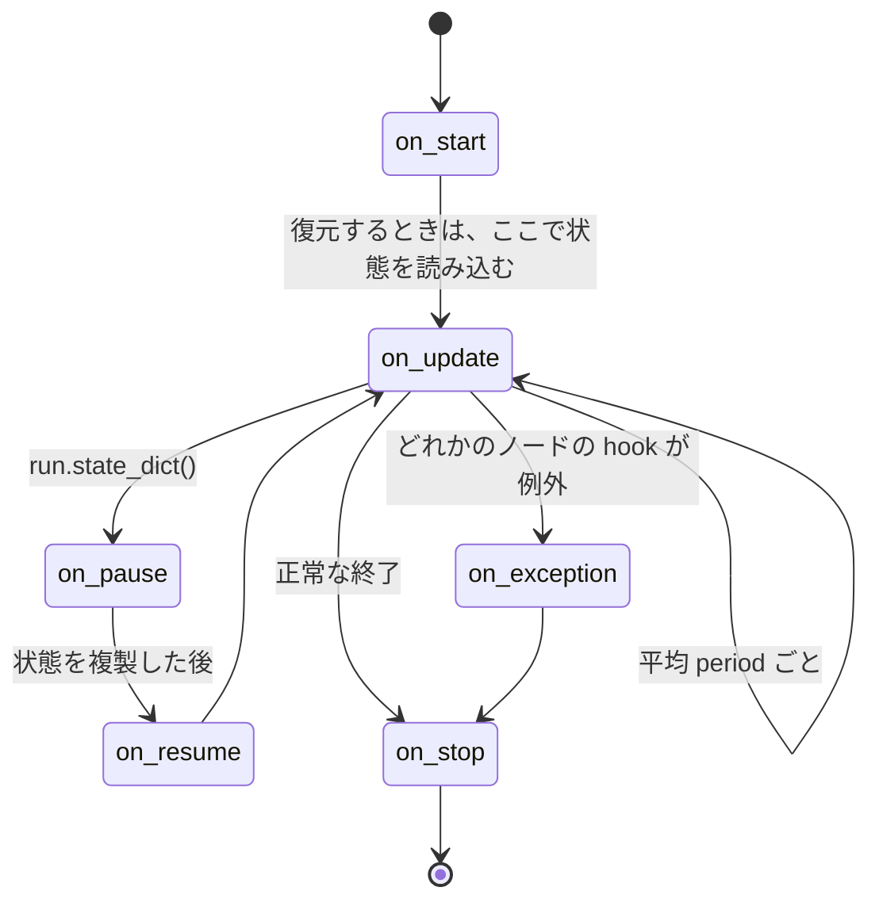

| hook                        | 呼ばれるとき                                                               |
| --------------------------- | -------------------------------------------------------------------------- |
| `on_start()`                | 実行の始まりに 1 回（復元するときも）。I/O はここで開く                    |
| `on_update(dt)`             | 平均 `period` ごとに繰り返し。`dt` は前回の更新からの秒数                  |
| `on_pause()`・`on_resume()` | `run.state_dict()` が状態を取得するための停止と、その再開                  |
| `on_exception()`            | どれかのノードの hook が例外を出したとき、全ノードで `on_stop` の前に 1 回 |
| `on_stop()`                 | 実行が止まるときに 1 回（例外の後も）。I/O などの資源を解放する            |

正確な順と細かい条件は API リファレンスの [`Node`](api/node-and-ports.md#mujou.Node) にある。

!!! tip "override した hook では最初に `super()` を呼ぶ"

    `__init__` でも hook でも、先頭で `super().__init__(...)` や `super().on_update(dt)` を呼ぶ。上のコードもそう書いている。

### 内側は同期、間は非同期

ノードの境界で、計算の仕方が切り替わる。

|          | ノードの内側                    | ノードの間                                          |
| -------- | ------------------------------- | --------------------------------------------------- |
| 実行     | 同期。ふつうの PyTorch のコード | 非同期。互いを待たない                              |
| やり取り | 変数と計算グラフ                | Port のメッセージ（計算グラフから切り離したコピー） |
| 勾配     | 通常の PyTorch と同じく記録する | 届かない                                            |

1 つのノードにどれだけの計算を入れるかは、ノードのクラスで決まる。1 つの層でも、複数の層でも、モデル全体でもよい。一緒に計算したい層（BP で一緒に学習させたい層も）は 1 つのノードのクラスにまとめる。

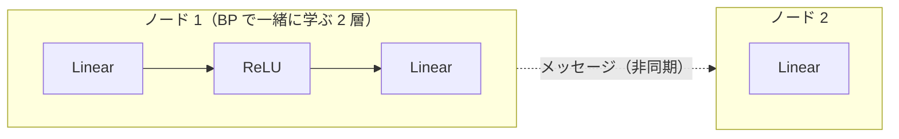

実線はノードの内側で同期して進む計算、点線はノードをまたいで非同期に届くメッセージ。

??? question "ノードにループを書かないのはなぜ？"

    mujou は多くのノードを少ないワーカースレッドで回す。ノードが 1 回分の更新だけを書けば、いつ・どのスレッドで呼ぶかを mujou が決められる。状態を取得するために全ノードを止めることも、テストで 1 回ずつ進めることも、この形だからできる。

## 2. Port と Channel

!!! abstract "要点"

    Port はノードの接続口、Channel は 2 つの Port をつなぐ線。読む側は待たず、相手が最後に送った値を読む。

`connect` が 2 つの Port を 1 本の Channel でつなぎ、その Channel を返す。

```python
self.scale.next.connect(self.shift.prev)  # scale の出力を shift の入力へ
```

### 値は溜まらず、最新の値だけが残る

Channel はキューではない。送った値は前の値を上書きし、`recv()` はそのときの最新の値を返す。

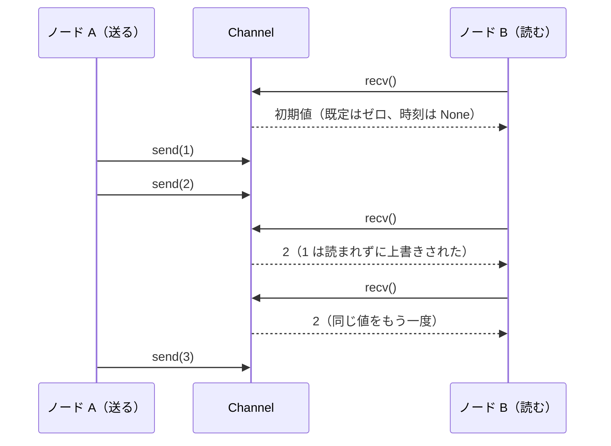

- 読むときは待たない。相手がまだ送っていなくても、すぐに値が返る
- 相手が最初に送るまでは、相手の Port の初期値（既定はゼロ）を返し、その時刻は `None`
- 値には送った時刻が付く。`recv_with_time()` で時刻と一緒に読めば、新しい値か同じ値の読み直しかがわかる

??? question "キューにしないのはなぜ？"

    キューに値を溜めると、送る側と読む側の速さの差で値が溜まっていき、遅い側に合わせてノード同士の歩調がそろってしまう。最新の値だけを読み書きすれば、各ノードは互いを待たずに自分の速さで動ける。

### Port と MultiPort

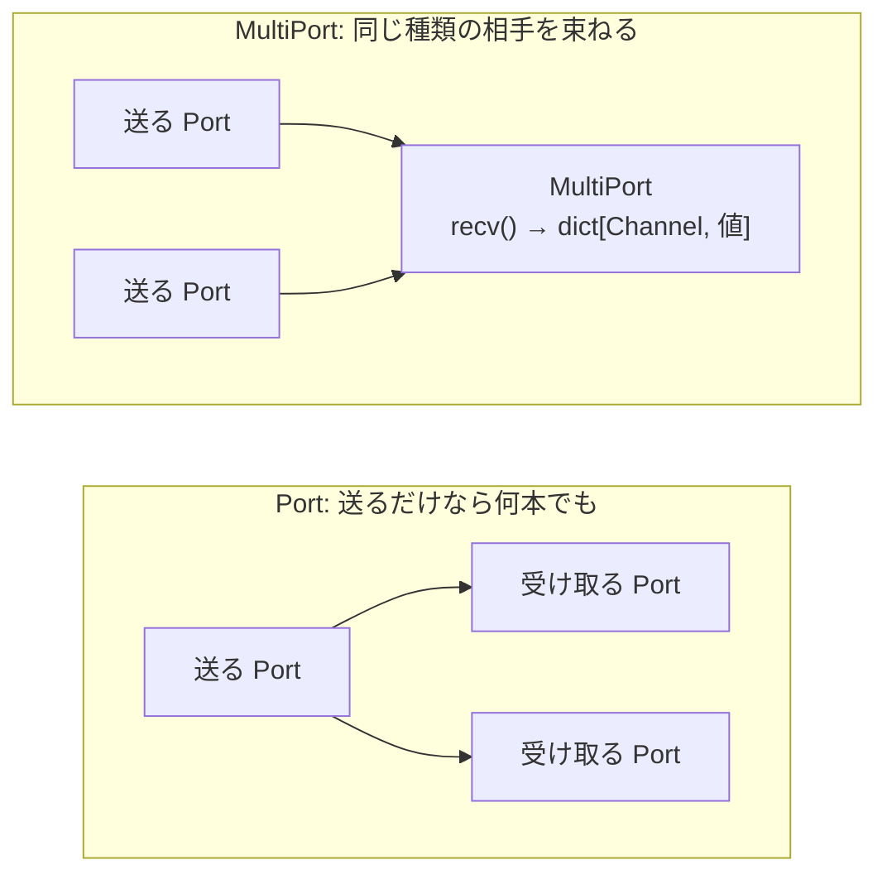

|               | `Port`                                       | `MultiPort`                                          |
| ------------- | -------------------------------------------- | ---------------------------------------------------- |
| 受け取る相手  | 1 つまで                                     | いくつでも（同じ種類の相手）                         |
| `recv()` の値 | 値 1 つ                                      | `dict[Channel, 値]`（`connect` の順）                |
| 使いどころ    | 1 対 1 のやり取り。送るだけなら 1 対多の配信 | 同じ種類の入力を束ねる。どう束ねるかはノードが決める |

役割の違う入力（予測と誤差など）は、`MultiPort` で束ねずに別々の `Port` で受ける。つなぎ方が循環してもよい。詳しくは [Port と Channel](topics/ports.md)。

## 3. メッセージの型（spec）

!!! abstract "要点"

    Port は送るものと受け取るものの shape と dtype を spec で宣言する。spec が一致する Port どうしだけがつながる。

```python
VECTOR = TensorSpec((3,))      # 要素 3 つの float32 のベクトル
self.prev = Port(recv=VECTOR)  # 受け取るだけ
self.next = Port(send=VECTOR)  # 送るだけ
```

送る側の spec が受け取る側の spec と一致するときだけ `connect` できる。値は `torch.Tensor`、Python のスカラー、またはその dict。

| spec                                                      | 運ぶもの                                 | 使いどころ                               |
| --------------------------------------------------------- | ---------------------------------------- | ---------------------------------------- |
| `TensorSpec(shape, dtype)`                                | テンソル 1 つ                            | 活動や誤差のような 1 つの値              |
| `IntSpec(bits)`、`FloatSpec`、`BoolSpec`、`TimestampSpec` | `int`、`float`、`bool`、`Timestamp` 1 つ | 回数・フラグ・時刻。テンソルに包まない   |
| `DictSpec`                                                | `TypedDict` のテンソルとスカラーの組     | 入力とその目標のように、一緒に届けたい値 |

!!! warning "組になる値は 1 つのメッセージで送る"

    2 つの Port の値は別々に届く。読む側は一方の新しい値と、もう一方の古い値を同時に読むことがある。入力とその目標のように組になる値は `DictSpec` にまとめると、dict 全体が一度に届く。

`send` は計算グラフから切り離したコピーを送る。送った後で元のテンソルを変えても、送った値は変わらない。

## 4. ネットワークとパス

!!! abstract "要点"

    `Network` はノードを組み立てる入れ物で、自分では何も実行しない。中のノードは、ルートからの属性名をドットでつないだパスで指す。

`nn.Module` に子のモジュールを持たせるのと同じように、ノードを属性に代入して Port をつなぐ。次は「2 倍する → 1 を足す」の 2 つのノードを並べたネットワーク。

```python
--8<-- "examples/quickstart.py:network"
```

最後の行で、最初のノードの入力と最後のノードの出力を自分の `prev` と `next` として公開している。こうすると、ネットワークもノードと同じように外からつなげる。

ネットワークを入れ子にすると、パスはルートからの属性名をつないだものになる。

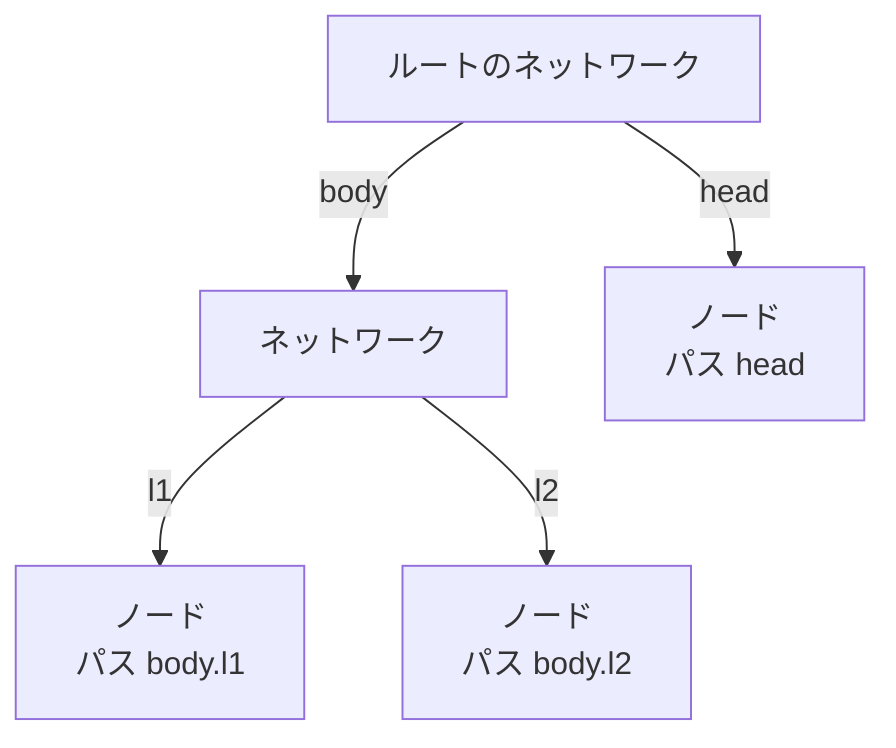

パスは状態のキーになる（[7. 状態](#7-%E7%8A%B6%E6%85%8B)）。名前を付けて並べるだけなら、`Group(**named)` を使う。ネットワーク自身は何も実行せず、実行中も中のノードはそれぞれ独立に動く。

## 5. 実行

!!! abstract "要点"

    `mujou.run(root)` が全ノードをバックグラウンドで動かし、ホストに窓口の `Run` を返す。ホストは `Run` で入力を書き、出力を読む。

ホストは利用者のプログラムのこと。上の `Pipeline` を走らせ、出力が届くまで待つ。

```python
--8<-- "examples/quickstart.py:run"
```

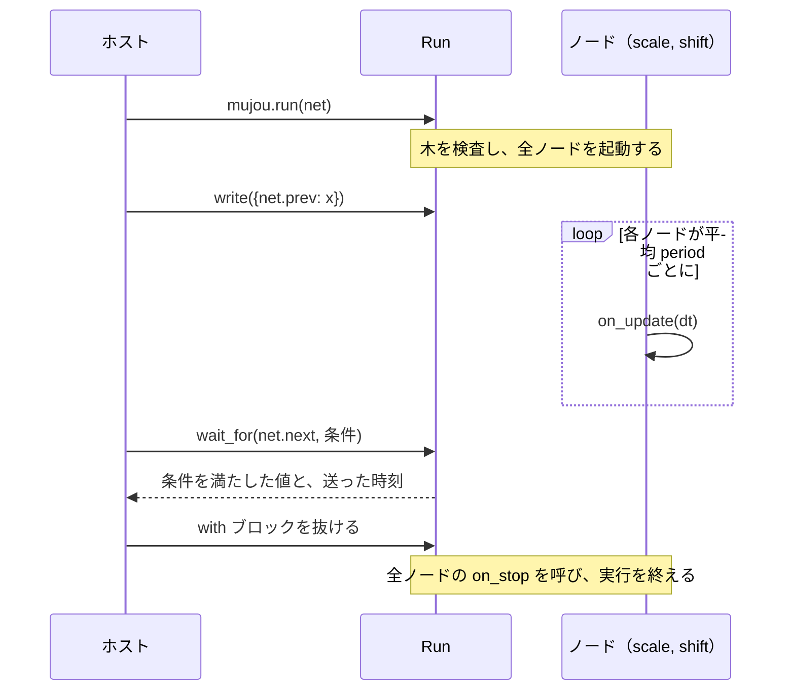

ホストが `Run` でできること。

| したいこと               | 使うもの                                         |
| ------------------------ | ------------------------------------------------ |
| 入力を書く               | `run.write`                                      |
| 最新の出力を読む         | `run.read`・`run.read_with_time`                 |
| 条件を満たす出力を待つ   | `run.wait_for`                                   |
| 送られた値を順に受け取る | `run.subscribe`                                  |
| 実行の時間で待つ         | `run.timer.sleep`                                |
| 状態を取得する           | `run.state_dict()`                               |
| 実行を終える             | `with` ブロックを抜ける、または `run.shutdown()` |

ルートは 1 回だけ走る。もう一度走らせるときは新しいインスタンスを作る。終わった後は、ノードの属性をホストが読んでよい。詳しくは[ホストの入出力](topics/host-io.md)。

## 6. 時間

!!! abstract "要点"

    1 つの実行の時間軸は 1 本のタイマー。ノードは前回の更新からの経過時間 `dt` に比例して状態を進める。

実行ごとに時間軸は 1 本で、それが実行のタイマーである。すべてのノードとホストがこれを使う。自分の `Timer` を渡さない実行は `mujou.time.global_timer` で走る。ホストは `run.timer` で時間を待ったり止めたりし、ノードは `self.timer` で読むだけ。

### `dt` に比例して更新する

各ノードは平均 `period` ごとに 1 回更新する。ただし更新の間隔はノードごとに違い、揺らぐ。そのため `on_update` は回数ではなく、渡された `dt` に比例して状態を進める。

<figure class="mujou-diagram">
<svg viewBox="0 0 640 170" role="img" aria-label="2 つのノードの更新の時刻。ノード A は一定の間隔で、ノード B は不規則な間隔で更新し、途中で 1 回だけ間隔が長くなる">
<line class="mujou-axis" x1="90" y1="150" x2="620" y2="150"/>
<text class="mujou-label" x="620" y="166" text-anchor="end">実行のタイマー →</text>
<text class="mujou-label" x="10" y="54">ノード A</text>
<line class="mujou-lane" x1="90" y1="50" x2="620" y2="50"/>
<g class="mujou-tick-a"><line x1="100" y1="38" x2="100" y2="62"/><line x1="160" y1="38" x2="160" y2="62"/><line x1="220" y1="38" x2="220" y2="62"/><line x1="280" y1="38" x2="280" y2="62"/><line x1="340" y1="38" x2="340" y2="62"/><line x1="400" y1="38" x2="400" y2="62"/><line x1="460" y1="38" x2="460" y2="62"/><line x1="520" y1="38" x2="520" y2="62"/><line x1="580" y1="38" x2="580" y2="62"/></g>
<text class="mujou-note" x="130" y="30" text-anchor="middle">dt</text>
<text class="mujou-note" x="190" y="30" text-anchor="middle">dt</text>
<text class="mujou-label" x="10" y="114">ノード B</text>
<line class="mujou-lane" x1="90" y1="110" x2="620" y2="110"/>
<g class="mujou-tick-b"><line x1="100" y1="98" x2="100" y2="122"/><line x1="175" y1="98" x2="175" y2="122"/><line x1="235" y1="98" x2="235" y2="122"/><line x1="400" y1="98" x2="400" y2="122"/><line x1="455" y1="98" x2="455" y2="122"/><line x1="530" y1="98" x2="530" y2="122"/><line x1="590" y1="98" x2="590" y2="122"/></g>
<path class="mujou-brace" d="M 237 92 Q 237 84 245 84 L 390 84 Q 398 84 398 92"/>
<text class="mujou-note" x="317" y="78" text-anchor="middle">混んで遅れても dt が長くなるだけ</text>
</svg>
<figcaption>縦の線が更新の時刻。ノードごとに間隔が違い、揺らぐ。どの更新も、前回から経った時間を <code>dt</code> として受け取る</figcaption>
</figure>

たとえば入力 $u$ に時定数 $\tau$ で追従するノードは、次の微分方程式に従う。

$$
\frac{dx}{dt} = \frac{u - x}{\tau}
$$

`on_update(dt)` は、この式を `dt` だけ進める。

$$
x \leftarrow x + \left(1 - e^{-\Delta t / \tau}\right)(u - x)
$$

こう書くと、更新の速さが違い揺らぐノード同士でも同じダイナミクスに従う。マシンが混んでも `dt` が伸びるだけで、経った時間は失われない。このノード `Leaky` は[ノードを書く](tutorial/2-node.md)で作る。

### 2 種類の秒

| 秒の種類           | 使うもの                                          |
| ------------------ | ------------------------------------------------- |
| 実行のタイマーの秒 | `dt`、`period`、`run.timer.sleep`、値を送った時刻 |
| 実時間の秒         | `timeout` だけ                                    |

ホストは実行のタイマーを一時停止したり、速さを変えたりできる。そのときも `dt` と `period` はタイマーに従い、`timeout` だけが実時間で測る。詳しくは[時間](topics/time.md)。

## 7. 状態

!!! abstract "要点"

    ノードの状態は属性から自動で集まる。`run.state_dict()` は実行全体の状態を 1 つの dict で取得し、`mujou.run(..., state=tree)` がその続きから走らせる。

### ノードの状態になるもの

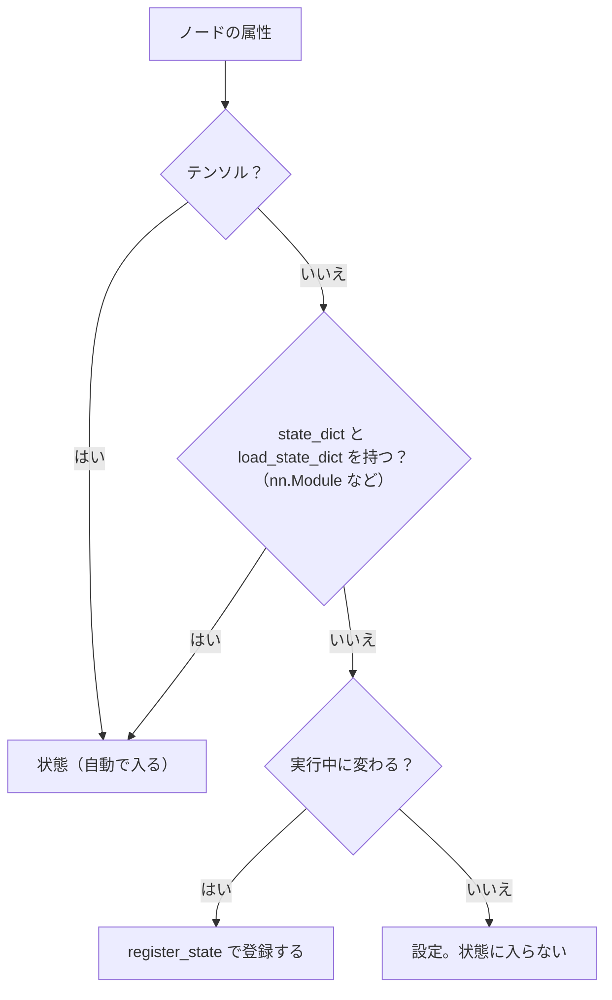

| 属性の例                               | 状態になるか                           |
| -------------------------------------- | -------------------------------------- |
| `self.x = SCALAR.zeros()`              | テンソルなので自動で入る               |
| `self.model = nn.Linear(4, 2)`         | `mujou.Stateful` なので自動で入る      |
| `self.count = 0`                       | `self.register_state("count")` で入る  |
| `self.buffer = []`（テンソルのリスト） | `self.register_state("buffer")` で入る |
| `self.tau = 0.05`（変わらない設定）    | 入らない                               |

ノードの乱数生成器の状態も自動で入る。規則は API リファレンスの [`Node`](api/node-and-ports.md#mujou.Node) にある。

### 実行全体の状態を保存して再開する

`run.state_dict()` は実行を終えずに、その時点の実行全体の状態を取得する。各ノードの状態、各 Channel の最新のメッセージ、時刻を、パスをキーにした 1 つの素の dict にまとめたもの。

```python
tree = run.state_dict()
# {
#     "timer": {"time_ns": ..., "time_scale": ...},
#     "nodes": {
#         "body.l1": {"state": ..., "last_update_ns": ..., "ports": {...}},
#         ...
#     },
# }
```

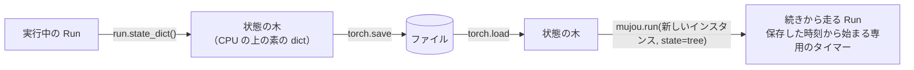

手順は[保存と再開](tutorial/6-save-and-resume.md)。

## 8. テスト

!!! abstract "要点"

    `mujou.testing.run` は仮想のタイマーの上で、時間を手で進めて決定的に走らせる。

ふつうの実行では、各ノードがいつ更新するかは実行ごとに揺らぐ。テストでは時間と更新の順をテストが決める。

|          | `mujou.run`                             | `mujou.testing.run`                                     |
| -------- | --------------------------------------- | ------------------------------------------------------- |
| タイマー | 実行のタイマー（既定は `global_timer`） | 仮想のタイマー。`run.step` でだけ進む                   |
| 更新     | 各ノードが平均 `period` ごとに          | `run.step(dt, *nodes)` で 1 回ずつ。`period` は使わない |
| `dt`     | 実際に経った時間                        | `step` で進めた時間                                     |
| 結果     | 実行ごとに揺らぐ                        | 毎回同じ                                                |

`run.step(dt, *nodes)` は時間を `dt` だけ進めてから、渡したノードを渡した順に 1 回ずつ更新する。ノードを渡さなければ、全ノードを木の順に更新する。

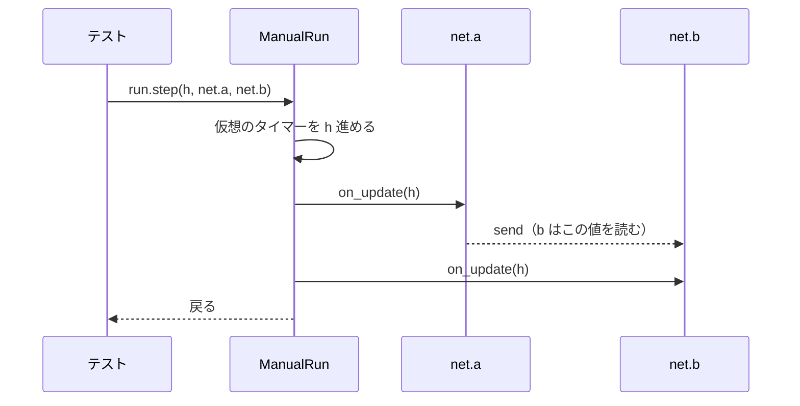

次は 6 節の `Leaky` を厳密解と比べるテスト。

```python
--8<-- "examples/test_leaky.py:test"
```

手順は[ノードをテストする](tutorial/3-test.md)。

## 9. 学習

!!! abstract "要点"

    更新則はノードの中に書く。ノードの間を流れるのはメッセージだけで、学習と推論のモードもエポックも無い。

### 学び続けるネットワーク

従来の機械学習は学習を終えたら重みを固定して推論する。mujou の走っているネットワークは入力を受け取り、出力を出し、同時に学ぶ。

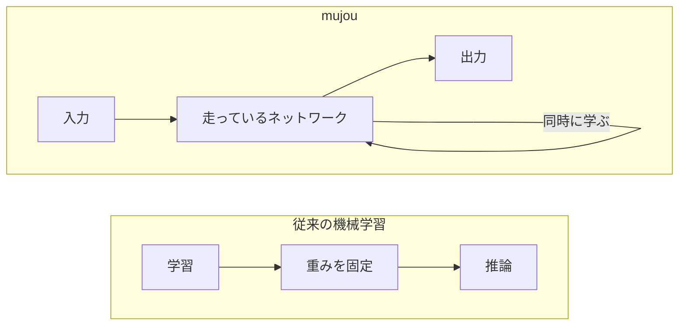

### 更新則を選ぶ

mujou はノード・Port・スケジューラに更新則を組み込まない。どの則で学ぶかはノードが決める。

| 更新則               | 勾配を取る範囲                               | 読むページ                                            |
| -------------------- | -------------------------------------------- | ----------------------------------------------------- |
| ノードの中の BP      | 1 つのノードの中。ふつうの `loss.backward()` | [ノードの中で学習する](tutorial/4-learn-in-a-node.md) |
| PC-ALM（`mujou.pc`） | 各ノードの中。隣とはメッセージでやり取り     | [PC-ALM で学習する](tutorial/5-learn-with-pc.md)      |
| 自作の則             | ノードが決める                               | [更新則](topics/update-rules.md)                      |

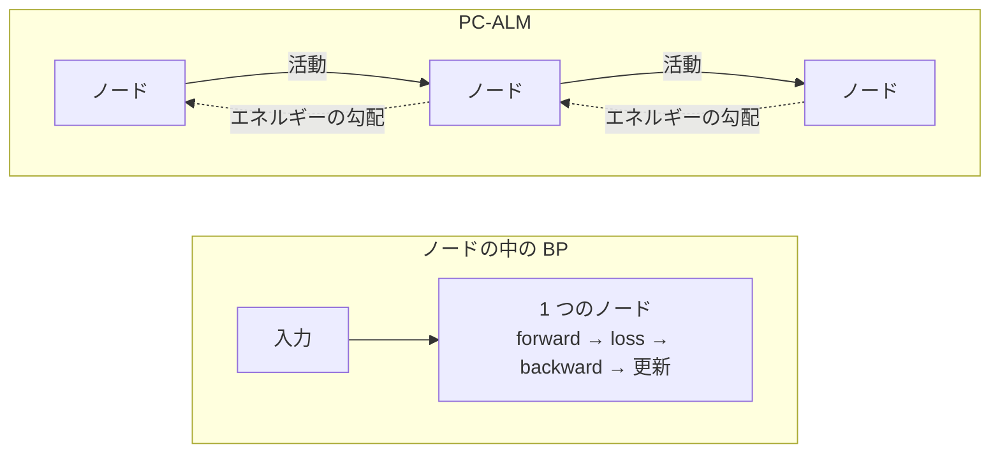

Port は計算グラフから切り離したコピーを送るので、ノードをまたぐ計算グラフは作れない。ノードの間を流れるのは活動・誤差・目標などのメッセージである。

## ノードが守る規則

ほかのページに出てくるノードの注意は、ここにまとめてある。

| 規則                                                                                                                                | 守らないと                             |
| ----------------------------------------------------------------------------------------------------------------------------------- | -------------------------------------- |
| [`time.sleep` でブロックしない](#%E3%82%B9%E3%83%AA%E3%83%BC%E3%83%97)                                                              | ほかのノードの `dt` が伸びる           |
| [ノードは 1 回だけ走る](#%E5%86%8D%E5%AE%9F%E8%A1%8C)                                                                               | `RuntimeError`                         |
| [走っている間はホストからノードの属性を読まない](#%E5%AE%9F%E8%A1%8C%E4%B8%AD%E3%81%AE%E5%B1%9E%E6%80%A7)                           | ノードの更新と競合する                 |
| [`on_start` では状態に依存する出力をしない](#on_start-%E3%81%AE%E5%87%BA%E5%8A%9B)                                                  | 復元する前の状態を送ってしまう         |
| [`on_stop` で状態を変えない](#on_stop-%E3%81%A8%E7%8A%B6%E6%85%8B)                                                                  | 正常に終了した後に取得する状態が変わる |
| [実行中に変わる値は登録する](#%E7%8A%B6%E6%85%8B%E3%81%AE%E7%99%BB%E9%8C%B2)                                                        | 復元したときに初めからになる           |
| [計算グラフは 1 回の更新の中に閉じる](#%E8%A8%88%E7%AE%97%E3%82%B0%E3%83%A9%E3%83%95%E3%81%AE%E7%AF%84%E5%9B%B2)                    | グラフが伸び続ける                     |
| [例外で終わった後は時刻が止まる](#%E4%BE%8B%E5%A4%96%E3%81%AE%E5%BE%8C%E3%81%AE%E6%99%82%E5%88%BB)                                  | `self.timer` で測っても時間が経たない  |
| [時間を動かせるのはホストだけ、ノードは Port だけで話す](#%E6%99%82%E9%96%93%E3%81%AE%E6%93%8D%E4%BD%9C%E3%81%A8%E9%80%9A%E4%BF%A1) | `RuntimeError`                         |

### スリープ

**`time.sleep` でブロックしない。** ノードはワーカースレッドをほかのノードと共有し、ブロッキングする hook はその間ワーカーをふさぐ。ほかのノードの `dt` が伸びる。

=== "避ける"

    ```python
    def on_update(self, dt: float) -> None:
        super().on_update(dt)
        time.sleep(0.1)  # 0.1 秒ごとに更新したい
    ```

=== "こう書く"

    ```python
    def __init__(self) -> None:
        super().__init__(period=0.1)  # 平均 0.1 秒ごとに更新する
    ```

一定間隔で更新するなら `period` を使う。デバイス・ソケット・lock を待つしかないノードには `dedicated_thread=True` を渡す。ホストは `run.timer.sleep` で待つ。こちらは実行の時間の速さと一時停止に従うが、`time.sleep` はどちらにも従わない。

### 再実行

**ノードは 1 回だけ走る。** 走ったノードやネットワークをもう一度走らせると `RuntimeError` になる。もう一度走らせるときは新しいインスタンスを作る。終わった後も属性は読める。

### 実行中の属性

**走っている間はホストからノードの属性を読まない。** ノードの更新と競合する。Port を `run.read` で読むか、`run.state_dict()` を取得する。

### on_start の出力

**`on_start` では状態に依存する出力をしない。** 復元するときは `on_start` の後に状態を読み込む。

### on_stop と状態

**`on_stop` で状態を変えない。** 正常に終了した後に取得する状態は、`on_stop` の後にノードが残したもの。`on_stop` では I/O などの資源だけを解放する。

### 状態の登録

**実行中に変わる値は登録する。** テンソルとモジュールは自動で集まる。素の値（カウンタ、最後に見た時刻）と、テンソルを入れたリストや dict（リプレイバッファなど）は `register_state` しないと、復元したときに初めからになる。

=== "避ける"

    ```python
    self.count = 0  # 復元すると 0 に戻る
    ```

=== "こう書く"

    ```python
    self.count = 0
    self.register_state("count")  # __init__ で登録する
    ```

### 計算グラフの範囲

**計算グラフは 1 回の更新の中に閉じる。** hook は通常の PyTorch と同じく勾配を記録する。パラメータの更新は `torch.no_grad()` の中で行い、パラメータから計算した値を属性で次の更新へ持ち越すときは detach する。そうしないとグラフが伸び続ける。

=== "避ける"

    ```python
    self.last_y = self.model(x)  # グラフごと次の更新へ持ち越す
    ```

=== "こう書く"

    ```python
    self.last_y = self.model(x).detach()
    with torch.no_grad():
        for p in self.model.parameters():
            p -= lr * p.grad
    ```

### 例外の後の時刻

**例外で終わった後は時刻が止まる。** 実行の時刻は終了の時点で止まるので、`on_exception` と `on_stop` の中では `self.timer` が進まない。ロボットを 1 秒かけて減速させるような処理は実時間で測る。

### 時間の操作と通信

**時間を動かせるのはホストだけ、ノードは Port だけで話す。** hook の中で `Timer.sleep`・`pause`・`resume`・`set_time_scale`・`VirtualTimer.advance` や `Run` のメソッドを呼ぶと `RuntimeError` になる。1 つのノードが時間を動かすと、同じ実行のほかのすべてのノードの `dt` が変わってしまう。送った値は切り離されたコピーなので、`backward()` はほかのノードに届かない。
