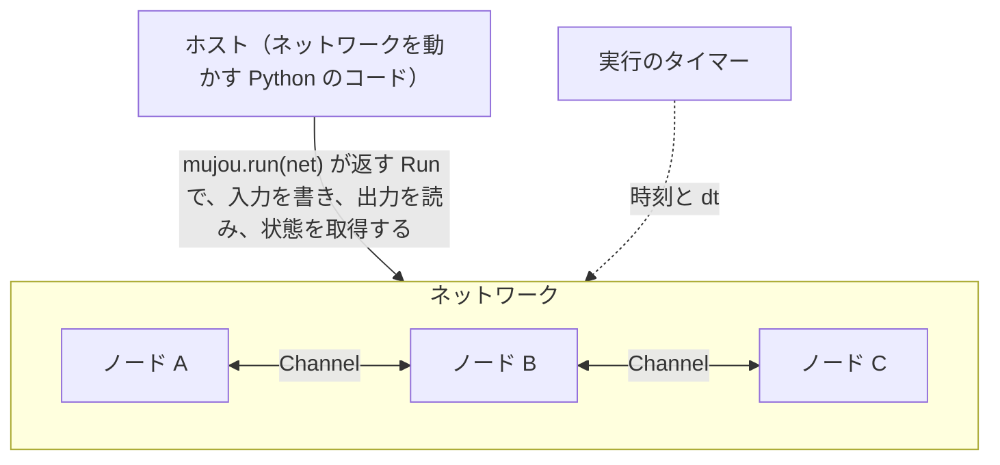

# 🧠 Mujou の仕組み

mujou の考え方を、次の 5 つに分けて説明する。

- **ノード**: 計算の単位
- **Port と Channel**: ノード同士をつなぐ口と接続
- **ネットワーク**: ノードの組み合わせ方
- **グローバル時間**: すべてのノードが従う時間の流れ
- **状態**: 実行中のネットワークから取得し、後で復元できるもの

コードの書き方は[ユーザーガイド](user-guide/index.md)を参照。



## ノード

ノードは計算の単位で、`mujou.Node` を継承したクラスとして書く。

ノードの内側では PyTorch のコードを同期的に実行する。ノードの内側に閉じていれば誤差逆伝播法（BP）も使える。

ノード同士はすべて非同期に動く。mujou はノードごとのスレッドで `on_update(dt)` を繰り返し呼び、ノードはほかのノードを待たない。`on_update` のたびにノードは次のことをする。

1. 隣のノードが送った最新の値を読む
2. 自分の状態を更新する
3. 結果を送る

ループは mujou が回すので、ノードは自分で `while` ループを持たない。実行の開始時や終了時などにも、mujou はノードが override できる hook を呼ぶ。呼ばれる順は API リファレンスの [`Node`](api/node.md) を参照。

エポックも、学習と推論の切り替えも、メッセージを受け取るたびに呼ばれる hook も無い。

1 つのノードにどれだけの計算を入れるかはノードのクラスで決まる。1 つの層でも、複数の層でも、モデル全体でもよい。ノードの境界がそのまま非同期の境界になる。複数の層を同期的に計算したいときや、BP で一緒に学習させたいときは、それらを 1 つのノードのクラスにまとめる。

!!! info "ノードが守る 3 つの規則"

    - **計算グラフをつなげない**: ノードをまたいで計算グラフをつなげない。送った値は送信時に計算グラフから切り離されるので、勾配はノード間を通らない
    - **Port だけでやり取りする**: ほかのノードやホストとは自分の Port だけでやり取りする
    - **時間は読むだけ**: 時間を動かせるのはホストだけ

どれかのノードが例外を投げると実行全体が止まる。例外を投げたノードだけを止め、ほかのノードを動かし続けることはない（[例外と終了](user-guide/errors.md)）。

既定の更新手法は [PC-ALM](https://pub.sakana.ai/pc-alm/)（Augmented Lagrangian Predictive Coding。実装予定）で、各ノードは局所的な更新だけで学ぶ。更新手法は mujou に組み込まれていないので、上の 3 つを守る限りノードはどの手法でも使える。

## Port と Channel

**Port** はノードが持つ接続口である。**Channel** は 2 つの Port をつなぐ 1 本の接続で、`connect` で作る。

Channel は向きごとに値の置き場所を 1 つずつ持ち、各置き場所に書けるのはその向きの送り手だけである。

Port は送る値と受け取る値の型を shape と dtype で宣言する。互いの送る型が相手の受け取る型と一致するときだけ、2 つの Port は接続できる。この検査は `connect` を呼んだときに mujou が行う。dtype は変換しない。

読み書きの動作は次のとおり。

- **待たない**: 読む側はその時点の最新の値を受け取る。新しい値が来るまで待つことはない
- **溜まらない**: 誰にも読まれないまま上書きされる値もあれば、同じ値を何度も読むこともある。どちらも正常な動作
- **初期値**: 送り手がまだ書いていなければ、送り手の Port の初期値（既定はゼロ）を読む。送り手が書いたかどうかは `has_received()` でわかる
- **コピー**: 値はどれも計算グラフから切り離された `torch.Tensor` のコピー。受け取ったテンソルを書き換えても、ほかのノードには影響しない
- **時刻付き**: 値には送った時刻が付く。新しい値かどうかは、値を時刻と一緒に読み（`recv_with_time()`）、前回読んだ値の時刻と比べればわかる。時刻が進んでいれば新しい値

1 つの Port を複数の相手に接続することもできる。その場合は Channel ごとに値を 1 つずつ受け取り、それらをどう束ねるか（足す、平均するなど）はノードが決める。

どこにも接続していない Port を残してもよい。接続していない Port がネットワークの入力と出力になる。

- ホストは接続していない入力の Port に入力を書く。書いた値はホストが次に書くまでその Port に残る
- ホストは値を送るどの Port からも、送られた最新の値を読める。接続していない出力の Port だけでなく、ノード同士をつなぐ Port も読める

## ネットワーク

ネットワークはノードの組み合わせ方を宣言するもので、`mujou.Network` を継承したクラスとして書く。PyTorch の `nn.Module` に子のモジュールを持たせるのと同じ書き方で、次の 3 段階で組む。

1. ノードや別のネットワークを属性として持つ
2. それらの Port を `connect` でつなぐ
3. 外からつなぎたい Port をネットワーク自身の属性として公開する

Port を公開したネットワークは、ノードと同じようにほかのノードやネットワークと接続できる。

ネットワークを使うのは組み立てるときだけである。ネットワークは hook を持たず、自身では何も実行しない。実行中も中のノードはそれぞれ独立に動き、ネットワークで囲んでも同期はしない。

`mujou.run(net)` は構造と型を検査し、凍結してから走らせる。その後は接続を足せない。

各ノードにはパスという名前が付く。パスはルートからの属性名を `.` でつないだもので、`"body.l1"` のようになる。状態ではこのパスを使う。

!!! warning "名前や接続を変えると状態を復元できない"

    属性の名前や接続を変えると、変える前に取得した状態は復元できなくなる。

## グローバル時間

mujou は学習するネットワークを、時間とともに連続的に変わる系として扱う。`dt` はそのノードの前回の更新からの経過時間（秒）である。

ノードは状態を `dt` に比例して更新する。状態 $x$ が $\frac{dx}{dt} = f(x)$ に従うなら、1 回の更新は次のようになる（陽的 Euler 法）。

```python
x = x + dt * f(x)
```

更新の速さはノードごとに違い、負荷によっても揺らぐ。更新量を反復 1 回あたりで決めると、速く回るノードほど状態が大きく変わってしまう。`dt` に比例させれば、どのノードも同じ時間の流れの上で同じダイナミクスに従う。負荷が高くなっても `dt` が伸びるだけで済む。

!!! warning "`dt` を打ち切らない"

    `dt` に上限を設けて打ち切ってはならない。打ち切ると実際に経った時間が失われる。`dt` が大きくて更新が不安定になるなら、1 回の `on_update` の中で刻みを分割する。

ノードは周期を持つ（既定は 0.01 秒）。更新の間隔は 1 回ごとに揺らぐが、平均すると周期ごとに 1 回更新する。遅れたときの `dt` は周期より長くなる。`dt` は実際に経った時間なので、周期を決めていても更新は `dt` に比例させる。

タイマーは実行ごとに 1 つあり、その実行のすべてのノードとホストがそれを使う。既定ではプロセスに 1 つのグローバルタイマーを使う。ホストは時間を実時間より速くも遅くも進められるが、ノードは時間を読むだけである。

!!! tip "ホストは `mujou.time.sleep` で待つ"

    ホストがその時間で待つとき（たとえば入力を 2 秒見せるとき）は `mujou.time.sleep` を使う。標準の `time.sleep` は実時間で待つので使わない。

実行中のネットワークの状態を取得するとき、mujou は実行を一時停止してそのタイマーを止める。止まっていた時間は再開後のどの `dt` にも入らないので、ノードから見ると一時停止は無かったのと同じである。

一時停止は同じタイマーを使うすべての実行の時間を止める。ほかの実行と時間を止め合わないようにするには、その実行に専用のタイマーを持たせる（[時間の制御](user-guide/time.md)）。

一時停止は状態の取得と観測のためのもので、学習の手順の一部にしてはならない。

## 状態

実行中のネットワークの状態は、実行を終了させずに取得でき、後でその状態から再開できる。状態は 1 つの木で、次のものを持つ。

- ノードのパスごとの、各ノードの状態（重み、活動などのテンソル）
- 値の置き場所ごとの、最新の値とその時刻
- 各ノードの最後の更新の時刻と、タイマーの時刻

ネットワークはノードとその間を流れる値を合わせたものなので、置き場所の値も状態に含める。置き場所の値が初期値に戻ると、隣のノードはそれまでにたどり着いた平衡から外れてしまう。

ノードは `nn.Module` と同じように自分の状態を自分で集める。属性に代入したテンソルと `nn.Module` は自動で状態に入る。

状態を取得する間は、前の節で述べた一時停止が起きる。各ノードは `on_update` の途中では止まらず、1 回の更新を終えてから次の更新を始めるまでの間で止まる。そのため木の中の値はすべて同じ時点のものになる。

| 状態を取得するとき   | 得られるもの                                                         |
| -------------------- | -------------------------------------------------------------------- |
| ネットワークの実行中 | その時点の状態                                                       |
| 正常に終了した後     | `on_stop` の後にノードが残した値                                     |
| 例外で終了した後     | 取得できず `NetworkError` になる。残したい状態は実行中に取得しておく |

正常に終了した後の木が持つタイマーの時刻は、`shutdown()` が終了を求めた時刻と、ノードが最後に更新か送信をした時刻のうち遅いほうである。この木から復元した実行は、終了した後に経った時間を数えない。

!!! warning "`on_stop` で状態を変えない"

    正常に終了した後の木は `on_stop` の後に取得するので、`on_stop` で状態を変えるとその変更が木に入る。たとえば `on_stop` で `self.w = None` とすると、木から `w` が消える。`on_stop` では状態を変えず、I/O などの資源だけを解放する。

復元するには、木を `mujou.run(net, state=tree)` に渡す。ネットワークは木を取得した時刻から、同じノードの状態と置き場所の値で続きを走る。走らせるネットワークは、木を取得したネットワークと同じノードのパスと接続を持たなければならない。

木をファイルに保存する方法（`torch.save`、`pickle` など）は利用者が決める。手順は[状態の保存と復元](user-guide/state.md)を参照。
