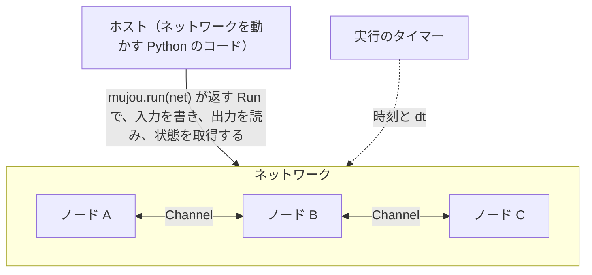
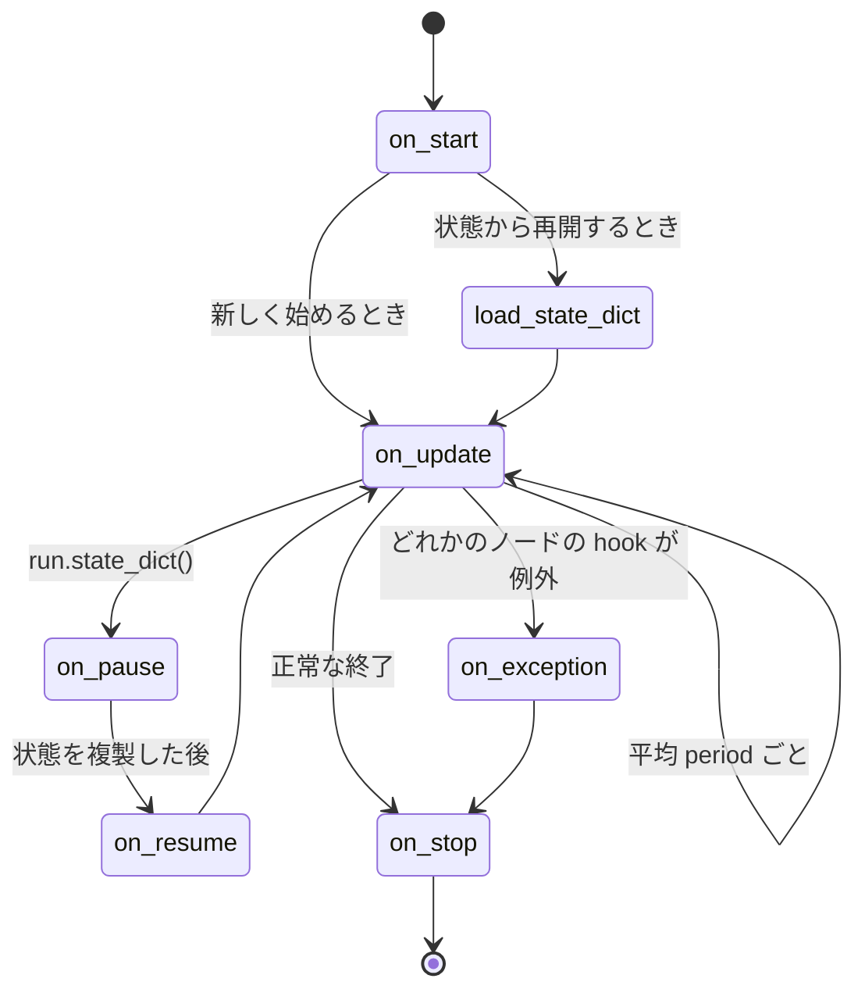
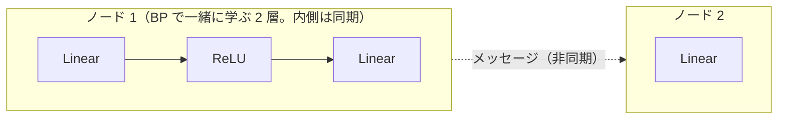
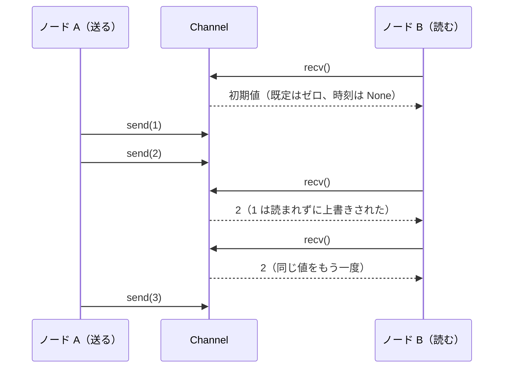
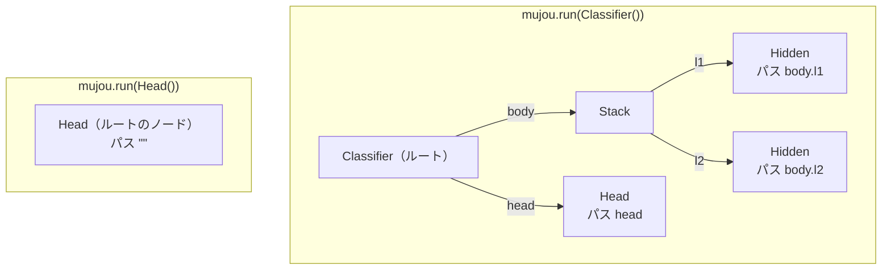

# 🧠 Mujou の仕組み

PyTorch の `nn.Module` とテンソルを使ったことがある前提。手を動かすなら [ネットワークを走らせる](tutorial/1-run.md) から。

## 全体像 {#overview}



| 部品             | ひとことで                                                                                                                   | 行き先                                            |
| ---------------- | ---------------------------------------------------------------------------------------------------------------------------- | ------------------------------------------------- |
| ノード           | 1 回分の更新を `on_update(dt)` に書くクラス。繰り返し呼ぶのは mujou                                                          | [ノード](#nodes)                                  |
| Port と Channel  | ノードの接続口と、2 つの口をつなぐ線。値は溜まらず、最新の値だけが残る                                                       | [Port と Channel](#ports)                         |
| ネットワーク     | ノードを組み立てる入れ物。中のノードはパスで指す                                                                             | [ネットワークとパス](#networks)                   |
| 実行             | [`mujou.run`][mujou.run] が全ノードをバックグラウンドで走らせ、`Run` を返す。ホストは `Run` だけでネットワークとやり取りする | [ネットワークを走らせる](tutorial/1-run.md#run)   |
| 時間             | ノードは前回の更新から経った時間 `dt` に比例して状態を進める                                                                 | [時間](#time)                                     |
| 状態             | [`run.state_dict()`][mujou.Run.state_dict] で実行を終えずに取得し、新しいインスタンスに `state=` で渡すと続きから走る        | [保存と再開](tutorial/6-save-and-resume.md)       |
| シミュレーション | [`mujou.run_manually`][mujou.run_manually] は仮想時間を `step` で進め、結果は毎回同じになる                                  | [シミュレーション](topics/simulation.md#two-ways) |
| 学習             | 更新則はノードの中に書き、どの則で学ぶかはノードが決める                                                                     | [学習](#learning)                                 |

### PyTorch との対応 {#pytorch}

| PyTorch                                 | mujou                                                         |
| --------------------------------------- | ------------------------------------------------------------- |
| モデルの `forward` を自分のループで呼ぶ | ノードの `on_update(dt)` を mujou が呼ぶ。ループは書かない    |
| `forward` の引数と戻り値                | Port の `recv()` と `send()`                                  |
| 親のモジュールの属性に子を代入する      | `Network` の属性にノードを代入する                            |
| `model.train()` と `model.eval()`       | 無い。推論と学習を同時に行う                                  |
| `loss.backward()` がモデル全体に届く    | 勾配はノードの中だけ。ノードの間はメッセージ                  |
| `model.state_dict()`                    | ノードごとの `state_dict()` と、実行全体の `run.state_dict()` |

## ノード {#nodes}



!!! tip "override では最初に `super()` を呼ぶ"

    `__init__` でも hook でも、最初に `super().__init__(...)` や `super().on_update(dt)` を呼ぶ（[`Node`][mujou.Node]）。

|          | ノードの内側                    | ノードの間                                          |
| -------- | ------------------------------- | --------------------------------------------------- |
| 実行     | 同期。ふつうの PyTorch のコード | 非同期。互いを待たない                              |
| やり取り | 変数と計算グラフ                | Port のメッセージ（計算グラフから切り離したコピー） |
| 勾配     | 通常の PyTorch と同じく記録する | 届かない                                            |

ノードに入れる計算の量（1 つの層でも、複数の層やモデル全体でもよい）は設定ではなくノードのクラスで決まり、BP で一緒に学ばせたい層は 1 つのクラスにまとめる。



??? question "ノードにループを書かないのはなぜ？"

    mujou は多くのノードを少ないワーカースレッドで回す。ノードが 1 回分の更新だけを書けば、いつどのスレッドで呼ぶかを mujou が決められる。状態を取得するために全ノードを止めることも、テストで 1 回ずつ進めることも、この形ならできる。

## Port と Channel {#ports}



??? question "キューにしないのはなぜ？"

    キューに溜めると、送る側と読む側の速さの差で値が増え続け、遅い側に歩調がそろってしまう。最新の値だけを読み書きすれば、各ノードは互いを待たずに自分の速さで動ける。

読む側は待たない。相手がまだ送っていなければ初期値を返し、時刻は None になる（[`Port.recv`][mujou.Port.recv]・[`Port.recv_with_time`][mujou.Port.recv_with_time]）。

メッセージの型は Port の [spec](topics/ports.md#spec) で決まり、送った値は計算グラフから切り離したコピーとして届く。

受け取る相手が 1 つなら [`Port`][mujou.Port]（送るだけなら相手はいくつでもよい）、同じ役割の複数の相手から受け取って束ねるなら [`MultiPort`][mujou.MultiPort]（使い分けは [Port の種類](topics/ports.md#kinds)）。

## ネットワークとパス {#networks}

[`Network`][mujou.Network] は、ノードを属性に代入して Port を `connect` でつなぐ入れ物。自分では何も実行しない。子の Port を自身の属性（慣例で `prev`・`next`）に代入して公開すれば、ノードと同じように外からつなげる（コードは [ネットワーク](tutorial/1-run.md#network)）。



パスは状態の木のキーになる（属性名を変えたときは [再開するときの注意](tutorial/6-save-and-resume.md#restore)）。

複数のネットワークを 1 つの実行に並べるには [`Group`][mujou.Group] を使う（[Group](topics/groups.md)）。

## 時間 {#time}

<figure class="mujou-diagram">
<svg viewBox="0 0 640 170" role="img" aria-label="2 つのノードの更新の時刻。ノード A は一定の間隔で、ノード B は不規則な間隔で更新し、途中で 1 回だけ間隔が長くなる">
<text class="mujou-note" x="90" y="12">縦の線 = on_update が呼ばれた時刻。前回からの間隔が dt</text>
<line class="mujou-axis" x1="90" y1="150" x2="620" y2="150"/>
<text class="mujou-label" x="620" y="166" text-anchor="end">実行のタイマー →</text>
<text class="mujou-label" x="10" y="54">ノード A</text>
<line class="mujou-lane" x1="90" y1="50" x2="620" y2="50"/>
<g class="mujou-tick-a"><line x1="100" y1="38" x2="100" y2="62"/><line x1="160" y1="38" x2="160" y2="62"/><line x1="220" y1="38" x2="220" y2="62"/><line x1="280" y1="38" x2="280" y2="62"/><line x1="340" y1="38" x2="340" y2="62"/><line x1="400" y1="38" x2="400" y2="62"/><line x1="460" y1="38" x2="460" y2="62"/><line x1="520" y1="38" x2="520" y2="62"/><line x1="580" y1="38" x2="580" y2="62"/></g>
<text class="mujou-note" x="130" y="30" text-anchor="middle">dt</text>
<text class="mujou-note" x="190" y="30" text-anchor="middle">dt</text>
<text class="mujou-label" x="10" y="114">ノード B</text>
<line class="mujou-lane" x1="90" y1="110" x2="620" y2="110"/>
<g class="mujou-tick-b"><line x1="100" y1="98" x2="100" y2="122"/><line x1="175" y1="98" x2="175" y2="122"/><line x1="235" y1="98" x2="235" y2="122"/><line x1="400" y1="98" x2="400" y2="122"/><line x1="455" y1="98" x2="455" y2="122"/><line x1="530" y1="98" x2="530" y2="122"/><line x1="590" y1="98" x2="590" y2="122"/></g>
<path class="mujou-brace" d="M 237 92 Q 237 84 245 84 L 390 84 Q 398 84 398 92"/>
<text class="mujou-note" x="317" y="78" text-anchor="middle">混んで遅れても dt が長くなるだけ</text>
</svg>
</figure>

時間軸は実行ごとに 1 本のタイマーで、全ノードとホストがこれを使う（[時間](topics/time.md)）。

更新の間隔はノードごとに違い揺らぐため、`on_update` は呼ばれた回数ではなく渡された `dt` に比例して状態を進める（書き方は [dt に比例して更新する](tutorial/2-node.md#dt)）。

## 学習 {#learning}

mujou はノード・Port・スケジューラに更新則を組み込まない。

| 更新則               | 勾配を取る範囲                               | 読むページ                                            |
| -------------------- | -------------------------------------------- | ----------------------------------------------------- |
| ノードの中の BP      | 1 つのノードの中。ふつうの `loss.backward()` | [ノードの中で学習する](tutorial/4-learn-in-a-node.md) |
| PC-ALM（`mujou.pc`） | 各ノードの中。隣とはメッセージでやり取り     | [PC-ALM で学習する](tutorial/5-learn-with-pc.md)      |
| 自作の則             | ノードが決める                               | [更新則](topics/update-rules.md)                      |

## ノードが守る規則 {#rules}

| 規則                                                         | 守らないと                               | 代わりに                                                                                                                                                                          |
| ------------------------------------------------------------ | ---------------------------------------- | --------------------------------------------------------------------------------------------------------------------------------------------------------------------------------- |
| `time.sleep` でブロックしない                                | ほかのノードの `dt` が伸びる             | 一定間隔なら [`period`][mujou.Node.period]。待つしかないなら [`dedicated_thread=True`][mujou.Node.dedicated_thread]。ホストが待つなら [`run.timer.sleep`][mujou.time.Timer.sleep] |
| ノードは 1 回だけ走る                                        | `RuntimeError`                           | もう一度走らせるなら新しいインスタンスを作る（[`mujou.run`][mujou.run]）                                                                                                          |
| 走っている間はホストからノードの属性を読まない               | ノードの更新と競合する                   | Port は [`run.read`][mujou.Run.read]、状態は [`run.state_dict()`][mujou.Run.state_dict] で読む。属性は実行が終わった後なら読める                                                  |
| `on_start` では状態に依存する値を送らない                    | 復元する前の状態を送ってしまう           | 最初の `on_update` で送る（`load_state_dict` は `on_start` の後。[ノード](#nodes) の図）                                                                                          |
| `on_stop` で状態を変えない                                   | 正常に終了した後に取得する状態が変わる   | `on_stop` では I/O などの資源だけを解放する                                                                                                                                       |
| 実行中に変わる素の値とテンソルの入れ物は登録する             | 復元すると初めからになる                 | カウンタ・最後に見た時刻・テンソルのリストや dict は [`register_state`][mujou.Node.register_state]                                                                                |
| 計算グラフは 1 回の更新の中に閉じる                          | グラフが伸び続ける                       | 次の更新へ持ち越す値は `detach` し、パラメータは `torch.no_grad()` の中で更新する（下のコード）                                                                                   |
| `on_exception`・`on_stop` では `self.timer` で時間を測らない | 実行の終了で時刻が止まり、時間が経たない | 実時間で測る（[`Node.timer`][mujou.Node.timer]）                                                                                                                                  |
| 時間を動かせるのはホストだけ、ノードは Port だけで話す       | `RuntimeError`                           | 時間の操作はホストの [`run.timer`][mujou.Run.timer] で。ノードは `Run` のメソッドも `mujou.run` も呼ばず、自分の Port で話す                                                      |

```python
self.last_y = self.model(x).detach()  # 次の更新へ持ち越す値はグラフから切り離す
with torch.no_grad():  # パラメータの更新は記録しない
    for p in self.model.parameters():
        p -= lr * p.grad
```
