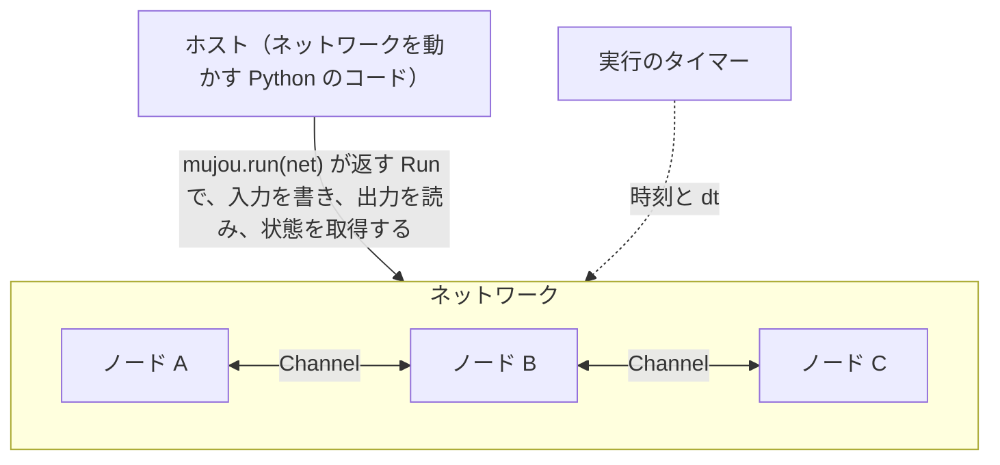

# 🧠 Mujou の仕組み

mujou を使うのに要る 9 つの考え方を、出会う順に説明する。最後の節はノードが守る規則。実際の使い方は[チュートリアル](tutorial/1-run.md)で扱う。

## 1. ノード

ノードは計算の単位で、`mujou.Node` を継承したクラスとして書く。1 回分の処理を `on_update(dt)` に書くと、mujou がそれを繰り返し呼ぶ。ノードは自分でループを持たない。`on_start` や `on_stop` などほかの hook も mujou が呼び、その順は API リファレンスの [`Node`](api/node-and-ports.md#mujou.Node) にある。

ノードの内側では PyTorch のコードを同期的に実行し、勾配も通常の PyTorch と同じく記録する。ノード同士はすべて非同期に動き、ほかのノードを待たず、自分の Port だけでやり取りする。状態は自分の属性に持つ。

1 つのノードにどれだけの計算を入れるかはノードのクラスで決まる。1 つの層でも、複数の層でも、モデル全体でもよい。ノードの境界がそのまま非同期の境界になるので、一緒に計算したい層（BP で一緒に学習させたい層も）は 1 つのノードのクラスにまとめる。

## 2. Port と Channel

**Port** はノードの接続口。`connect` が 2 つの Port を 1 本の **Channel** でつなぎ、それを返す。

- `Port` の `recv()` は値を 1 つ返すので、受け取る相手は 1 つまで。送るだけの `Port` はいくつの相手にでも届く
- `MultiPort` は同じ種類の相手を束ねる。`recv()` は `dict[Channel, 値]` を `connect` の順で返し、どう束ねるかはノードが決める。役割の違う入力（予測と誤差など）は別々の `Port` で受ける
- 循環してつないでもよい

読むときは待たず、値も溜まらない。`recv()` は相手が送った最新の値を返す。相手が最初に送るまでは相手の Port の初期値（既定はゼロ）を返し、その時刻は `None`。値には送った時刻が付くので、新しいかどうかがわかる。詳しくは [Port と Channel](topics/ports.md)。

## 3. メッセージの型（spec）

Port は送るものと受け取るものを spec で宣言する。テンソル 1 つなら `TensorSpec(shape, dtype)`、一緒に届けたいテンソルの組なら `TypedDict` の `DictSpec`。値はいつも `torch.Tensor`（かその dict）である。互いの送る spec が相手の受け取る spec と一致するときだけ接続でき、`send` は計算グラフから切り離したコピーを送る。

## 4. ネットワークとパス

`Network` は組み立て専用の入れ物。`nn.Module` に子のモジュールを持たせるのと同じように、ノードを属性に代入して Port をつなぐ。`Group(**named)` は子に名前を付けて並べるだけのネットワーク。ネットワーク自身は何も実行せず、実行中も中のノードはそれぞれ独立に動く。

ノードの**パス**はルートからの属性名をドットでつないだもので、`"body.l1"` のようになる。パスは状態のキーになる。

## 5. 実行

`mujou.run(root)` は木を検査して全ノードを起動し、ホスト（利用者のプログラム）の窓口 `Run` を返す。ホストは `write` で入力を書き、`read` や `wait_for` などで出力を読み、`run.timer` で待つ。ルートは 1 回だけ走る。もう一度走らせるときは新しいインスタンスを作る。終わった後は、ノードの属性をホストが読んでよい。

## 6. 時間

実行ごとに時間軸は 1 本で、それが実行のタイマーである。すべてのノードとホストがこれを使う。自分の `Timer` を渡さない実行は `mujou.time.global_timer` で走る。ホストは `run.timer` で時間を操作し、ノードは `self.timer` で読むだけ。

`dt` は前回の更新からの秒数で、実行のタイマーで測る。ノードは `dt` に比例して更新するので、更新の速さが違い揺らぐノード同士でも同じダイナミクスに従う。マシンが混んでも `dt` が伸びるだけで済む。各ノードは平均 `period` ごとに 1 回更新する。timeout だけは例外で実時間の秒。詳しくは[時間](topics/time.md)。

## 7. 状態

ノードの状態は自動で集まる。テンソルの属性、`state_dict` と `load_state_dict` を持つ属性（`nn.Module` など）、乱数生成器の状態である。それ以外で実行中に変わる値（カウンタ、最後に見た時刻）は `register_state` で加える。規則は API リファレンスの [`Node`](api/node-and-ports.md#mujou.Node) にある。

`run.state_dict()` は実行を止めずに、その時点の実行全体の状態を取得する。各ノードの状態、各 Channel の最新のメッセージ、時刻を 1 つの素の dict にまとめたもの。`mujou.run(新しいインスタンス, state=tree)` でその続きから走らせると、保存した時刻から始まる専用のタイマーで走る。手順は[保存と再開](tutorial/6-save-and-resume.md)。

## 8. テスト

`mujou.testing.run` は仮想のタイマーの上で決定的に走らせる。`run.step(dt, *nodes)` は時間を `dt` だけ進めてから、ノードを 1 回ずつ更新する。手順は[ノードをテストする](tutorial/3-test.md)。

## 9. 学習

更新則はノードの中に書く。ノードの内側の BP（誤差逆伝播法）でも、PC-ALM（`mujou.pc` のノード）でも、自作の則でもよい。mujou はノード・Port・スケジューラに更新則を組み込まない。Port はコピーを送るので、ノードをまたぐ計算グラフは作れない。ノードの間を流れるのは活動・誤差・目標などのメッセージである。[ノードの中で学習する](tutorial/4-learn-in-a-node.md)、[PC-ALM で学習する](tutorial/5-learn-with-pc.md)、[更新則](topics/update-rules.md)を参照。

学習のモードも推論のモードも、エポックも無い。走っているネットワークは、入力を受け取り、出力を出し、同時に学ぶ。

## ノードが守る規則

ほかのページはこの節へのリンクだけを張り、同じことを繰り返さない。

- **`time.sleep` でブロックしない。** ノードはワーカースレッドをほかのノードと共有し、ブロッキングする hook はその間ワーカーをふさぐ。ほかのノードの `dt` が伸びる。一定間隔で更新するなら `period` を使い、デバイス・ソケット・lock を待つしかないノードには `dedicated_thread=True` を渡す。ホストは `run.timer.sleep` で待つ。こちらは実行の時間の速さと一時停止に従うが、`time.sleep` はどちらにも従わない
- **ノードは 1 回だけ走る。** 走ったノードやネットワークをもう一度走らせると `RuntimeError` になる。もう一度走らせるときは新しいインスタンスを作る。終わった後も属性は読める
- **走っている間はホストからノードの属性を読まない。** ノードの更新と競合する。Port を `run.read` で読むか、`run.state_dict()` を取得する
- **`on_start` では状態に依存する出力をしない。** 復元するときは `on_start` の後に状態を読み込む
- **`on_stop` で状態を変えない。** 正常に終了した後に取得する状態は、`on_stop` の後にノードが残したもの。`on_stop` では I/O などの資源だけを解放する
- **実行中に変わる値は登録する。** テンソルとモジュールは自動で集まる。素の値（カウンタ、最後に見た時刻）は `register_state` しないと、復元したときに初めからになる
- **計算グラフは 1 回の更新の中に閉じる。** hook は通常の PyTorch と同じく勾配を記録する。パラメータの更新は `torch.no_grad()` の中で行い、パラメータから計算した値を属性で次の更新へ持ち越すときは detach する。そうしないとグラフが伸び続ける
- **例外で終わった後は時刻が止まる。** 実行の時刻は終了の時点で止まるので、`on_exception` と `on_stop` の中では `self.timer` が進まない。ロボットを 1 秒かけて減速させるような処理は実時間で測る
- **時間を動かせるのはホストだけ、ノードは Port だけで話す。** hook の中で `Timer.sleep`・`pause`・`resume`・`set_time_scale`・`VirtualTimer.advance` や `Run` のメソッドを呼ぶと `RuntimeError` になる。1 つのノードが時間を動かすと、同じ実行のほかのすべてのノードの `dt` が変わってしまう。送った値は切り離されたコピーなので、`backward()` はほかのノードに届かない
