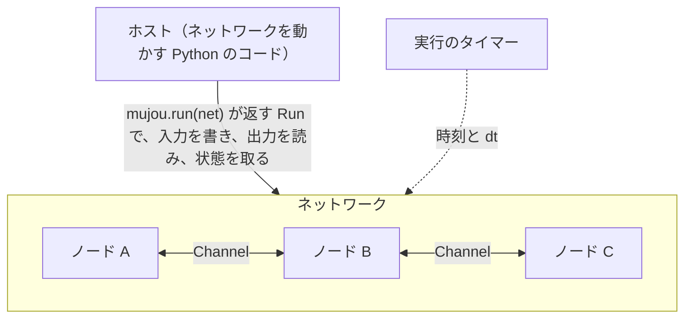

# 概念

この章では、mujou を使う前に知っておく考え方を説明する。コードの書き方は[ユーザーガイド](../user-guide/index.md)にある。

## mujou が作るもの

mujou は、推論と学習を同時に行い続ける学習機械を作るためのフレームワークである。従来の機械学習は、学習を終えたら重みを固定して推論する。mujou のネットワークは、走っている間ずっと入力を受け取り、学び続ける。

## 5 つの要素

| 要素                        | 一言でいうと                                                         |
| --------------------------- | -------------------------------------------------------------------- |
| [ノード](nodes.md)          | 計算の単位。内側は同期で計算し、ほかのノードとは非同期にやり取りする |
| [Port と Channel](ports.md) | ノードの接続口と、2 つの接続口をつなぐ線                             |
| [ネットワーク](networks.md) | ノードの組み合わせ方を宣言する構造                                   |
| [グローバル時間](time.md)   | ノードの更新量を決める、実行ごとに 1 本の時間軸                      |
| [状態](state.md)            | 走らせたまま取得し、後で復元できる、ネットワークの中身               |

これらの関係は次のとおりである。

各ノードは自分のスレッドで `on_update(dt)` を繰り返し、互いを待たない。

## 従来の学習との違い

| 従来の学習（PyTorch の典型的な学習ループ）     | mujou                                                                                  |
| ---------------------------------------------- | -------------------------------------------------------------------------------------- |
| データセットをエポック単位で回す               | エポックは無い。入力は時間とともに変わる信号で、ホストが書いた値は次に書くまで保たれる |
| `train()` と `eval()` で学習と推論を切り替える | 切り替えるモードは無い。ノードは走っている間、更新を続ける                             |
| 損失からネットワーク全体を `backward()` する   | ノードをまたぐ `backward()` は禁止。各ノードは自分の状態と隣のノードの値だけで更新する |
| 更新量は反復 1 回あたりで決まる                | 更新量は前回の更新からの経過時間 `dt` に比例する                                       |
| 学習を止めてから重みを保存する                 | 走らせたまま状態を取得できる                                                           |

エポックとモードが無いのは、mujou がストリームから学び続ける機械を対象にしているからである。終わりの無い入力にはエポックの区切りが無い。学習と推論を分けると、推論している間は学べない。

ネットワーク全体の `backward()` を使わないのは、それがすべてのノードの forward と backward を同期させるからである。同期させると、ノードを互いに待たせずに動かせない。既定の更新手法 PC-ALM は、局所的な更新だけで誤差逆伝播法（BP）に近い性能を出せると報告されている。BP そのものも、1 つのノードの内側に閉じていれば使える（[ノード](nodes.md)）。
