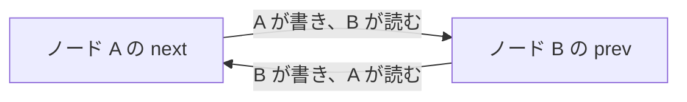

# Port と Channel

ノード同士は、Port と Channel を通してだけ値をやり取りする。

## 接続口と接続線

- Port は、ノードが持つ接続口である。`__init__` で属性として宣言する
- Channel は、2 つの Port をつなぐ 1 本の接続である。`connect` を呼ぶと 1 本できる

Channel は双方向である。1 本の Channel は向きごとに 1 つずつ値の置き場所を持つ。片方向の Port 同士では値が一方にしか流れないので、置き場所は 1 つになる。各置き場所に書くのは、その向きの送り手のノード 1 つだけである。

図の 2 本の矢印を合わせたものが、1 本の Channel である。

## Port の型

Port は、送る値の型（`send`）と受け取る値の型（`recv`）の組を持つ。2 つの Port は、片方の `send` がもう片方の `recv` と一致するときだけ接続できる。一致しなければ、`connect` を呼んだ時点でエラーになる。

`send` と `recv` の一方だけを持つ Port も作れる。入力を送るだけのノードや、観測するだけのノードに使う。

型は spec で宣言する。

| spec         | 表すもの                                                             |
| ------------ | -------------------------------------------------------------------- |
| `TensorSpec` | `torch.Tensor` 1 つの shape と dtype。例: `TensorSpec((32, 256))`    |
| `DictSpec`   | `TypedDict` の各キーの `TensorSpec`。複数のテンソルを 1 つの値で送る |

一致を比べるのは shape と dtype である。dtype が違う Port 同士はつなげない。dtype の暗黙の変換もしない。バッチ次元も shape の一部で、mujou はバッチ次元を特別扱いしない。spec はデバイスを持たないので、CPU のノードと GPU のノードもつなげる。

## 読み書きの性質

ノードは `send(値)` で書き、`recv()` で読む。

- 読む側は、そのときの最新の値を受け取る。新しい値が来るまで待つ機能は無い
- 古い値は溜まらない。一度も読まれずに上書きされる値もあれば、同じ値を何度も読むこともある。どちらも正常な動作である
- 相手がまだ書いていなければ、初期値を読む。初期値は、受け取り側の spec の shape と dtype のゼロである（`DictSpec` ならキーごとのゼロのテンソル）。相手を 1 つ取るが、つながっていない Port も、初期値を読む
- 相手を複数取るが、つながっていない Port は、Channel を 1 本も持たないので、空の dict を読む
- 値の中身は `torch.Tensor` である（`DictSpec` の Port ではキーごとの Tensor の dict）。読み書きのたびにコピーされるので、受け取ったテンソルを書き換えても、ほかのノードには影響しない
- 送る値は計算グラフから切り離される。勾配は Port を通らない

値には、書いた時点の時刻（[グローバル時間](time.md)の `Timestamp`）が付く。`recv_with_time()` で値と時刻を組で読めば、値がどれだけ古いかを判断できる。

## PrevPort・NextPort・Port

Port の宣言には 3 種類ある。違いは、`a.connect(b)` でどれが使われるかと、つながる相手の数の既定である。

| 宣言       | `a.connect(b)` での役割 | 相手の数の既定 |
| ---------- | ----------------------- | -------------- |
| `PrevPort` | `b` の側で使われる      | 1 つ           |
| `NextPort` | `a` の側で使われる      | 複数           |
| `Port`     | 使われない              | 1 つ           |

`a.connect(b)` は、`a` の `NextPort` と `b` の `PrevPort` をつなぐ。`Port` 同士は `a.out.connect(b.inp)` のように Port を指定してつなぐ。相手の数は `multi=True` / `multi=False` で変えられる。

相手が 1 つの Port の `recv()` は値そのものを返す。相手が複数の Port の `recv()` は、Channel をキーにした dict を接続した順に返す。キーの Channel は `connect` が返したものである。たとえばノード `head` をノード `x` に `ch = head.connect(x)` でつないだなら、`head.next.recv()[ch]` で `x` からの値を取り出せる。複数の相手の値をどう束ねるか（足すか、平均するか）はノードが決める。mujou は束ね方を決めない。

複数の相手に送るときは、`send(値)` で全員に同じ値を送るか、`send_to(channel, 値)` で相手ごとに違う値を送る。

## つながっていない Port

どこにもつながっていない Port も残せる。つながっていない Port は、ネットワークの入力と出力になる（[ネットワーク](networks.md)）。

- ホストは `Run.write` で、つながっていない Port に入力を書ける。最初の入力は `mujou.run(net, inputs={port: 値})` で渡せる。その値がその Port の初期値になる。つながっている Port には書けない。各置き場所の書き手を 1 つに保つためである
- ホストは `Run.read` で、送る型を持つどの Port からでも、そのノードが送った最新の値を読める。つながっていない Port から読めば出力になり、つながっている Port から読めば中間の値の観測になる

Port の宣言と接続の詳細は[ネットワークを組む](../user-guide/building-a-network.md)にある。
